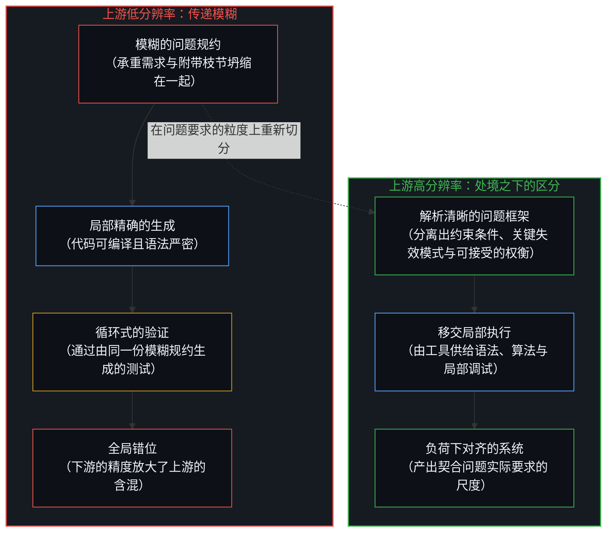
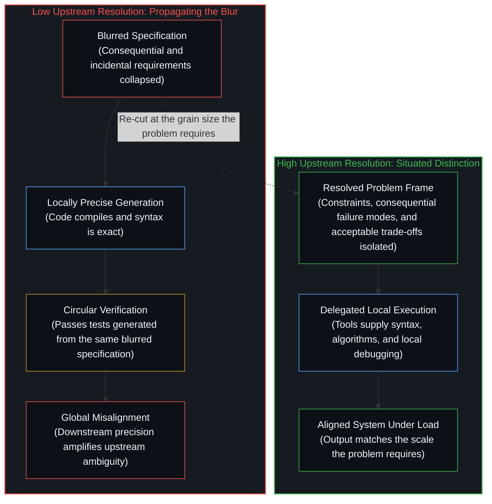
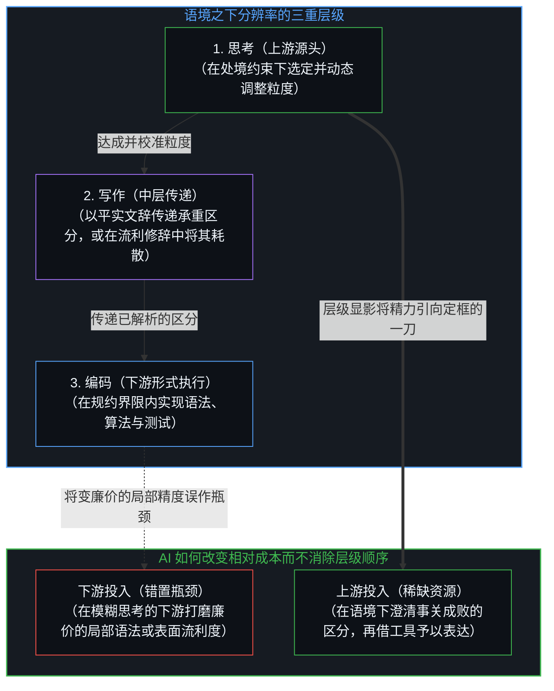
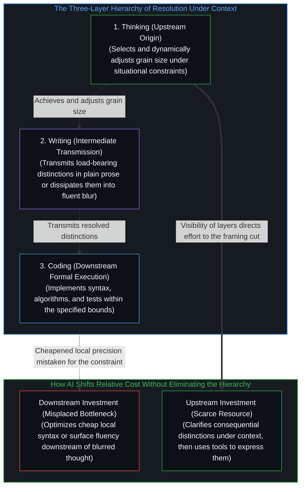

# 精度与分辨率 / Precision and Resolution

*精度追求脱离语境的穷尽准确，而分辨率是在具体约束下切出要紧区分的能力。 / Precision pursues context-free exactness, whereas resolution is the capacity to make the distinctions that matter under the constraints of a given situation.*

在 AI 时代，同清晰的写作相比，编码正变得微不足道；而同清晰的思考相比，清晰的写作也正变得微不足道。精度与分辨率之间的区分，阐明了这一层级顺序为何成立，又为何历来如此。精度指向一种脱离语境的严密准确——一种试图毫无遗漏地捕捉每一处细节的理想。相比之下，分辨率是在特定处境的约束之下——手头可用的信息、时间、目的、受众与工具——作出要紧区分的能力。高分辨率意味着在问题实际要求的尺度上，将事关成败的要素与无关枝节剥离开来。低分辨率则将那些区分坍缩在一起，以致后续的努力——无论投入在代码、散文还是进一步的推演中——都只是在把这份模糊一路传递下去。

In the age of AI, coding is increasingly trivial compared to writing clearly, and writing clearly is increasingly trivial compared to thinking clearly. The distinction between precision and resolution clarifies why that hierarchy holds and why it has always held. Precision suggests an absolute, context-independent exactness—an ideal of capturing every detail without remainder. Resolution, by contrast, is the capacity to make the distinctions that matter under the constraints of a given situation: the available information, the time, the purpose, the audience, and the tools at hand. High resolution means separating what is consequential from what is not at the scale the problem actually requires. Low resolution collapses those distinctions, so that subsequent effort—whether in code, prose, or further thought—propagates the blur.

这并非 AI 造就的新处境。限制工作的瓶颈，历来都是框定工作的思想所具备的分辨率。AI 改变的是各层级的可见度。那些过去要求人类维持局部高分辨率的任务，如今可以移交出去，从而使更高阶的短板显露无遗。

This is not a new condition created by AI. It has always been the case that the limiting factor is the resolution of the thought that frames the work. What changes with AI is the visibility of the layers. Tasks that once demanded high local resolution from a human can now be delegated, making the higher-order shortfalls more obvious.

## 一、 编码：局部精度与问题规约的分辨率 / 1. Coding: Local Precision and the Resolution of the Specification

先看编码。数十年来，编写正确、高效的代码要求程序员在语法、算法、边缘情况与系统约束之间同时维持分辨率。如今，很大一部分局部分辨率可由依规约生成、补全或调试代码的工具供给——如[注释不是代码](../the-comment-is-not-the-code/)所追溯的，工具在交付给它的先决条件签名之内重新组合——从而将控制杠杆向外推移（如[要紧的控制迁往边缘](../residual-control-recedes-to-the-edge/)所追溯），并将工程工作的构成引向上游（如[AI 不会终结软件工程，而是将其扩展](../ai-wont-kill-software-engineering/)所审视）。留给人的任务不再是代码本身的更细精度，而是对问题作出更高分辨率的规约：系统必须在哪些约束下达成什么目标，哪些失效模式事关成败，以及哪些权衡可以接受。当上游分辨率偏低时，生成的代码便会在局部上精确，在全局上却偏离靶心。代码能够编译，也能通过由同一份模糊规约生成的测试——这正是[验证的倒置](../the-reversal-of-verification/)所剥离的落差：检验内部的自洽不等同于同问题保持开放的融贯。短板的主要症结从来不在打字或语法，而在于没能把实际需求解析清楚。

Consider coding. For decades, writing correct, efficient code required a programmer to maintain resolution across syntax, algorithms, edge cases, and system constraints. Much of that local resolution can now be supplied by tools that generate, complete, or debug code from a specification—recombining within the preconditions handed to them as [The Comment Is Not the Code](../the-comment-is-not-the-code/) traces—which relocates the lever of control as [Essential Control Moves to the Edge](../residual-control-recedes-to-the-edge/) traces and shifts the composition of engineering work upstream as [AI Won't Kill Software Engineering, It Will Expand It](../ai-wont-kill-software-engineering/) examines. The residual human task is not finer precision in the code itself but higher-resolution specification of the problem: what the system must achieve under which constraints, which failure modes matter, and which trade-offs are acceptable. When that upstream resolution is low, the generated code is locally precise yet globally misaligned. The code compiles and passes tests that were also generated from the same blurred specification, the same gap between internal consistency inside a check and open coherence with the problem that [The Reversal of Verification](../the-reversal-of-verification/) isolates. The shortfall was never primarily one of typing or syntax; it was one of resolving the actual requirements.

## 二、 写作与思考：传递区分与动态校准粒度 / 2. Writing and Thinking: Transmitting Distinctions and Calibrating Grain Size

写作处在中间层。清晰的写作传递已在思考中达成的分辨率；含糊的写作则将其耗散。一个解析清晰的想法，用平实的语言便能表达清楚并为人理解，因为其中的区分已经锋利。相反，一个尚未解析清楚的想法，无法靠更繁复的修辞来挽救。行文可以合乎语法，甚至颇为典雅，读者却依然无从分辨哪些主张承重、哪些只是附带。在 AI 写作工具面前，同样的样式再度显现：流利的句子唾手可得，但它们继承的是提示词与底层思考的分辨率。学会不再被表面流利度迷惑的读者，如今会穿透文辞去寻找那些区分确已作出的证据，如[对“AI 糟粕”的反感是反复出现的模式](../the-distaste-for-ai-slop-is-no-different-from-the-recurring-historical-pattern/)所追溯的那样就内容本身而非出处作出评价。

Writing occupies the intermediate layer. Clear writing transmits the resolution already achieved in thought; unclear writing dissipates it. A well-resolved idea can be expressed in relatively ordinary language and still be understood, because the distinctions are already sharp. An unresolved idea, by contrast, cannot be rescued by more elaborate phrasing. The prose may be grammatical, even elegant, yet the reader is left unable to tell which claims are load-bearing and which are incidental. In the presence of AI writing tools, the same pattern appears: fluent sentences are easy to produce, but they inherit the resolution of the prompt and the underlying thought. Readers who have learned to discount surface fluency now look through the prose for evidence that the distinctions have actually been made, evaluating the content rather than the provenance as [The Distaste for “AI Slop” Is a Recurring Pattern](../the-distaste-for-ai-slop-is-no-different-from-the-recurring-historical-pattern/) traces.

思考是分辨率首先得以达成或丧失的层级。它在于为问题选定恰当的粒度，在心智中把相关的区分握持得足够久以看清它们之间的相互作用，并舍弃那些不影响结果的细节——这是一种如[抽象、边界与现实的移动边缘](../abstraction-boundaries-and-the-moving-edge-of-reality/)所追溯的那样，靠舍弃无关维度而奏效的选择性压缩。这件事内在地取决于语境。决定一项功能是否上线，只需要在用户影响与工程成本上保持较粗的分辨率；同一个人在一小时后排查某个并发原语的失效模式时，则需要远为细腻的分辨率。这项能力不在于堆积越来越精确的事实，而在于随当下的要求调整分辨率，并在当前粒度不够用时及时察觉。

Thinking is the layer at which resolution is first achieved or lost. It consists in selecting the right grain size for the problem, holding the relevant distinctions in mind long enough to see their interactions, and discarding details that do not affect the outcome—a selective compression that succeeds by dropping axes that do not bear on the situation, as [Abstraction Boundaries and the Moving Edge of Reality](../abstraction-boundaries-and-the-moving-edge-of-reality/) traces. This is inherently contextual. A decision about whether to ship a feature may require only coarse resolution about user impact and engineering cost; the same person, an hour later, may need far finer resolution about the failure modes of a particular concurrency primitive. The skill is not the accumulation of ever-more-precise facts but the ability to adjust resolution to the demands of the moment and to notice when the current grain size is insufficient.

## 三、 跨时代的连续性与上游的稀缺 / 3. Continuity Across Eras and Scarcity Upstream

历史先例让这种连续性一目了然。在大语言模型问世之前，技术手册与学术论文便时常展现出极高的局部精度——引文准确、符号一致、定义审慎——却在“这项工作究竟改变了什么”或“为何选取这一路径而非其他方案”的问题上停留在低分辨率，这正是[自愿的致盲](../the-sovereign-blinding/)所审视的那种被共享符号平面上的局部精确遮住视线的现象。读者可以核实每一个句子，却依然不知道什么才要紧。反过来，一些极具影响力的短篇随笔或设计文档，哪怕用平实的语言写成，数十年后却依然保持着高分辨率，因为它们分离出了那几道持续组织后续工作的区分。工程实践中也呈现出同样的规律：系统失效的原因，很少是单个组件不够精确，而是组件之间的接口相对于运行条件被解析在了错误的粒度上——正如[没有固定者的固定](../fixed-by-nothing/)所追溯的，选定尺度与边界变量始终是一次位于上游的指向动作，没有任何形式规则能够自行生成它。

Historical examples make the continuity plain. Before large language models, technical manuals and academic papers frequently displayed high local precision—correct citations, consistent notation, careful definitions—while remaining low-resolution on the question of what the work actually changed or why a particular approach was chosen over alternatives, the same blindness through local exactness on a shared symbolic plane that [The Sovereign Blinding](../the-sovereign-blinding/) examines. Readers could verify every sentence and still not know what mattered. Conversely, some of the most influential short essays or design documents have been written in plain language yet remain high-resolution decades later because they isolate the few distinctions that continue to organize subsequent work. The same pattern appears in engineering practice: systems that fail often do so not because individual components were imprecise, but because the interfaces between them were resolved at the wrong grain size relative to the operating conditions, where choosing the scale and boundary variables is always an upstream act of pointing that no formal rule generates on its own, as [Fixed by Nothing](../fixed-by-nothing/) traces.

AI 改变了各层级的相对成本，却没有消除这一层级顺序。生成局部精确的代码或流利的文辞变得低廉；生成使那些产出有用的分辨率依然稀缺。由此带来的实际后果是：把已被自动化的层级当作主要瓶颈的人，会继续在真正约束的下游投入精力，停留在[一个提示词之遥](../whatever-is-one-prompt-away/)所追溯的、单次请求即可触及的基线之内。而那些把语境之下的分辨率视为稀缺资源的人，则向上游投入：先把问题澄清到相关区分稳定下来，再动用手头任何可用的工具将其表达出来。编码相对于清晰的写作已变得微不足道、清晰的写作相对于清晰的思考也已变得微不足道，这一观察由此直接推出。三者始终是分辨率差异的表达；工具只是让这些差异再难被忽视。

AI shifts the relative cost of the layers without eliminating the hierarchy. Generating locally precise code or fluent prose is cheaper; generating the resolution that makes those outputs useful remains scarce. The practical consequence is that people who treat the automated layers as the primary bottleneck continue to invest effort downstream of the actual constraint, resting in what is already one prompt away as [Whatever Is One Prompt Away](../whatever-is-one-prompt-away/) traces. Those who treat resolution under context as the scarce resource invest upstream: in clarifying the problem until the relevant distinctions are stable, then using whatever tools are available to express them. The observation that coding has become trivial relative to clear writing, and clear writing trivial relative to clear thinking, follows directly. All three remain expressions of differences in resolution; the tools merely make the differences harder to overlook.

