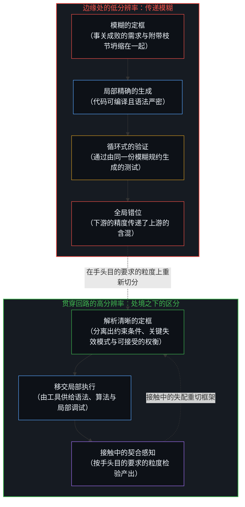
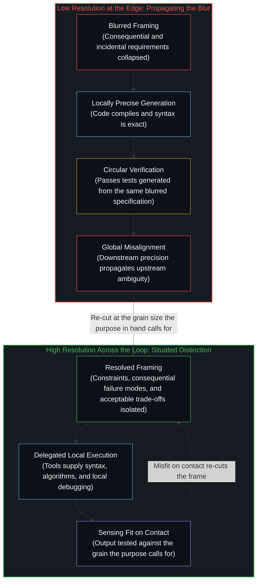
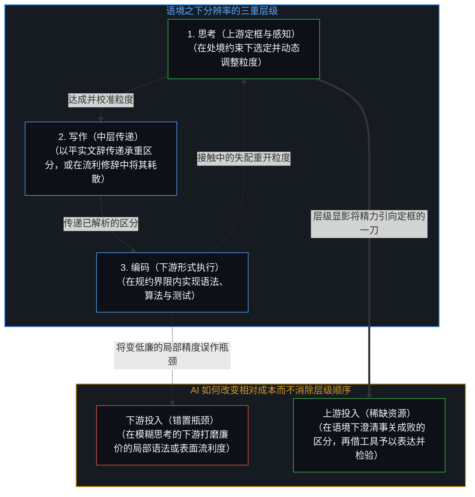
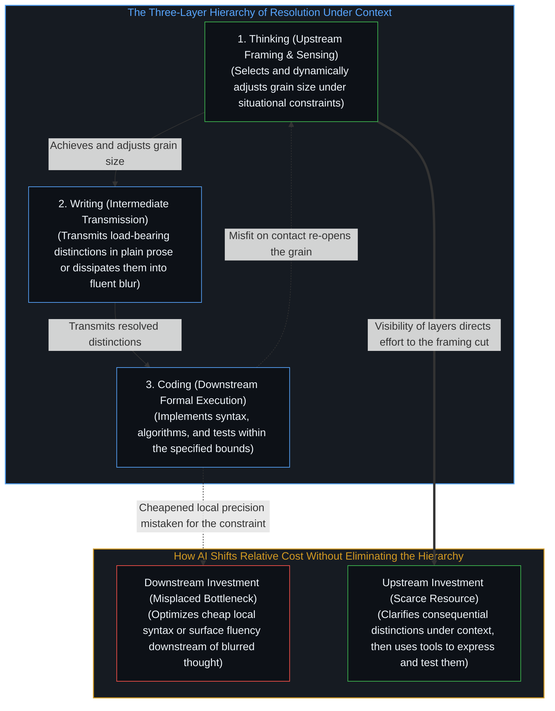

# 精度与分辨率 / Precision and Resolution

*精度衡量相对于选定框架的严密准确，而分辨率是在特定处境的约束下切出要紧区分的能力。 / Precision measures exactness against a chosen frame, whereas resolution is the capacity to make the distinctions that matter under the constraints of a given situation.*

在 AI 时代，同清晰的写作相比，编码正变得越来越低廉；而同清晰的思考相比，清晰的写作也正变得越来越低廉。当编码在清晰的写作面前显得微不足道、清晰的写作在清晰的思考面前显得微不足道时，这里显露的是相对成本的转移，而非下游层级不再要紧。精度与分辨率之间的区分，阐明了这一层级顺序为何成立，又为何历来如此。精度是相对于选定框架的严密准确；一旦相关区分已经切出，在该框架之内检验语法、符号一致性与组件公差，正是分辨率所要求的。然而，一旦被单列为一项独立标准，精度便指向一种脱离语境的严密准确——一种试图毫无遗漏地捕捉每一处细节的理想。相比之下，分辨率是在特定处境的约束之下——手头可用的信息、时间、目的、受众与工具——作出要紧区分的能力。高分辨率意味着在手头目的所要求的粒度上，将事关成败的要素与无关枝节剥离开来。低分辨率则将那些区分坍缩在一起，以致后续的努力——无论投入在代码、文辞还是进一步的推演中——都在把这份模糊一路传递下去。

In the age of AI, coding is increasingly cheap compared to writing clearly, and writing clearly is increasingly cheap compared to thinking clearly. When coding looks trivial next to clear writing and clear writing trivial next to clear thinking, what registers is a shift in relative cost, not that the downstream layers stop mattering. The distinction between precision and resolution clarifies why that hierarchy holds and why it has always held. Precision is exactness relative to a chosen frame; within that frame, checking syntax, notation consistency, and component tolerances is what resolution calls for once the relevant distinctions are cut. Held up as a standard of its own, however, precision suggests a context-independent exactness—an ideal of capturing every detail without remainder. Resolution, by contrast, is the capacity to make the distinctions that matter under the constraints of a given situation: the available information, the time, the purpose, the audience, and the tools at hand. High resolution means separating what is consequential from what is not at the grain the purpose in hand calls for. Low resolution collapses those distinctions, so that subsequent effort—whether in code, prose, or further thought—propagates the blur.

这并非 AI 造就的新处境。由于文辞或代码中的下游执行只是在交付给它的先决条件之内重新组合，任何下游的严密准确都无法补上一道从未切出的区分；每一轮推进中限制工作的瓶颈，历来都是框定工作并感知回传结果的思想所具备的分辨率。AI 改变的是各层级的可见度。那些过去要求人维持局部高分辨率的任务，如今可以移交出去，从而让更高阶的短板更加显眼。

This is not a new condition created by AI. Because downstream execution in prose or code recombines within the preconditions handed to it, no downstream exactness can supply a distinction that was never cut; the limiting factor in each pass has always been the resolution of the thought that frames the work and registers what returns. What changes with AI is the visibility of the layers. Tasks that once demanded high local resolution from a human can now be delegated, making the higher-order shortfalls more obvious.

## 一、 编码：局部精度与回路的分辨率 / 1. Coding: Local Precision and the Resolution of the Loop

先看编码。数十年来，编写正确、高效的代码要求程序员在语法、算法、边缘情况与系统约束之间同时维持分辨率。如今，很大一部分局部分辨率可由依规约生成、补全或调试代码的工具供给——如[注释不是代码](../the-comment-is-not-the-code/)所追溯的，工具在交付给它的先决条件之内重新组合。把那层基底工作移交出去，便将控制杠杆向外推向标准、界限与验证（如[要紧的控制迁往边缘](../residual-control-recedes-to-the-edge/)所追溯），同时将工程工作的构成引向上游（如[AI 不会终结软件工程，而是将其扩展](../ai-wont-kill-software-engineering/)所审视）。留给人的任务不再是代码本身的更细精度，而是在回路两端维持更高的分辨率：在执行之前，框定哪些约束、失效模式与权衡事关成败；在执行之后，当产出交付使用时辨认出失配。前置规约只是分辨率的一种载体——握持相对于[活的语境](../the-living-context/)的当下增量——而非分辨率的栖身之处，因为如[最小化路径](../minimizing-path/)所追溯的，接触中的修正是比详尽无遗的前置规约更弱的要求，规约是在使用中浮现的。当这些边缘处的分辨率偏低时，生成的代码便会在局部上精确，在全局上却发生错位。代码能够编译，也能通过由同一份模糊规约生成的测试——检验之内的自洽与同问题保持开放的融贯之间的落差，正是[验证的倒置](../the-reversal-of-verification/)所析出的那道落差。短板的主要症结从来不在打字或语法，而在于没能在定框时与接触中把需求解析清楚。

Consider coding. For decades, writing correct, efficient code required a programmer to maintain resolution across syntax, algorithms, edge cases, and system constraints. Much of that local resolution can now be supplied by tools that generate, complete, or debug code from a specification, recombining within the preconditions handed to them as [The Comment Is Not the Code](../the-comment-is-not-the-code/) traces. Delegating that substrate work moves the lever of control outward to criteria, bounds, and verification, as [Essential Control Moves to the Edge](../residual-control-recedes-to-the-edge/) traces, while shifting the composition of engineering work upstream, as [AI Won't Kill Software Engineering, It Will Expand It](../ai-wont-kill-software-engineering/) examines. The residual human task is not finer precision in the code itself but higher resolution at both ends of the loop: before execution, in framing which constraints, failure modes, and trade-offs matter, and after execution, in recognizing misfit when the output meets use. Upfront specification is one carrier of resolution—holding the immediate delta against [The Living Context](../the-living-context/)—not where resolution lives, since correction on contact is a weaker requirement than exhaustive pre-specification and specifications emerge from use, as [The Minimizing Path](../minimizing-path/) traces. When resolution at those edges is low, the generated code is locally precise yet globally misaligned. The code compiles and passes tests that were also generated from the same blurred specification, the same gap between internal consistency inside a check and open coherence with the problem that [The Reversal of Verification](../the-reversal-of-verification/) isolates. The shortfall was never primarily one of typing or syntax; it was one of resolving the requirements in framing and on contact.

## 二、 写作与思考：传递区分与校准粒度 / 2. Writing and Thinking: Transmitting Distinctions and Calibrating Grain Size

写作处在中间层。清晰的写作传递已在思考中达成的分辨率；含糊的写作则将其耗散。一个解析清晰的想法，用平实的语言便能表达清楚并为人理解，因为其中的区分已经锋利。相反，一个尚未解析清楚的想法，无法靠更繁复的修辞来挽救。行文可以合乎语法，甚至颇为典雅，读者却依然无从分辨哪些主张承重、哪些只是附带。在 AI 写作工具面前，同样的规律再度显现：流利的句子唾手可得，但它们继承的是提示词与底层思考的分辨率。学会不再被表面流利度迷惑的读者，如今会穿透文辞去寻找那些区分确已作出的证据，如[对“AI 糟粕”的反感是反复出现的模式](../the-distaste-for-ai-slop-is-no-different-from-the-recurring-historical-pattern/)所追溯的那样就内容本身而非出处作出评价。

Writing occupies the intermediate layer. Clear writing transmits the resolution already achieved in thought; unclear writing dissipates it. A well-resolved idea can be expressed in relatively ordinary language and still be understood, because the distinctions are already sharp. An unresolved idea, by contrast, cannot be rescued by more elaborate phrasing. The prose may be grammatical, even elegant, yet the reader is left unable to tell which claims are load-bearing and which are incidental. In the presence of AI writing tools, the same pattern appears: fluent sentences are easy to produce, but they inherit the resolution of the prompt and the underlying thought. Readers who have learned to discount surface fluency now look through the prose for evidence that the distinctions have actually been made, evaluating the content rather than the provenance as [The Distaste for “AI Slop” Is a Recurring Pattern](../the-distaste-for-ai-slop-is-no-different-from-the-recurring-historical-pattern/) traces.

思考是在每一轮推进中分辨率首先得以达成或丧失的层级，也是当某个区分被证明缺失时、来自写作或运行代码的阻力所折返的层级。它在于选定手头目的所要求的粒度，在心智中把相关的区分握持得足够久以看清它们之间的相互作用，并舍弃那些不影响结果的细节——这是一种选择性压缩，靠舍弃与处境无关的维度而奏效，如[抽象、边界与现实的移动边缘](../abstraction-boundaries-and-the-moving-edge-of-reality/)所追溯。这件事取决于语境。决定一项功能是否上线，可能只需要在用户影响与工程成本上保持较粗的分辨率；同一个人在一小时后排查某个并发原语的失效模式时，则可能需要远为细腻的分辨率。这项能力不在于堆积越来越精确的事实，而在于随当下的要求调整分辨率，并及时察觉——常常是在一句话说不到位或一段程序在负荷下失效之时——当前粒度何时不够用。

Thinking is the layer at which resolution is first achieved or lost in each pass, and to which friction from writing or running code returns when a distinction proves missing. It consists in selecting the grain size the purpose in hand calls for, holding the relevant distinctions in mind long enough to see their interactions, and discarding details that do not affect the outcome—a selective compression that succeeds by dropping axes that do not bear on the situation, as [Abstraction Boundaries and the Moving Edge of Reality](../abstraction-boundaries-and-the-moving-edge-of-reality/) traces. This is contextual. A decision about whether to ship a feature may require only coarse resolution about user impact and engineering cost; the same person, an hour later, may need far finer resolution about the failure modes of a particular concurrency primitive. The skill is not the accumulation of ever-more-precise facts but the ability to adjust resolution to the demands of the moment and to notice—often when a sentence fails to land or a program fails under load—when the current grain size is insufficient.

## 三、 跨时代的连续性与上游的稀缺 / 3. Continuity Across Eras and Scarcity Upstream

由于下游的形式体系只是在展开供给它们的区分，跨越时代的诸多历史实例印证了同样的结构顺序。在大语言模型问世之前，技术手册与学术论文便时常展现出极高的局部精度——引文准确、符号一致、定义审慎——却在“这项工作究竟改变了什么”或“为何选取这一路径而非其他方案”的问题上停留在低分辨率，这正是[自愿的致盲](../the-sovereign-blinding/)所审视的那种致盲：视线被共享符号平面上的局部精确遮住。读者可以核实每一个句子，却依然不知道什么才要紧。反过来，一些极具影响力的短篇随笔或设计文档，哪怕用平实的语言写成，数十年后依然保持着高分辨率，因为它们分离出了那几道持续组织后续工作的区分。工程实践中也呈现出同样的规律：失效的系统常常并非败在单个组件不够精确，而是因为组件之间的接口相对于运行条件被解析在了错误的粒度上——正如[没有固定者的固定](../fixed-by-nothing/)所追溯的，选定尺度与边界变量是一次位于上游的指向动作，没有任何形式规则能够自行生成它。当序列模型学会按语境在预测不确定性转折之处放置边界，而不是在语境到来之前就把边界固定在分词器里时，边界的放置移入了回路之内，而尺度依然留在上游：那道内部切分之所以能够安定下来，是因为边界上设有价格——目标压缩率或算力成本，即由构建并运行该网络的中心在外环给定、并在那里依结果加以修正的一道实际软硬件界限。去掉这一价格，策略要么在每个字节处都放置边界，要么一直压缩到信息丢失——前一端是没有要紧区分的严密准确，后一端则是模糊——正如[学到的边界与给定的尺度](../learned-boundaries-and-the-given-rate/)所追溯的那样。

Because downstream formalisms only unfold the distinctions supplied to them, historical examples across eras confirm the same structural ordering. Before large language models, technical manuals and academic papers frequently displayed high local precision—correct citations, consistent notation, careful definitions—while remaining low-resolution on the question of what the work actually changed or why a particular approach was chosen over alternatives, the same blindness through local exactness on a shared symbolic plane that [The Sovereign Blinding](../the-sovereign-blinding/) examines. Readers could verify every sentence and still not know what mattered. Conversely, some of the most influential short essays or design documents have been written in plain language yet remain high-resolution decades later because they isolate the few distinctions that continue to organize subsequent work. The same pattern appears in engineering practice: systems that fail often do so not because individual components were imprecise, but because the interfaces between them were resolved at the wrong grain size relative to the operating conditions, where choosing the scale and boundary variables is an upstream act of pointing that no formal rule generates on its own, as [Fixed by Nothing](../fixed-by-nothing/) traces. When a sequence model learns to place its boundaries per context where predictive uncertainty turns, instead of fixing them in a tokenizer before the context arrives, boundary placement moves inside the loop while the scale stays upstream: that inner segmentation settles because a price is set on its boundaries—a target compression rate or a compute cost, a practical hardware and software bound given at the outer loop by the center that builds and runs the network and refined there by results. Remove that price, and the policy either places a boundary at every byte or compresses until information is lost—the first end exactness with no distinction that matters, the second the blur—as [Learned Boundaries and the Given Rate](../learned-boundaries-and-the-given-rate/) traces.

AI 改变了各层级的相对成本，却没有消除这一层级顺序。生成局部精确的代码或流利的文辞变得低廉；生成使那些产出有用的分辨率依然稀缺。由此带来的实际后果，是在每一步都敞开的两种取向之间的分野：把已被自动化的层级当作主要瓶颈的投入，会停留在真正约束的下游，止步于[一个提示词之遥](../whatever-is-one-prompt-away/)所追溯的那种单次请求即可触及的现成之物；而把语境之下的分辨率视为稀缺资源的投入，则走向上游——持续切分问题，直到相关区分在下一次接触中依然立得住，再动用手头任何可用的工具将其表达并付诸检验，正如[清晰不是抵达的终点，而是运动本身](../clarity-isnt-a-state-you-arrive-at/)所追溯的那样。编码相对于清晰的写作已变得低廉、清晰的写作相对于清晰的思考也已变得低廉，正是从这一因果不对称中推导出来的。三者始终是分辨率差异的表达；工具只是让这些差异再难被忽视。

AI shifts the relative cost of the layers without eliminating the hierarchy. Generating locally precise code or fluent prose is cheaper; generating the resolution that makes those outputs useful remains scarce. The practical consequence is a split between two orientations open at every step: effort spent where the automated layers are treated as the primary bottleneck stays downstream of the actual constraint, resting in what is already one prompt away as [Whatever Is One Prompt Away](../whatever-is-one-prompt-away/) traces, whereas effort that treats resolution under context as the scarce resource goes upstream—cutting the problem until the relevant distinctions hold under the next contact, then using whatever tools are available to express and test them, as [Clarity Isn't a State You Arrive At. It's the Movement Itself.](../clarity-isnt-a-state-you-arrive-at/) traces. That coding has become cheap relative to clear writing, and clear writing cheap relative to clear thinking, follows from this causal asymmetry. All three remain expressions of differences in resolution; the tools merely make the differences harder to overlook.

