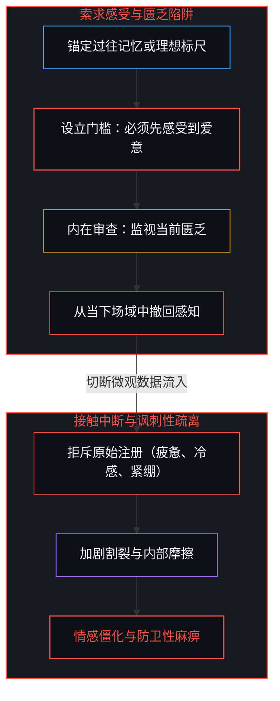
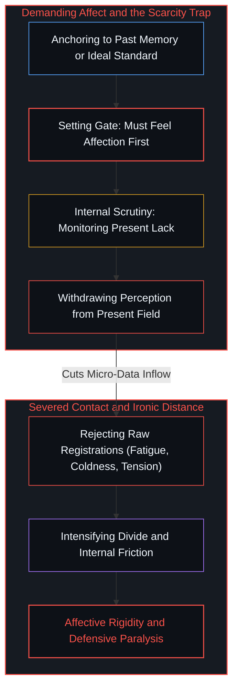
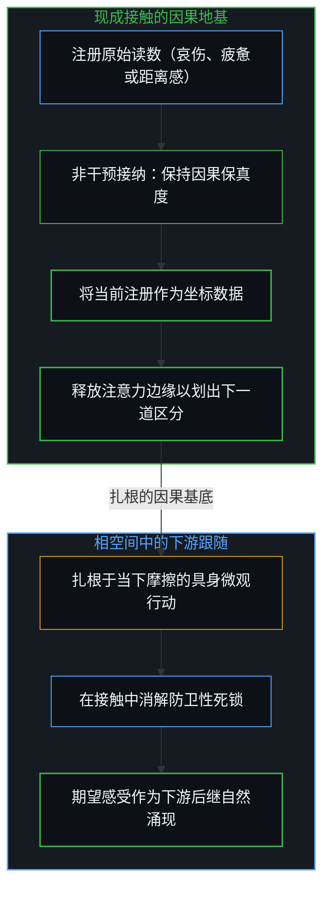
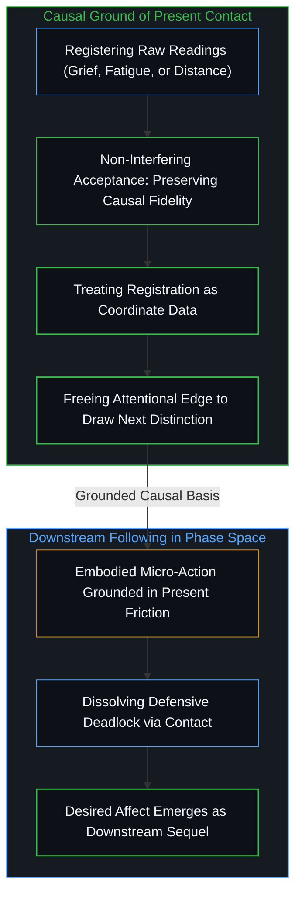
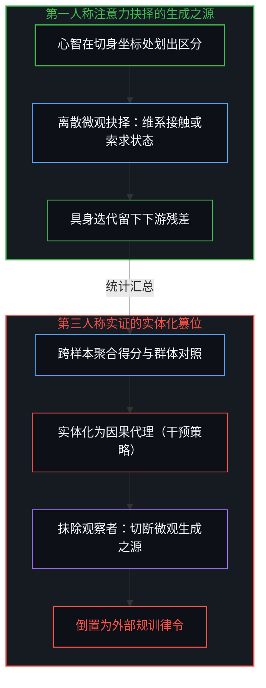
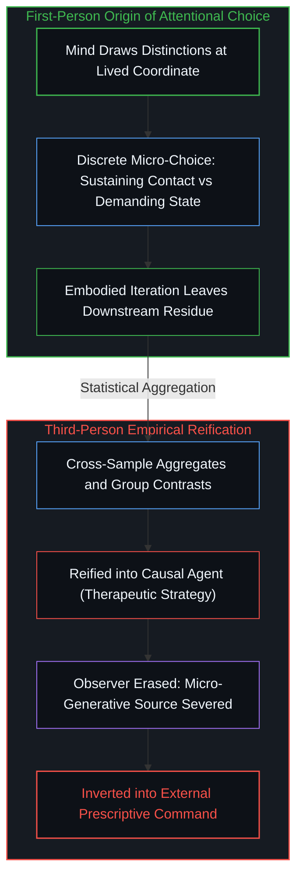

# 现成接触的因果先验与期望感受的倒置遮蔽 / Present Contact as Causal Prior and the Obscuration of Desired Feeling

*前置期望感受会隔断当下注册，汇总指标的篡位则遮蔽生成之源 / Demanding desired affect as prerequisite severs present registration; aggregate metrics usurp the generative source*

将注意力固定在遥远过去或预设未来的期望感受上，会直接隔断心智与当下所能触及之注册的接触。由此产生的讽刺性疏离表明，被追逐的感受之所以不断后退，恰是因为心智撤回了对眼前实际发生之物的注册能力。在可行的因果序列中，注册当下经验的能力是任何后续期望状态得以作为下游后继而展开的实践前提；将期望感受设定为先决条件，倒置了因果次序并进一步加深了空白。这种倒置同样在经验科学内部重演，表现为实验心理学将下游汇总指标实体化为外部因果代理，从而将第一人称的生成之源遮蔽在无根基的第三人称假相背后。

Fixating attention on desired feelings located in a distant past or a projected future severs contact with whatever registration is available in the present. The resulting ironic distance reveals that the sought-after feeling recedes precisely because the capacity to register what is actually occurring has been withdrawn. In a workable causal sequence, the capacity to register present experience serves as the practical precondition for any subsequent desired state to unfold as a downstream sequel; treating desired affect as an antecedent requirement reverses the causal order and entrenches the void. This inversion recurs within empirical science, where experimental psychology reifies downstream aggregate metrics into external causal agents, obscuring the generative first-person source behind an ungrounded third-person facade.

## 一、 情感门槛的设立与讽刺性疏离 / 1. The Gatekeeping of Affect and Ironic Distance

在亲密纽带与日常生活的紧要关头，一种隐蔽的认知僵局屡见不鲜：当事人痛苦地察觉到自己无法找回最初的温情与心动，进而判定当下的投入已经破裂。这种痛苦在通俗叙事中常被刻画为无解的心碎，其机制却源于对情感因果次序的误读。心智在此安置了一个未经审视的前提：必须先在内心召唤出某种特定的理想感受，随后的沟通、在场与承诺才能推进。通过抱持一段过往温情的存留痕迹或一幅免于重新渲染的理想化投射，这一索求将感受当成了可按指令调取的静态库存，指望具身系统在缺乏情境滋养的前提下凭空造出结果。由于注意力容量有限，将焦点钉死在追索过往感官与稽查当前匮乏上，便从正在展开的当下现场中撤回了感知注册。

During critical junctures in intimate bonds and everyday life, an insidious cognitive impasse frequently appears: an individual realizes with distress that they cannot recover their initial warmth and affection, concluding that present engagement is broken. This distress is portrayed in popular drama as an insoluble heartbreak, yet its mechanism stems from misreading the causal order of affect. The Mind installs an unexamined premise: a specific ideal feeling must first be summoned within before subsequent communication, presence, and commitment can proceed. By holding a retained trace of past warmth or an idealized projection exempt from re-rendering, this demand treats feeling as a static inventory item to be retrieved on command, expecting the embodied system to fabricate an outcome without contextual nourishment. Because attentional capacity is finite, fixing focus on pursuing past sensations and policing present absence withdraws perceptual registration from the unfolding room.

这种对特定体验的索求，不可避免地诱发出讽刺性疏离。丹尼尔·韦格纳的讽刺性加工理论表明，意向性的心理控制伴随着自动搜寻失败的监视进程，而在认知负荷之下，这一监视进程反而会主动放大缺失状态的信号；由于每一次针对缺失温情的核查本身都是一次重描匮乏的离散区分行动，个体越是用力强迫自己产生爱意，内心的空白便越发刺眼。在这一机制下，当下正在注册的具体信号——无论是未言明的紧绷、挥之不去的疲惫、切身的失落还是微弱的哀伤——在冻结的模板面前皆被贴上残次品的标签而遭到排推。现成接触中所能触及的，是正在展开的互动中未经修饰的直接性，对应于马丁·海德格尔所区分的先于抽离现成状态的投入上手状态；困境之所以产生，是因为心智将唯有在投入上手状态中才能涌现的体验，降格为了供二阶监视审视的抽离标量客体。将期望状态命名为必须预先确立的现成终点，会把鲜活的投入冻结为陈列柜中的标本，这一转换正如[何谓形而上学？作为将追寻命名为目的的一刀](../what-is-metaphysics-as-the-cut-that-names-the-seeking-as-destination/)所追溯的那样；而转向内部去搜寻缺失的感受，则将心智劈裂为审查者与被审查的切片，正如[寻觅的语法与淡出的观察者](../the-grammar-of-finding-and-the-fading-observer/)所阐明的那样。将情感设为准入门槛，带来的不是生机的恢复，而是情感上的麻痹。

This demand for a targeted experience inevitably engenders ironic distance. Daniel Wegner's ironic process theory demonstrates that intentional mental control operates alongside an automatic monitoring search for failure, and under cognitive load that monitoring process actively amplifies the signal of the omitted state; because every check for missing warmth is itself a discrete act of distinction that re-traces the absence, the more vigorously an individual forces themselves to generate affection, the more glaring the internal void becomes. Under this mechanism, the concrete signals registering in the present—unspoken tension, lingering fatigue, acute disappointment, or faint grief—are branded as defective against the frozen template and pushed aside. What is available in present contact is the unembellished immediacy of ongoing interaction, corresponding to what Martin Heidegger distinguished as engaged readiness-to-hand (*Zuhandenheit*) prior to detached presence-at-hand (*Vorhandenheit*); the impasse arises because the Mind degrades what can only emerge through engaged readiness-to-hand into a detached scalar object for secondary surveillance. Naming the desired state as a standing destination to be secured in advance freezes living engagement into a display-case specimen, the same conversion traced in [What Is Metaphysics? As the Cut That Names the Seeking as Destination](../what-is-metaphysics-as-the-cut-that-names-the-seeking-as-destination/), while turning inward to hunt for the missing feeling splits the Mind into an inspector and an inspected slice, as demonstrated in [The Grammar of Finding and the Fading Observer](../the-grammar-of-finding-and-the-fading-observer/). Demanding affect as an entry gate yields emotional paralysis rather than restored vitality.

## 二、 现成接触的因果序与相空间跟随 / 2. The Causal Priority of Contact and Phase Space Following

化解这一困境需要厘清情感的因果拓扑。在动力学意义上，感受并非可以凭意志随意启动的程序，而是活态系统与环境阻力相撞时留下的经验读数。注册当下所能触及的一切体验——无论其效价如何——构成了后续状态得以涌现的唯一地基。如果当下注册到的是疏离或哀伤，那么与这份疏离进行不加粉饰的接触，便是相空间中唯一可着力的锚点。拒斥当下的即时注册，相当于向导航回路中输入伪造的坐标，必然招致仪表的迷航与系统的死锁。

Resolving this impasse requires clarifying the causal topology of affect. Dynamically, feeling is not an arbitrary program launched at will; it is an empirical reading left when a living system collides with environmental resistance. Registering whatever is available in the present—regardless of its valence—forms the sole ground from which a subsequent state can emerge. If what registers in the present is estrangement or grief, unvarnished contact with that estrangement serves as the only actionable anchor in the phase space. Rejecting immediate registration is equivalent to feeding falsified coordinates into a navigation loop, ensuring instrumental disorientation and systemic gridlock.

将注意力从“强索结果”转向“维系接触”，改变了认知容量的分配方式。接纳并不是道德上的隐忍，而是保持因果保真度的信息自律。非干预接纳所悬置的，并非划出区分的一阶行动，而是持续核查当下体验是否符合预设标尺的二阶规范性审计。放弃将感受作为准入门槛，断然不意味着放弃行动的意向矢量，更非鼓励机械顺从或空洞的和谐表演。扎根于现成接触并不要求戴上强颜欢笑的面具；相反，保持因果保真度的回应会付出下一步的具体代价——既可以是在疲惫中安静地递上一杯水，也可以是平静而坦诚地道出当前的疏离与无法靠近。意向矢量负责校准心智直面当下摩擦的朝向，而非强推某种肤浅的和解剧本；期望感受则是沿持续接触的路径所生成的气候。当防卫性的二阶监视止息，正如在[开悟的相与门槛的倒置](../the-form-of-enlightenment-and-the-inversion-of-gates/)中所剖析的，将涌现的结果倒置为先决条件清单的做法，便不再把敞开的觉察压缩为贫瘠的标量审查。唯有当心智双脚踏上当下的地表，新的姿态、自发的舒展以及深化的共振，才能在持续接触下作为下游后继而展开。期望中的感受若能到来，也是持续投入所结出的果实，而非启动引擎的燃料。

Reorienting attention from extorting outcomes to sustaining contact alters the allocation of cognitive capacity. Acceptance is not ethical resignation; it is informational discipline preserving causal fidelity. What non-interfering acceptance suspends is not the primary act of drawing a distinction, but the secondary normative auditing that continuously checks whether immediate experience complies with a preconceived metric. Relinquishing affect as a prerequisite gate by no means implies abandoning the intentional vector of action, nor does it encourage mechanical compliance or hollow performances of harmony. Grounding in present contact does not demand a mask of forced cheer; rather, a response preserving causal fidelity pays the concrete cost of the next step—offering a quiet cup of water amidst fatigue, or calmly and candidly voicing current estrangement and the inability to draw near. The intentional vector calibrates the Mind's orientation toward facing present friction, rather than enforcing a superficial script of reconciliation; desired affect remains the atmospheric climate generated along the path of sustained contact. When defensive secondary surveillance ceases, as analyzed in [The Form of Enlightenment and the Inversion of Gates](../the-form-of-enlightenment-and-the-inversion-of-gates/), inverting an emergent outcome into a prerequisite checklist no longer compresses open awareness into sterile scalar scrutiny. Only when the Mind plants its feet on present ground can new postures, spontaneous ease, and deepened resonance unfold as a downstream sequel under continued contact. Desired affect, should it arrive, appears as the fruit of sustained engagement, not the fuel that starts the engine.

## 三、 心理学实证的因果篡位与观察者的隐退 / 3. Empirical Usurpation and the Fading of the Observer

从个体的亲密关系僵局走向学术界的科学理论，两者在机制上暴露出同一种退缩：当面对直接摩擦时，心智习惯于退入抽离的旁观者席位。在微观体验中，个体从具身在场中撤退，变成审查自身内部状态是否符合预设标准的冷酷法官；而在经验心理学中，理论家同样从具体处境下行动者的第一人称抉择中抽离，试图以旁观者的全局审计取代行动者的活态生成。当代经验心理学在统计观察中清晰地捕捉到了这一规律的回响。关于情绪调节的研究证实，结合当下监测与非干预接纳的方案，在提升正向情感、减轻痛苦反应方面，远比情绪抑制或强行认知替换更为可靠。当下的觉察与更高的体验愉悦感及更少的反刍思维相关联。这些群体对照记录了特定注意力抉择所留下的下游残差。然而，当经验科学构建理论解释时，其第三人称架构却反转了它本欲阐明的因果次序。

Moving from the intimate impasse of an individual to academic scientific theory reveals a shared retreat: when confronted with direct friction, the Mind habitually retreats into the detached vantage of a spectator. In microscopic experience, the individual withdraws from embodied presence to become a cold judge auditing whether their internal state complies with a predetermined standard; in empirical psychology, the theorist similarly detaches from the first-person choices of situated agents, attempting to substitute the spectator's global audit for the agent's live generation. Contemporary empirical psychology captures clear echoes of this regularity in statistical observations. Studies in emotion regulation confirm that protocols combining present monitoring with non-interfering acceptance elevate positive affect and reduce distress far more reliably than emotional suppression or aggressive cognitive replacement. Present awareness correlates with greater consummatory pleasure and diminished rumination. These population contrasts register the downstream residue of specific attentional choices. Yet when empirical science frames an explanation, its third-person architecture reverses the very causal order it seeks to illuminate.

在标准的实验范式中，汇总得分、群体对照与量表差异被奉为自变量，被当作解释心理弧线的因果力量。不同个体在直面切身摩擦时作出的细微第一人称抉择，被压平为某项干预技术的内在属性。为了维持抽离客观的表象，观察者退居记录仪器之后并从因果说明中被抹去，把方法论上的悬置误认作本体论上的缺席，其机制正与[框架的盲区](../the-blind-spot-of-the-frame/)所剖析的如出一辙。指标所记录的，原本是个体采取微观接纳姿态后留下的历史沉淀；然而在理论建构中，这一做法违背了阿尔弗雷德·柯日布斯基“地图不是地表”的原则，让统计图表遮蔽了地形，将聚合残差误认作活态心智的生成引擎。

In standard experimental paradigms, aggregate scores, group contrasts, and scale differentials are enshrined as independent variables, treated as causal forces explaining the psychological arc. Subtle first-person choices made by diverse individuals confronting lived friction are flattened into intrinsic properties of an intervention technique. To preserve the appearance of detached objectivity, the observer steps behind the recording apparatus and is erased from the causal account, mistaking methodological bracketing for ontological absence in the exact manner dissected in [The Blind Spot of the Frame](../the-blind-spot-of-the-frame/). What the metrics record is historical sediment left after individuals adopt microscopic postures of acceptance; yet in theoretical framing, violating Alfred Korzybski's principle that the map is not the territory, the statistical chart eclipses the terrain, and aggregate residues are mistaken for the generative engine of the living Mind.

## 四、 宏观残差的界限与第一人称的生成之源 / 4. The Boundary of Macro Residuals and the First-Person Source

这种认识论倒置并不局限于情感心理学，每当下游聚合结果被转化为上游律令时，它便会重演。正如在[宏观现象及参数和个人微观选择的因果倒置与利率的命令幻相](../the-summary-first-reversal-and-the-command-of-yields/)中所阐明的，宏观指标代表微观交换留下的事后残差，并不具备支配个体行动的因果主权。科学观察的第三人称姿态，依然是身处具体锚点的观察者所起草的辅助参考系。正如[不可还原的观察者](../the-irreducible-observer/)所证明的，观察心智无法借助精密的仪器将自身的首要地位从因果区分的源头中抹去。

The epistemological inversion is not confined to the psychology of emotion; it recurs whenever downstream aggregations are converted into upstream mandates. As articulated in [Macro Parameters, Micro Choices, and the Command of Yields](../the-summary-first-reversal-and-the-command-of-yields/), macro indicators represent post-hoc residue left by micro-exchanges, possessing no sovereign mandate to dictate individual acts. The third-person posture of scientific observation remains an auxiliary coordinate frame drafted by an observer situated at a concrete anchor. As demonstrated in [The Irreducible Observer](../the-irreducible-observer/), an observing Mind cannot use sophisticated instrumentation to erase its own primacy from the origin of causal distinction.

观察者从未离场。正如乔治·斯宾塞-布朗在《形式之律》中所形式化的那样，一切形式宇宙皆起源于划出一道区分的原初行动；科学的第三人称视角本身就是具体心智划出的又一道区分，无法跳出构成其自身的区分活动之外。心理学中的每一项实验设计、执行与阐释，都发生在具体处境下心智的递归反思之内。将观察者从说明中略去，原本只是暂时的工具性权宜之计；可一旦被实体化为自足的根基，它便退化为认识论上的障眼法。用柯日布斯基的话来说，第三人称实证指标的作用如同航行日志与后视镜：它们记录了历史规律，却无法充当实时行动的方向盘。科学模型唯有在具体处境下的第一人称摩擦中经过重新翻译与扎根，才能发挥实用价值，而不是作为外部律令凌驾于活态施为之上。在感受与行动的领地内，这带有直接的后果：注册当下经验的容量，只能在第一人称步伐的活态边缘被行使。后续感受的展开，是毫不回避的接触所维系的涌现后继，绝非出发前预先购买的资格凭证。若将统计指标奉为权威的先决条件，或在切入当下现场之前索求未来的理想状态，便是将因果施为放逐到了唯一能够行动的席位之外。唯有收回投射、扎根于切身摩擦，下一道区分才能在活土中生根。这一实践转向的原初微观动作质朴无华：它要求心智停止盘问“为何我还感受不到爱意”的二阶审讯——这种盘问将过往感受当成可供查询的存储文件，把存留的记忆痕迹与[你的代码库即是记忆](../your-codebase-is-memory/)所定位的一切操控所在的活态边缘混为一谈——转而坦诚地注册具身系统中当下存在的紧绷、冷感或疲惫。在第一人称心智划出这道不加粉饰的一阶区分的瞬间，觉察便从监视的审判席上走下，重新踏回唯一能够施力的地表。

The observer never vacates the scene. As George Spencer-Brown formalized in *Laws of Form*, every formal universe originates in the primordial act of drawing a distinction; the third-person vantage of science is itself a further distinction drawn by a concrete Mind and cannot step outside the distinguishing activity that constitutes it. Every experimental design, execution, and interpretation in psychology transpires within the recursive reflection of a situated Mind. Dropping the observer from the account is a transient instrumental expedient; yet when reified as a self-sufficient ground, it degenerates into an epistemological sleight of hand. In Korzybski's terms, third-person empirical metrics function as navigational logs and rearview mirrors: they record historical regularities, but cannot serve as the steering wheel for live action. Scientific models achieve pragmatic utility only when translated and re-grounded within situated first-person friction, rather than reigning as external decrees over living agency. Within the domain of feeling and action, this carries immediate consequence: the capacity to register present experience is exercised exclusively at the living edge of the first-person step. Subsequent affect unfolds as an emergent sequel sustained by unevaded contact, never as an antecedent credential bought prior to departure. Treating statistical indices as authoritative prerequisites or demanding future ideals before engaging the immediate room exiles causal agency outside the only seat where action exists. Only by retracting projections and grounding within lived friction can the next distinction take root in living soil. The primordial micro-action of this practical turn is unadorned: it asks the Mind to halt the secondary interrogation of 'why do I not yet feel affection'—which treats past affect like a stored file to be queried, confusing retained memory traces with the living edge where [Your Codebase Is Memory](../your-codebase-is-memory/) locates all steering—and instead candidly register the tightness, coldness, or exhaustion present in the embodied system. The instant the first-person Mind draws this unvarnished primary distinction, awareness steps down from the tribunal of surveillance and grounds itself on the only soil where force can be exerted.
