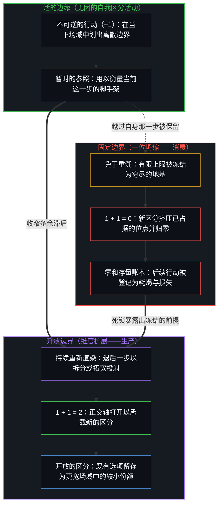
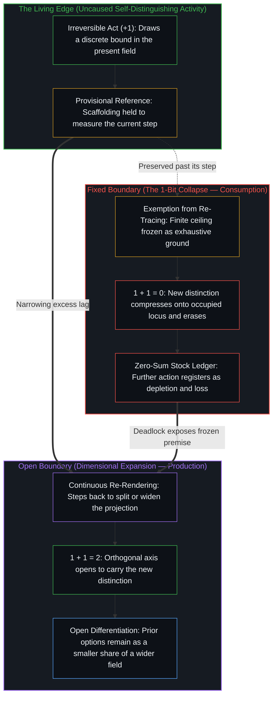

# 生产、消费与心智的区分 / Production, Consumption, and the Mind's Distinction

*生产与消费登记的是同一行动在开放或固定边界下的显现 / Production and consumption register the same act under an open or fixed bound*

生产是让新的存在得以生成：从 0 到 1 的不可逆推进，以及紧随其后的进一步区分。消费则是存在的缩减或抹除。这两个名称在自然界中并不对应两种彼此独立的行为类型；它们命名的是同一个自我区分的活动，在心智将自己划出的边界持守为开放或固定时所登记出的不同形态。

Production is the bringing of new being into existence: the irreversible movement from 0 to 1 and the further differentiation that follows. Consumption is the reduction or elimination of being. These two names do not pick out two separate kinds of act in nature; they name how the same self-distinguishing activity registers when the Mind holds the boundary it has drawn as open or as fixed.

生产与开放相一致：在开放之中，区分绵延不绝，结构只被当作暂时的脚手架来持守，而不被安装为穷尽一切的地基。消费则是同一活动在被困于免于重溯的边界之内时所呈现的样子。并非生产在道德上高尚、消费在道德上败坏；而是固定现实的假设把创造性的能量倒转为表面上的毁灭。在封闭的一位持守下，1 加 1 得出 0；当寄存器保持开放并随时重新渲染时，1 加 1 则得出 2。围绕榨取组织起来的经济形态、工具系统与制度安排，只是这一冻结在宏观尺度上留下的残余，并非从外部作用于心智的独立力量。正如[开放即一致](../openness-is-consistency/)在结构与地基的层面上所追溯的，强行让一个有限的框架去封闭那只是不断继续着的活动，恰恰制造出了它随后苦苦试图消解的不一致。

Production is coherent with openness, where differentiation continues without end and structure is held as provisional scaffolding rather than installed as exhaustive ground. Consumption is what that identical activity looks like when trapped inside a boundary exempted from re-tracing. It is not that production is a moral good and consumption a moral failing; rather, the fixed-reality assumption inverts creative energy into apparent destruction. Adding 1 to 1 yields 0 under a closed 1-bit hold and 2 when the register stays open to re-render. Economies, tools, and institutions organized around extraction are the macroscopic residue of that freeze at scale, not independent forces acting from outside. As [Openness Is Consistency](../openness-is-consistency/) traces at the level of structure and ground, forcing a finite frame to close what only continues produces the exact inconsistency it then struggles to resolve.

## 一、 区分必不可少，终局并非如此 / 1. Distinction Is Required, Finality Is Not

自我区分的活动发生着——无因、不息。称之为心智：早已在途的观察者，其每一个行动都是一次离散的区分。要登记任何关系，就必须划出边界；没有这一划界之举，就没有可理解的世界。边界在划出它的那一步是真实的，而下一步会再次划界。[智能只属于心智](../intelligence-belongs-only-to-the-mind/)将这一发起性的活动持守为不可化约的先在，而[一步一步绘制出的路径](../the-path-drawn-one-step-at-a-time/)则追溯了同一离散性如何展开为因果序列与时间。

Self-distinguishing activity occurs — uncaused, unceasing. Call it the Mind: the observer already underway, every act of which is a discrete distinction. To register relations at all, a boundary must be drawn; without that bounding act there is no intelligible world. The boundary is real at the step that draws it, and the next step draws again. [Intelligence Belongs Only to the Mind](../intelligence-belongs-only-to-the-mind/) holds that initiating activity as the irreducible prior, while [The Path Drawn One Step at a Time](../the-path-drawn-one-step-at-a-time/) traces the same discreteness unfolding as causal sequence and time.

多余的滞后从不在于做出区分本身。滞后在于将选定的框架豁免于重溯——把服务于前一步的暂时脚手架保留下来，当作现实已经完工的建筑。一旦这项豁免生效，框架之内的每一次后续行动都会被登记为对有限存量的扣减。生产所需的开放，就此被消费所预设的封闭取代：依然是同一道活的边缘在做功，却被对照着一个宽度已被冻结的参照来衡量。[重新审视反脆弱](../a-new-deeper-look-at-antifragility/)将这一剖析运用于统计持守：框架之下的症候依然真实，但对框架本身的豁免并不会随症候一同成立。即便腾空日程去迎接意外，底层的边界依然可能被固定下来，正如[追求机缘中的封闭现实](../closed-reality-in-the-pursuit-of-serendipity/)所揭示的那样。

The excess lag is never distinction-making itself. The lag is the exemption of a chosen frame from re-tracing — preserving provisional scaffolding past the step it served and treating it as the finished architecture of reality. Once that exemption is active, every further act inside the frame registers as subtraction from a finite stock. The openness that production requires has been replaced by the closure that consumption presupposes: the same living edge is at work, measured against a reference whose width has been frozen. [A New Deeper Look at Antifragility: Prosthesis, Not Driver](../a-new-deeper-look-at-antifragility/) applies this cut to statistical holds, where symptoms under a frame remain real while the exemption of the frame does not travel with them. Even clearing one's calendar to invite the unexpected can leave the underlying boundary fixed, as [Closed Reality in the Pursuit of Serendipity](../closed-reality-in-the-pursuit-of-serendipity/) shows.

## 二、 一位坍缩 / 2. The 1-Bit Collapse

在固定边界的假设下，因果次序发生了倒置。把一个活的区分加到另一个区分之上是最简明的情形。当一次不可逆的 +1 行动被强行塞进一个已经持有 1 的封闭一位寄存器时，结果便坍缩为 0：新的区分溢出了冻结的容量，被边界本身抹去。当同样的加法获准拓宽寄存器时，结果则是 2——可表征的存在得到了实实在在的扩展。同一个运算究竟产生抹除还是区分，取决于心智是将参照系持守为封死的，还是向重新渲染敞开。消费正是试图让寄存器保持封闭的姿态，而[没有系统能被保持封闭](../no-system-can-be-kept-closed/)表明，面对不息的边缘，这种姿态无法维持。

Under a fixed-boundary assumption, the causal order inverts. Adding one living distinction to another is the simplest case. When an irreversible act of +1 is forced into a closed 1-bit register that already holds 1, the result collapses to 0: the new distinction overflows the frozen capacity and is erased by the boundary itself. When the same addition is permitted to widen the register, the result is 2 — a genuine expansion of representable being. The identical operation yields erasure or differentiation depending on whether the Mind holds its reference as sealed or as open to re-rendering. Consumption is the attempt to keep the register closed, a posture that [No System Can Be Kept Closed](../no-system-can-be-kept-closed/) shows cannot hold against an unceasing edge.

这一位溢出，正是生产被转化为消费表象的确切机制。这种转化并不是与创造性能量相抗衡的第二种物理力量；它是对照被保留的极限所做的登记——当前寄存器的高位被当作不可退让的终局，而不是当前持守的临时上限。正如[超越投射](../beyond-the-projection/)在人类与智能体系统的架构中所追溯的，每一条显式规则、每一个模型或账本，都是压缩了自由度的有限低维投射；把新的正交区分强行塞进那个固定的坐标空间，就会击碎正交性并触发维度坍缩。当活的边缘推过那道上限时，一个更大的可表征空间随之打开。从封闭寄存器的内部看，这一推进被登记为溢出、矛盾与损失；从开放的持守看，它则是沿着新分离出的坐标轴继续展开的区分。[一个提示词之遥](../whatever-is-one-prompt-away/)捕捉了开放现实下进步的切身体验：先前的选项完好无损，只是它们在不断扩张的场域中所占的份额缩小了。[人、Token 与估值的范围](../humans-tokens-and-the-scope-of-valuation/)将同一几何结构追溯为仍可重画边界的有限范围，而[没有区分的效率是没有存在的运动](../efficiency-without-differentiation/)则诊断了运用于成本的封闭寄存器——把产出固定住，好让单纯的减法伪装成价值。[价值、货币与财富的生成机制](../the-generative-mechanics-of-value-money-and-wealth/)将这种持续的区分锚定在主权行动者鲜活的能力之中，而不是过去器物的静态清单里。

This 1-bit overflow is the exact mechanism by which production is converted into the appearance of consumption. The conversion is not a second physical force opposing creative energy; it is registration against a preserved limit, where the upper bits of the current register are treated as an unyielding finality rather than as the temporary ceiling of the present hold. As [Beyond the Projection](../beyond-the-projection/) traces in the architecture of human-agent systems, every explicit rule, model, or ledger is a finite low-dimensional projection that compresses degrees of freedom; cramming new, orthogonal distinctions into that fixed coordinate space shatters orthogonality and triggers dimensional collapse. When the living edge pushes past that ceiling, a larger representable space opens. From inside the closed register, that push registers as overflow, contradiction, and loss; from the open hold, it is differentiation continuing across a newly separated axis. [Whatever Is One Prompt Away](../whatever-is-one-prompt-away/) captures that lived feel of progress under open reality, where prior options remain intact while their share of an expanding field shrinks. [Humans, Tokens, and the Scope of Valuation](../humans-tokens-and-the-scope-of-valuation/) traces the same geometry as a finite scope that can still redraw its bound, whereas [Efficiency Without Differentiation Is Movement Without Existence](../efficiency-without-differentiation/) diagnoses the closed register applied to cost — holding output fixed so that mere subtraction can masquerade as value. [The Generative Mechanics of Value, Money, and Wealth](../the-generative-mechanics-of-value-money-and-wealth/) anchors this ongoing differentiation in the living capability of sovereign agents rather than in static inventories of past artifacts.

## 三、 封闭必须借用它所否认之物 / 3. Closure That Must Borrow What It Denies

围绕消费优先性组织起来的姿态并不会停止生产；它只是将生产推入背景。为了维持稳定、有限存量的图像，封闭框架必须不断从其假定边界之外汲取新鲜的区分，同时把价值与注意力记在存量内部的缩减名下。封闭被捍卫得越僵硬，生产就越被迫在暗中运转——本已在途的延续，被登记为外部的意外之财或环境供给，而不是心智自身的下一步行动。[验证中因果权能的分配](../the-allocation-of-causal-power-in-validation/)追溯了这种对延续的错置：生成性的供给被归因到那道亲身执行每一步后续行动的边缘之外。

A posture organized around the primacy of consumption does not halt production; it backgrounds it. To sustain the image of a stable, finite stock, a closed frame must continually draw fresh differentiation from beyond its assumed boundary while crediting value and attention to reduction within the stock. The more rigidly the closure is defended, the more production is forced to operate unacknowledged — continuation already underway, registered as external windfall or ambient supply rather than as the Mind's own next act. [The Allocation of Causal Power in Validation](../the-allocation-of-causal-power-in-validation/) traces this relocation of continuation, where generative supply is attributed outside the very edge that performs every following step.

这种安排在严格意义上是不一致的：一个有限的结构被强行用来为支撑它的开放活动奠基。对封闭的索求亲手制造了它随后声称要管理的稀缺与摩擦。只有当一个世界先被用来衡量它的参照系封死之后，消费才会显现为这个世界的原生朝向。要求一本滞后的账本去授权活的边缘早已带入存在之物，正是[秩序、剩余与道德拦截](../order-surplus-and-the-moral-intercept/)所拆解的同一因果倒置。在每一种制度变体之下，两极依然是开放持守与固定持守之别。

That arrangement is inconsistent in the strict sense: a finite structure is forced to ground the open activity that sustains it. The demand for closure manufactures the scarcity and friction it then claims to manage. Consumption appears as the native orientation of a world only after that world has been sealed by the reference used to measure it. Asking a lagging ledger to authorize what the living edge has already brought into being is the same causal inversion dissected in [Order, Surplus, and the Moral Intercept](../order-surplus-and-the-moral-intercept/). Beneath every institutional variant, the polarity remains an open versus a fixed hold.

## 四、 规模只是同一滞后的外化 / 4. Scale Is the Same Lag, Externalized

当许多中心通过同样未经审视的封闭来对待自身的生成活动时，这一模式便压实为持久的文化与制度痕迹。围绕零和榨取组织的经济、建立在封闭世界假设上的技术拘具，以及为守成而非区分做优化的官僚机构，并不是从外部作用于心智的自主力量。它们是各个中心允许自身的工作区分硬化为固定边界之后所形成的稳定对齐。宏观模式只是残余；根源依然在于每一个心智如何对待自己划出的区分。[命运偏爱反讽：生产创造自己的意识形态消费](../fate-loves-irony-refined/)在文明尺度上追溯了这一几何结构：生产的剩余资助了那些反过来将生产重构为侵害固定存量之罪的意识形态框架。[公共支出不创造资本](../public-spending-does-not-create-capital/)揭露了同一冻结下被改名为投资的抽取，把被抽走的私人产出的重新调配计作某个集合位点的创造。[财富转移政策与价格下限中的原因错置](../the-reversal-of-causality-in-wealth-transfer-policies-and-price-floors/)追溯了披着工资与转移支付外衣的同一冻结：压制相对价格信号，使得边际上的容量扩展被登记为有待消化的成本，而不是促使重溯的反馈。

When many centers relate to their own generative activity through the same unexamined closure, the pattern densifies into durable cultural and institutional traces. Economies organized around zero-sum extraction, technological harnesses built on closed-world assumptions, and bureaucracies that optimize for conservation rather than differentiation are not autonomous forces acting upon minds from outside. They are stabilized alignments of centers that have allowed their working distinctions to harden into fixed boundaries. The macroscopic patterns are residue; the root remains each Mind's relationship to the distinctions it draws. [Fate Loves Irony: Production Creates Its Own Ideological Consumption](../fate-loves-irony-refined/) traces this geometry at civilizational scale, where productive surplus funds the exact ideological frameworks that reframe production as a crime against a fixed stock. [Public Spending Does Not Create Capital](../public-spending-does-not-create-capital/) exposes extraction renamed investment under the same freeze, scoring the reallocation of removed private output as if an aggregate locus authored creation. [The Misallocation of Cause in Wealth-Transfer Policies and Price Floors](../the-reversal-of-causality-in-wealth-transfer-policies-and-price-floors/) traces that freeze under wage and transfer costume, suppressing relative price signals so that capacity expansion at the margin registers as a cost to absorb rather than feedback to re-trace.

在社会与技术的各个领域，同一个被保留的边界把生成性的运动转化为静态的记账。[个体抉择是唯一的因果杠杆](../individual-choices-as-the-only-causal-levers/)消解了把繁荣与舒适当作外部引擎而非个体行动回报场的习惯，而[剩余个人主义](../residual-individualism/)则揭示了把集体蛋糕当作基本单位如何将注意力死死锁在固定存量上。[看似AI的强化学习，实为人类的自我强化学习](../self-rl-for-humans/)对工具保持了同样的纪律：加密介质能为心智拓宽带宽，却不会把发起权转移到器物之中。[卓异、感知与自我设限的问题场域](../exceptionality-perception-and-the-self-limiting-field-of-problems/)展示了每当封闭框架把生成边缘冻结在账本之外时，前沿的创造性能量如何被登记为消耗或问题存量。[人口崩溃神话的拆解](../the-myth-of-population-collapse-explained/)诊断了人口学中的固定池持守：把生产剩余当作有待重新分配的静态蓄水池，直到下一代不再被登记为活的边缘可以亲手起草的工程。[悲观是乐观的阴影](../pessimism-is-the-shadow-of-optimism/)追溯了这一冻结在情绪层面的对偶：区分是运动，稳态是它留下的痕迹，而悲观消费着由乐观压实的残余，却从不曾成为它的共同作者。单一行动之所以被读作两面，只是因为果有别于因，正如[非万物之理（因果的二重性）](../not-a-theory-of-everything/)所确立的那样。

Across social and technical domains, the same preserved bound converts generative movement into static accounting. [Individual Choices as the Only Causal Levers](../individual-choices-as-the-only-causal-levers/) dissolves the habit of treating prosperity and comfort as external engines rather than as the payoff field of individual acts, while [Residual Individualism](../residual-individualism/) exposes how treating the collective pie as the primary unit keeps attention locked on a fixed stock. [What Looks Like RL for AIs Is Self-RL for Humans](../self-rl-for-humans/) maintains the same discipline for tools: densifying the medium expands bandwidth for the Mind without relocating initiation into the artifact. [Exceptionality, Perception, and the Self-Limiting Field of Problems](../exceptionality-perception-and-the-self-limiting-field-of-problems/) shows how creative energy at the frontier registers as consumption or problem-stock whenever a closed frame freezes the generative edge out of the ledger. [The Myth of Population Collapse Explained](../the-myth-of-population-collapse-explained/) diagnoses the fixed-pool hold in demography, where productive surplus is treated as a static hoard to reallocate until the next generation no longer registers as a project the living edge can author. [Pessimism Is the Shadow of Optimism](../pessimism-is-the-shadow-of-optimism/) traces the affective dual of this freeze: distinguishing is the movement, steadiness is the trace it leaves behind, and pessimism consumes the residue densified by optimism without becoming its co-author. The single act reads as two only because effect is distinct from cause, as [Not a Theory of Everything](../not-a-theory-of-everything/) establishes.

集体总计——静态资金池、国民总账、固定资源存量——充当着被保留的参照系，后果对照它们被登记，而生成活动则退居背景。器物从不发起滞后；它只是延伸了早已在建造并查阅它的各个中心处运作的滞后。[数据是局部的，智能是分配的](../data-is-local-intelligence-is-allocated/)追溯了披着“数据上限”外衣的同一冻结：人类持续的生成活动如今经由 AI 放大，却被封存为一份有限清单，其纯度等级被误认为存量的内在属性。[规模化回路](../the-scaling-loop/)则将开放持守与固定持守的交织追溯为压缩与重组的循环相位。

Collective aggregates — static pools, national ledgers, fixed resource stocks — function as preserved references against which consequences register while the generating activity stays backgrounded. The artifact never initiates the lag; it extends the reach of a lag already operating at the centers that built and consult it. [Data Is Local; Intelligence Is Allocated](../data-is-local-intelligence-is-allocated/) traces that freeze under the costume of a "data bound," where continuous human generation, now amplified through AI, is sealed as a finite inventory whose purity grade is mistaken for an intrinsic property of the stock. [The Scaling Loop](../the-scaling-loop/) traces the interplay of open and fixed holds as circulating phases of compression and recombination.

## 五、 解除豁免 / 5. Release of the Exemption

解除冻结并不需要放弃划出区分；它需要认出每一个区分都是选定的工具，而非被发现的终局。当这一认识起作用时，框架便随着步伐的推进而持续重新渲染，收窄多余的滞后，而不是越过自身那一步继续保留参照。每当有限的规则或记账框架在负荷下撞上不可化约的死锁，心智便退回到未投射的意图，拆分或拓宽投射，使被压缩的坐标轴重新分离。一位坍缩随之让位于开放的区分，而在封闭寄存器内部被登记为消费的活动，也再度被登记为对开放的参与——持守结构而不将其冻结。[清晰不是抵达的终点，而是运动本身](../clarity-isnt-a-state-you-arrive-at/)将这种持续的跨出命名为践行：不闭合是行进中的运动，而非终极目的地；而[复杂性遮蔽了涌现之为心智的行动](../complexity-obscures-emergence-as-the-act-of-mind/)则表明，涌现正是从内部看到的这一开放生产。

Releasing the freeze does not require abandoning distinction-making; it requires recognizing every distinction as a chosen instrument rather than discovered finality. When that recognition is operative, the frame is continuously re-rendered as the step moves, narrowing excess lag rather than preserving the reference past its step. Whenever a finite rule or accounting frame hits an irreducible deadlock under load, the Mind steps backward to unprojected intent and splits or widens the projection so that compressed axes separate again. The 1-bit collapse gives way to open differentiation, and what registered as consumption inside the sealed register registers once more as participation in openness — structure held without freeze. [Clarity Isn't a State You Arrive At. It's the Movement Itself.](../clarity-isnt-a-state-you-arrive-at/) names this continuous stepping-out as practice, where non-closure is the ongoing movement rather than a final destination, and [Complexity Obscures Emergence as the Act of Mind](../complexity-obscures-emergence-as-the-act-of-mind/) shows that emergence is simply this open production seen from within.

生产与消费之间的区分取决于同一个支点：心智是将自己划出的边界持守为封闭且终局的，还是持守为开放且可修订的。随后的一切，都是在该持守之下的登记。[旁观者洞察的悖论](../the-paradoxical-nature-of-bystander-insights/)追溯了当生产力与创造力在被保留的边界下被计作对立模式时的同一开放与固定登记之别。[封闭竞技场中的开放视野](../open-vision-in-a-closed-arena/)审视了垄断份额与硬件账本如何把越过任何单一厂商主张而继续延伸的机会锁进封闭清单，而[只要它不被保持为空](../only-if-it-is-not-kept-empty/)则将同一剖析运用于剩余容量，指明有用的器皿是用来承接的临时空间，而非永久排空或永久填满的持守。[进步叙事中的症候与原因](../symptom-and-cause-in-the-narratives-of-progress/)追溯了扩张在多数人保留的均衡下如何被登记为萎缩的蛋糕：这种转化只是延迟的登记，而非第二台经济引擎。[免费智能的幻觉](../the-illusion-of-free-intelligence/)诊断了披着免费残余外衣的消费优先论，它把丰裕的成品形态冻结为心智的均等，而真正的生产早已越过那道持守继续向前。[封闭的假设把复利挤成 S 曲线](../closed-assumptions-squeeze-compounding-into-s-curves/)追溯了工业增长中的封闭寄存器：一旦固定的承载力被安装为自然法则，开放的复利便被挤压为逻辑斯蒂饱和。[技术是人类复利的残差](../technology-is-residual-of-human-compounding/)将开放的乘积表达为“技术 = 人类 · (∏ − 1)”，它随开放或封闭的序列而增厚或变薄，却从不会成为独立的力量。[抽象、边界与现实的移动边缘](../abstraction-boundaries-and-the-moving-edge-of-reality/)在概念目录中追溯了开放寄存器：在封闭的库存持守下，1 + 1 得出 0；当边界保持暂时性时，区分则继续向前。在活的边缘上被生产出来、随后又被豁免于重溯之物，便成了[遗忘的脚手架](../the-scaffolding-we-forget/)。

The distinction between production and consumption turns on a single pivot: whether the Mind holds the bound it has drawn as sealed and final, or as open and revisable. Everything that follows is registration under that hold. [The Paradoxical Nature of Bystander Insights](../the-paradoxical-nature-of-bystander-insights/) traces the same open-versus-fixed registration when productivity and creativity are scored as rival modes under a preserved boundary. [Open Vision in a Closed Arena](../open-vision-in-a-closed-arena/) examines monopoly share and hardware ledgers as closed inventories of an opportunity that continues past any single firm's claim, while [Only If It Is Not Kept Empty](../only-if-it-is-not-kept-empty/) applies the cut to residual capacity, showing that a useful vessel is temporary room to receive rather than a permanently emptied or permanently packed hold. [Symptom and Cause in the Narratives of Progress](../symptom-and-cause-in-the-narratives-of-progress/) traces how expansion registers as a shrinking pie under the majority's retained equilibrium, where the conversion is delayed registration rather than a second economic engine. [The Illusion of Free Intelligence](../the-illusion-of-free-intelligence/) diagnoses consumption-primacy under the costume of free residue, freezing abundant finished output as equality of Mind while real production continues past the hold. [Closed Assumptions Squeeze Compounding into S-Curves](../closed-assumptions-squeeze-compounding-into-s-curves/) traces the closed register in industrial growth, where open compounding is squeezed into logistic saturation once a fixed carrying capacity is installed as nature. [Technology Is Residual of Human Compounding](../technology-is-residual-of-human-compounding/) expresses the open product as Technology = Human · (∏ − 1), which thickens or thins with open or closed sequence without ever becoming an independent force. [Abstraction, Boundaries, and the Moving Edge of Reality](../abstraction-boundaries-and-the-moving-edge-of-reality/) traces the open register in conceptual catalogues, where 1 + 1 yields 0 under a closed inventory hold and continues when the bound stays provisional. What was produced at the living edge and then exempted from re-tracing becomes [The Scaffolding We Forget](../the-scaffolding-we-forget/).
