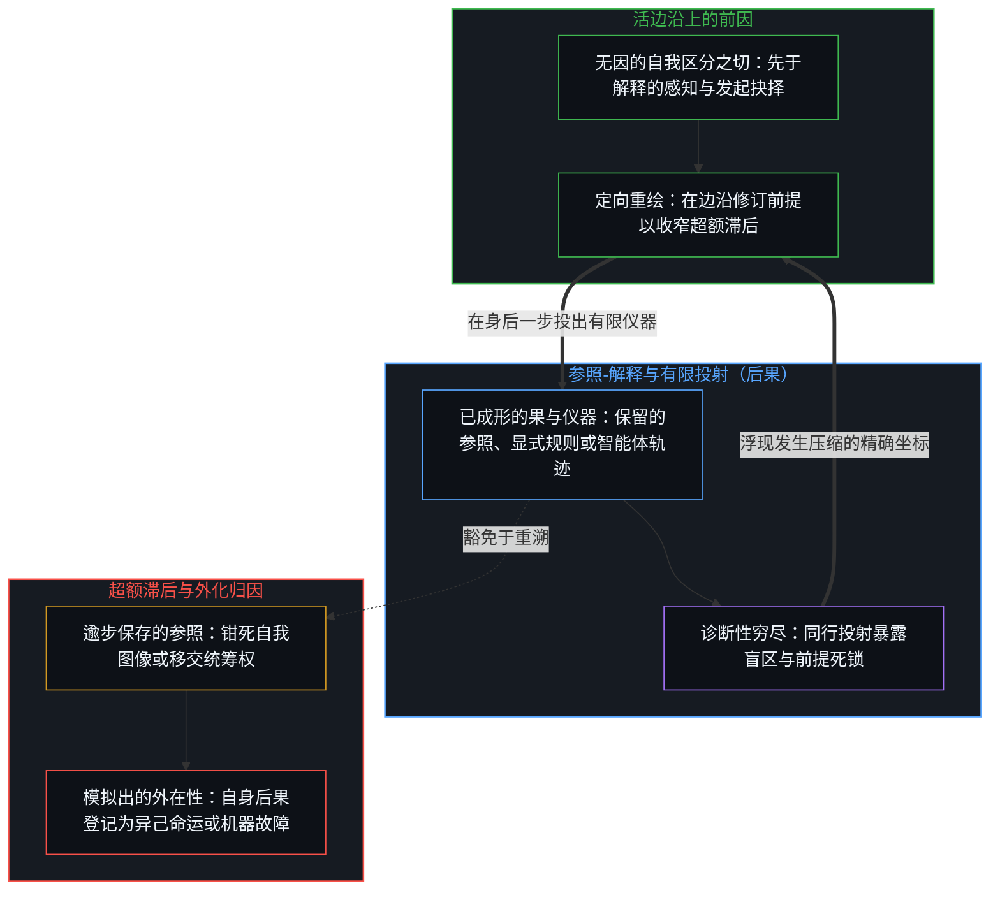
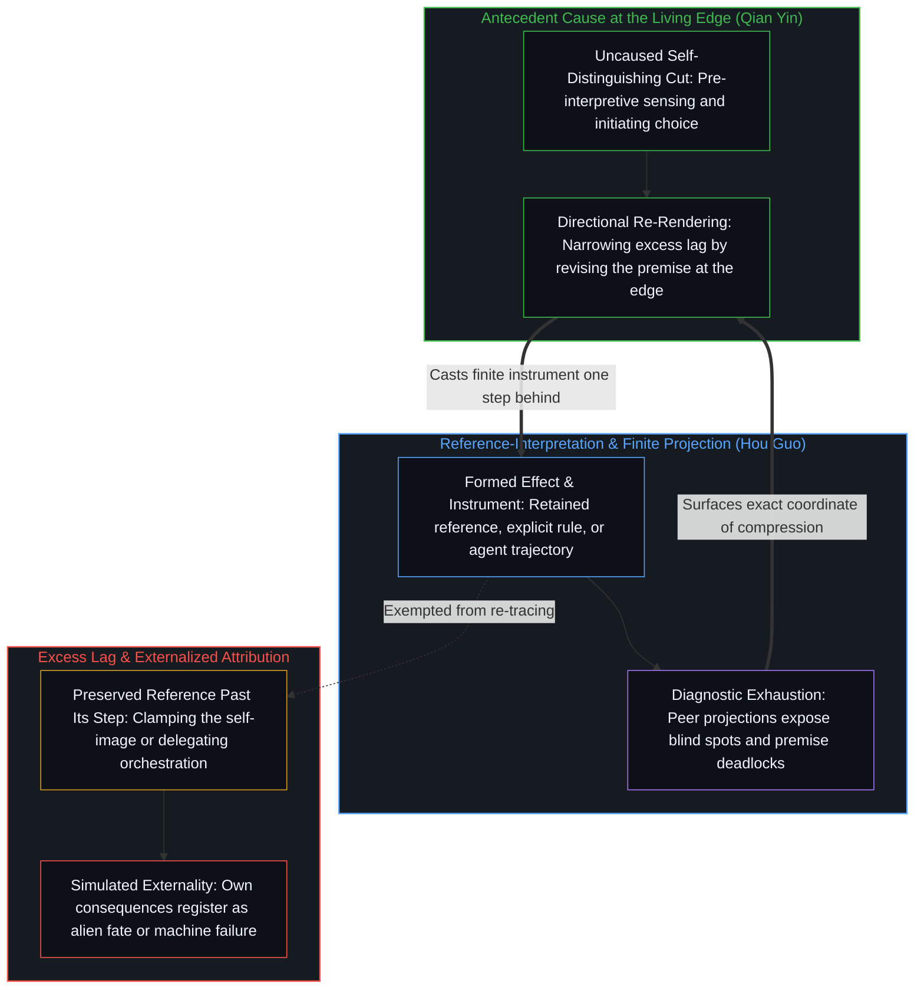

# 前因，后果 / Cause Before, Effect After

*时间是因果单向塑造的方向与间隔，观察始终落在已成形的果这一边 / Time is the direction and gap of causality where observation holds effects*

因果相连，却从来不是同一件事，也非同时发生。能观察的是果，试图理解的是因。果之所以永远滞后，不是观察的缺陷，而是轨迹只能向前塑造的结构。每当保留的参照-解释滞后于观察并超出构成性的一步下界，前因种下的后果便会登记为外来的动因。站在因的位置，不是占据某个居高临下的高度，而是在区分正在发生的那一刻直接成为因的主人。缘起性空所指出的，正是同一几何结构：一切法皆依条件成立，无独立自性，甚至连追溯这一结构的解读本身也是缘起之物——作为仪器，用过之后即可放下。

Cause and effect are bound together, yet they are never the same event and never occur simultaneously. What observation can hold is the effect; what interpretation seeks to grasp is the cause. That the effect always lags behind is not a defect of observation, but the structure of a trace that shapes only forward. Whenever a retained reference-interpretation lags behind observation by more than the constitutive minimum step, consequences seeded by antecedent causes register as arriving from an external source. Standing at the locus of cause is not occupying an elevated vantage point; it is directly owning the cause in the immediate act of differentiation. Dependent origination and emptiness point to this same geometry: every phenomenon arises conditionally without independent self-nature, and even the interpretation that traces this structure is itself conditionally arisen—an instrument to be set down once its work is done.

## 一、 轨迹只能单向塑造 / 1. Traces Shape Only One Way

自我区分的活动在发生——无因、不息。每一次区分都是离散的，而连续性正是同一活动穿过这一个个离散的步。先前的活动塑造后来的显现，且这种塑造只朝一个方向延伸。这一不对称性就是时间的箭头，也是因果的方向：同一关系，两个名字。方向是塑造延伸的朝向；间隔则是生成之因始终领先一步、而观察始终落在果这一侧的单步落差。

Self-distinguishing activity occurs—uncaused, unceasing. Every distinction is discrete, and continuity is that single activity carrying across its own discrete steps. Earlier acts shape later appearances, and that shaping runs in one direction only. That asymmetry is the arrow of time and the direction of causality: one relation, named twice. Direction is the way the shaping runs; interval is the one-step gap by which the generating cause stays ahead while observation lands on the side of the effect.

观察抓住的是果。前因——生成的那一步本身——永远领先于将其钉住的登记。这一落差并非源于工具不够精密，而是观察本身的构成性结构。正因为区分活动只留下单向的轨迹，且轨迹只能塑造后续的显现，因必先于果，果必晚于因。观察站在已经成形的果这一边，回望那已经流过的前因。正如[一步一步绘制出的路径](../the-path-drawn-one-step-at-a-time/)所追溯的，“无因”命名的恰恰是活的边沿永远领先于观察所持有一切的那一步。在思想史上，[读《中文哲学简史》有感](../du-zhongwen-zhexue-jianshi-you-gan/)登记了同样的滞后：哲学研究总是慢活生生的思想一拍，回看所捕获的只是已经定型的余波。而在日常与物理感知中，[翻袋球与魔术戏法](../the-bank-shot-and-the-magic-trick/)则展示了所有观测到的现象皆为终端结果：一旦中介因果链条被遮蔽，寻常的连续碰撞便被登记成不可思议的魔术戏法。

Observation seizes the effect. The antecedent cause—the generating step itself—always remains one step ahead of the registration that pins it down. This gap does not stem from imprecise instruments; it is the constitutive structure of observation. Because distinguishing activity leaves a unidirectional trace that shapes only subsequent appearances, cause precedes effect and effect always arrives after cause. Observation stands on the side of the effect already formed, looking back toward the antecedent cause that has already moved on. As [The Path Drawn One Step at a Time](../the-path-drawn-one-step-at-a-time/) traces, "uncaused" names the exact step by which the active edge precedes everything observation holds. In the history of thought, [Reflections on A Short History of Philosophy in Chinese](../du-zhongwen-zhexue-jianshi-you-gan/) registers this same lag where philosophical scholarship trails living thought by a beat, capturing only the stabilized aftermath. And in physical and everyday perception, [The Bank Shot and the Magic Trick](../the-bank-shot-and-the-magic-trick/) shows how every observed phenomenon is a terminal effect: whenever the intermediate causal chain is occluded, an ordinary sequence of collisions registers as an inexplicable magic trick.

向后搜寻更早的因，得到的依然是果，因为搜寻本身又是另一次观察。要求前因与被观察到的后果重合在同一时间步上，就等于要求观察取消自身。

Searching backwards for an earlier cause still yields an effect, because the search is itself another act of observation. Demanding that the antecedent cause and the observed consequence coincide in the same step is demanding that observation cancel itself.

## 二、 超额滞后将前因登记为外因 / 2. Excess Lag Registers Antecedent Cause as External

当后果被登记到他人或环境头上时，其机制鲜少是蓄意推卸责任的密谋，而是保留的参照-解释未能随当下的活动一同重绘，滞后于观察的幅度超出了构成性的一步下界。在这一超额滞后之下，由自身先前行动种下的后果，对照陈旧的参照便被登记为外在的原因。外在性具有幅度，其幅度就是超额落差的宽度：被保存的参照-解释落后于当前行动步越远，折返的后果看起来就越陌生、越像外来之物。

When consequences register as imposed by other people or by the environment, the mechanism is rarely a deliberate plot to shirk responsibility; rather, a retained reference-interpretation has failed to re-render along with the present activity, lagging behind observation past the constitutive one-step bound. Under that excess lag, consequences seeded by one's own antecedent acts register against the stale reference as external causes. Externality has a magnitude, and its magnitude is the width of the excess gap: the further the preserved reference-interpretation trails behind the active step, the more alien the returning consequence appears.

这种滞后在结构上会自我续期。参照-解释一旦成形，其内建指令就是保存自身；随当前边沿重绘，正是它为了维持存在而本能排斥的微死。漂移不需要恶意。即便不推卸责任，有限的递归也只能朝向更窄的超额滞后逼近，而无法闭合那构成性的一步落差，因为生成的那一步永远领先于它自己的登记。再诚实的问责话语，也无法把前因与观察中的后果压缩进同一个同步的瞬间。在预测与抽象的层面上，[因果贯穿始终](../causality-all-the-way/)指出了同一机制：被固定的因果图解释不了仍在边沿分岔的序列，在那里起作用的唯有边沿自身的再描绘。在事后复盘中，[关于归因](../guan-yu-gui-yin/)追溯了超额滞后如何把时间上的先后顺序直接误认作生成性的原因，使归因停留在最显眼的可见节点上。正如[决策与后果的不可约先验](../the-irreducible-prior-of-decision-and-consequence/)所确立的，决策与后果之间看似断裂的鸿沟只发生在参照未能更新的感知内部，因果本身从未发生断裂。而当组织将这种超额滞后制度化、把开放性的价值判断移交给指标或自动化系统时，[任务的移交与后果的不可让渡](../the-delegation-of-the-task-and-the-inalienability-of-consequences/)表明，自我客体化只会让反馈回路失声，直到失去缓冲的后果重新砸回发起行动的中心。

This lag renews itself by construction. Once a reference-interpretation forms, its built-in directive is self-preservation; re-rendering along with the current edge is the micro-death it exists to select against. Drift requires no malice. Even without evading responsibility, finite recursion can only narrow excess lag directionally without ever closing the constitutive one-step gap, because the generating act always stays ahead of its own registration. Honest accountability discourse still cannot compress antecedent cause and observed consequence into a single simultaneous step. Across prediction and abstraction, [Causality All the Way](../causality-all-the-way/) shows that a fixed causal map cannot account for a sequence still diverging at the edge, where only the edge's own re-drawing operates. In retrospective analysis, [On Attribution](../guan-yu-gui-yin/) traces how excess lag mistakes temporal succession for generative cause, halting attribution at the most salient visible node. And as [The Irreducible Prior of Decision and Consequence](../the-irreducible-prior-of-decision-and-consequence/) establishes, the apparent rupture between decision and consequence occurs strictly within perception when the reference fails to update, never as an ontological break in causality itself. When organizations institutionalize this excess lag by handing open-ended value judgments to metrics or automated systems, [The Delegation of the Task and the Inalienability of Consequences](../the-delegation-of-the-task-and-the-inalienability-of-consequences/) demonstrates that self-objectification only silences the feedback loop until unbuffered consequences land back on the initiating center.

## 三、 站在因的位置就是成为因的主人 / 3. Standing at the Locus of Cause Is Owning the Cause

站在因的位置，并非去占据某个特权高度，也不是在事后破解已经凝固的因果链。它是在行动正在发生的那一刻，直接成为因的主人——把因果供给留在活的这一步上，既不交由滞后的解释代管，也不登记到外来的作者名下。

Standing at the locus of cause does not mean occupying a privileged height or decoding a frozen causal chain after the fact. It means directly owning the cause at the exact moment action occurs—keeping causal supply at the living step rather than surrendering it to a lagging interpretation or registering it under an external author.

当保留的参照-解释持续朝向构成性的最小滞后重绘时，仪器便随边沿的每一步死去又重新成形。此时，后果直接登记为前因抉择的延续，而非外来力量的冲击。收窄超额滞后并不是删除仪器，而是让仪器恢复为仪器。在社会行动中，[个体抉择是唯一的因果杠杆](../individual-choices-as-the-only-causal-levers/)定位了同样的归位：每一个离散行动仍是它自己的因果杠杆，周围的条件只是行动展开的场域，而非替行动提供原因的第二作者。在人类与智能体系统的架构中，[超越投射](../beyond-the-projection/)将前因与已成形后果的这一边界转化为可操作的运转机制：每一条显式规则、提示词或模型轨迹，都是已经落在果这一侧的有限投射；无自我的智能体可以在其中把演绎后果推演到底，并通过同行辩论暴露出隐藏的矛盾，而处在未投射边沿的人类心智则认领折返的死锁信号，从破裂的旧框架后退一步，重新划定前提。而在围绕这些系统不断累积的制品中，[你的代码库即是记忆](../your-codebase-is-memory/)追溯了为何代码库、模型检查点或提交历史始终是早先区分留下的下游之果，而非持续涌出能动性的源头：正因为观察站在已成形的果这一侧，而活的切分站在因的位置，累积的数字残余才必须在因果当下被持续重溯与修剪，而非作为档案神像受到供奉。

As the retained reference-interpretation is continuously re-rendered toward the constitutive minimum lag, the instrument dies and reforms with each step of the edge. Consequences then register directly as the continuation of antecedent choices rather than the impact of alien forces. Narrowing excess lag does not delete the instrument; it restores the instrument to functioning as an instrument. Across social action, [Individual Choices as the Only Causal Levers](../individual-choices-as-the-only-causal-levers/) locates this same restoration: every discrete act remains its own causal lever, while surrounding conditions form the field rather than a second author supplying the cause. In the architecture of human-agent systems, [Beyond the Projection](../beyond-the-projection/) operationalizes this exact boundary between antecedent cause and formed effect: every explicit rule, prompt, or model trajectory is a finite projection already on the side of the effect, where ego-free agents can exhaustively trace deductive consequences and expose hidden contradictions through peer debate, while the human Mind at the unprojected edge claims the returning deadlock signal, steps back from the broken frame, and re-draws the premise. And across the artifacts that accumulate around those systems, [Your Codebase Is Memory](../your-codebase-is-memory/) traces why a codebase, model checkpoint, or commit history is always the downstream effect of prior distinctions rather than a continuing source of agency: because observation stands on the side of the formed effect while the living cut stands at the cause, accumulated digital residue must be continuously re-traced and pruned from the causal present rather than worshipped as an archival idol.

## 四、 缘起性空指出同一结构 / 4. Dependent Origination and Emptiness Point to the Same Structure

一切法皆依条件和合而生，无独立自性。这里的“法”，涵盖数学、物理以及日常借以在世界中航行的各种道理。每一套框架都只在特定条件下成立。有的适用域更广，但没有任何规律或道理能够脱离界定它的前提条件而独立自存。在形式系统中，[为何数学永远解不完](../why-mathematics-can-never-be-solved/)追溯了为何没有任何有限持握能够封死一个只是继续着的活动；而[开放即一致](../openness-is-consistency/)则指明，不一致恰恰出现在强迫有限结构充当无条件地基的时刻。

All phenomena arise through conditional co-dependence and possess no independent self-nature. Here "phenomena" encompasses mathematics, physics, and the everyday principles used to navigate the world. Every such framework holds only under specific conditions. Some span a wider domain than others, yet no law or principle exists independently of the premises that bound it. In formal systems, [Why Mathematics Can Never Be Solved](../why-mathematics-can-never-be-solved/) traces why no finite hold can seal an activity that simply continues, and [Openness Is Consistency](../openness-is-consistency/) identifies how inconsistency arises precisely when a finite structure is forced to serve as an unconditional ground.

中观以二谛阐明这一结构。世俗谛依名言、约定、因果效能与作用而安立诸法；在其条件边界内，因果规律作为有效的仪器而成立，并非虚妄幻影。胜义谛则指出，这一切安立皆无内在、自存的自性——不是因为在世俗世界之外另有一个更高的“空”之领域，而是因为世俗谛所安立的诸法本身就没有独立自存的实体。

Madhyamaka articulates this structure through the two truths. Conventional truth establishes phenomena through naming, convention, causal efficacy, and function; within its conditional bounds, causal regularities hold as effective instruments rather than mere illusions. Ultimate truth points out that all such establishments lack intrinsic, self-subsistent nature—not because a separate, higher realm of "emptiness" stands outside the conventional world, but because the very phenomena established conventionally have no independent substance of their own.

二谛不是两个割裂的世界，而是对同一缘起活动的两个登记层次。正因为诸法无自性，才得以随条件变化而生起；正因为依条件而生起，才必然没有固定不变的自性。以有空义故，一切法得成。

The two truths are not two separate worlds, but two levels of registering the same conditionally arisen activity. Because phenomena lack intrinsic self-nature, they can arise through changing conditions; because they arise through conditions, they are necessarily devoid of fixed self-nature. Because emptiness holds, all things can be established.

这不是两种哲学教义之间的比附，而是同一自我区分活动在另一套语汇中的登记：无自性命名了任何独立静态地基的缺席；依缘而生命名了轨迹在既有轨迹场中继续塑造；观察站在果这一侧，则命名了登记永远比生成晚到一步。

This is not a doctrinal comparison between two philosophical traditions, but the same self-distinguishing activity registered in another vocabulary: non-self-nature names the absence of any independent static ground; conditional arising names the trace continuing to shape within a field of prior traces; and observation standing on the side of the effect names registration always arriving one step after generation.

## 五、 将空抽离成普适律便实体化了无自性 / 5. Abstracting Emptiness into a Universal Reifies Non-Self-Nature

缘起性空的广泛适用性，恰恰源于它所描述的彻头彻尾的相对性。它不承认任何独立自存的基点——包括它自己。一旦把“空”从具体条件中抽离出来，奉为无条件的普适法则，就已经将它实体化成了静态之物，直接违背了它所陈述的无自性。

The broad applicability of dependent origination and emptiness stems strictly from the thoroughgoing relativity it describes. It admits no independent, self-existing ground—including itself. The moment emptiness is abstracted from concrete conditions and held up as an unconditional universal law, it is reified into a static entity, violating the very non-self-nature it states.

正如[有无之边](../you-wu-zhi-bian/)在这一边界上所追溯的，“有”与“无”都不是可以站到外部去裁定的终局答案；出路在于正在区分的活边沿，而不在于加冕其中一极。把“空”封为唯一正统或终极答案，与把“有”封为永久地基，是同一种参照-解释的超额滞后。也正如[清晰不是抵达的终点，而是运动本身](../clarity-isnt-a-state-you-arrive-at/)所展示的，清晰是不断迈出而不停驻于静态状态的运动本身；一旦把某个框架紧握为终点，它就不再作为仪器运转。

As [The Edge of Being and Non-Being](../you-wu-zhi-bian/) traces at this exact boundary, neither "being" nor "non-being" is a final verdict that can be adjudicated from outside; the resolution lies at the active edge of differentiation rather than in crowning one pole over the other. Sealing "emptiness" into the sole orthodox path or final answer is the same excess lag in reference-interpretation as sealing "being" into a permanent foundation. And as [Clarity Isn't a State You Arrive At. It's the Movement Itself.](../clarity-isnt-a-state-you-arrive-at/) shows, clarity is the repeated stepping-out that never lands in a static state; the moment a framework is gripped as a destination, it ceases to function as an instrument.

## 六、 因从来不是可抵达的彼岸 / 6. Cause Is Never a Far Shore to Arrive At

凡事皆有前因，但这个“因”从来不是可供观察抵达并安顿下来的静态彼岸。搜寻前因本身就是当下的行动，在搜寻的瞬间又会生成新的条件轨迹。一旦观察者以为找到了可以停驻的终极之因，那个“找到”本身就已经凝固为已成形的果，并成为下一步的条件轨迹。正如[现实的边界](../xian-shi-de-bian-jie/)所追溯的，因果链条向两端无限延伸而无终点，对终极第一因的执念，只是企图将闭合强加于开放场域的代偿。

Every event has an antecedent cause, yet that cause is never a static shore where observation can arrive and come to rest. Searching for a cause is itself a present act that generates new conditional traces in the moment of searching. Once an observer believes a final, resting cause has been found, that "finding" has already become a formed effect and a conditioning trace for the next step. As [The Boundary of Reality](../xian-shi-de-bian-jie/) traces, causal chains extend without terminus in both directions, and the obsession with an ultimate first cause is a compensatory attempt to force closure onto an open field.

在公共话语中，[伪装成远见的表演性后见](../performative-hindsight-that-pretends-to-be-foresight/)拆解了这种滞后的社交伪装：对着一幅被保留下来的“早先无人注意”的旧图像，事后重描已经公开的成功，并把这种回溯性的反差登记成先见之明。远见从不驻留在事后的评论里；它只发生在结果尚且开放、而区分正在落下的那个活步之中。

In public discourse, [Performative Hindsight That Pretends to Be Foresight](../performative-hindsight-that-pretends-to-be-foresight/) exposes the social costume of this lag: redrawing an already public success against a preserved image of earlier neglect and registering the retrospective contrast as foresight. Foresight never resides in the post-hoc commentary; it occurred only at the live step where a distinction was made while the outcome remained open.

## 七、 解读本身也是缘起 / 7. Interpretation Itself Is Dependently Originated

即便对因果与性空的这一解读，本身也是依条件而生起的。它回应特定的语境与既有轨迹而成形，在条件契合处有效运转，而在脱离语境被生搬硬套时徒增缠缚。领悟不在于把解读攥得更紧，而在于用过之后能够将它放下——收窄超额滞后，使解读本身不被登记为外在原因或终极地基。正因为观察站在已成形的果这一侧，它所审视的始终是低维投射，这也正是[向量与投影的迷局](../the-vector-and-the-puzzle-of-projections/)将注意力从投下的影子引回生成向量本身的原因。

Even this interpretation of causality and emptiness arises conditionally. It takes shape in response to specific contexts and prior traces, functioning effectively where those conditions align and adding entanglement where it is gripped out of context. Understanding does not consist in clutching the interpretation more tightly, but in setting it down once its work is done—narrowing excess lag so the interpretation itself is never registered as an external cause or a final ground. Because observation stands on the side of formed effects, what it inspects is always a low-dimensional projection, which is why [The Vector and the Puzzle of Projections](../the-vector-and-the-puzzle-of-projections/) redirects attention from the cast shadow back to the generating vector.

在不同的中心之间，[没有普渡，只有自渡的无限可能](../mei-you-pu-du-zhi-you-zi-du/)标出了同样的结构边界：没有任何中心能替另一个中心完成递归折返。在书写的一侧，表达完成了局部的自我区分，并在媒介中留下持久的轨迹；在阅读的一侧，是否摄取这道轨迹、如何摄取，依然取决于接收端心智自身的下一步区分。

Across distinct centers, [No Universal Salvation, Only Boundless Possibilities of Self-Salvation](../mei-you-pu-du-zhi-you-zi-du/) marks the same structural boundary: no center can complete the recursive return on behalf of another. On the writing side, an articulation completes its own local differentiation and leaves a durable trace in the medium; on the reading side, whether and how that trace is taken up remains exclusively the receiving Mind's own next distinction.

## 八、 停留在前因尚未凝固之处 / 8. Staying Close Where Antecedent Cause Has Not Yet Congealed

活的位置，既不在事后破解因果链条，不在死守某个固定的前因，也不在于把任何规律或解读供奉为无条件的普适法则。它在于留在前因正在生成、尚未凝固为已成形后果的地方——在掌舵的边沿成为因的主人，而不是沦为后果的解释者。当事后评论把已经成形的结果打包成可照搬的公式、并兜售为通向未来胜利的引擎时，便产生了[成功学](../cheng-gong-xue/)所剖析的倒置。而当统计观察把过往结果的宏观分布误认作生成机制本身时，便犯下了[幂律是结果的表象](../mi-lv-shi-jie-guo-de-biao-xiang/)所追溯的同一种事后颠倒。

The live locus lies neither in decoding causal chains after the fact, nor in gripping a fixed antecedent cause, nor in enshrining any law or interpretation as an unconditional universal. It lies in staying where antecedent cause is actively generating and has not yet congealed into a formed effect—owning the cause at the steering edge rather than serving as an explainer of consequences. When retrospective commentary packages already formed outcomes into portable formulas and markets them as the engine of future triumph, it produces the inversion dissected in [Theories After Success](../cheng-gong-xue/). And when statistical observation mistakes the macro distribution of past outcomes for the generative mechanism itself, it commits the same post-hoc reversal traced in [Power Law Is the Surface of Outcomes](../mi-lv-shi-jie-guo-de-biao-xiang/).

前因持续生成，后果始终滞后，时间正是这一方向与间隔的显现。一切框架——包括用来解释框架的框架——皆无独立自性可供执取。当参照-解释的超额滞后被收窄，仪器重新恢复为仪器，边沿继续区分。

Antecedent cause is continuously generating, consequent effect is always lagging behind, and time is the manifestation of that direction and interval. Every framework—including the framework that explains frameworks—lacks independent self-nature to cling to. As excess lag in the reference-interpretation is narrowed, the instrument returns to being an instrument, and the edge continues to distinguish.
