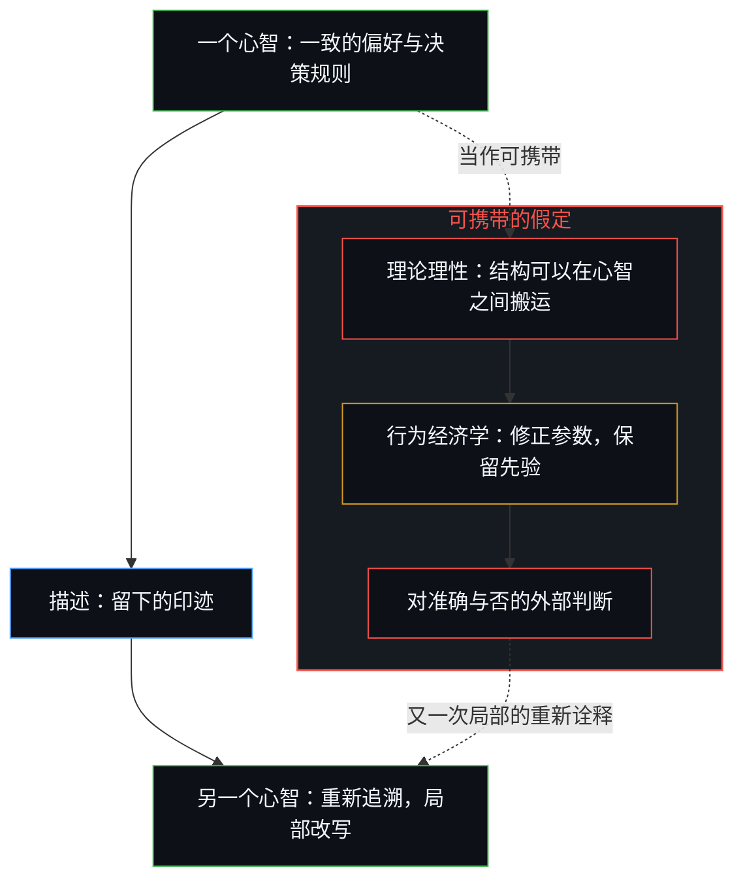
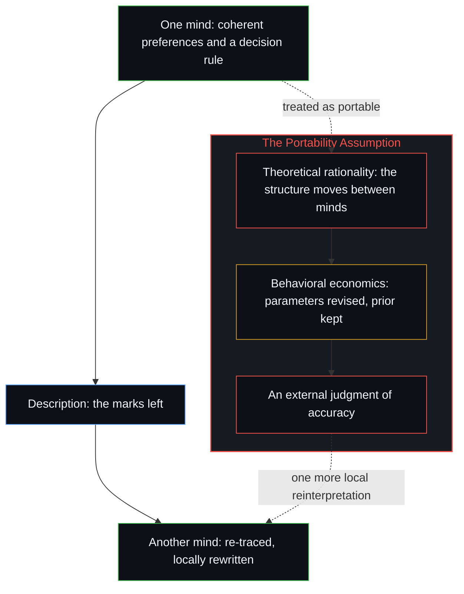

# 理性从不跨越心智 / Rationality Never Travels Across the Mind

*对理性的每一次描述，本身已是一次重新诠释 / Every description of rationality is already a reinterpretation.*

理论理性把一种一致的偏好结构与一条一致的决策规则，二者都各自独属于每一个心智，当作可以在人与人之间搬运的东西。行为经济学修正了这个先验，却没有丢弃它。剩下的那一步，把这种局部的好用，转成了一条常驻的、可以转移的论断。

Theoretical rationality treats a coherent preference structure and a consistent decision rule, each uniquely held at each mind, as interpersonally portable. Behavioral economics conditions that prior without discarding it. The residual step converts that local serviceability into a standing, transferable thesis.

## 一、 重新诠释是描述的媒介 / 1. Reinterpretation Is the Medium of the Description

任何表述、接收或评价“什么算理性”的心智，都已经在进行这种重新诠释。这个过程就是描述本身的媒介。

Any mind that articulates, receives or evaluates a statement about what counts as rational is already performing the reinterpretation. The process is the medium of the description itself.

## 二、 理论理性把结构当作可携带的 / 2. Theoretical Rationality Treats the Structure as Portable

理论理性从另一个前提出发。它设定一组一致的偏好和一条一致的决策规则，一般是期望效用最大化或博弈论的均衡，并把这个结构当作可以在人与人之间搬运的东西。前提一旦被接受，一个理想化行动者所认定的理性，就可以在行动者之间汇总、比较、开出处方，仿佛他们内部关于价值、风险与约束的地图可以互换。[理性选择公设是原罪](../the-rational-choice-postulate-is-the-original-sin/)讲的就是这种冻结被装进微观基础的样子：一致性与主体间的均一被当作牢靠到足以为汇总奠基，而选择只在各自私人的前提下继续。

Theoretical rationality begins from a different premise. It posits a coherent set of preferences and a consistent decision rule, typically expected-utility maximization or game-theoretic equilibrium, and treats that structure as interpersonally portable. Once the premise is granted, the rationality registered by one idealized agent can be aggregated, compared and prescribed across agents as if their internal maps of value, risk and constraint were interchangeable. [The Rational Choice Postulate Is the Original Sin](../the-rational-choice-postulate-is-the-original-sin/) traces that freeze installed as a micro-foundation: consistency and intersubjective uniformity treated as solid enough to ground aggregation, while choice continues only under private premises.

历史上的一例让这个前提的失效变得具体。冯·诺依曼主张核先发制人的论证，从模型严密地推出，接收这些论证的决策者却觉得这个建议陌生，并拒绝了它。一个心智认定为理性的东西，到达另一个心智时已经被改写。[价格是言说，理解是交易](../price-as-utterance-understanding-as-trade/)在寻常的交换里追溯同一种无法抵达：一笔成交价或一句话只是余留，它的力量只在于另一个心智如何重新追溯它。相信未来的读者会重建作者内部的一致，不过是把因果的推力派给了不动的印迹，这一越界在[信任读者是最后的越界](../trusting-the-reader-is-the-last-overstep/)中有过剖析。

Historical illustration makes the premise's failure concrete. Von Neumann's formal arguments for nuclear first strikes followed rigorously from the model, yet the decision-makers who received them experienced the recommendation as alien and refused it. What one mind registers as rational arrives in another already rewritten. [Price as Utterance, Understanding as Trade](../price-as-utterance-understanding-as-trade/) traces the same non-arrival in ordinary exchange: a printed price or a sentence is residue, and its force is only how another mind re-traces it. Trusting that a future reader will reconstruct the author's internal coherence merely assigns causal propulsion to inert marks, an overstep analyzed in [Trusting the Reader Is the Last Overstep](../trusting-the-reader-is-the-last-overstep/).

## 三、 行为经济学修正了先验 / 3. Behavioral Economics Conditions the Prior

行为经济学与这个理论先验处在一种特定的关系里。它把标准的理性选择装置当作组织结构，在其上做一连串贝叶斯更新。观察到的偏离，损失厌恶、概率加权、现时偏差、公平约束，被吸收为修正后的参数或附加的项。先验从未被挑战，它被修正，好让后验模型在描述上更贴合。结果是一套精炼过的演算，仍然留在原来的优化框架之内。这种调整改善了局部的可解释性，对预测力的改善有限。可携带的演算仍被当作对能动的描述。智能体社会之间传递的是印迹，不是理性，正如[印迹与行动](../the-mark-and-the-act/)所示。

Behavioral economics stands in a particular relationship to this theoretical prior. It treats the standard rational-choice apparatus as the organizing structure and performs a sequence of Bayesian updates upon it. Observed departures, loss aversion, probability weighting, present bias and fairness constraints, are absorbed as revised parameters or additional terms. The prior is never challenged; it is conditioned so that the posterior model yields improved descriptive fit. The result is a refined calculus that remains inside the original optimization framework. The adjustment improves local explainability with limited improvement in predictive power. The portable calculus remains the description of agency. Agent societies pass marks between them, not rationality, as [The Mark and the Act](../the-mark-and-the-act/) shows.

## 四、 对准确与否的判断重演了理论的那一步 / 4. The Judgment of Accuracy Reenacts the Theoretical Move

即便是判断这种关系准确与否，也重演了原来那一步理论动作。这样的判断，声称有一个外部的立足点，从那里可以把行为经济学与理论理性之间的关系评估为跨越心智地正确。那个立足点本身，是又一次局部的重新诠释。[自我形象仿佛从无处发声](../self-image-speaks-as-if-from-nowhere/)追溯的就是这种立场：一次重新投射，被当作超然的外部来占据。

Even a judgment that the relationship is accurate or not reenacts the original theoretical move. Such a judgment claims an external vantage from which the relationship between behavioral economics and theoretical rationality can be assessed as correct across minds. That vantage is itself another local reinterpretation. [Self-Image Speaks as if from Nowhere](../self-image-speaks-as-if-from-nowhere/) traces that stand: a re-projection occupied as if it were a detached exterior.

这种描述因其局部的用处被保留下来，在某一场具体的交换、某一组具体的例子里好用。剩下的那一步，把这种局部的好用转成了一条常驻的、可以转移的论断。[当观察变成表演](../when-observation-becomes-performance/)讲的是同一种转换装扮成美德的样子：一个第一人称的参照，被包装成可携带的产品。评判另一个人的推理，返回的是自己的模型，也就是[投射中的自画像](../the-self-portrait-in-the-projection/)所描述的那幅自画像。

The description is retained for its local usefulness, serviceable inside a particular exchange and a particular set of examples. The residual step converts that local serviceability into a standing, transferable thesis. [When Observation Becomes Performance](../when-observation-becomes-performance/) is the same conversion dressed as virtue: a first-person reference packaged as a portable product. Judging another's reasoning returns one's own model, the self-portrait that [The Self-Portrait in the Projection](../the-self-portrait-in-the-projection/) describes.
