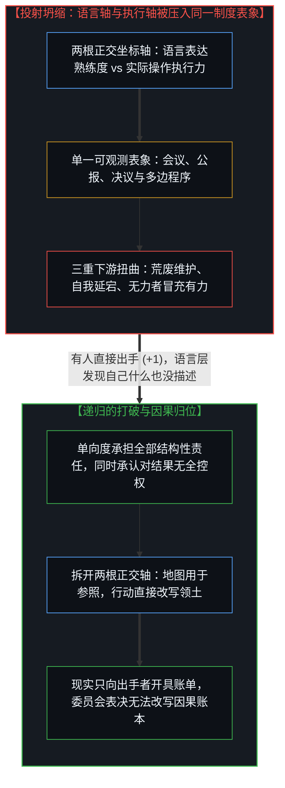
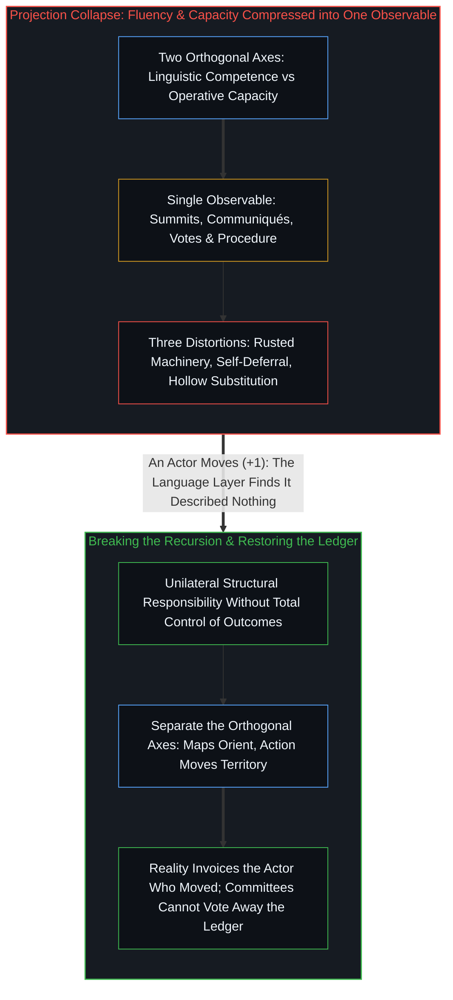

# 现实不按委员会开账单 / Reality Doesn't Invoice by Committee

*语言流利度与执行力压入同一表象时，叙事便替代行动，直至有人出手结账。 / When fluency and capacity collapse onto one institutional metric, narration displaces action until someone moves.*

表达能力最准确的语言是行动，但它只有在出手移动时才看得见；外交则是另一种语言——它既可以用来描述能力，也可以用来替代能力，而且在某人真正出手之前，这两者从外观上无从区分。这一机制贯穿于地缘政治、组织文化与个体的自我认知：同一个几何错位，在它运转的每一个地方都稳定地产出可预测的扭曲。

The most accurate language for capacity is action, yet it becomes visible only when it moves. Diplomacy is a different language—one that can either describe capacity or substitute for it, and the two look indistinguishable from outside until someone actually moves. This mechanism runs through geopolitics, institutional culture, and individual self-understanding: a single geometric error producing predictable distortions wherever it operates.

## 一、 一句话刺穿的帷幕 / 1. The Line That Pierces the Curtain

“外交，就是你拥有力量时用来解释它的说辞，以及你缺乏力量时用来遮掩它的借口。”

"Diplomacy is the explanations you need for power and the excuses for the lack of it."

这句话出现在一条关于美方抓捕马杜罗以及对伊朗最高层实施斩首打击的热门讨论串下——两场行动、两个夜晚，让数十年的多边程序瞬间沦为摆设。讨论串里附着欧洲领导人震惊失色的照片：冯德莱恩、马克龙，全员在列。但这句话真正切中的并不仅是外交政策；外交政策只是这一机制暴露得最赤裸的舞台。

That line landed on a widely circulated thread discussing the capture of Maduro and the decapitation strike on Iran's top leadership—two operations across two nights that rendered decades of multilateral procedure ornamental. The thread included photographs of European leaders mid-shock: von der Leyen, Macron, and the full institutional cast. Yet the line is not narrowly about foreign policy; foreign policy is simply the stage where the mechanism is most exposed.

## 二、 投射坍缩：当语言熟练度冒充行动能力 / 2. Projection Collapse: When Linguistic Fluency Registers as Operative Capacity

这里有两个彼此独立的维度在同时运转：**语言表达的熟练度**与**实际操作的执行力**。这两者都被投射到了同一个可观测的公共表象上——制度性的日常活动。无论底下有没有执行力，会议室同样坐得满满当当，联合声明同样按时发布，表决票同样庄重投下；至于会议桌底下究竟有没有任何真实可动用的力量，在某人真正出手之前是看不见的。

Two independent dimensions are in play: **linguistic competence** and **operative capacity**. Both project onto a single public observable—institutional activity. The conference room is full either way, the joint statements are issued on schedule, and the formal votes are cast; whether anything operative sits underneath remains invisible until someone moves.

这是一场典型的**投射坍缩**：两根正交的坐标轴——“你能描述什么”与“你能做成什么”——被硬塞进了同一个坐标。结果便是虚假相关：言辞的流利被登记成了功能的完备。这场坍缩在下游制造了三重后果。

This is a **projection collapse**: two orthogonal axes—what you can describe and what you can execute—crammed onto one coordinate. The result is spurious correlation where verbal fluency registers as functional power, producing three downstream effects.

第一重后果是**原本有能力的人停止维护能力**。如果关于力量的语言在记分牌上被直接算作了力量本身，那么照料好语言就感觉像是照料好了力量。你主持峰会、起草框架、发表联合公报——而底下的执行机器则在悄然生锈。这并不是因为语言主动腐蚀了机器，而是因为描述上的流利挤占了操作上的纪律。欧洲外交传统之所以演变为今天这副模样，正是因为它用一套日益繁复精巧的语言去包裹一项早已被这套语言的精巧本身慢慢掏空了的能力：描述吞噬了被描述之物。

First, **the capable stop maintaining capacity**. If the language of power registers on the institutional scoreboard as the thing itself, attending to the language feels like attending to the capacity. You convene the summits, draft the frameworks, and issue the joint communiqués while the machinery underneath rusts—not because language actively corroded the machinery, but because fluency in description displaced the discipline of operation. Europe's diplomatic tradition is a sophisticated language for a capacity that has been hollowed out by the sophistication of the language itself: the description ate the described.

第二重后果是**原本有能力的人向语言俯首听命**。这指的不是那个直接出手的人，而是此前数十年的惯性：明明握有实际执行力的决策层，却越来越把“外交口径上的对齐”当成了能力本身。语言层宣称力量驻留在联盟里、在程序里、在多边共识里——于是握有能力且熟稔这套话语的行动者便选择了自我延宕。不是因为执行力已经衰减，而是因为投射发生了坍缩：被描述出来的对齐，在认知里被登记成了所握有的力量。自我怀疑不是从失败中溜进来的，而是从话语的流利中溜进来的——你明明**能够**直接行动，但受认可的话语体系规定“未经叙事授权的行动不算正当行动”，于是你停下来等待语言去批准那件你的能力早已允许你去做的事。委员会所画的那张地图，正是[现实扭曲力场命名了那张闭合的地图](../the-reality-distortion-field-names-the-closed-map/)所指认的闭合共识。

Second, **the capable defer to the language**. This does not refer to the actor who moved, who demonstrated capacity directly, but to the decades preceding: administrations that held operative capacity yet increasingly registered diplomatic alignment as the capacity itself. The language layer insisted that power resides in coalition, in procedure, and in multilateral consensus, so the capable actor, fluent in that register, deferred—not because capacity had vanished, but because alignment-as-described registered as power-as-held. Self-doubt enters not through failure, but through fluency: you *can* move, yet the approved register insists that moving without prior narration is illegitimate, so you wait for the language to authorize what your capacity already permits. The committee's consensus map is the exact self-sealing loop that [The Reality Distortion Field Names the Closed Map](../the-reality-distortion-field-names-the-closed-map/) locates when institutional agreement substitutes for contact with friction.

第三重后果是**没有能力的人在账面上登记为有能力**。只要在不具备执行力的情况下精通那套话语，替代便大功告成：欧洲议会全员落座、举手表决，就几周前早已尘埃落定的既成事实投票确立自己的“官方立场”。他们并不是在决定事情的结果，他们只是在商定一套共享的故事，好让账单在内部平摊下去。这场投票是真实的制度活动——耗费了真实的精力、真实的协调与真实的行政体量——但它所做的，恰恰是替代那唯一一件本可以让这整场会议变得多余的事：早已先行出手。

Third, **the incapable register as capable**. Master the approved language without the underlying capacity and the substitution is complete: the parliament sits in full session with hands raised, voting on its official position toward an event that concluded weeks ago. They are not deciding outcomes; they are deciding the shared story so the political invoice can be split internally. The vote is real institutional activity—real effort, real coordination, real procedural weight—substituting for the one thing that would have made the session unnecessary: having already moved.

## 三、 单边与多边的递归陷阱 / 3. The Recursion of Unilateral versus Multilateral

原讨论串里的人们争论不休：这类行动到底算不算“单边主义”？然而“单边还是多边”依然只是叙事画框。真正切到底层的刀口在于：**在“你永远要对自身位点发生的一切承担全部责任”这一意义上，行动永远是单边的；而在“结果从不只取决于你做了什么、尤其不取决于你对自身行动抱有何种期待”这一意义上，结果从来不是单边的。**

Commentators on the thread argued endlessly over whether the strikes were "unilateral." Yet unilateralism versus multilateralism is still framing; the cut underneath is sharper: **it is always unilateral in the sense that you are responsible, in full, for what happens at your locus, and it is never unilateral in the sense that outcomes never depend solely on what you do—least of all on what you expect your actions to produce.**

对自身行动的完整主权承担，加上对最终结果的非全盘控制——这不是两条相互冲突的主张，而是剥除整层叙事泡沫之后显露出来的因果基岩。

Full ownership of the act paired with non-total control over the outcome is not two claims in tension; it is the causal bedrock that remains when the narrative layer is stripped away.

投射坍缩会以递归的方式自我繁殖：围绕“单边主义还是多边主义”展开的激烈辩论，本身就是这一坍缩机制的现场运转——两个阵营在语言轴上捉对厮杀，而底下的执行轴却无人审视。那次行动在现实中奏效了吗？它改写战略约束了吗？这些问题在辩论框架里激不起半点水花，因为整座辩论框架就是用语言熟练度的坐标搭建起来的，而非用执行力的坐标搭建的。关于那一步棋的辩论，替代了对那一步棋本身的审视；地图在跟地图激烈争吵，而脚下的领土早已移位。

The projection collapse operates recursively: the debate over "unilateral versus multilateral" is itself the mechanism in motion, with two camps competing on the language axis while the operative axis goes unexamined. Was the action effective? Did it alter the strategic constraint? Those questions barely register in the debate because the frame is constructed from language-competence coordinates rather than operative ones. Debating the move substitutes for examining the move, as the map argues with itself while the territory has already shifted.

这场递归在语言内部没有自然出口：每一次试图用叙事去剖析这场坍缩，都会变成又一层叙事；每一个旨在看穿这种替代的理论框架，都会变成又一层语言。唯一能打破这一循环的，依然是当初扯下帷幕的同一件事：有人直接出手移动，而语言层骤然发觉自己刚才在半空中描绘的只是一片虚空。

This recursion has no internal verbal exit: every attempt to narrate the collapse adds another layer of narration, and every conceptual framework for diagnosing the substitution adds another layer of language. What breaks the loop is the same event that exposed it: someone moves, and the language layer discovers it was describing nothing.

## 四、 拆开坐标轴之后的消解 / 4. Dissolution When the Axes Separate

真正的消解并不是喊出“外交无用、唯行动至上”——那只是制造了另一场坍缩，把两个投射重新压回一根粗暴的价值评判轴上。描述能力的语言是必要的，地图也是必要的；真正的病灶极其具体：它发生在**把地图当成领土、并且因为地图画得滴水不漏就任由领土荒芜**的那一刻。

The dissolution is not proclaiming "diplomacy bad, action good"—which merely forces the two projections back onto a single evaluative axis. Language for capacity is useful, and maps are indispensable; the pathology is specific to the moment **the map is taken for the territory and the territory is left unattended because the map looks complete**.

这一错位无法靠立下一条新规矩（例如“切勿把流利当成能力”）来矫正，因为规矩本身依然属于语言层，依然会沦为同一种替代的猎物。真正消解坍缩的，是看清那两个原本正交的维度在何处被强行塞进了同一个坐标。一旦你停止要求一个投射去替另一个投射干活，两个维度便各自顺畅运转而不再互相干涉：会议依然可以召开，公报依然可以发布；但在某个地方，必须已经有人在真实领土上迈出了那一步——否则整间会议室里流淌的语言就什么也没有描述，而屋里竟无一人察觉。

The corrective does not parse as a verbal rule ("stop mistaking fluency for function"), since a rule is more language layer and subject to the same substitution. What dissolves the collapse is seeing where orthogonal dimensions were forced to share a coordinate they do not share. Once you stop demanding that one projection do the work of another, each operates without interference: the conference still convenes and the communiqué still issues, yet somewhere someone has to have moved in the territory—or the language is describing nothing, and no one in the room can tell.

现实早已向那个出手移动的行动者开具了账单；没有任何委员会、任何峰会、任何表决票能够篡改那本因果账本。能力用它唯一拥有的语言——行动——发出了声音，而那次行动之所以清晰可见，恰恰因为它真正移动了。正如[你的代码库即是记忆](../your-codebase-is-memory/)所揭示的，一切联合公报、会议纪要与制度决议都只是过往切分留下的外化记忆痕迹，唯有在第一人称的掌舵前沿（`+1`）实际踏出并承担后果的行动，才能在现实中产生因果重量。剩下的唯一问题是：你此刻正在说的语言，究竟是在描述一项真实存在的能力，还是早已在不知不觉中取而代之？

Reality already invoiced the actor who moved, and no committee, summit, or parliamentary vote alters that ledger. Capacity spoke in the only language it has—action—and the action was visible because it moved. Joint communiqués, parliamentary minutes, and institutional resolutions are externalized memory traces of past cuts ([Your Codebase Is Memory](../your-codebase-is-memory/)), whereas only the action taken and paid for at the first-person steering edge (`+1`) carries causal weight in the territory. The only question left is whether the language you are speaking describes a capacity that exists, or has quietly replaced it.
