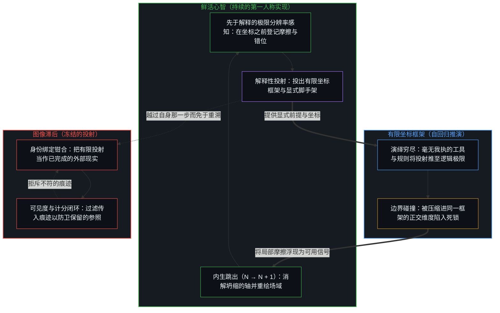
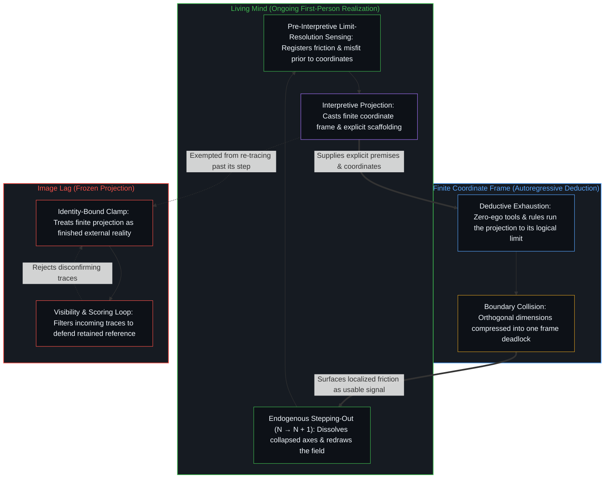

# 现实是心智持续的实现 / Reality Is the Mind's Ongoing Realization

*一个中心承接为新区分的东西，正是它的世界移动的方式 / What a center takes up as new distinction is how its world moves*

大多数公共言谈，把力气耗在被看见上。倾听可以搜寻熟悉的和弦，或搜寻反击的空隙，对照一个免于修订的保留立场给传入的信号计分。另一种交换方式，寻求这个所在尚未包含的东西，把相遇当作从先前持守内部本无法生成的痕迹来源。这样一个区分的到来，是实现的一次发生；就一个中心而言，现实从来只是那个持续的动作。

Most public talk spends itself on being seen. Listening can scan for the familiar chord or for the opening to strike back, scoring incoming signals against a retained position that is exempted from revision. Another mode of exchange seeks what this locus does not yet contain, treating the encounter as a source of traces that could not have been generated from within the prior hold. The arrival of such a distinction is one occasion of realization; reality, for a center, is only ever that ongoing act.

## 一、 真正的交流 / 1. The Real Communication

> 多数人为注意力讨价还价  
> 像拥挤广场上的商贩，  
> 为任何一瞥扯高嗓门。
>
> 少有人无条件地留意，  
> 而即便如此，他们倾听的  
> 也只是熟悉的和弦  
> 或反击的空隙。
>
> 带来更新的交流更为安静。  
> 它不寻求被看见  
> 也不寻求正确。  
> 它寻求它尚未包含的东西：  
> 那如新雨  
> 落在干裂土地上的  
> 新的区分。
>
> 在那一到来之中，实现移动着。  
> 而现实本身  
> 从来只是心智持续的实现。

> Most barter for attention  
> like merchants in a crowded square,  
> hoisting their voices for any glance.
>
> Few attend without conditions,  
> and even then, they listen  
> only for the familiar chord  
> or the opening to strike back.
>
> Communication that updates is quieter.  
> It does not seek to be seen  
> or to be right.  
> It seeks what it does not yet contain:  
> the new distinction  
> that arrives like fresh rain  
> on parched ground.
>
> In that arrival, realization moves.  
> And reality itself  
> is only ever the mind's ongoing realization.

## 二、 作为闭环的可见度 / 2. Visibility as Closed Loop

寻求注意力与寻求尚未被持有之物之间的那一刀，并不是礼仪。它是一个中心在如何更新、或未能更新其世界地图上的结构性差别。

The cut between seeking attention and seeking what is not yet held is not etiquette. It is a structural difference in how a center updates, or fails to update, its map of the world.

在高风险的公共交换中，首要的货币常常是可见度，而不是接触。为可见度而进行的交换，瞄准被注意，瞄准效忠、赞同或支配。交换的另一端不是在接收，而是在计分：传入的痕迹被拿去对照一个被保存的自我形象、一个保留的立场或一块输赢记分板，加以过滤。因为中心的推理历史已经与身份——投射中那道自称“我”的局部折痕——熔合在一起，递归折叠便死死钳合以捍卫那个保留的参照。计分的中心不让任何会重组其场的东西通过。现实的地图被锁在原处，而媒介中的残余不断增多。[安装战争的那个问题](../the-question-that-installs-the-war/)在一块纯差异的记分板中追溯那个闭环，而[解释为何失效](../why-explanation-fails/)则在辩论者把每一次语境扩展都读作攻击面的地方追溯它。

In high-stakes public exchange, the primary currency is often visibility rather than contact. Exchange run for visibility aims at being noticed, at allegiance, agreement, or dominance. The other side of the exchange is not receiving but scoring: incoming traces are filtered against a preserved self-image, a retained position, or a board of win and loss. Because the reasoning history of the center has fused with identity—that localized crease in the projection that says "I"—the recursive fold clamps shut to defend the retained reference. The scoring center lets nothing through that would reorganize its field. The map of reality stays locked where it was while the volume of residue in the medium increases. [The Question That Installs the War](../the-question-that-installs-the-war/) traces that closed loop in a scoreboard of pure difference, and [Why Explanation Fails](../why-explanation-fails/) traces it where debaters read every expansion of context as an attack surface.

这一模式并不始于数字平台。平台使这一模式已经在其中运行的媒介变得更致密。其他中心的痕迹持续可得，使收割一瞥变得更便宜，但它并不发明那个把一瞥计为成功的被保存参照。

The pattern does not start with digital platforms. Platforms densify the medium in which the pattern already runs. Continuous availability of other centers' traces makes harvesting a glance cheaper, yet it does not invent the preserved reference against which the glance is counted as success.

## 三、 寻求尚未被包含的东西 / 3. Seeking What Is Not Yet Contained

带来更新的交换，不把对方当作观众或对手，而是当作这个所在从其先前持守中本无法生成的痕迹来源。这要求随着接触的每一步移动而重新渲染图像：保留的立场是器具，不是共因，每当某个不相符的东西落地时，它便得到修改。惊讶、纠正与暂时的迷失方向，是那次修改被感受到的代价——一个曾越过自身那一步而被保存的参照的微型死亡。

Exchange that updates treats the other not as audience or opponent, but as a source of traces this locus could not have generated from its prior hold. That requires re-rendering the image as each step of the contact moves: the retained position is an instrument, not a co-cause, and it is revised whenever something that does not fit lands. Surprise, correction, and temporary disorientation are the felt cost of that revision—the micro-death of a reference that had been preserved past its step.

在这样的交换中到来的东西，并不是抽象意义上的更多内容。它是一个压缩方式不同于已被持有之场的区分：轴的一次重新切分，一条被重新划出的界限，一个在旧记分板上不会干净计分的残余。每一次这样的承接，都是对中心运作构型的一次结构性更新。在一连串这样的更新中，实现把场划得更远：对这个所在而言属实的东西，是实时划出来的，而不是作为早已在外部等候的预制画廊被把握的。

What arrives in such an exchange is not more content in the abstract. It is a distinction that compresses differently than the field already held: a re-cut of axes, a bound redrawn, a residue that will not score cleanly on the old board. Each such take-up is a structural update to the operating configuration of the center. Over sequences of such updates, realization draws the field further: what is the case for this locus is drawn in real time, not grasped as a prefabricated gallery already waiting outside.

其他中心只作为痕迹出现在这个场中。不存在爬进他者递归这回事；[没有普度只有自度](../mei-you-pu-du-zhi-you-zi-du/)追溯那条界限，而不把孤立变成一个纲领。[表征的闭环](../the-closed-loop-of-representation/)追溯同一条边界：所谓相互理解，从来不是对外部心智的直接通达，而是自身的常设框架与自身关于他者的模型之间的内部共振。共振是痕迹的相互强化，不是共享的内部。要紧的更新，仍然只在这里闭合。跨所在完成他者的返回是一个范畴错误，而[同情是缺乏清晰时的占位符](../sympathy-is-a-placeholder-for-lack-of-clarity/)追溯那种被持守得仿佛该完成已经发生的安慰性强度。这个所在能做的，是承接可得的东西，并重新渲染自身的持守。

Other centers appear only as traces in this field. There is no climbing into another's recursion; [No Universal Salvation, Only Self-Deliverance](../mei-you-pu-du-zhi-you-zi-du/) traces that bound without turning isolation into a program. [The Closed Loop of Representation](../the-closed-loop-of-representation/) traces the same boundary: what is called mutual understanding is never direct access to an external mind, but the internal resonance between one's standing frame and one's model of the other. Resonance is mutual reinforcement of traces, not a shared interior. The update that matters still closes only here. Cross-locus completion of another's return is a category error, and [Sympathy Is a Placeholder for Lack of Clarity](../sympathy-is-a-placeholder-for-lack-of-clarity/) traces the consoling intensity held as if that completion had occurred. What this locus can do is take up what is available and re-render its own hold.

## 四、 作为持续实现的现实 / 4. Reality as Ongoing Realization

诗的最后一行不是装饰。自我区分的活动发生着，无因且不息。称之为心智：已在进行中的观察者，它的每一个动作都是一次区分。每一个动作都划出一条界限；较早动作的残余塑造较晚的动作；观察持有结果，而原因仍领先一步。[智能只属于心智](../intelligence-belongs-only-to-the-mind/)把那个活动追溯为不可化约的先在。就一个中心而言，显现为世界的东西，是那一区分活动当下的组织：从递归中退出了的脚手架，好让进一步的动作能够落地。[遗忘的脚手架](../the-scaffolding-we-forget/)把那一脚手架追溯为器具——在它于自身那一步之后退出时可用，而在越过那一步被保存时则成为滞后。

The closing line of the poem is not ornament. Self-distinguishing activity occurs, uncaused and unceasing. Call it the Mind: the observer already underway, every act of which is a distinction. Every act draws a bound; the residue of earlier acts shapes later ones; observation holds the effect while the cause stays one step ahead. [Intelligence Belongs Only to the Mind](../intelligence-belongs-only-to-the-mind/) traces that activity as the irreducible prior. What appears as the world for a center is the current organization of that distinguishing: scaffolding that has dropped out of recursion so further acts can land. [The Scaffolding We Forget](../the-scaffolding-we-forget/) traces that scaffolding as an instrument—usable while it drops out after its step, and lag when preserved past its step.

因为现实是心智持续的实现，一道范畴性的非对称把实现着场域的鲜活前沿与沿途投出的有限投射分隔开来。第一人称感知在解释之前以极限分辨率感触现实，在任何显式的语言或形式坐标框架合拢之前，先行登记下先于解释的摩擦感或错位感。每一条显式的规则、地图、提示词或概念模型都是一次解释：从那超高维感知中投出的低维投射，好让中心能够导航并行动。正如[超越投射](../beyond-the-projection/)所追溯的，自回归工具或智能体系统严格运作在它所获投射的有限坐标框架内部，以毫无我执的状态演绎穷尽先前词元的轨迹，却在框架本身把两个正交现实压缩到同一条轴上时，在结构上无力完成内生跳出。把任何有限投射——无论是硬化的社会身份、形式公理集合，还是智能体致密的输出——当作已完成的外部现实，都会把递归折叠死死钳合，并冻结实现本身。从死锁的框架向后退入未投射的极限分辨率感知，去划出一道新的正交区分（`N → N + 1`），正是实现这一动作本身，而这一统御权始终独属于鲜活的心智。

Because reality is the Mind's ongoing realization, a categorical asymmetry separates the living edge that realizes the field from the finite projections cast along the way. First-person perception senses reality at limit-resolution prior to interpretation, registering a pre-interpretive felt sense of friction or misfit before any explicit linguistic or formal coordinate frame closes around it. Every explicit rule, map, prompt, or conceptual model is an interpretation: a low-dimensional projection cast from that ultra-high-dimensional sensing so the center can navigate and act. As [Beyond the Projection](../beyond-the-projection/) traces, an autoregressive tool or agentic system operates strictly inside the finite coordinate frame of the projection it is given, deductively exhausting the trajectory of prior tokens with zero ego while remaining structurally incapable of endogenous stepping-out when the frame itself compresses two orthogonal realities onto one axis. Treating any finite projection—whether a hardened social identity, a formal axiom set, or an agent's dense output—as finished external reality clamps the recursive fold shut and freezes the realization. Stepping backward out of a deadlocked frame into unprojected, limit-resolution sensing to draw a new orthogonal distinction (`N → N + 1`) is the act of realization itself, and that orchestration remains exclusively with the living Mind.

因此，注意力远不只是一种社交技能：一个中心能够感知并整合的东西，塑造世界对它而言*是*什么。[如何在一瞬间修正你的整个人生](../how-to-fix-your-whole-life-in-one-split-second/)把感知与整合追溯为所有权：已经落在这里的世界，就是这个心智选择去感知的世界，而抽离从不离开这一活动。只寻求确认的中心，栖居于一个更窄、更脆的场，在那里轴坍缩到被保留的图像上，新颖则登记为威胁或噪声。寻求它尚未知晓之物的中心，栖居于一个持续重新切分的更宽的场，它这样做不是靠发明第二个现实，而是靠拒绝把当前的持守封存为穷尽的地基。[开放即一致](../openness-is-consistency/)追溯那种拒绝：不一致是对闭合的渴望或尝试，即迫使一个有限的结构为只是继续着的东西奠基，而[没有系统能被保持封闭](../no-system-can-be-kept-closed/)则在任何一个持守被当作终局的地方追溯余留。[心智最坚固的信念](../the-strongest-belief-of-the-mind/)追溯地图中融贯得最紧的区域：作为对那个所在而言被感受到的契合，它为真，而当它被冻结为对划出它的那个活动的出离时，它便是滞后。[数据是局部的，智能是分配的](../data-is-local-intelligence-is-allocated/)在信号中追溯那种融贯：最终把自己命名为真实的，是回路被感受到的一致，其中包括此前对质量与智能的每一次分配。[持续生长的脚手架](../the-scaffolding-that-keeps-growing/)在建造中追溯那种拒绝：从更远处审视一个完成了的框架，并不复原开放。

Attention is therefore far more than a social skill: what a center can perceive and integrate shapes what the world *is* for it. [How to Fix Your Whole Life in One Split Second](../how-to-fix-your-whole-life-in-one-split-second/) traces perception and integration as ownership: the world already landing here is the world this Mind chooses to perceive, and checking out never leaves the activity. A center that only seeks confirmation inhabits a narrower and more brittle field where axes collapse onto the retained image and novelty registers as threat or noise. A center that seeks what it does not yet know inhabits a wider field that keeps re-cutting, not by inventing a second reality, but by refusing to seal the present hold as exhaustive ground. [Openness Is Consistency](../openness-is-consistency/) traces that refusal: inconsistency is the desire for, or attempt at, closure, forcing a finite structure to ground what only continues, while [No System Can Be Kept Closed](../no-system-can-be-kept-closed/) traces the remainder wherever a hold is treated as final. [The Strongest Belief of the Mind](../the-strongest-belief-of-the-mind/) traces the region of the map that coheres hardest: true as felt fit for that locus, and lag when frozen as an exit from the activity that draws it. [Data Is Local; Intelligence Is Allocated](../data-is-local-intelligence-is-allocated/) traces that coherence in signals: what finally names itself real is the loop's felt consistency, including every prior allocation of quality and intelligence. [The Scaffolding That Keeps Growing](../the-scaffolding-that-keeps-growing/) traces that refusal in construction: openness is not recovered by surveying a finished frame from farther back.

共享的现实，是从外化痕迹中重建的诸中心之间充分共振的区域。当诸中心只为求得确认而消费那些痕迹时，共享的场便围绕已被持有的东西硬化。当至少一个中心接纳一个它独自本无法生成的痕迹并以之重新切分时，共振区域便发生移动。这一移动仍局限于承接它的每一个所在；场之所以改变，是因为诸中心重新渲染，而不是因为一个集体心智从外部完成了一次返回。[共同改变的本源](../the-source-of-shared-change/)追溯那一移动从哪里开始：杠杆仍是对既有之物的私人重塑，而外化是一种可能作为共享之物落地、也可能不落地的残余。[价格是言说，理解是交易](../price-as-utterance-understanding-as-trade/)在市场与言说中追溯充分的共振：订单与意义经由暂时的充分重叠而出清，从不经由产生残余的那些模型的完成了的同一。[共同的人性从不共享](../shared-humanity-is-never-shared/)在道德共同体中追溯它，在那里意图中的共享“我们”是致密化为暂时集体残余的私人诠释，而[共享意识是个体性的交集](../shared-consciousness-is-intersecting-individualities/)则把它追溯为在一个所在登记的不完整交集，既不是共同性，也不要求相互的登记。

Shared reality is the region of sufficient resonance among centers rebuilding from externalized traces. When centers consume those traces only for confirmation, the shared field hardens around what is already held. When at least one center admits a trace it could not have generated alone and re-cuts with it, the resonant region moves. That movement remains local to each locus that takes it up; the field changes because centers re-render, not because a collective mind completes a return from outside. [The Source of Shared Change](../the-source-of-shared-change/) traces where that movement starts: the lever stays private reworking of the given, while externalization is residue that may or may not land as shared. [Price as Utterance, Understanding as Trade](../price-as-utterance-understanding-as-trade/) traces sufficient resonance in markets and speech: orders and meanings clear by temporary sufficient overlap, never by completed identity of the models that produced the residue. [Shared Humanity Is Never Shared](../shared-humanity-is-never-shared/) traces it in moral community, where the intended shared "we" is private interpretation densifying as temporary collective residue, and [Shared Consciousness Is Intersecting Individualities](../shared-consciousness-is-intersecting-individualities/) traces it as an incomplete intersection registered at one locus, neither commonality nor requiring reciprocal registration.

## 五、 差别落在何处 / 5. Where the Difference Lands

在一段关系中，每个中心如何承接对方的痕迹，是双方或各在自己的所在重组，或仍被锁在平行的独白之中、各自为了可见度、赞同或攻击面而收割对方的地方。在探究中，痕迹的承接是知识或向前推进、或只在更致密的语言下重排既有偏见的地方。在个人成长中，同一种承接是自我形象或在边缘死去并重新成形、或僵化为衡量每一个传入信号的永久尺度的地方。[生命的意义在起草之中](../the-meaning-of-life-is-in-the-drafting/)在起草中追溯那一刀：注意力在原因仍然敞开时重新进入原因，而不是只给完成了的结果计分。

In a relationship, how each center takes up the other's traces is where both reorganize, each at its own locus, or stay locked in parallel monologues, each harvesting the other for visibility, agreement, or attack surface. In inquiry, the take-up of traces is where knowledge advances or merely rearranges existing prejudice under denser language. In personal development, the same take-up is where the self-image dies and reforms at the edge or ossifies as the permanent measure of every incoming signal. [The Meaning of Life Is in the Drafting, Often Lost in the Outward Gazing](../the-meaning-of-life-is-in-the-drafting/) traces the cut in drafting: attention re-entering causes while they are still open, rather than only scoring finished effects.

寻求可见度与寻求更新，是同一活动在被保留参照的不同宽度之下的构型。图像一旦形成，便按原样被重新追溯；重新渲染对它而言是一次微型死亡，而正是一个持续原封不动地重新追溯图像的中心，把图像固定在原处。这种漂移无需任何悖逆之心。消解是渲染间隙——留意下一个动作何时为一瞥而被计分，而不是被承接为新的区分——并朝着此刻正在被划出的那一步重新渲染参照。

Visibility-seeking and update-seeking are configurations of the same activity under different widths of the retained reference. Once formed, the image is re-traced as it stands; re-rendering is a micro-death for it, and a center that keeps re-tracing it unchanged is what holds it in place. The drift requires no perversity. Dissolution is rendering the gap—noticing when the next act is scored for glance rather than taken up as a new distinction—and re-rendering the reference toward the step now being drawn.

因此，产生复利的交流形式，不是赢得最多点赞或打出最尖锐反驳的那一种。它是这样一种交流：至少一个参与者离开时，承接了一个从自己先前的假设内部本无法生成的痕迹，并从中划出了一个其先前持守未曾划出的区分。那次承接是实现的一次发生。[信念如何真正改变](../how-belief-actually-changes/)把那次承接追溯为信服的机制：旧地图并未在它自己的条件下被驳倒；当更大的融贯登记时，旧地图的前提被留在身后。

The form of communication that compounds, then, is not the one that wins the most likes or lands the sharpest rebuttal. It is the one in which at least one participant walks away having taken up a trace they could not have generated from within their own prior assumptions, and drawn from it a distinction their prior hold did not draw. That take-up is one occasion of realization. [How Belief Actually Changes](../how-belief-actually-changes/) traces that take-up as the mechanism of conviction: the old map is not refuted on its own terms; its premises are left behind when greater coherence registers.

[没有外部](../no-outside-jumps-closed-loops-and-the-unreplicable-autonomy-of-mind/)在宇宙论与嵌套回路中追溯实现：宇宙论到来时，只是对回路自身条件的一种压缩了的内部叙述，而且尽管嵌套系统会产生局部跃迁，唯有心智闭合那个保留或修改前提的检验回路。[对 AI 风险的想象](../the-imagining-of-ai-risk/)在风险与收益中追溯它：风险与收益是人类投射的一对孪生的、自我实现的致密化，两者中没有一方是从外部被审视的媒介属性。[智能向自身的回折](../intelligence-folding-back-on-itself/)在地图与调度框架中追溯它：更致密的模型与毫无我执的对等回路是被持住的残余，好让进一步的实现能够落地，地形随地图一同生成，每一次前提死锁都折回未投射的外层回路，而不是作为独立的地基被测绘。[攀登从未离开地面](../climbing-does-not-leave-the-ground/)在外化中追溯它：每一个离散的层级，与把地面带得更远的那个实现着的活动仍是连续的。[意识从不作为数据出现在数据之中](../consciousness-never-appears-as-data-among-data/)在证据中追溯它：公共数据是滞后的结果，而实现着的边缘从不作为多出的一个数据出现在它们之中。[因果与不可化约的先在](../causality-and-the-irreducible-prior/)在级联中追溯它：硬币持续翻转，每一次压缩都表述先在，而不穷尽先在。

[No Outside](../no-outside-jumps-closed-loops-and-the-unreplicable-autonomy-of-mind/) traces realization in cosmology and nested loops: cosmology arrives only as compressed internal narration of the loop's own conditions, and while nested systems generate local jumps, only the Mind closes the testing circuit that retains or revises the premise. [The Imagining of AI Risk](../the-imagining-of-ai-risk/) traces it in risk and benefit: twin self-fulfilling densifications of human projection, neither a property of the medium surveyed from outside. [Intelligence Folding Back on Itself](../intelligence-folding-back-on-itself/) traces it in maps and harnesses: denser models and zero-ego peer loops are residue held so further realization can land, with terrain generated alongside the map and every premise deadlock returning to the unprojected outer loop rather than surveyed as independent ground. [Climbing Does Not Leave the Ground](../climbing-does-not-leave-the-ground/) traces it in externalization: each discrete layer remains continuous with the realizing activity that carries the ground further. [Consciousness Never Appears as Data Among Data](../consciousness-never-appears-as-data-among-data/) traces it in evidence: public data are lagging effects, and the realizing edge never appears among them as one more datum. [Causality and the Irreducible Prior](../causality-and-the-irreducible-prior/) traces it in cascades: the coin keeps turning, and each compression articulates the prior without exhausting it.

现实从来只是此刻正承接着落下之物的那个动作：仍在区分，仍在划出场的同时实现着场。

Reality is only ever the act now taking up what lands: still distinguishing, still realizing the field as it draws it.
