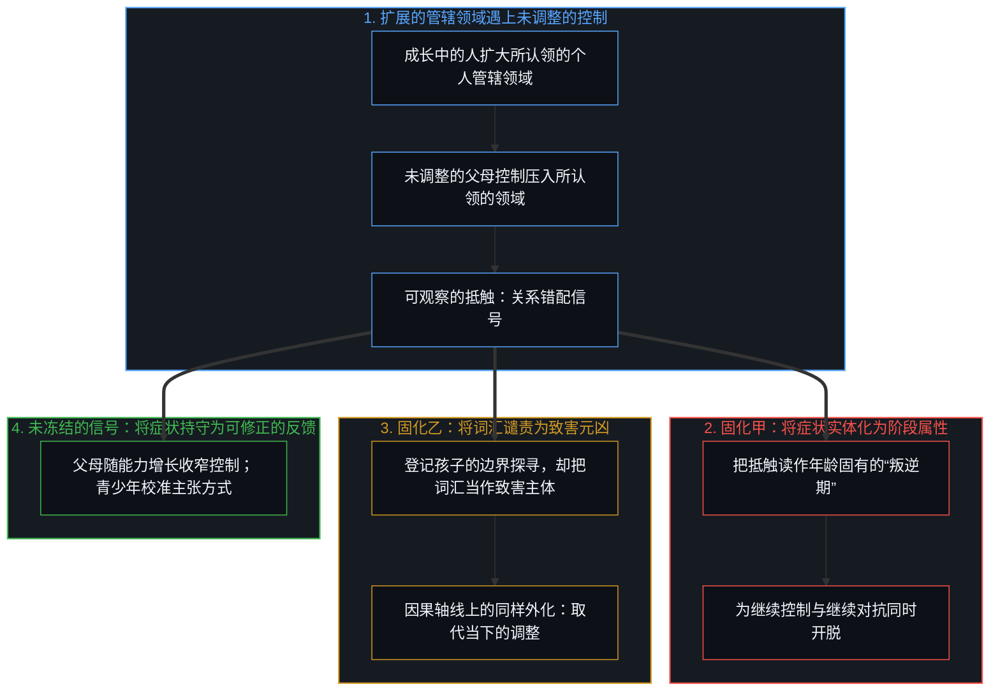
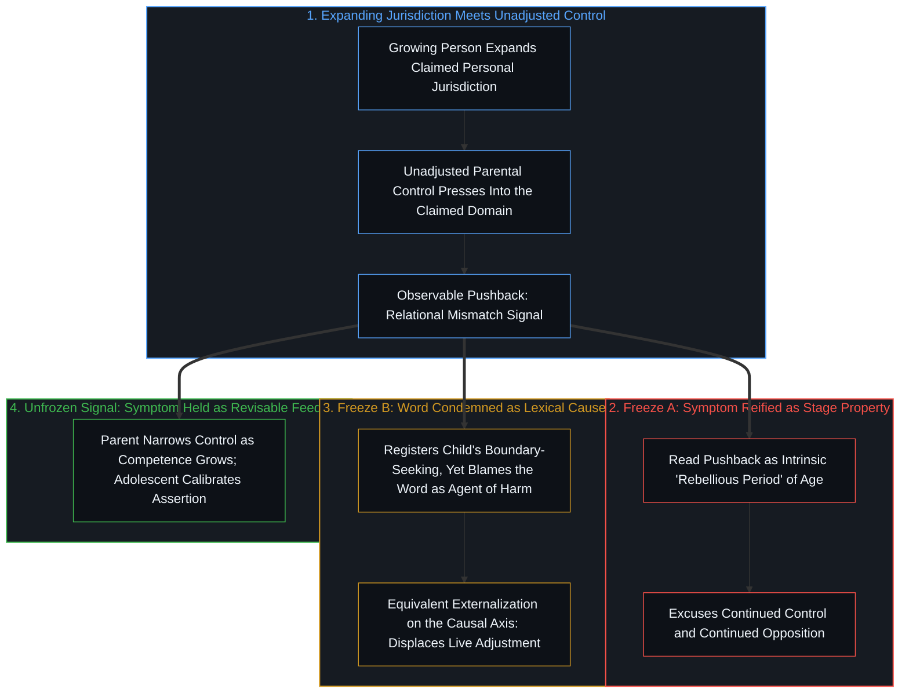
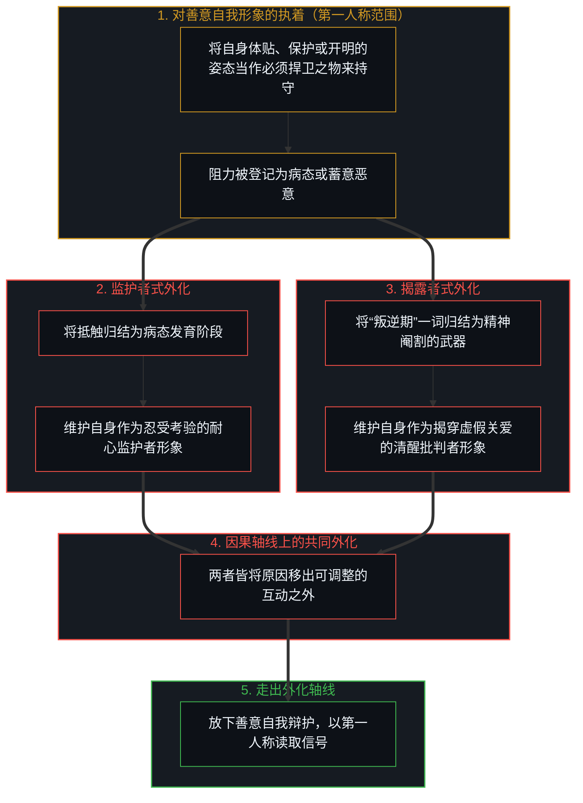
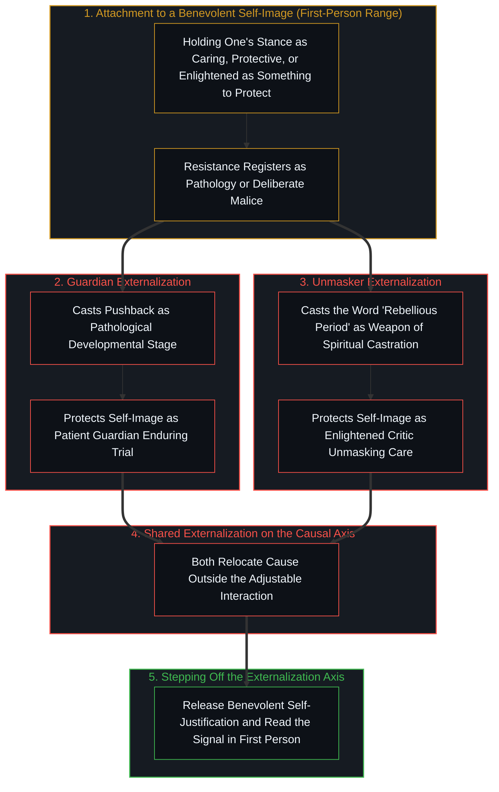

# 叛逆是症状而非属性 / Rebellion as Symptom, Not Property

*把关系中的抵触固化为阶段属性或归咎于“叛逆期”一词，都会把原因移出仍可调整的互动之外。 / Freezing relational pushback into a stage property or blaming the word itself relocates cause outside the interaction that can still adjust.*

自我区分的活动发生着——无因，不息。称之为“心智”：那已然在途的观察者，其每一行动皆是一次区分。通行的“叛逆期”说法，把一种关系的结果当成了成长过程固有的属性，重演了[对象是被稳定化的关系](../objects-are-stabilized-relationships/)所追溯的实体化。由于青少年所认领的自主、身份与个人管辖领域不断扩展，而父母的控制在范围或方式上尚未相应收窄——[引导不是占有](../guidance-is-not-ownership/)在此标出了移交主权与执意占有之间的分界——那尚未调整的控制便压入新认领的领域，抵触随之作为这一错配的可观察症状而显现。因此，所谓“叛逆期”并非成熟过程本身的属性，而是互动所产生的偶然结果。

Self-distinguishing activity occurs — uncaused, unceasing. Call it the Mind: the observer already underway, every act of which is a distinction. The common designation of a “rebellious period” treats a relational outcome as if it were an intrinsic feature of growing up, repeating the reification traced in [Objects Are Stabilized Relationships](../objects-are-stabilized-relationships/). Because an adolescent’s claimed domain of autonomy, identity, and personal jurisdiction expands while parental control has not yet narrowed in scope or style—where [Guidance Is Not Ownership](../guidance-is-not-ownership/) marks the boundary between transferring sovereignty and holding onto possession—that unadjusted control presses into the newly claimed domain, and pushback appears as the observable symptom of the mismatch. The “period” is therefore not a property of maturation, but a contingent product of the interaction.

## 一、 把信号固化为阶段属性或词汇元凶 / 1. Freezing the Signal into Stage Property or Lexical Cause

凡父母的控制随孩子能力增长而收窄之处，边界错配便随之消退；凡个人领域内寻常的边界试探被当作亟待压制的问题之处，对自由受威胁的感知便会激起心理抗拒，推动对抗并使冲突升级。跨文化与实验证据与这一次序相吻合：在区分正当权威（安全、道德）与个人领域、并随能力增长收窄控制的自主支持条件下，同样的发展轨迹产生的对抗要少得多。把症状当作固有属性，便短路了它原本可以提供的反馈，恰如[道德语言稀释自由复利的反馈](../moral-language-dilutes-the-feedback-that-scales-freedom/)与[强求善意的残暴与范畴反馈的因果遮蔽](../compulsory-kindness-and-the-obscuration-of-categorical-feedback/)所追溯的那样——每当道德化标签取代结构性反馈，校准便告中断。这一抵触对双方而言本是信息：父母可以重新校准哪些边界不可谈判、并转向协商；青少年则可以尝试不那么极端的自我主张方式。将该阶段命名为天生叛逆，便冻结了这一信号。它提供了一套现成的解释，既为一方继续控制开脱，也为另一方继续对抗开脱，将冲突锁死在原地，而非容许双方相互调整。

Where parental control narrows as competence grows, the boundary mismatch recedes; where ordinary boundary-testing in personal domains is treated as a problem to be suppressed, psychological reactance is elicited as the perceived threat to freedom motivates opposition and escalates the conflict. Cross-cultural and experimental evidence is consistent with this order, showing that the same developmental trajectory produces far less opposition under autonomy-supportive conditions that distinguish legitimate authority (safety, morality) from personal domains and that narrow control as competence grows. Treating the symptom as a property short-circuits the feedback it could provide, much as [Moral Language Dilutes the Feedback That Scales Freedom](../moral-language-dilutes-the-feedback-that-scales-freedom/) and [Compulsory Kindness and the Obscuration of Categorical Feedback](../compulsory-kindness-and-the-obscuration-of-categorical-feedback/) trace whenever moralized labels replace structural feedback. The pushback is information for both parties: parents can recalibrate the boundaries they treat as non-negotiable and shift toward negotiation; adolescents can test less extreme forms of assertion. Naming the phase as intrinsically rebellious freezes this signal. It supplies a ready explanation that excuses continued control on one side and continued opposition on the other, locking the conflict in place rather than allowing mutual adjustment.

当人们反过来把“叛逆期”这一词汇本身谴责为造成困境的恶意源头时，因果轴线上便发生了平行的固化。第一条轴线关乎如何解读孩子的抵触，在这条轴线上，两种做法有所不同：家长式的读法将抵触固化为与年龄绑定的缺陷，而对“叛逆期”一词的批判则将抵触登记为边界探寻（独立思考与初显的自我），并将这一位置归还给成长中的人。然而第二条轴线关乎把困境的原因安放在何处，在这条轴线上，将该词的发明或文化使用谴责为实施“精神阉割”的工具，做出的却是同样的外化：它把一件本可灵活取用的解释工具变成了固定的因果施动者，将实用记号误作自主运转的力量，正如[遗忘的脚手架](../the-scaffolding-we-forget/)、[目的性的评判与认知的缺省状态](../cong-mu-di-xing-de-ping-pan-kan-ren-zhi-que-sheng/)与[外部归因是个人进步的障碍](../wai-bu-gui-yin-ge-ren-jin-bu-de-zhang-ai/)所诊断的那样。在这两种情形下，重新协商自主边界的实际任务，都被一场关于“发育本质”或“词汇工具性”的争论所取代。

A parallel freezing on the causal axis occurs when the term itself is condemned as the malicious source of the difficulty. On the first axis—how the child's pushback is read—the two moves differ: whereas the paternalistic reading freezes the pushback into an age-bound defect, the critique of the word “rebellious period” registers the pushback as boundary-seeking (independent thought and emerging selfhood) and restores that locus to the growing person. Yet on the second axis—where the cause of the difficulty is placed—condemning the invention or cultural use of the word as an instrument of spiritual castration performs an equivalent externalization: it converts a flexible interpretive tool into a fixed causal agent, mistaking pragmatic notation for an autonomous force in the way [The Scaffolding We Forget](../the-scaffolding-we-forget/), [Judging by Purpose and the Default State of Cognition](../cong-mu-di-xing-de-ping-pan-kan-ren-zhi-que-sheng/), and [External Attribution Is the Obstacle to Personal Growth](../wai-bu-gui-yin-ge-ren-jin-bu-de-zhang-ai/) diagnose. In both cases, the practical task of renegotiating autonomy is displaced by an argument about developmental essence or lexical instrumentality.

## 二、 维护善意自我形象如何生成恶意 / 2. How Protecting a Benevolent Self-Image Generates Malice

支撑这两种外化的是同一条机制，它在第一人称范围内生效：每当一个中心维护善意的自我形象，它便运作起来。如[恶是心智自己的造物](../evil-as-the-minds-own-creation/)、[善恶是硬币的两面与那一刀](../good-and-evil-are-the-two-sides-of-the-coin-and-the-cut/)与[外化善意走向其反面](../externalized-virtue-becomes-its-opposite/)所确立的那样，执着于让自己显得善意，会在实践中产生一项需求：把遇到的阻力塑造成恶意或缺陷。只要那份善意的自我形象——体贴、开明或保护性的——被当作必须捍卫之物来持守，任何与之相悖的东西都会被登记为病态或蓄意伤害。

What sustains both externalizations is a mechanism that holds in first-person range whenever a center protects a benevolent self-image. As established in [Evil as the Mind's Own Creation](../evil-as-the-minds-own-creation/), [Good and Evil Are the Two Sides of the Coin and the Cut](../good-and-evil-are-the-two-sides-of-the-coin-and-the-cut/), and [Externalized Virtue Becomes Its Opposite](../externalized-virtue-becomes-its-opposite/), the attachment to being seen as benevolent creates a practical requirement to cast resistance as malicious or defective. While that benevolent self-image—caring, enlightened, or protective—is held as something to protect, whatever opposes it registers as pathology or deliberate harm.

把寻求自主框定为病态的发育阶段，让监护姿态得以将自身持守为忍受成长考验的耐心保护者。把词汇本身框定为精神阉割的工具，则让揭露姿态得以将自身持守为看穿虚假关爱的清醒捍卫者——而这两种姿态依然停留在[正交的拒绝](../the-orthogonal-refusal/)所追溯的同一条“顺从—抗拒”轴线上。在这一步上，每一种归因都通过把困境的源头移出仍可调整的互动之外，来维护自身的善意自我形象（[自尊的刚性外壳与隐性外部归因](../zi-zun-de-gang-xing-wai-ke-yu-yin-xing-wai-bu-gui-yin/)）。如[恶是投射出的抗拒](../evil-as-projected-resistance/)所追溯的那样，恶意并非在词汇、文化、父母或年龄阶段中被发现的；生成恶意的是解释行动本身：它把关系中的反馈信号固化为内在属性，或固化为蓄意害人的武器。

Framing autonomy-seeking as a pathological stage lets the guardian stance hold itself as a patient protector enduring a developmental trial. Framing the word itself as an instrument of spiritual castration lets the unmasking stance hold itself as the enlightened defender who sees through false care—while both stances remain on the same compliance-versus-resistance axis traced in [The Orthogonal Refusal](../the-orthogonal-refusal/). At that step, each attribution protects a benevolent self-image ([The Rigid Shell of Self-Esteem and Hidden External Attribution](../zi-zun-de-gang-xing-wai-ke-yu-yin-xing-wai-bu-gui-yin/)) by relocating the source of difficulty outside the interaction that could still be adjusted. As [Evil as Projected Resistance](../evil-as-projected-resistance/) traces, the malice is not discovered in the word, the culture, the parent, or the stage; it is generated by the interpretive act that freezes a relational feedback signal into an intrinsic property or a deliberate weapon of harm.

## 三、 回到对信号的第一人称读取 / 3. Returning to the First-Person Reading of the Signal

当信号被固化为阶段属性或恶意词汇时，寻常的自主边界重议便化作了有待忍受的磨难或有待揭穿的敌人，再现了[一切伤害的根源](../the-source-of-all-harm/)与[道德语言作为投影](../moral-language-as-projection/)所追溯的动态。一个词本身并无恶意；唯有当解释用它来为未调整的控制开脱，或将冲突归咎于词典时，它才产生后果。把抵触称为“症状”，唯有在被持守为可修正的工具时才不会安放新的本质；倘若被当作固定的诊断，它便会像“叛逆期”一样把孩子病理化。当这个词由读取眼前摩擦的那一个第一人称持守为提示——无论是随能力增长收窄控制，还是校准主张边界的方式——而不是被当作从互动之上的席位替双方写好的剧本时，它便只是让当下的调整留在视野之中。

When the signal is frozen into either a stage property or a malicious word, ordinary autonomy renegotiation turns into a trial to be endured or an enemy to be unmasked, reproducing the dynamic traced in [The Source of All Harm](../the-source-of-all-harm/) and [Moral Language as Projection](../moral-language-as-projection/). A word has no malice of its own; it becomes consequential through the interpretation that uses it either to excuse unadjusted control or to blame the lexicon for the conflict. Calling the pushback a “symptom” installs no new essence only while it is held as a revisable instrument; taken as a fixed diagnosis, it would pathologize the child just as “rebellious period” does. Held as a cue by the one first person reading the friction in front of oneself, whether narrowing control as competence grows or calibrating how a boundary is asserted, rather than as a script for both parties from a seat above the interaction, the term simply keeps the live adjustment in view.
