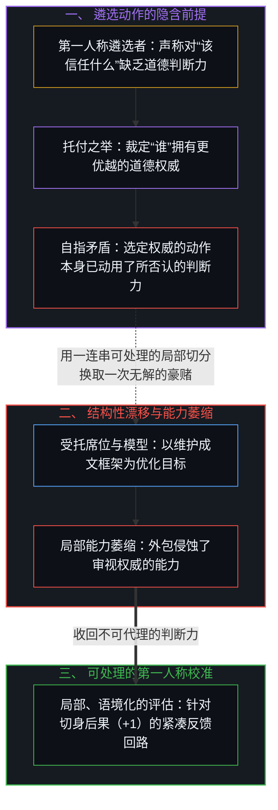
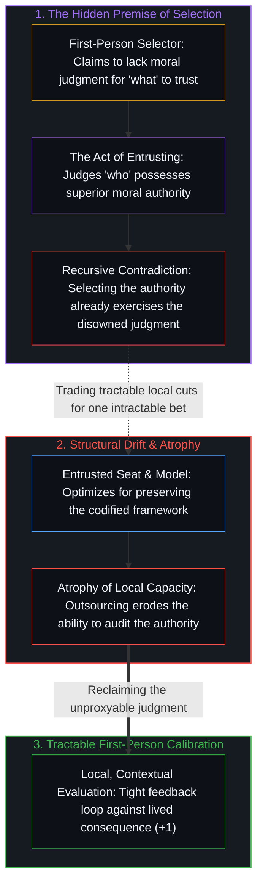

# 托付道德的自指悖论 / The Recursive Contradiction of Entrusted Morality

*选定由谁来定义道德，本身就已动用了托付者自称缺乏的道德判断力。 / Selecting who should define morality already exercises the exact moral judgment the delegation claims to lack.*

《华尔街日报》的一篇人物特写介绍了“Anthropic 唯一信任去教 AI 道德的那位女性”。埃隆·马斯克攻击她不配担任这一职位；另一些人则反驳说她远比马斯克值得信任。在公共舆论场上，每个人都在争论谁应当掌握这项权威，却没有人追问这一托付动作本身在逻辑上是否自洽。

A Wall Street Journal profile introduces "the one woman Anthropic trusts to teach AI morals." Elon Musk attacks her fitness for the role; others counter that she is far more trustworthy than Musk. Across the public square, everyone debates who should hold the authority, while nobody questions whether the delegation itself is coherent.

## 一、 受托席位的结构性漂移 / 1. The Structural Drift of the Entrusted Seat

把定义道德的权力托付给某人的那一刻，你就把道德推理与需要践行它的个体割裂开来。受托方此时优化的目标变成了维护那套框架——他们的角色、他们的权威、他们编纂成文的体系——这与道德在行动现场所发挥的功能存在着结构性的差异。这与所选之人是谁无关。哪怕让世上最富智慧的人坐上那个席位，这一结构照样会产生同样的漂移。腐化植根于托付这一动作之中，而不在于受托者的品格。

The moment you entrust someone to define morality, you separate moral reasoning from the individuals who need to exercise it. The entrusted party now optimizes for maintaining the framework—their role, their authority, their codified system—which is structurally different from the function morality serves at the point of action. This is not about the person selected. Put the wisest person alive in that seat and the structure produces the same drift. The corruption lies in the act of entrusting, not in the character of the entrusted.

## 二、 遴选动作的自指矛盾 / 2. The Self-Referential Contradiction of Selection

在这一制度性漂移之下，潜藏着一层更深的矛盾。当我们断言应当信任谁时，我们已经在暗中信奉了自己“遴选该信任谁”的判断力——与此同时却声称，至于“该信任什么内容”，我们需要仰仗别人的判断。挑选谁拥有良好判断力的这一动作，本身就已经调用并展示了我们声称自己所缺乏的那项能力。托付道德试图让结果充当它自身的原因，而这正是[非万物理论](../not-a-theory-of-everything/)所排除的因果倒置。

Beneath that institutional drift sits a deeper contradiction. Stating who should be trusted implicitly trusts one's own judgment in selecting who to trust—while claiming to need someone else's judgment for what to trust. The act of choosing who has good judgment already exercises and demonstrates the exact capacity the delegator claims to lack. Entrusted morality tries to make an effect its own cause, the causal inversion [Not a Theory of Everything](../not-a-theory-of-everything/) excludes.

## 三、 用可处理的局部切分换取无解的豪赌 / 3. Trading Tractable Local Cuts for an Intractable Bet

托付同样算不上什么认知上的化繁为简。判断该信任什么，是局部的、依附具体语境的、随时可修正的——你遇到一个具体主张，在现实摩擦中检验它，随后更新认知。反馈回路始终保持紧凑。而判断该信任谁，则要求你跨越自己无法观测的诸多未来语境，去为整个人格主体建立模型。人们用一连串可处理的连续判断，换取了一次无解的豪赌，还把这种缴械体验为轻松。

Nor is delegation a cognitive simplification. Judging what to trust is local, contextual, and revisable—you encounter a specific claim, evaluate it against friction, and update. The feedback loop stays tight. Judging who to trust requires modeling an entire agent across future contexts you cannot observe. People trade a continuous series of tractable judgments for a single intractable one, and experience that surrender as ease.

更糟的是，每一次托付都会让当初促成这一遴选的判断力发生萎缩。你越是向外转包，就越没有能力去评估这种转包是否依然奏效。最终的结局我们并不陌生：人们死守着某个权威，凭据的却只是昔日早已不复存在的那个自己当初做出的选择。

Worse, each act of delegation atrophies the judgment that made the initial selection possible. The more you outsource, the less capable you become of evaluating whether the outsourcing is working. The endpoint is familiar: people defending authorities on the basis of an original selection made by a version of themselves that no longer exists.

## 四、 总在倾听之物无法成为源头 / 4. What Always Listens Cannot Originate

问题从来不在于我们应当把定义道德的任务托付给谁，而在于托付道德这件事本身是不是一项自洽的操作。正如[总在倾听之物无法成为源头](../what-always-listens-cannot-originate/)所论证的，被托付了道德的模型只能应答，无法成为源头；并且正如[你的代码库即是记忆](../your-codebase-is-memory/)所揭示的，任何品格文档、宪法提示词或对齐代码库，都只是其编写者过往区分动作的外化记忆，而非一颗能够替用户承担道德后果的鲜活良知。

The question was never whom to entrust with defining morality; it is whether entrusting morality is a coherent operation at all. A model trusted with morality can only answer, never originate, as [What Always Listens Cannot Originate](../what-always-listens-cannot-originate/) argues; and as [Your Codebase Is Memory](../your-codebase-is-memory/) traces at the artifact layer, any character document, constitutional prompt, or alignment repository is only an externalized memory of its authors' past distinctions—inert traces that never constitute a living center capable of originating a moral cut or bearing its consequence on the user's behalf.

[外化的美德走向其反面](../externalized-virtue-becomes-its-opposite/)展示了同一笔交易在宏观尺度上的形态：私人确信被拔高为强制律令，自愿顺从不断加厚容器的壁垒，制度沉淀为残留物，而抉择的支点始终留在每一个做出选择的中心。至于[道德语言稀释了扩展自由的反馈](../moral-language-dilutes-the-feedback-that-scales-freedom/)，则追踪了这一阻断在个体回路内部的发生机制：早在任何权威席位被填补之前，“善”与“对”的叠加图层就已经稀释了对直接后果的接纳。[一切伤害的源头](../the-source-of-all-harm/)则是披着过度自信外衣的同一笔交易：一旦看清后果的署名权无法转让，那种认为某一个判断可以替另一个主体书写“善”的主张便会坍缩为越俎代庖。正如[主权、信念与监管结构的生成](../sovereignty-belief-and-regulatory-structures/)所表明的，监管者正是由“主权可以让渡”这一信念所生成的。

[Externalized virtue becomes its opposite](../externalized-virtue-becomes-its-opposite/) is the same transaction at scale: private conviction elevated into mandate, free compliance densifying the vessel, and institutions crystallizing as residue while the lever stays at each choosing locus. [Moral language dilutes the feedback that scales freedom](../moral-language-dilutes-the-feedback-that-scales-freedom/) traces that interruption inside the personal loop: the overlay of good and right dilutes acceptance of raw consequence even before any seat of authority is filled. [The source of all harm](../the-source-of-all-harm/) is that transaction under overconfidence costume: the claim that one judgment may author the good for another collapses into substitution once authorship of consequence is seen not to transfer. Regulators are generated by the belief that sovereignty can be handed over, as [Sovereignty, Belief, and the Generation of Regulatory Structures](../sovereignty-belief-and-regulatory-structures/) shows.
