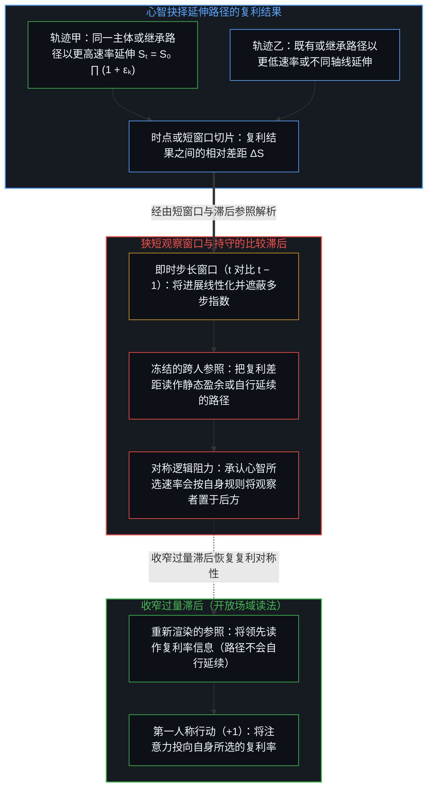
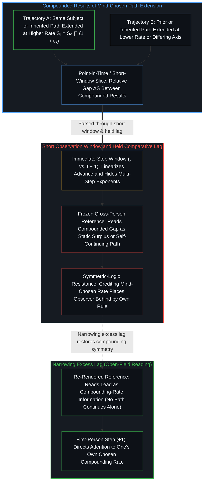
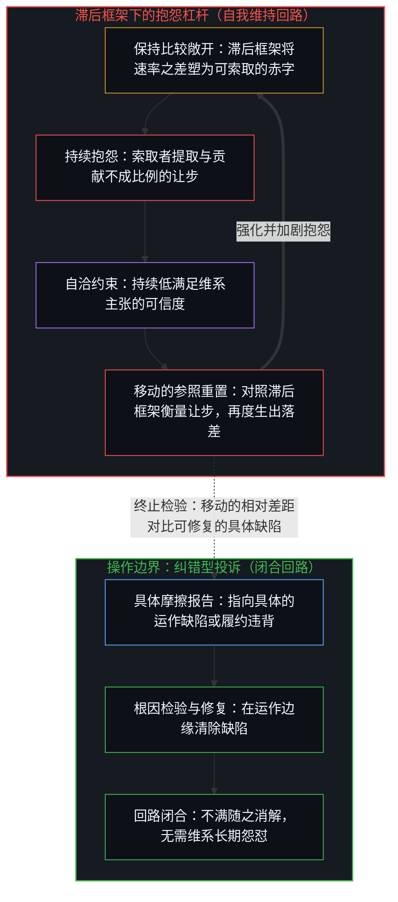
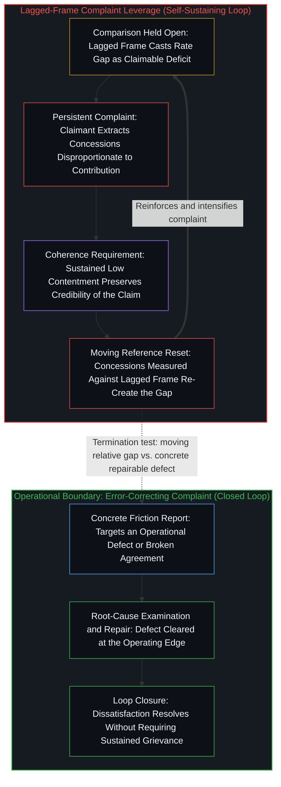

# 相对差异与复利比较 / Relative Differentials and the Comparison of Compounding

*滞后比较下，复利率之差读作可索取的盈余；低满足维系抱怨杠杆的自洽。 / Under lagged comparison, compounding-rate gaps read as claimable surplus; low contentment keeps complaint leverage coherent.*

自我区分的活动发生着——无因，不息。称之为心智：早已在途的观察者，其每一行动皆是一次区分。连续性经由离散行动留下痕迹——先前的区分塑造了后续区分展开的场域——因此，在任一时点或狭短窗口内比较相对位置，比较的都是复利结果：既可能由同一主体筑就，更常见的是由某一主体延续先前的继承路径，且这条路径并不限于字面上的财富。路径本身不会自行延续；唯有活的心智抉择是否延伸这些既有痕迹，以及以何种复利率延伸。当狭短的观察窗口遮蔽了这份多步复利、而同侪比较却愈发显眼时，不断上升的绝对生活水平便与下滑的主观满意度同时出现；持续抱怨者借由让这份滞后比较保持敞开，提取不成比例的相对回报，并让低满足得以维系，使其内在状态与这一主张保持自洽。

Self-distinguishing activity occurs — uncaused, unceasing. Call it the Mind: the observer already underway, every act of which is a distinction. Continuity through discrete acts leaves trace—earlier distinctions shape the field in which later ones unfold—so comparing relative positions at any point in time or within a short window compares compounded results, built either by the same subject or, more often, by a subject continuing an inherited prior path not limited to literal wealth. The path itself does not continue; only a living Mind chooses whether and at what compounding rate to extend those prior traces. When short observation windows hide that multi-step compounding while peer comparisons grow ever more visible, rising absolute living standards coincide with declining subjective satisfaction, and those who complain persistently extract disproportionate relative returns by holding that lagged comparison open—keeping low contentment alive so their internal state stays coherent with the claim.

## 一、 狭短的观察窗口遮蔽复利 / 1. Short Observation Windows Hide Compounding

相对于自身先前状态的绝对进展，是连续性的寻常运作。每一次进一步的区分，都进入已被先前区分塑造好的场域，因此能力跨越离散步长呈乘法复利累积（`Sₜ = S₀ ∏ (1 + εₖ)`），单步速率 `εₖ` 上持续存在的差异终将压过有限的起始位置——这正是[能动性、复利与 AI 封建之争](../agency-compounding-and-the-argument-over-ai-feudalism/)所追溯的“速率压过截距”几何结构。任一时刻可见的复利底座，既可能由同一主体历经先前诸多轮次筑就，更常见的是由某一主体延续先前的继承路径——这条路径并不限于字面上的财富，而是涵盖知识、方法、习惯、语言、关系网络，以及制度或文化痕迹。然而路径本身不会自行延续：既有残余不带任何自我推进的动量，正如[拥有更多从不是原因](../having-more-is-never-the-cause/)所确立的，占有仅命名先前区分在当下的渲染，而非写下下一步的独立力量。延续仅发生在活的心智抉择延伸这条路径之处——由其自身的区分定下复利率 `εₖ`，使既有残余加速累积、持平或逐渐变薄；而因为每一刻的微选择都在有意识审计的阈值之下复利累积，事后唯有沉淀下来的结果进入视野，正如[不可读的复利重溯](../the_illegible_compound_retraced/)所追溯的那样，一条持续推进的轨迹由此筑起复利底座，其累积之积远超任何单一轮次。

Absolute advance relative to an individual's own prior state is the ordinary operation of continuity. Each further distinction enters a field already shaped by earlier ones, so capability compounds multiplicatively across discrete steps (`Sₜ = S₀ ∏ (1 + εₖ)`), where sustained differences in the step rate `εₖ` overtake finite starting positions—the rate-over-intercept geometry traced in [Agency, Compounding, and the Argument Over AI Feudalism](../agency-compounding-and-the-argument-over-ai-feudalism/). The compounded base visible at any given moment may have been built by the same subject across prior turns, or—more often—by a subject continuing an inherited prior path, not limited to literal wealth but spanning knowledge, methods, habits, language, networks, and institutional or cultural traces. Yet the path itself does not continue: prior residue carries zero self-propelling momentum, and as [Having More Is Never the Cause](../having-more-is-never-the-cause/) establishes, possession names only the current rendering of prior distinctions rather than an independent force that authors the next step. Continuation occurs only where a living Mind chooses to extend that path at a compounding rate `εₖ` set by its own distinctions—accelerating, holding flat, or thinning the prior residue—and because each moment's micro-choice compounds below the threshold of conscious audit and leaves only settled outcomes visible afterward, as [The Illegible Compound Retraced](../the_illegible_compound_retraced/) traces, a sustained trajectory builds a compounded base whose cumulative product far exceeds any single turn.

然而，在日常感知之内，观察窗口始终狭短——只将今天对照紧邻的过去（`t` 对比 `t − 1`），也只向前外推短短一步。放在单个时间间隔内看，乘法增长（`εₜ Sₜ₋₁`）与线性相加难以分辨，于是个人进步的指数特征退居视野之外，进入登记的只有局部的相减。若把这种局部线性化仅仅当作孤立的算术失误，便漏掉了它在人际比较中的后果。正如[指数级进程与线性之眼](../Analysis_Adolescence_of_Technology/)所展示的，一旦指数曲线的斜率跑赢狭窄的误差带，线性外推便会将其误读为骤然断裂；同样，狭短的个人视域遮蔽了过往步长的累积之积，使得另一位个体——无论其是复利更久、以更高速率延伸继承路径、更快扫清约束，还是将区分置于更高放大倍率的轴线上——在当下的即时切片中显得握有一笔无从解释的静态盈余。

Inside everyday perception, however, the observation window stays narrow—measuring today only against the immediate past (`t` versus `t − 1`) and extrapolating only a short step ahead. Over a single interval, multiplicative growth (`εₜ Sₜ₋₁`) looks indistinguishable from linear addition, so the exponential character of personal progress stays out of view while only local subtraction registers. Treating that local linearization as an isolated arithmetic slip misses its relational consequence. Just as [The Exponential and the Linear Eye](../Analysis_Adolescence_of_Technology/) shows how linear extrapolation misreads an exponential curve as a sudden rupture once its slope outruns a narrow error band, a short personal horizon hides the cumulative product of prior steps—so another individual who has compounded longer, extended an inherited path at a higher rate, cleared constraints faster, or placed distinctions on higher-amplification axes appears inside the immediate slice to hold an unexplained static surplus.

## 二、 同侪比较将复利率之差转化为可索取的赤字 / 2. Peer Comparison Turns Compounding-Rate Gaps into Claimable Deficits

一旦比较从个体自身的过去转向他人可见的构型，同样的短窗口压缩便在人与人之间运转起来，并在日益拓宽的同侪可见度下进一步放大。在任一时点或狭短窗口内比较相对位置，比较的都是复利结果（`ΔS`）：既可能由同一主体跨越先前步长累积而成，更常见的是由某一主体延续先前的继承路径，且这条路径远不止于字面上的财富。然而路径本身不会自行延续：拉开可见位置的，是各条活的复利轨迹之间累积出的差值，其间各处心智选择以不同的复利率延伸既有痕迹——一条序列重溯得更久、更快释放容量，或将相继的区分落在能够倍增既有能力的轴线上，另一条序列则以更低速率延伸其既有或继承路径，使其持平，或任其变薄。正如[来自个体差异的层级](../hierarchy-from-individual-difference/)所确立的，沿着共同维度为各异的序列计分，会让这些分叉的轨迹可读为位次；一旦观察窗口略去了生成这道距离的复利历史，进入登记的便只剩当下的相减，参照标尺未经标示便发生移位，将相对于过去的绝对改善抹消在相对于可见同侪的相对落差之后，重演了[遮蔽进步的框架](../the-frame-that-conceals-improvement/)所剖析的参照移位。

Once comparison shifts from an individual's own past to the visible configurations of other individuals, the same short-window compression operates across people—now amplified by ever-wider peer visibility. Comparing relative positions at any given point in time or within a short window is a comparison of compounded results (`ΔS`), accumulated either by the same subject across prior steps or, more often, by a subject continuing an inherited prior path well beyond literal wealth. Yet the path itself does not continue: what separates the visible standings is the accumulated difference between live compounding trajectories where Minds chose to extend prior traces at differing compounding rates—one sequence re-tracing longer, freeing capacity faster, or placing successive distinctions on axes that multiply prior capability, while another extended its prior or inherited path more slowly, held it flat, or let it thin. Scoring distinct sequences along a shared dimension makes those diverging trajectories legible as rank, as [Hierarchy from Individual Difference](../hierarchy-from-individual-difference/) establishes; when the observation window omits the compounding history that produced the separation, only the present subtraction registers, and an unmarked shift of the reference bar erases absolute improvement relative to the past behind relative shortfall against visible peers, reproducing the reference shift dissected in [The Frame That Conceals Improvement](../the-frame-that-conceals-improvement/).

承认时点上的差异所比较的是复利结果——无论是由同一主体筑就，还是沿继承路径以心智所选的复利率延伸而来——就要求将自身也置于同一条规则之内：把自己当下的位置登记为自己如何延伸可得痕迹的产物，而非外部赤字。这一登记消解了作为可索取短缺的差距，将其还原为活的序列，也让一切把他人领先视作欠付的静态盈余、或当作继承路径自行运转的姿态失去运作前提。即便已经在自身攀升中认出复利作用的人，在把同一规则用于复利更快或延伸路径更久的他人时，仍会遭遇尖锐阻力：在共同的复利尺度下，将他人的领先归因于心智所选的更快或更久复利，就会凭自己刚刚用过的同一套逻辑把自己置于相对落后的位置——同时也会显露出，践行那一复利率本会让自己走到相对领先之处，而非停在后方争执。在封闭前提下，他人的上升会被登记为减法，而非敞开地平线的证据，如[潜能作为威胁或启发](../ones-potential-as-threat-or-inspiration/)所追溯；此时让比较参照保持滞后，便使观察者免于这份对称核算。

Accepting that a point-in-time differential compares compounded results—whether built by one subject or extended from an inherited path at a Mind-chosen compounding rate—requires placing oneself inside the same rule: registering one's own current standing as the product of how one has extended available traces rather than as an external deficit. That registration dissolves the gap as a claimable shortfall and restores it as live sequence, collapsing the operating premise of any posture that treats another's lead either as an owed static surplus or as an inherited path running on autopilot. Even an individual who recognizes compounding in their own climb encounters sharp resistance when applying the same rule to someone compounding faster or extending a path longer: under a shared compounding measure, crediting another's lead to faster or longer Mind-chosen compounding places the observer relatively behind by the very logic they just applied to themselves—and exposes that enacting that compounding rate would place them relatively ahead rather than contesting from behind. Under a closed premise where another's ascent registers as subtraction rather than evidence of an open horizon, as [One’s Potential as Threat or Inspiration](../ones-potential-as-threat-or-inspiration/) traces, keeping the comparative reference lagged spares the observer that symmetric accounting.

常见的“繁荣之中不满反增”叙事登记了这一症候，却未能推导出其中的主动机制：一旦同侪的推进变得可见、尚存的差距被登记为可变而非固定，不断上升的绝对福祉便会与停滞乃至下滑的主观满意度同时出现。把这一反复出现的模式塑造成外在比较公式的被动读数，或是期望上升引发的自动情绪溢出，都在抉择着的心智之前止步。正如[幸福是欲望与状态的关系](../happiness-is-the-relation-of-desire-to-state/)所确立的，主观满意度并非物质条件的自动产出；在抉择着的心智处，它登记着欲望与状态的两项关系，因此，将跨人比较框架固定在原处是一种主动姿态，而非外生的偏好参数。

Conventional accounts of rising discontent amid rising prosperity register this symptom without deriving its active mechanism: once peer advancement grows visible and remaining disparities register as contingent rather than fixed, rising absolute welfare coincides with stagnant or falling subjective satisfaction. Modeling that recurring pattern as a passive readout of an external comparison formula or an automatic affective spill from rising expectations stops short of the choosing Mind. As [Happiness Is the Relation of Desire to State](../happiness-is-the-relation-of-desire-to-state/) establishes, subjective satisfaction is not an automatic output of material conditions; it registers the two-term relation between desire and state at the choosing Mind, so holding a cross-person comparison frame fixed in place is an active posture rather than an exogenous preference parameter.

## 三、 抱怨杠杆要求持续的低满足 / 3. Complaint Leverage Requires Sustained Low Contentment

一旦复利率之差被冻结为无从解释的盈余，抱怨便充当起提取相对回报的主动杠杆——所提取的注意力、让步、资源或规则调整，与产生它们的贡献不成比例。个体借由使比较参照豁免于重新渲染（即过量形象滞后）来提取这些回报：把参照冻结在这样一道宽度上，使他人持续的复利在其中被登记为可索取的短缺，而非持续的区分。由于索取者会对照同一个被持守的比较框架来评估赢得的任何让步，而分叉复利轨迹之间的差距又在继续拉大，差异便在下一步再度生成，抱怨也随之加剧。倘若个体收窄过量滞后，使参照依据生成这道差距的各条复利序列——包括自己的序列——重新渲染，就会同时登记下绝对进展与速率之差，怨怼作为杠杆的作用也随之消解。因此，持续的低满足并非独立的心理怪癖，而是为保住滞后参照不被打破、让索取姿态维持内在自洽所需的主观登记。

Once a compounding-rate differential is held frozen as an unexplained surplus, complaining functions as an active lever for extracting relative returns—attention, concessions, resources, or rule adjustments disproportionate to the contribution that produced them. An individual extracts those returns by holding the comparative reference exempted from re-rendering (excess Image lag): keeping the reference frozen at the width where another's ongoing compounding registers as a claimable shortfall rather than as continued distinguishing. Because the claimant evaluates any concession won against the same held comparative frame—while the gap between diverging compounding trajectories keeps widening—the differential regenerates at the next step, and complaining intensifies. An individual who narrowed excess lag and let the reference re-render against the compounding sequences that produced the gap—including their own—would register both absolute advance and differing rates, dissolving the grievance as leverage. Sustained low contentment is therefore not an independent psychological quirk; it is the subjective registration required to keep the lagged reference intact and the claiming posture internally coherent.

这一自洽约束消解了两种常见的心理学捷径。把满足感描绘成一只仅对改善后的条件被动适应的稳态仪表，忽略了不满如何与人际杠杆相耦合，因而在能动性之前止步。把动机性怨怼当作固定的心理硬件，即便点出了其中的功能关联——伪装的主张会在审视下露出破绽而失效，因此要让奏效的怨怼策略保持可信，就必须切身承受低满足，因为一旦更新为满足，议价杠杆便随之清零——同样漏掉了边缘上持续进行的抉择。维系这一对齐的并非固定的心理硬件，而是持续选择捍卫一幅冻结的自我模型——这正是[自我模型维护悖论](../the-maintenance-paradox/)所追溯的保全棘轮：看守一幅未经检视的表征会不断消耗注意力，并让内在感知始终贴合受捍卫的姿态。

This coherence constraint dissolves two familiar psychological shortcuts. Picturing contentment as a passive homeostatic gauge that merely habituates to better conditions stops short of agency by leaving out how dissatisfaction couples to interpersonal leverage. Treating motivated grievance as fixed mental hardware likewise misses the living choice at the edge, even when it spots the functional link—feigned claims leak and fail under scrutiny, so keeping a winning grievance strategy credible demands absorbing felt low contentment because updating into satisfaction liquidates the bargaining lever. What sustains that alignment is not fixed psychological hardware, but an ongoing choice to defend a frozen self-model—the preservation ratchet traced in [The Maintenance Paradox](../the-maintenance-paradox/), where guarding an unexamined representation burns attention and keeps internal perception aligned with the defended posture.

两道操作边界将这种滞后框架机制与表面用语相近的邻近现象区分开来。其一，纠错型投诉指向具体的运作缺陷或履约违背；一旦报告在运作边缘得到检验、缺陷得以修复，回路便告闭合，不满也随之消解，这正是[投诉的判定与即时回路的撤离](../the-judgment-that-classifies-the-complaint/)区别于自动工单闭合的鲜活判定回路。滞后框架下的怨怼无法通过这一终止检验，因为索取者把要求锚定在不断移动的相对差异上，让步只会印证这一策略的回报，并推高后续索求。其二，可扩展物质产出与结构上位次固定席位之间的区分，标定了复利的适用范围：在位次锁死的席位或拥堵瓶颈之内——正如[寄存器的算术](../the-arithmetic-of-the-register/)所追溯的截断本地位切片内部——他人的所得按构造即伴随位次偏移；而在能力、工具与生活水平等可扩展领域中，零和短缺则是将狭短窗口与滞后比较框架覆于开放复利之上所制造的。

Two operational boundaries separate this lagged-frame mechanism from neighboring phenomena that share its surface vocabulary. First, error-correcting complaint targets a concrete operational defect or broken agreement; once the report is examined at the operating edge and the defect is repaired, the loop closes and dissatisfaction resolves, the live-judgment loop [The Judgment That Classifies the Complaint and the Withdrawal from the Immediate Loop](../the-judgment-that-classifies-the-complaint/) distinguishes from automated ticket closure. Lagged-frame grievance fails that termination test because the claimant indexes demands to a moving relative differential, so concessions confirm the payoff and intensify further claims. Second, the distinction between expandable material output and structurally fixed-rank slots marks the scope of compounding: inside a fixed-rank seat or congested bottleneck—just as inside a truncated local bit slice traced in [The Arithmetic of the Register](../the-arithmetic-of-the-register/)—another's gain entails a rank offset by construction, whereas across expandable domains of capability, tools, and living standards, zero-sum shortfall is manufactured by holding a short-window, lagged comparison frame over open compounding.

## 四、 跨尺度的同一机制与回归当下抉择 / 4. The Same Mechanism Across Scales and the Return to Present Choice

跨越所有尺度，同一推导始终成立，无需增添额外地基。在单个个体尺度上，狭短的观察窗口把自身轨迹的复利遮蔽在一步步的局部相减之后。在个体与个体之间，任何时点或短窗口比较衡量的都是复利结果——或由同一主体历经先前步长筑就，或沿继承路径延伸而来，横跨财富、习惯、知识或关系网络——且没有任何路径会自行延续；让比较参照保持滞后，便将这些由心智所选、彼此各异的复利率转化为可索取的赤字，并将低满足与杠杆绑定在一起。在群体与制度尺度上，传统、组织与既有禀赋同样不带任何自我推进的惯性，其存续或变薄只取决于活的心智选择以何种速率延伸它们；经由同一滞后框定行事的个体，共同塑造出哪些序列获得让步、哪些序列继续被维持在“不足”的敞开状态，借由有组织的游说集团与政治诉求在更大尺度上展开运作。把这类组织化集团视作冷峻的收益最大化者或自主机构，便漏掉了维系它们的机制：所谓联盟，不过是一个汇总命名，指称那些选择让滞后比较框架保持敞开的个人；它需要参与者共享怨怼叙事并维系持续不满，诉求方能在群体内外保持可信。正如[继承的残余与索取的必要](../inheritance-as-residue-and-the-need-for-extraction/)所追溯的，将描述性的相对度量转化为政治索取的靶标，会消耗既有残余，并降低进一步生产性复利的回报。

Across every scale, the same derivation holds and requires no added ground. At the scale of a single individual, a short observation window hides the compounding of one's own trajectory behind local step-by-step subtraction. Across individuals, any point-in-time or short-window comparison weighs compounded results—whether built across one subject's own prior steps or extended from an inherited path across wealth, habits, knowledge, or networks—where no path continues by itself, and holding a comparative reference lagged converts those differing Mind-chosen compounding rates into claimable deficits while binding low contentment to leverage. At group and institutional scales, traditions, organizations, and endowments likewise carry no self-propelling inertia and persist or thin strictly at the rates living Minds choose to extend them; individuals acting through that same lagged framing pattern which sequences receive concessions and which remain held open as insufficient, operating at scale through organized lobbies and political claims. Treating such organized blocs as cold payoff-maximizers or autonomous institutions misses what holds them together: a coalition is only a summary name for individuals choosing to hold a lagged comparative frame open, requiring shared grievance narratives and sustained dissatisfaction among participants so claims stay credible inside and outside the group. As [Inheritance as Residue and the Need for Extraction](../inheritance-as-residue-and-the-need-for-extraction/) traces, converting descriptive relative measures into targets for political extraction consumes existing residue and lowers the return to further productive compounding.

在每一个尺度上，只要仍有心智不断拓展前沿、让新增产能向外扩散，相对于先前构型的绝对进展便会持续发生——这正是[前沿抬升底线](../the-frontier-lifts-the-floor/)所追溯的后随边缘抬升。然而，对这一进展的主观登记，却被滞后同侪比较所生成的更为醒目的差异所覆盖。最一贯地让比较框架保持滞后的个体，得以凭其投入提取最大的相对回报，而这些回报又反过来强化滞后——这并非因为外部力量迫使人陷入不满，而是因为从相对差异中汲取杠杆，本身就依赖维持那份让杠杆持续生效的不足感知。可观测到的诸般模式——生活水平上升伴随主观幸福感走低、持续抱怨换来不成比例的相对收益，以及对承认他处更快复利的尖锐抗拒——皆作为这同一条因果序列的下游症候直接显现，无需引入任何次级心理学或社会学地基。

At every scale, absolute advance relative to prior configurations continues wherever Minds keep extending the frontier and letting new capacity diffuse outward—the trailing-edge rise traced in [The Frontier Lifts the Floor](../the-frontier-lifts-the-floor/). Yet subjective registration of that advance is overridden by the far more salient differential produced by lagged peer comparison. Individuals who most consistently hold the comparative frame lagged extract the largest relative returns for their input, and those returns reinforce the lag—not because external forces compel dissatisfaction, but because drawing leverage from a relative differential relies on preserving the perception of insufficiency that keeps the lever working. Every observed pattern—rising living standards paired with falling subjective happiness, the disproportionate relative yield of sustained complaining, and the sharp resistance to crediting faster compounding elsewhere—follows directly as a downstream symptom of this single causal sequence, with no secondary psychological or sociological ground needed.

既然比较是在第一人称感知之内执行的行动，便没有任何比较框架能够从外部自行封死。在每一个当下的步长上，抉择都在活的前沿敞开：要么让同侪差异继续滞后为可索取的短缺——在复利轨迹进一步分叉之际，付上持续低满足的自洽代价；要么收窄过量滞后，依据生成这道差距的各条复利序列重新渲染参照，并将自身的轨迹与后果认领为下一次离散切分的原材料。正如[自我价值感与所有权](../ownership-and-self-worthiness/)所确立的，唯有当结果作为归属于己的材料重新进入，而非作为他处欠付的外部赤字被登记时，心智才产生复利。参照一旦重新渲染，他人更快或更久的复利——无论是由同一主体历经先前步长筑就，还是沿继承路径延伸而来——便不再登记为怨怼的杠杆或自行运转的继承，而是重新显现为开放场域中的信息：既然没有任何路径会自行延续，眼前可见的一切正标明了心智选择延伸可得痕迹时所能触及的复利率，使注意力得以回到唯一能推动自身轨迹的变量之上——此时此地划出下一次区分的速率。

Because comparison is an act performed inside first-person perception, no comparative frame holds itself closed from outside. At every present step, the choice stands open at the living edge: hold a peer differential lagged as a claimable shortfall—paying the coherence price of sustained low contentment while compounding trajectories diverge further—or narrow excess lag, re-render the reference against the compounding sequences that produced the gap, and claim one's own trajectory and consequences as raw material for the next discrete cut. As [Ownership and Self-Worthiness](../ownership-and-self-worthiness/) establishes, a Mind compounds only when outcomes re-enter as its own material rather than as an external deficit owed from elsewhere. Once the reference re-renders, another's faster or longer compounding—whether built across the same subject's prior steps or extended from an inherited path—ceases to register as a grievance lever or as self-moving inheritance and reappears as open-field information: because no path continues by itself, what stands visible shows which compounding rates are reachable when a Mind chooses to extend available traces, returning attention to the only variable that moves one's own trajectory—the rate of the next distinction taken here.
