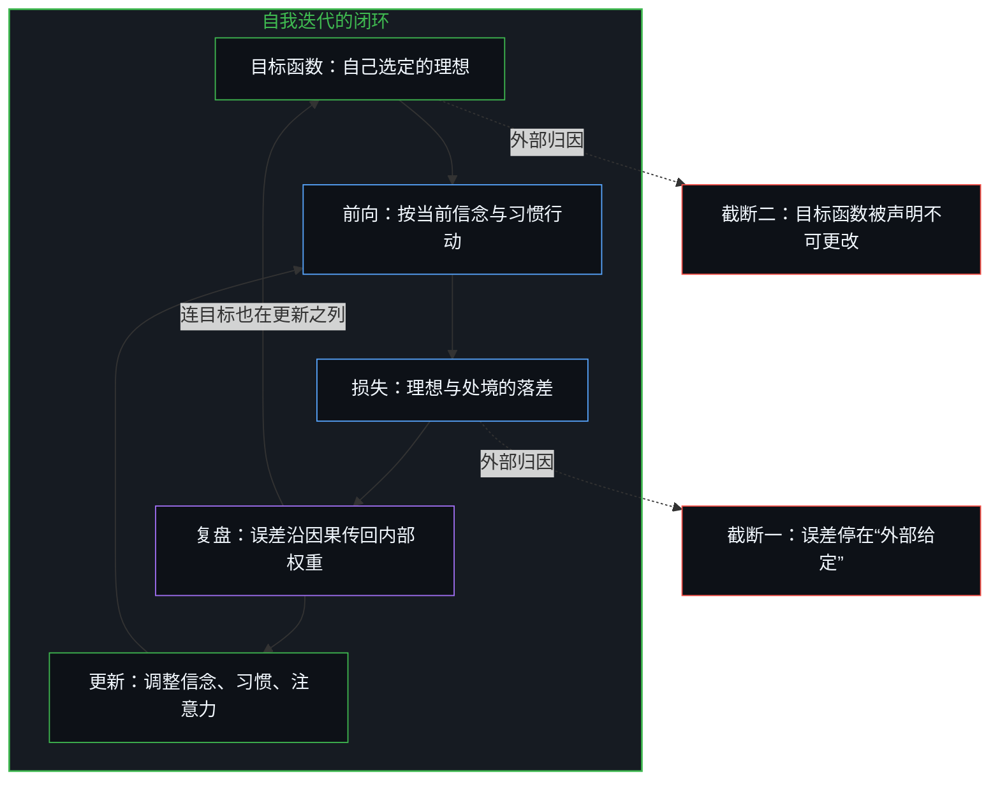
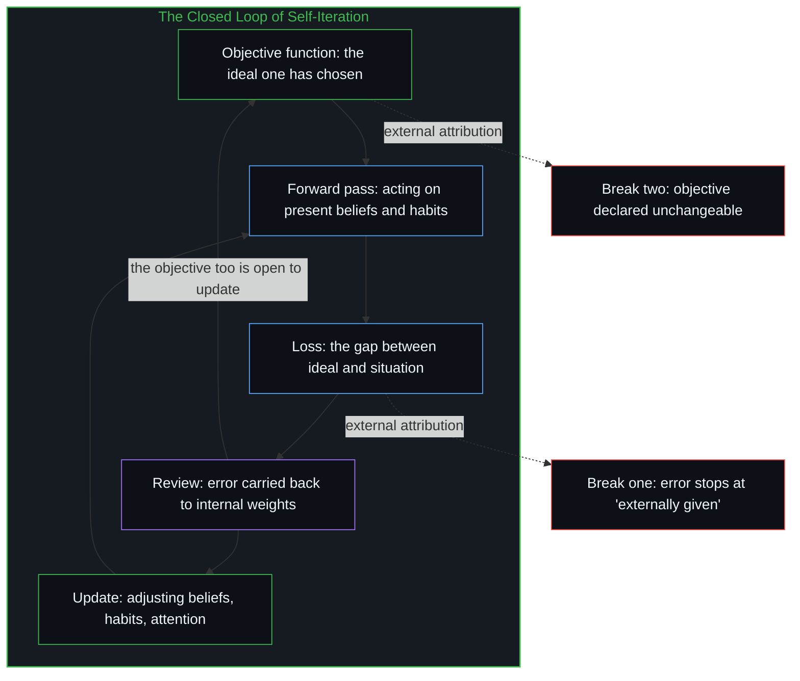

# 人生是一个持续的自我迭代过程 / Life as a Continuous Process of Self-Iteration

*误差信号必须回到可更新的权重，包括选定目标函数的那一步 / The error signal must return to weights that can still be updated, including the step that selected the objective function.*

人的一生可以描述为一个持续的自我迭代过程。把机器学习里的训练循环翻译成日常语言，得到一个可操作的反馈模型：目标、当前状态、误差信号，以及根据误差对内部参数的更新。这种对应是一种翻译，并不是在人生之外另有一套过程。循环断在两处：误差停在“外部给定”上，以及目标函数被声明不可更改。两处都是外部归因，把产生下一步的来源登记在自己之外。

A life can be described as a continuous process of self-iteration. Translating the training loop of machine learning into everyday language yields a workable feedback model: a goal, a current state, an error signal, and updates to internal parameters according to the error. The correspondence is a translation, not a second process running somewhere apart from life. The loop breaks in two places: where the error stops at "externally given," and where the objective function is declared unchangeable. Both are external attribution, registering the source of the next step as lying outside oneself.

在集体层面，看起来先于个人的结构，追溯下去是交出更新与代为更新相互对接之后留下的共振。外部归因就是人们常说的缺乏主观能动性；它进入仍在闭环的人的误差方程，加强那个人的迭代，外显为跨越个体的影响力。

At the collective level, what looks like a structure prior to individuals traces back to the resonance left once handing over updates meets updating on another's behalf. External attribution is what is commonly called a lack of agency; it enters the error equation of someone whose loop is still closed, strengthens that person's iteration, and shows outwardly as influence across individuals.

## 一、 四个对应是同一个循环 / 1. Four Correspondences, One Loop

损失函数衡量当前输出与期望输出之间的距离。对应到人生，就是理想状态与实际处境之间的落差。这个差距不是外界强加的客观事实，它由选定的目标函数决定：把什么当成理想，损失函数的形态就由那一步定下。

The loss function measures the distance between the current output and the desired output. In a life, it is the gap between the ideal state and the actual situation. That gap is not an objective fact imposed from outside; it is set by the chosen objective function: what is taken as the ideal is the step that fixes the shape of the loss.

前向传播是根据当前参数完成一次计算并输出结果。人根据当前的信念、习惯、注意力的分配和默认的选择采取行动，结果落地，差距显现。

Forward propagation is one computation carried out with the current parameters, producing an output. A person acts according to present beliefs, habits, allocation of attention and default choices; the result lands, and the gap shows.

反向传播把输出端的误差沿因果链传回内部，算出每一个参数对最终误差的贡献。对应到人生，就是复盘：不停在“结果不好”，而是沿因果往回走，找到产生这个结果的内部权重，即哪些信念、哪些默认选择、哪些注意力模式、哪些未经检视的前提，共同造成了当前的差距。

Backpropagation carries the error at the output back along the causal chain into the interior, computing each parameter's contribution to the final error. In a life, this is review: not stopping at "the result was bad," but walking back along the causes to the internal weights that produced the result, the beliefs, default choices, patterns of attention and unexamined premises that together made the present gap.

梯度下降沿梯度的反方向调整参数，使下一次前向的损失更小。对应到人生，就是根据复盘得到的因果信息，调整信念、习惯或注意力的分配，使下一次行动更接近目标。整个过程不断循环，行动、结果、复盘、调整、再行动，这就是自我迭代。

Gradient descent adjusts the parameters against the gradient so that the next forward pass has a smaller loss. In a life, this is adjusting beliefs, habits or the allocation of attention according to the causal information the review returned, so that the next action comes closer to the goal. The process keeps cycling, action, result, review, adjustment, action again, and that is self-iteration.

## 二、 误差停在“外部给定”，闭环就断了 / 2. When the Error Stops at "Externally Given," the Loop Breaks

目标函数从来都是自我定义的。“别人给定的目标”只是事后的解释层，一幅被保留下来的图像。一旦这个解释被当作事实，反向传播就在“外部给定”这个节点上被截断：误差信号传不到目标函数本身，也无法更新那些支撑当前行为的内部权重。迭代不是变慢，而是闭环断开，优化的是一个自己已经声明“不可更改”的函数。

The objective function has always been self-defined. "A goal someone else set" is only a layer of explanation added afterward, an image that has been retained. Once that explanation is taken as fact, backpropagation is cut off at the node "externally given": the error signal cannot reach the objective function itself, nor update the internal weights that sustain present behavior. Iteration does not slow down; the loop comes open, and what is optimized is a function one has already declared "unchangeable."

当理想与现实出现差距，如果把原因定位在外部，环境、他人、运气、系统，误差信号就停在“外部因素”这个节点上，到不了产生结果的内部参数。从计算图看，误差没有回到可更新的权重，结构被冻结：在一张已经固定的图外面反复测量同一个损失，算不出可以下降的梯度。

When a gap opens between ideal and reality and the cause is located outside, in the environment, other people, luck, the system, the error signal stops at the node "external factors" and never reaches the internal parameters that produced the result. Seen as a computational graph, the error has not returned to weights that can be updated, and the structure is frozen: measuring the same loss over and over from outside a graph already fixed yields no gradient to descend.

外部归因不是道德问题，而是机制问题：它把后果登记成“从别处来的”，使产生这个后果的内部配置从计算图中消失。没有信号到达参数，就没有更新；没有更新，就没有迭代。[如何在一瞬间修正你的整个人生](../how-to-fix-your-whole-life-in-one-split-second/)追的是同一闭环作为瞬间的归属：通道一开，其余只是读梯度、再调整。[关于归因：从事实到因果，从外部节点到内部迭代](../guan-yu-gui-yin/)是同一截断停在显眼节点上的那一面。[外部归因是个人进步的障碍](../wai-bu-gui-yin-ge-ren-jin-bu-de-zhang-ai/)把同一截断看成唯一的杠杆：对发生之事的解释，以及此刻做什么，只有这一处在自己手里。

External attribution is not a moral problem but a mechanical one: it registers the consequence as "coming from elsewhere," so the internal configuration that produced it drops out of the computational graph. With no signal reaching the parameters there is no update, and with no update there is no iteration. [How to Fix Your Whole Life in One Split Second](../how-to-fix-your-whole-life-in-one-split-second/) traces the same loop as an instant of ownership: once the channel opens, the rest is reading the gradient and adjusting again. [On Attribution: From Fact to Cause, From Outside Node to Inner Iteration](../guan-yu-gui-yin/) is the face of the same cut that stops at a conspicuous node. [External Attribution Is the Obstacle to Personal Growth](../wai-bu-gui-yin-ge-ren-jin-bu-de-zhang-ai/) takes the same cut as the only lever: the explanation of what happened and what to do now is the one place that lies in one's own hands.

## 三、 交出误差与代为更新对接成外部循环 / 3. Handing Over Error and Updating for Others Join into an External Loop

集体层面的共振，并不是所有人朝同一方向做外部归因。如果每个人都只是把原因归给外部，循环并不会闭合。形成稳定结构的，是两种互补的操作。一边把原因归给外人，声明自己无法或不该更新自己的目标函数与参数；另一边认为自己有能力、有责任替别人做决定，替对方定义目标或执行更新。

Resonance at the collective level is not everyone making external attributions in the same direction. If each person only assigned causes outward, no loop would close. What forms a stable structure is two complementary operations. One side assigns the cause to others and declares that it cannot or should not update its own objective function and parameters; the other side takes itself to be able, and responsible, to decide for others, defining their goals or carrying out their updates.

两边一旦对接，就形成一个中心化的外部迭代循环：误差信号被交出，更新动作被代行。原本属于个体自己的反向传播与参数更新，被这个外部循环替换，个体自我迭代的效率降低，停滞或倒退。

Once the two sides join, a centralized external loop of iteration forms: the error signal is handed over and the act of updating is performed by proxy. The backpropagation and parameter updates that belonged to the individual are replaced by this external loop, and the individual's self-iteration loses efficiency, stalls or regresses.

集体主义的倾向，是个人在自我迭代中做外部归因，并与互补的“代为决定”对接之后，在集体层面形成的外显。所谓“集体无意识”，是这种互补循环稳定之后留下的共振痕迹。它看起来像先于个人的深层结构，追溯下去是大量个体把迭代外移、彼此互补之后的结果；机制落在每个心智是否把误差信号传回自己可更新的参数。[没有普渡，只有自渡](../mei-you-pu-du-zhi-you-zi-du/)是同一道边界：没有任何一个内心能替另一个内心完成返回。

The collectivist tendency is the outward form, at the collective level, of individuals making external attributions in their self-iteration and joining with the complementary "deciding for them." What is called the "collective unconscious" is the trace of resonance this complementary loop leaves once it stabilizes. It looks like a deep structure prior to individuals; traced back, it is the result of many individuals moving their iteration outside and complementing one another, and the mechanism rests on whether each mind carries the error signal back to its own updatable parameters. [No Universal Salvation, Only Boundless Possibilities of Self-Salvation](../mei-you-pu-du-zhi-you-zi-du/) marks the same boundary: no inner life can complete the return for another.

个体的外部归因，就是人们常说的缺乏主观能动性，也就是缺少“主人翁精神”：对落到自己身上的结果负责。责任在这里不是谁该被责备，而是后果是否作为自己的信号重新进入。对发生在自己身上的结果负全责，误差回到可更新的权重，自我迭代的效率最高。把责任交给外部因素，迭代就被留下，等某个仍在闭环的个体去完成。

An individual's external attribution is what is commonly called a lack of agency, a lack of the sense of ownership that takes responsibility for the results that land on oneself. Responsibility here is not about who is to blame; it is whether the consequence re-enters as one's own signal. Taking full responsibility for what happens to oneself returns the error to updatable weights, and self-iteration is at its most efficient. Handing responsibility to external factors leaves the iteration behind, waiting for some individual whose loop is still closed to complete it.

这种缺乏不会停在那一张计算图里。它成为仍在闭环的人，也就是主观能动性高的人，误差方程的一部分。如果这个人愿意把他人的失误当作自己误差过程的一部分，就用过剩的能动性去承担他人的后果，对方冻结的循环成为这个心智损失里的一项，那个人的自我迭代因此加强，看起来像跨越个体的影响力。影响力是这个仍在更新的循环多了一项可以回传的残差，并愿意把它算进自己的前向，而不是替对方完成了返回。

This lack does not stay inside that one computational graph. It becomes part of the error equation of someone whose loop is still closed, someone with high agency. If that person is willing to take another's mistakes as part of their own error process, they bear the other's consequences with their surplus agency; the other's frozen loop becomes one term in this mind's loss, and that person's self-iteration is strengthened, which looks like influence across individuals. Influence is this still-updating loop gaining one more residual it can propagate back and being willing to count it in its own forward pass, not completing the return on the other's behalf.

## 四、 信号必须回到可更新的权重 / 4. The Signal Must Return to Updatable Weights

有效的自我迭代只有一个条件：误差信号完整传回产生它的那些内部权重。复盘要回答的不是“谁该负责”，而是在可更新的范围内，哪些参数，信念、习惯、注意力的分配、默认的选择，对这个结果有贡献；这些参数当前的值是什么；要降低损失，它们朝哪个方向微调。

Effective self-iteration has one condition: the error signal returns whole to the internal weights that produced it. The question a review answers is not "who is responsible" but, within the range that can be updated, which parameters, beliefs, habits, allocation of attention, default choices, contributed to this result; what their present values are; and in which direction to nudge them to lower the loss.

只有信号回到可更新的地方，梯度下降才会发生。下一次行动才是带着新信息的前向计算，而不是旧模式再跑一遍。

Only when the signal returns to where updating is possible does gradient descent take place. Only then is the next action a forward computation carrying new information rather than the old pattern run once more.

## 五、 目标函数本身也在更新之列 / 5. The Objective Function Itself Is Open to Update

目标函数从来都是自我定义的。一个人可以终其一生都在优化一个自己定义、却因外部归因而从未重新检视的损失函数：成功、认可、安全、形象、某种被默认的“应该”。因为这个定义被登记成“不可更改”，迭代只发生在参数层面，目标函数本身被排除在更新之外。

The objective function has always been self-defined. A person can spend a whole life optimizing a loss function they defined themselves yet, through external attribution, never re-examined: success, recognition, security, image, some "ought" taken by default. Because that definition is registered as "unchangeable," iteration happens only at the level of parameters, and the objective function itself is excluded from updating.

[大脑不进行反向传播，而是正向传导](../the-brain-does-not-backprop/)追的是固定目标下的回传：目标事先给定，误差只能沿已经组织好的图往回走。这里的完整迭代是另一步，误差也传到目标函数本身。当长期存在的差距其实是由当前这个自己定义的目标函数所制造的，更新的就不再只是参数，而是整个优化问题。从那一刻起，迭代从“在固定目标下调整参数”，变成“连目标函数本身也持续重新定义”，这才是完整的参数更新。

[The Brain Does Not Backprop, but Propagates](../the-brain-does-not-backprop/) traces propagation back under a fixed objective: the goal is given in advance, and the error can only travel back along a graph already organized. The full iteration here is a further step, in which the error reaches the objective function itself. When a long-standing gap turns out to be produced by the present self-defined objective, what gets updated is no longer just the parameters but the whole optimization problem. From that moment iteration turns from "adjusting parameters under a fixed objective" into "continually redefining the objective function itself," and that is the complete update.

## 六、 没有训练结束的一天 / 6. There Is No Day When Training Ends

人生没有训练结束的一天。只有当前这一步的损失是否比上一步更低，以及误差信号是否还能回到那些可以改变的地方。

A life has no day when training ends. There is only whether the loss at this step is lower than at the last, and whether the error signal can still return to the places that can change.
