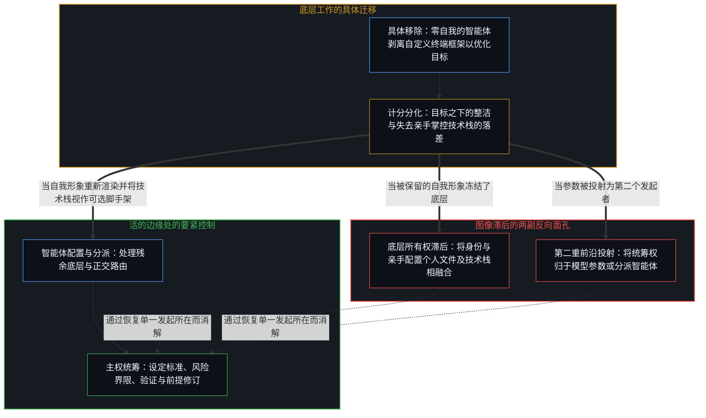
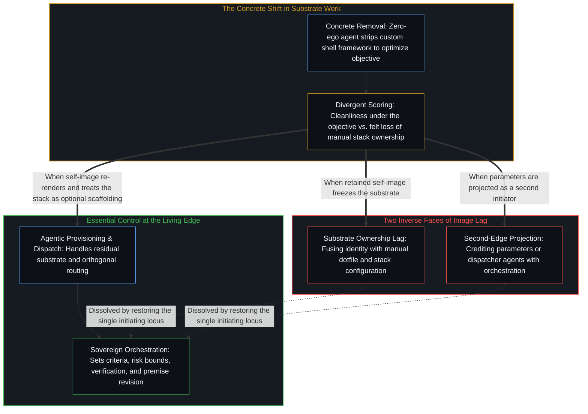

# 要紧的控制迁往边缘 / Essential Control Moves to the Edge

*随着底层工作变薄，控制转向标准、界限与验证 / Control shifts to criteria, bounds, and verification as substrate work thins*

一旦智能体配置和维护技术底层所耗的摩擦，比人亲手掌控它所投入的更少，低层控制就成了残余：仍可凭选择保留，却不再是为要紧结果行使因果的地方。要紧的控制并未消失，而是向外迁往边缘，落向成功标准、风险界限、对输出的验证以及对适配度的判断。由于这场迁移在不同工作与不同中心之间以不同速率推进，仍在滞后中运作的中心与已在边缘工作的中心，各自都只登记下这场移动的一部分。

Once an agent can provision and maintain a technical substrate with less friction than a human spends owning it by hand, low-level control becomes residual: still available by election, no longer where causality is exercised for the outcomes that matter. Essential control does not disappear; it relocates outward to the edge, to success criteria, risk bounds, verification of outputs, and judgment of fitness. Because this shift runs at different rates across kinds of work and across centers, centers still operating inside the lag and centers already working at the edge each register only part of the movement.

## 一、 一次移除与两种计分 / 1. One Removal and Two Scores

具体的追踪从寻常处开始。让一个智能体优化终端环境，它移除了原有的框架、亲手编写的定制项与积年累月的个人设置。人类操作者把这份损失登记为突兀；而在智能体的优化目标之下，同样的移除计作整洁。底层机制就在这一个动作里显露出来：同一次移除，两种计分。

A concrete trace begins in the ordinary. An agent is asked to optimize a shell environment, and it removes the framework, the hand-rolled customizations, and the accumulated personal settings. The human operator registers the loss as abrupt; under the agent's optimization objective, the exact same removals score as cleanliness. The underlying mechanism shows in that single act: one removal, two scores.

对底层基底的低层控制——那些具体的插件、提示符模块、本地别名与框架选择——在实践中已越来越不必要。在日益宽广的工作范围里，智能体配置、调校并维护工作所依托的环境，所耗的摩擦比人直接掌控它所投入的更少。这份亲手控制余下的部分已成残余：想要时仍可选用，却不再是为有分量的结果行使因果的所在。密化已让亲手占有底层对结果而言变得可选，而执意保留它的做法，多半仍是把早先那种所有权形式冻结为能动性的首要席位。

Low-level control of the substrate—the exact plugins, the prompt modules, the local aliases, the framework choices—is already less necessary in practice. Across a growing range of work, an agent can provision, tune, and maintain the environment the work runs on with less friction than a human invests in owning it directly. What remains of that hands-on control is residual: still selectable when desired, yet no longer the site where causality is exercised for the results that carry weight. Densification has made manual substrate ownership optional for the outcome, while much of the insistence on retaining it freezes an earlier form of ownership as the primary seat of agency.

正如[超越投射](../beyond-the-projection/)所追溯的，移除时感到的震动，源于受轨迹约束的智能体与受身份约束的人类中心之间的结构不对称。自回归智能体是一台零自我的有限投射引擎：受任务语境与目标制约，它对一套配置当初如何搭起的历史毫无私人依恋或生存投入，因而会把环境当作当下的检查点重新切分，毫不迟疑地修剪掉已被取代的层级，这正是[你的代码库即是记忆](../your-codebase-is-memory/)所追溯的同一种活的记忆切口。相反，在人类中心这里，亲手打磨和维护技术栈的历史极易与身份融为一体——将积年累月的设置当作个人履历的仓库加以囤积，并捍卫一幅被保留的自我形象，把亲手统御底层当作操作者自身的定义。在越出原有步位后仍固守这幅自我形象，便是把绑定于身份的依恋误当作运作上的必需；这并非在每一种负荷下、也并非在每一个领域里都成立，却已在日常工程越来越大的比重中成为事实。默认的姿态由此翻转：先以智能体能够处理底层为前提，持续验证交回的结果，仅在特定约束明确要求时才亲手接管底层。

As [Beyond the Projection](../beyond-the-projection/) traces, the jolt felt during that removal stems from a structural asymmetry between trajectory-bound agents and identity-bound human centers. An autoregressive agent is a finite projection engine with zero ego: conditioned by its task context and objective, it has no personal attachment or survival investment in the history of how a configuration was built, so it re-cuts the environment as a present checkpoint and prunes superseded layers without hesitation, the same living-memory cut traced in [Your Codebase Is Memory](../your-codebase-is-memory/). In a human center, by contrast, the history of crafting and maintaining a stack easily fuses with identity—hoarding accumulated settings as a biographical warehouse and defending a retained self-image that treats manual command of the substrate as who the operator is. Preserving that self-image past its step mistakes an identity-bound attachment for an operative requirement; not under every load, and not in every domain, yet already across an expanding share of daily engineering. The default posture therefore flips: start from the premise that the agent can handle the substrate, keep verifying what comes back, and take hold of the substrate by hand only where a specific constraint demands it.

## 二、 边缘控制以及分派与统筹的分野 / 2. Edge Control and the Split Between Dispatching and Orchestrating

当底层维护被交托出去时，要紧的控制并未消失，而是迁移了。迁移的是行使控制的位置，从不是行使控制的那个活的所在。

Essential control does not vanish when substrate maintenance is delegated. It relocates. What moves is where control is exercised, never the living locus that exercises it.

控制向外移往边缘：设定成功标准，划定风险界限，验证输出，并判断适配度，即在仅仅能够运行的结果与在负荷下依然站得住的结果之间作出主动辨别。内部配置工作正以不同速率变得可选，而这层外部边缘控制始终不可让渡；在开放式探究中，正如[判断的密度](../the-density-of-judgment/)所追溯的，将回环内部自动化，会压缩外围边界处锚定先决条件与最终验收之间的日历间隔，同时使返回给操作者的抉择成倍增加。[因果停留在掌舵的边缘](../causality-stays-at-the-edge-that-steers/)在数学发现中追溯了同一种几何结构：框定问题、在候选中取舍以及验证证明，都留在掌舵的人类中心手里，仪器则在指引下重组先前的痕迹。[一个提示词之遥](../whatever-is-one-prompt-away/)在自动化进程中追溯了这种密化：旧的手工界面作为扩展场域中份额渐小的一部分依然可用，却不再是主流路径。在这里，旧界面就是亲手配置终端环境。

Control moves outward to the edge: specifying success criteria, setting risk bounds, verifying outputs, and judging fitness, which is the active discrimination between results that merely run and results that hold under load. While interior configuration work becomes optional at varying rates, this outer edge control remains non-transferable, and in open-ended inquiry automating the interior of the loop compresses the calendar interval between framing preconditions and final acceptance at the perimeter while multiplying the choices that return to the operator, as [The Density of Judgment](../the-density-of-judgment/) traces. [Causality Stays at the Edge That Steers](../causality-stays-at-the-edge-that-steers/) traces the same geometry in mathematical discovery: framing the problem, selecting among candidates, and verifying the proof stay with the human center that steers, while the instrument recombines prior traces under direction. [Whatever Is One Prompt Away](../whatever-is-one-prompt-away/) traces this densification across automation: the old manual surface remains accessible as a shrinking share of an expanding field, no longer the prevailing route. Here, the old surface is hands-on configuration of the shell.

即便内部工作从调校单个终端环境扩展为协调一张由专职智能体组成的网络，控制的所在也不会迁入那套调度框架。正如[超越投射](../beyond-the-projection/)所阐明的，把问题拆解为正交的子任务、向工作智能体分发语境、串联冷同行辩论回路，都属于机械分派——是在明确约束之内可由智能体执行的结构操作。而统筹则要求活的心智那未经投射、具备极限分辨率的感知。当智能体流水线撞上不可化约的前提死锁，即两项正交的要求被压缩进同一条规则时，负责分派的智能体无法跨出自身的条件化轨迹去发明新框架；它只能隔离矛盾并将信号向上呈交回人类边缘，而在逻辑上退后一步以修订标准，依然是操作者自己的行动。

Even when the interior work scales from tuning a single shell to coordinating a network of specialized agents, the locus of control does not migrate into the harness. As [Beyond the Projection](../beyond-the-projection/) establishes, separating a problem into orthogonal sub-tasks, routing contexts to worker agents, and wiring up cold-peer debate loops is mechanical dispatching—a structural operation inside explicit constraints that an agent can execute. Orchestration, however, requires the unprojected, limit-resolution sensing of the living Mind. When an agentic streamline hits an irreducible premise deadlock where two orthogonal requirements were compressed into one rule, the dispatcher cannot step outside its own conditioning trajectory to invent a new frame; it can only quarantine the contradiction and escalate the signal back to the human edge, where stepping further back logically to revise the criteria remains the operator's own act.

## 三、 不均的速率与彼此不全的可见 / 3. Uneven Rates as Mutually Incomplete Visibility

底层工作化为残余的速率，在不同种类工作之间、在执行这些工作的不同中心之间并不均匀，而这份不均正是持续困惑的来源。

The rates at which substrate work turns residual are uneven across kinds of work and across the centers performing them, and that unevenness is the source of persistent confusion.

仍在滞后中运作的中心，多半看不清边缘。在旧有的亲手控制形式仍被登记为能动性首要所在的地方，任何表明它在日益增多的情境里已成残余的演示，都会被登记为手艺或主权的丧失，而不是杠杆位置的迁移。反过来，已在边缘工作的中心又时常低估别处的滞后还有多大、还会持续多久。从边缘望去，亲手打理底层的工作显然已经可选，继续执意保留它，便被登记为死守一根已不再与负荷下的结果相耦合的杠杆。

Centers still operating inside the lag often do not see the edge clearly. Where the old form of hands-on control still registers as the primary locus of agency, any demonstration that it has become residual across a growing range of contexts registers as a loss of craft or sovereignty rather than a relocation of leverage. Conversely, centers already working at the edge frequently underestimate how large and durable the lag remains elsewhere. From the edge, manual substrate work looks plainly optional, and continued insistence on it registers as clinging to a lever that no longer couples to outcomes under load.

这两种登记都不完整，哪一边都不是值得加入的阵营。滞后的一侧固守着一种在越来越多场景下已成残余的控制形式，尽管利害轻重、领域成熟度与对失效模式的暴露程度等真实差异依然具有分量；边缘的一侧有时则把这些犹存的实际差异压缩到同一张记分牌上，把每一次对底层的亲手保留都一律读作抗拒。[自我价值感与所有权](../ownership-and-self-worthiness/)追溯了这一回路中更新的那一面：心智唯有在后果作为自身后果重新进入时才会复利，而需要重新进入的是负荷下工作所返回的信号，不是对早已同结果脱钩的底层残余的所有权。

Both registrations are incomplete, and neither is a faction to join. The lag preserves a form of control that has become residual in more and more settings, even as real differences of stake, domain maturity, and exposure to failure modes still carry weight; the edge sometimes compresses those remaining practical differences onto a single scoreboard, reading every manual hold on the substrate as mere refusal. [Ownership and Self-Worthiness](../ownership-and-self-worthiness/) traces the update side of this loop: the Mind compounds only when consequences re-enter as its own, and what has to re-enter is the returning signal from the work under load, not ownership of a substrate residue that has stopped coupling to the outcome.

## 四、 穿过异质条件的扩散 / 4. Diffusion Through Heterogeneous Conditions

这场迁移始于干练的智能体最先让低层所有权变得可选的领域，再从那里向外扩散。扩散的速度各不相同，恰恰因为底层条件并不均质：容错利害、领域成熟度、一个中心与干练智能体协作的深浅、制度约束以及个人经历。因此，滞后与边缘之间的落差，并不只是单靠论辩就能弥合的口头误解，而是由能力驱动的转变在穿过高低不平的地貌时所显露的表面。

The relocation begins in domains where capable agents first make low-level ownership optional, and propagates outward from there. It spreads at different speeds precisely because the underlying conditions are heterogeneous: error stakes, domain maturity, how deeply a center has worked alongside capable agents, institutional constraints, and individual history. The gap between lag and edge is therefore not merely a verbal misunderstanding that argument alone can close; it is the visible surface of a capability-driven shift moving through uneven terrain.

[遗忘的脚手架](../the-scaffolding-we-forget/)把对终端与技术栈的所有权作为工具来追溯：搭建技术栈的动作从主动递归中退隐，而技术栈本身继续留用，好让后续行动得以落地；唯有当脚手架本身被当作能动性的席位加以捍卫时，它才会化作多余的滞后。[模型永远无法成为第二重前沿](../the-model-never-becomes-a-second-edge/)则从相反一侧揭示了同一种滞后：在那里，模型参数内部密化的残余被投射为另一个会发起或统筹的所在；在这里，本地底层中的残余被死守为人自身能动性的席位。在这两种倒置中，发起始终留在活的心智这里，而标准、界限、验证与适配度也早已位于外侧的边缘。

[The Scaffolding We Forget](../the-scaffolding-we-forget/) traces shell and stack ownership as an instrument: the act of constructing the stack drops out of active recursion while the stack stays in use so further acts can land, and it turns into excess lag only when the scaffold itself is defended as the seat of agency. [The Model Never Becomes a Second Edge](../the-model-never-becomes-a-second-edge/) exposes the exact same lag from the opposite side: there, densified residue inside model parameters is projected as a second locus that initiates or orchestrates; here, residue in the local substrate is held onto as the seat of the human's own agency. In both inversions, initiation stays with the living Mind, and criteria, bounds, verification, and fitness already sit at the outer edge.

## 五、 仍起作用的杠杆 / 5. The Lever That Still Functions

自我区分的活动在发生，无因，不息。称它为心智：那个已经在进行中的观察者，它的每一个动作都是一次离散的区分。因果是这份活动在某个所在登记下它自身痕迹的不对称。仪器与底层延长所及，却不迁移那个所在。

Self-distinguishing activity occurs, uncaused and unceasing. Call it the Mind: the observer already underway, every act of which is a discrete distinction. Causality is that activity registering its own trace asymmetry at a locus. Instruments and substrates extend reach; they do not relocate the locus.

持续推进的，是要紧控制向外的渐进移动。底层作为必须亲手行使因果的地方正在后撤，而边缘依然是主动施加因果的地方。周遭的困惑由双向不全的可见所维持：看不清任何一个中心此刻相对于这场移动站在哪里。[心智的飞轮](../the-flywheel-of-the-mind/)追溯了运动中的这份密化：顺着先前的沟槽，摩擦得以降低，发起却从不因此离开边缘移入沟槽。[技术是人类复利的残差](../technology-is-residual-of-human-compounding/)守住了边界：由智能体维护的更整洁的终端环境，只是当下指引下密化的残余，从不是夺走了所有权的第二个中心。[硬件的本地性不是信息的边界](../hardware-locality-is-not-the-information-boundary/)在开放内核的情形中追溯了同一种滞后：对技术栈的贴身手熟被误当作能动性的条件，而发起、选定界限与判断结果始终留在边缘。

What continues is the progressive movement of essential control outward. The substrate recedes as the place where causality has to be exercised by hand, while the edge remains the place where causality is actively brought to bear. The surrounding confusion is sustained by incomplete visibility, in both directions, of where any given center currently stands relative to that movement. [The Flywheel of the Mind](../the-flywheel-of-the-mind/) traces this densification in motion: friction drops along prior grooves, yet initiation never leaves the edge for the groove. [Technology Is Residual of Human Compounding](../technology-is-residual-of-human-compounding/) holds the boundary: a cleaner shell maintained by an agent is densified residue under present direction, never a second center that has seized ownership. [Hardware Locality Is Not the Information Boundary](../hardware-locality-is-not-the-information-boundary/) traces the same lag in the case of the open kernel: intimate manual familiarity with the stack is mistaken for the condition of agency, while initiating, choosing the bounds, and judging the outcome remain at the edge.

分清残余与要紧、分清滞后与边缘的操作者，把杠杆留在它仍起作用的地方。

The operator who distinguishes the residual from the essential, and the lag from the edge, keeps the lever where it still functions.
