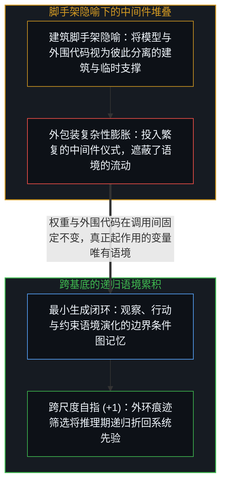
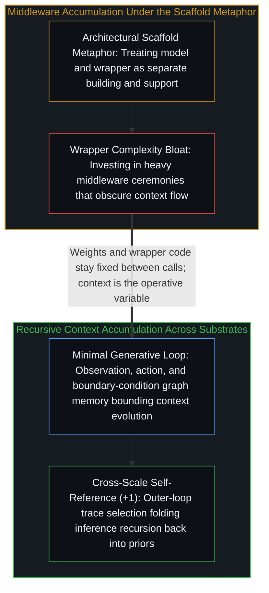

# 是脚手架还是特化语境 / Scaffolds or Specialized Contexts

*将模型外围代码称为脚手架会把精力引向中间件堆叠，而其核心机制是语境在递归中的持续演化。 / Calling model wrappers scaffolds pulls focus to middleware rather than recursive context evolution.*

亚历克斯·张在阐述语言模型将成为脚手架的文章中，敏锐地捕捉到了切实的方向转移：重心正在从单纯扩大模型规模，转向包裹在推理周围的运行结构。然而，“脚手架”这个词在细查之下却露出了破绽，引出一个更锋利的结构性问题：那套外围结构究竟是在充当外在的脚手架，还是在充当跨递归调用持续演化的特化语境？

Alex Zhang's essay arguing that language models will serve as scaffolds captures a genuine directional shift away from raw model scaling toward the structures wrapping inference. Yet the word "scaffold" snags on inspection, raising a sharper structural question: does that surrounding structure act as an external scaffold, or as a specialized context evolving across recursive calls?

## 一、 “脚手架”一词带入的工程本体论 / 1. The Engineering Ontology Imported by "Scaffold"

“脚手架”一词带入了一套建筑工程的本体论预设：建筑是一回事，临时支撑框架是另一回事——搭建它是由于结构眼下还无法独立站稳，一旦施工结束便予以拆除。观察围绕语言模型的外围代码在高效循环中触发时实际发生的过程：交互式求值环境（REPL）中的每一次工具返回、每一次状态更新与每一次递归调用，都是构造下一轮生成上下文窗口的机制。

The term "scaffold" imports an architectural ontology in which the building is one thing and the temporary support frame is another—erected only because the structure cannot yet stand alone, and dismantled once construction finishes. Observe what actually happens when a wrapper around a language model fires in a productive loop: every tool return, every state update, and every recursive invocation inside a read-eval-print loop (REPL) is a mechanism for constructing the context window of the next completion.

沿着“脚手架”的思路，工程投入会流向外包装——堆砌更多的中间件、更沉重的编排层与更繁复的架构仪式；而沿着“语境”的思路，注意力则会直接对准两次调用之间真正进入上下文窗口的内容。在上一轮输出成为下一轮输入语境的递归循环中，回答单条提示词的裸模型与在 REPL 中迭代的智能体之间的分界是数量上的，而非类别上的：二者皆为依赖语境的计算，区别仅在于语境跨迭代累积的方式（参见[遗忘的脚手架](../the-scaffolding-we-forget/)与[平台并未漂移，它只是走到了终点](../platform-decision-capture/)）。

Thinking in terms of "scaffolds" directs engineering effort toward the wrapper—more middleware, heavier orchestration layers, and elaborate architectural ceremony—whereas thinking in terms of "context" directs attention to what actually enters the window between calls. In a recursive loop where the output of one completion becomes the input context of the next, the boundary between a bare model answering a single prompt and an agent iterating inside a REPL is quantitative rather than categorical: both are context-dependent computations differing in how context accumulates across iterations (see [The Scaffolding We Forget](../the-scaffolding-we-forget/) and [The Platform Doesn't Drift, It Completes](../platform-decision-capture/)).

## 二、 代码固定而语境演化：跨基底的自指 / 2. Code Is Fixed While Context Evolves: Self-Reference Across Substrates

训练一旦结束，模型权重便固定下来；部署一旦完成，外围代码也固定下来。在两次调用之间真正发生变化、从而让迭代产生实效的唯一变量，就是语境。然而，由于冻结的权重与固定的解码规则在局部作为确定性状态转移系统（`sₜ₊₁ = f(sₜ, θ)`）运行，缺乏约束的循环在将每一轮生成结果喂回下一轮窗口时，会在多步推演中放大初始条件里那些细微且未被充分记录的偏差。倘若外围机制的职能是在不累积漂移的前提下为下一次调用培育高信噪比的语境，那么绝大多数中间件仪式都只是多余的开销；真正关键的是一个能够观察、行动并将持久状态铭刻进外部化存储库的最小闭环——正如[你的代码库即是记忆](../your-codebase-is-memory/)所追溯的那样（参见[至简即至繁](../simplicity-ultimate-sophistication/)），而这一存储库正是作为边界条件图运作的：它既在相对的内环与外环之间约束容许的前向分支，又保留经验证的痕迹，正如[递归形式系统中作为记忆与控制的边界条件图](../boundary-condition-graphs-as-memory-and-control-in-recursive-formal-systems/)所追溯的那样。

Once training concludes, model weights are fixed; once deployment finishes, wrapper code is fixed. What varies between calls—and what makes iteration productive—is context alone. Because frozen weights and fixed decoding rules operate locally as a deterministic state-transition system (`sₜ₊₁ = f(sₜ, θ)`), however, an unconstrained loop feeding each completion back into the next window amplifies small, partially registered variations in initial conditions across multi-step rollouts. If the function of surrounding machinery is to cultivate high-signal context for the next invocation without compounding drift, most middleware ceremony remains unnecessary overhead; what matters is a minimal loop capable of observing, acting, and inscribing durable state into an externalized repository as traced in [Your Codebase Is Memory](../your-codebase-is-memory/) (see [Simplicity Is the Ultimate Sophistication](../simplicity-ultimate-sophistication/)), where that repository operates as a boundary-condition graph that both constrains admissible forward branches and retains verified traces across relative inner and outer loops, as traced in [Boundary-Condition Graphs as Memory and Control in Recursive Formal Systems](../boundary-condition-graphs-as-memory-and-control-in-recursive-formal-systems/).

这也揭示了预训练规模与推理期脚手架之争背后的连续性：训练将海量语境压缩进权重，工具调用在推理期提供新鲜的初始条件，而边界条件图上的外环筛选则将经验证的推理痕迹折回系统的先验之中——无论是将成功轨迹编译为指令前缀，还是将其蒸馏进后续的权重更新——同时在中间脚手架的经验被吸收之后将其剪除。主导心智的自指活动并不偏袒某一个工程层级；无论通过梯度更新、工具调用还是外部代码库运作，能动性都在一切可用的基底上投射约束并重新吸纳经筛选的痕迹，而读取跨时间尺度的未对齐模式，远比押注某一层外包装更为关键。

This reveals the continuity beneath the debate between pre-training scale and inference-time scaffolding: training compresses vast context into weights, tool use supplies fresh initial conditions at inference time, and outer-loop selection over the boundary-condition graph folds verified inference traces back into the system's priors—whether by compiling successful trajectories into instruction prefixes or by distilling them into subsequent weight updates—while pruning intermediate scaffolding once its lessons are absorbed. The directing Mind's self-referential activity does not privilege one engineering layer over another; whether operating through gradient updates, tool calls, or external codebases, agency projects constraints and re-incorporates selected traces across whatever substrate is available, and reading the misalignment patterns across those timescales matters far more than betting on a wrapper.
