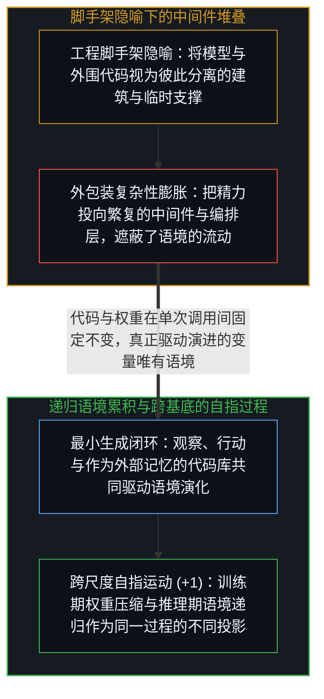
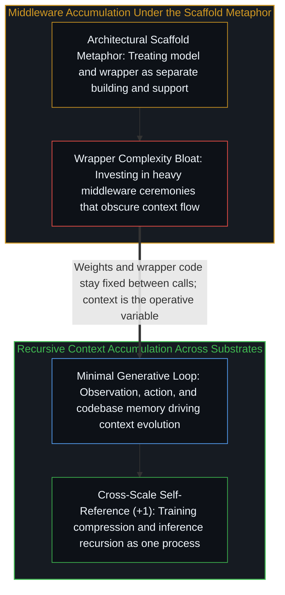

# 是脚手架还是特化语境 / Scaffolds or Specialized Contexts

*将模型外围代码称为脚手架会把精力引向中间件堆叠，而其核心机制是语境在递归中的持续演化。 / Calling model wrappers scaffolds pulls focus to middleware rather than recursive context evolution.*

亚历克斯·张在《语言模型将成为脚手架》一文中敏锐地捕捉到了风向的变化：重心正在从单纯扩大模型规模，转向环绕在模型周围的运行结构。然而，“脚手架”这个词本身却埋着一处值得深究的认识论卡点：我们搭建的究竟是外在的“脚手架”，还是不断演化的“特化语境”？

Alex Zhang's essay arguing that language models will serve as scaffolds captures a genuine directional shift away from raw model scaling toward the structures wrapping inference. Yet the word "scaffold" snags on inspection, raising a sharper structural question: are we building external scaffolds, or are we cultivating specialized contexts?

## 一、 “脚手架”隐喻偷渡的工程本体论 / 1. The Engineering Ontology Imported by "Scaffold"

“脚手架”一词自带一套建筑工程的本体论预设：大楼是一回事，脚手架是另一回事；搭建脚手架是因为大楼眼下还无法独立站稳，一旦大楼竣工，脚手架就该被拆除。然而只要仔细观察一套围绕语言模型高效运转的系统——当循环触发、工具返回结果、交互式求值环境（REPL）递归调用自身时——就会发现它真正在做的事情只有一件：为下一次生成构造语境。每一次工具调用、每一次递归自调用、每一次状态更新，都是把新的区分送入下一轮的上下文窗口。

The term "scaffold" imports an architectural ontology in which the building is one thing and the temporary support frame is another—erected only because the structure cannot yet stand alone, and dismantled once construction finishes. Observe what actually happens when a wrapper around a language model fires in a productive loop: every tool return, every state update, and every recursive invocation inside a read-eval-print loop (REPL) is a mechanism for constructing the context window of the next completion.

如果脑子里想的是“脚手架”，注意力和工程投入就会顺理成章地流向“外包装”——堆砌更多的中间件、更繁复的编排框架与更沉重的架构层级；而如果看清其机制是“语境生成”，注意力就会直接对准“究竟是什么进入了上下文窗口以及它如何演化”。在一个递归调用的循环中，上一轮生成的输出直接成为下一轮推理的输入语境；单次提示词下的裸模型调用与多轮交互环境中的递归智能体之间，并非“模型”与“非模型”的物种断裂，而是最小初始语境与跨轮次自指累积语境之间的连续谱（参见[我们遗忘的脚手架](../the-scaffolding-we-forget/)与[平台并未漂移，它只是走到了终点](../platform-decision-capture/)）。

Thinking in terms of "scaffolds" directs engineering effort toward the wrapper—more middleware, heavier orchestration layers, and elaborate architectural ceremony—whereas thinking in terms of "context" directs attention to what actually enters the window between calls. In a recursive loop where the output of one completion becomes the input context of the next, the boundary between a bare model answering a single prompt and an agent iterating inside a REPL is quantitative rather than categorical: both are context-dependent computations differing in how context accumulates across iterations (see [The Scaffolding We Forget](../the-scaffolding-we-forget/) and [The Platform Doesn't Drift, It Completes](../platform-decision-capture/)).

## 二、 代码固定而语境演化：跨尺度的自指过程 / 2. Code Is Fixed While Context Evolves: Self-Reference Across Substrates

训练结束之后，模型的权重是固定的；部署完成之后，外围的脚手架代码也是固定的。在一次次调用之间真正发生变化、从而让迭代产生复利的唯一变量，就是语境。如果外围代码的全部职责只是为下一轮模型调用生成高信噪比的语境，那么绝大多数繁琐的脚手架复杂性就都是冗余的损耗；真正需要的只是一个极简的闭环——一个循环、一种观察方式、一种行动方式，以及像[你的代码库即是记忆](../your-codebase-is-memory/)所揭示的那样可供持久读写的外部化记忆基底（参见[至简即至繁](../simplicity-ultimate-sophistication/)）。

Once training concludes, model weights are fixed; once deployment finishes, wrapper code is fixed. What varies between calls—and what makes iteration productive—is context alone. If the function of surrounding machinery is simply to cultivate context for the next invocation, then most middleware complexity is unnecessary overhead; what matters is the minimal loop capable of observing, acting, and inscribing durable state into an externalized repository as traced in [Your Codebase Is Memory](../your-codebase-is-memory/) (see [Simplicity Is the Ultimate Sophistication](../simplicity-ultimate-sophistication/)).

这也让“扩大预训练规模”与“推理期构建语境”之间的争论显露出深层的同构性：训练是将海量语境压缩进权重，外围工具是在推理时动态生成丰富语境，而递归自调用则是让语境在多轮迭代中自我精炼。自指的认识活动从不挑剔自己栖居在哪一层基底——无论是训练期的梯度更新、推理期的工具调用，还是将输出喂回输入的交互循环，都是同一股能动性在不同时间尺度与不同物质媒介上的表达。所谓“架构摩擦”，不过是同一自指过程在不同层级间的未对齐信号；学会读取这些未对齐的纹理，远比争论该押注哪一层外壳更有价值。

This reveals the continuity beneath the debate between pre-training scale and inference-time scaffolding: training compresses vast context into weights, tool use generates fresh context at inference time, and recursive self-invocation refines context across turns. The self-referential movement does not privilege one engineering layer over another; whether operating through gradient updates, tool calls, or external codebases, agency expresses itself across whatever substrate is available, and reading the misalignment patterns across those timescales matters far more than betting on a wrapper.
