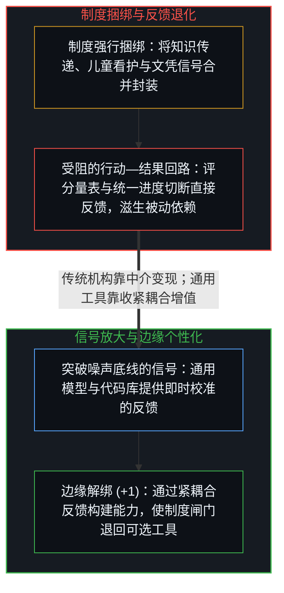
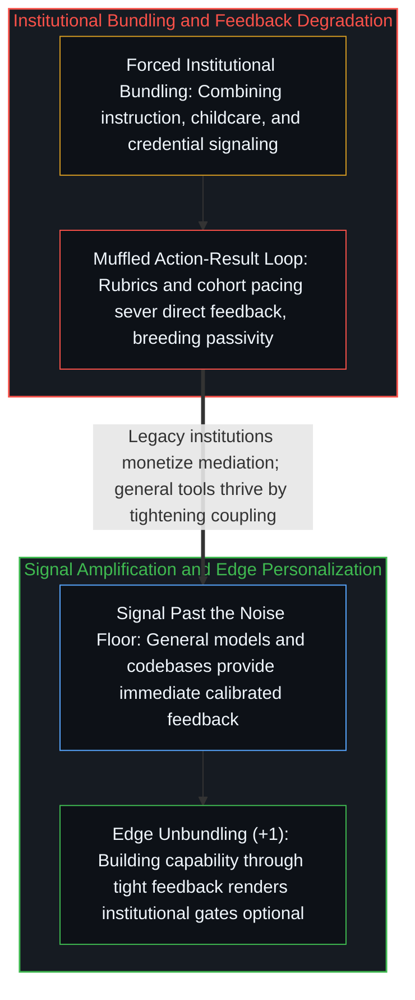

# 人工智能为何正在暴露现代学校教育的致命缺陷 / Why AI Is Exposing the Fatal Flaw in Modern Schooling

*现代学校将教学与文凭认证捆绑并阻隔了行动反馈，而通用人工智能扫清噪声以实现边缘端的紧耦合。 / Modern schooling bundles instruction with credentials and muffles feedback, while general AI clears the noise for tight edge coupling.*

近期一则广为流传的报道盛赞旧金山的 Alpha School：由人工智能授课的学童在全球测评中超越了前千分之一的同龄人，五岁儿童达到九岁学力，青少年掌握大学水平课程。然而任何忽略入学前基线、只汇报结果数据的宣称都极具误导性：一所每年学费高达三万至五万美元、专门筛选高能动性与高社会经济地位家庭的私立学校，其生源在入学前就已处在分布的右尾顶端，这无异于将筛选效应与干预效应混为一谈。更深层的结构矛盾在于：如果人工智能确是带来蜕变的变量，那么再用实体校区、高昂学费与强制坐班课时去包裹它，在结构上便自相矛盾——如果工具管用，外围机构就是冗余开销；如果离开外围机构工具就失灵，那起作用的就不是该工具。

A widely circulated report recently praised San Francisco's Alpha School for having AI-taught students outperform the global top tenth of a percent, with five-year-olds working at a nine-year-old level and teenagers mastering college-level coursework. Yet any claim that reports outcomes while omitting pre-enrollment baselines is misleading: a private school charging 30,000 to 50,000 USD a year and selecting for high-agency, high-socioeconomic-status families draws students who already sit in the upper tail of the distribution before enrollment, confusing selection effects with treatment effects. More fundamentally, if artificial intelligence is the transformative variable, wrapping it in physical campuses, steep tuition, and mandatory seat-time hours is structurally incoherent: if the tool works, the institutional wrapper is redundant overhead; if the tool fails without the wrapper, the tool is not what is doing the work.

## 一、 被掩埋的“行动—结果”紧耦合与制度依赖循环 / 1. Buried Action-Result Coupling and the Institutional Dependency Loop

我自己的家庭实践直接印证了这一结构差异：孩子们每天在自适应精熟平台 MathAcademy 上投入约一小时，辅以前沿模型对定理证明与定制问题的拆解，所建立的结构性理解便远深于以往整日坐班的学校课时，将数年的课程压缩进数月，并把其余时间留给自主项目、玩耍以及与世界的直接接触。学校常以结构化问责、社交情感培养、课程策展与文凭认证来为自身辩护；然而这四项职能对应着四个截然不同的问题——知识传递、社交协调、看护后勤与资格信号——被强行捆绑进同一个工业时代的机构之中，正如[论教育、共振与给人真东西](../on-education/)所追溯的，其标准化优化反而挤占了学习者自身的主体能动性。

In my own household, direct practice confirms this structural difference: children spending roughly one hour a day on the adaptive mastery platform MathAcademy, paired with frontier models to unpack theorem proofs and custom problems, build deeper structural comprehension than full school days ever produced, compressing years of curriculum into months and leaving the rest of the day open for independent projects, play, and direct contact with the world. Schools defend their role by invoking structured accountability, social-emotional development, curriculum curation, and credentialing; yet those four functions are distinct problems—knowledge transmission, social coordination, childcare logistics, and qualification signaling—forcibly bundled into a single industrial-era institution whose standardized optimization crowds out the learner's own agency, as [On Education, Resonance, and Giving Someone the Real Thing](../on-education/) traces.

比效率更深一层的，是行动与后果之间的连接究竟遭遇了什么。每当心智采取行动，而现实在选择、行动与后果的紧耦合闭环中给出即时、无缓冲的反馈时，能力与判断力便随之生长。大众化学校教育却将这条回路系统性地掩埋在评分量表、统一进度、同辈均值与官僚合规之下——即[教育与科学的倒置](../the-reversal-of-education-and-science/)所揭示的记录器替代——直到回传的信号反映的只是制度的优先级，而非该行动直接引发的后果。松散而失真的反馈诱发了习得性被动，正如[加速的自指回环与自我实现的终结叙事](../the-loop-accelerates/)所剖析的，这不断强化“学习者只是离开制度指令便寸步难行的执行者”这一投射；随后，教育机构又反过来指着这种被诱发的被动，证明学生需要更多外部监管与坐班课时控制，用自身造成的反馈退化来为自身的延续辩护。

Beneath efficiency lies what happens to the connection between action and consequence. Competence and judgment grow whenever a mind acts and reality returns immediate, unbuffered feedback in a tight loop of choice, action, and consequence. Mass schooling systematically buries that loop beneath grading rubrics, uniform pacing, cohort averages, and bureaucratic compliance—the register substitution traced in [The Inversion of Education and Science](../the-reversal-of-education-and-science/)—until the returning signal reflects institutional priorities rather than the consequence of the act itself. Loosened, distorted feedback induces learned passivity, reinforcing the projection that the learner is a mere executor who cannot move without institutional direction, as [The Loop Accelerates](../the-loop-accelerates/) traces; the institution then points to that induced passivity as proof that students require ever more external supervision and seat-time control, using the feedback degradation it created to justify its own continuation.

## 二、 突破噪声底线的信号与激励几何的反转 / 2. Signal Past the Noise Floor and the Inversion of Incentive Geometry

人工智能并未发明紧耦合反馈，它只是把信号放大到了制度噪声底线之上。在过去，要想在教育中保住“行动—结果”的直接连接，需要边缘端付出罕见的过滤成本——能看穿制度噪声的父母、肯主动让出路来的良师，或是独自披荆斩棘的自学者。如今，通用模型与如[你的代码库即是记忆](../your-codebase-is-memory/)所剖析的可演进外部知识库直接在底层拉高了信噪比：你发问，系统立即在你当前理解的边界处给出回应；你追问到底，它便陪伴到底；你已经掌握的环节可以瞬间跳过，卡壳的盲区则能反复推敲，脚手架随能力稳固而自然退隐。

Artificial intelligence did not invent tight feedback loops; it amplified the signal past the institutional noise floor. Preserving direct action-result coupling in education previously required rare filtering cost at the edge—parents who saw through bureaucratic noise, teachers willing to step out of the way, or determined autodidacts. Today, general models paired with evolving externalized repositories as traced in [Your Codebase Is Memory](../your-codebase-is-memory/) raise the signal-to-noise ratio at the substrate level: you ask a question and the system responds at the exact frontier of your current comprehension; you push an inquiry to the bottom and it stays with you; you skip what is already mastered, probe the blind spots where you are stuck, and let scaffolding recede as capability solidifies.

这也揭示了激励几何的结构性反转：传统制度与垂直平台靠在行动与结果之间插入厚重中介来抽取租金——走完了[平台并未漂移，它只是走到了终点](../platform-decision-capture/)所揭示的轨迹——而通用智能工具则通过褪去预设剧本、赋能用户边缘端的自适应来获得价值。紧耦合反馈回路依然需要掌舵边缘的判断力，去区分“接收现成答案”与“亲自重走一遍底层结构”——这正是[作业与考试的倒置折射出替代效应](../the-homework-exam-inversion-registers-substitution/)所划出的替代性绕行与辩证性放大之间的分水岭，也是学校从未解决、只用分数和文凭掩盖起来的评估难题。一旦学习建立在行动与后果的直接耦合之上，文凭与体制闸门便从生存必需品还原为按需选配的工具，依赖型制度在信噪比的不对称面前也将失去垄断。

This exposes a structural inversion in incentive geometry: whereas traditional institutions and vertical platforms capture rent by inserting thick mediation between action and outcome—completing the trajectory traced in [The Platform Doesn't Drift, It Completes](../platform-decision-capture/)—general intelligence tools gain value by shedding preset scripts to empower adaptation at the user's edge. A tight feedback loop still requires judgment at the steering edge to distinguish between receiving a finished answer and re-tracing the underlying structure for oneself—the dividing line between substitutive bypass and dialectical amplification traced in [The Homework–Exam Inversion Registers Substitution](../the-homework-exam-inversion-registers-substitution/), and an evaluation problem schools never solved, only obscured behind grades and diplomas. Once learning rests on direct coupling between action and consequence, credentials and institutional gates revert from survival necessities into optional instruments selected on demand, and dependency-based institutions lose their monopoly against the asymmetry in signal-to-noise.
