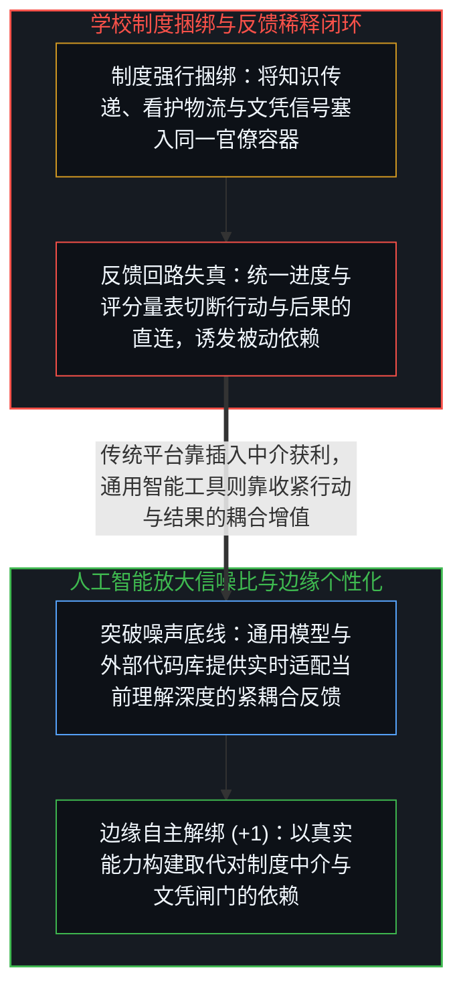
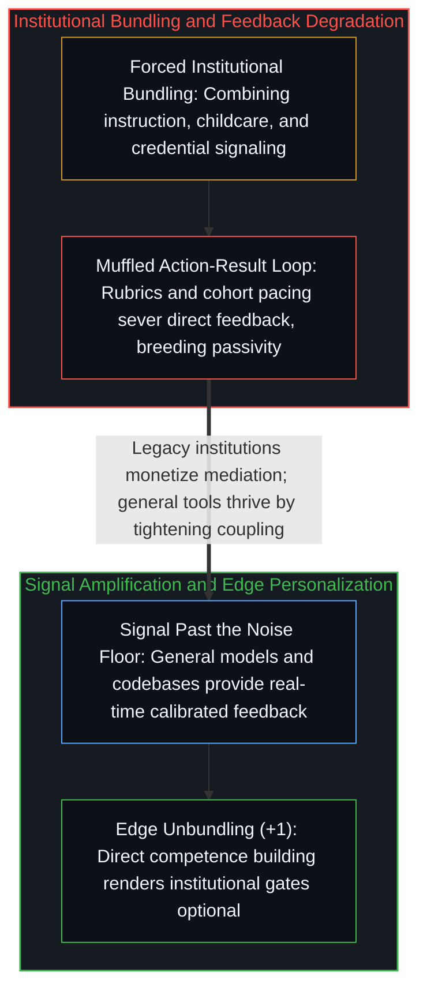

# 人工智能为何正在暴露现代学校教育的致命缺陷 / Why AI Is Exposing the Fatal Flaw in Modern Schooling

*现代学校将知识传递与看护文凭捆绑并稀释了行动反馈，而通用人工智能在边缘端恢复了紧耦合。 / Modern schooling muffles action-result feedback, whereas general AI restores tight edge coupling.*

近期一则广为流传的帖子盛赞旧金山的 Alpha School：由人工智能授课的学童在全球测评中超越了前千分之一的同龄人，五岁儿童达到九岁学力，青少年掌握大学水平课程。然而任何忽略入学前基线、只汇报结果数据的宣传都极具误导性：一所每年学费高达三万至五万美元、专门吸引高能动性与高社会经济地位家庭的私立学校，其生源在入学前就已处在分布的顶端尾部。更深层的矛盾在于：如果人工智能真是带来蜕变的核心变量，那么再用实体校区、高昂学费与强制坐班课时去包裹它，在逻辑上便显得自相矛盾——如果工具管用，外围机构就是冗余开销；如果离开机构工具就不转，那真正起作用的就不是工具。

A widely circulated report recently praised San Francisco's Alpha School for having AI-taught students outperform the global top tenth of a percent. Yet any measurement that omits pre-enrollment baselines in a 30,000 to 50,000 USD private school selecting for high-agency families confuses selection effects with treatment effects. More importantly, if artificial intelligence is the transformative ingredient, wrapping it in mandatory campus hours and institutional tuition is structurally incoherent: if the tool works, the institutional wrapper is overhead; if it requires the wrapper, the tool is not what is doing the work.

## 一、 被掩埋的“行动—结果”紧耦合与制度依赖循环 / 1. Buried Action-Result Coupling and the Institutional Dependency Loop

我自己的家庭实践直接印证了这一结构差异：孩子们每天只需在自适应精熟平台 MathAcademy 上投入约一小时，辅以大模型对定理证明与定制问题的深度拆解，所获得的扎实理解便远超以往一整天的学校课时，将数年的课程压缩进数月，留出充沛的时间去探索项目、玩耍与体验真实生活。学校常以“结构化问责、社交情感培养、课程策展与文凭认证”来为自身辩护；然而这四项职能原本是截然不同的独立问题——知识传递、社交协调、儿童看护与资格信号——只是被工业时代的制度强行捆绑进了同一个机构里（参见[论教育](../on-education/)）。

Direct experience confirms this structural gap: children working roughly one hour a day on adaptive mastery platforms paired with frontier models compress years of curriculum into months with genuine comprehension, leaving the rest of the day open for independent projects and play. Schools defend their role by citing structured accountability, socialization, curriculum curation, and credentialing; yet those are distinct problems—knowledge transmission, social coordination, childcare logistics, and signaling—forcibly bundled into a single institution (see [On Education](../on-education/)).

比效率更核心的，是“行动与结果的连接”究竟遭遇了什么。当一个心智采取行动，而现实直接针对该行动给出清晰反馈时——选择、行动、反馈形成紧耦合闭环——能力与判断力便会自然生长。大众化学校教育却系统性地掩埋了这条回路：学习者的努力被评分量表、统一进度、班级均值与官僚逻辑层层过滤，收回的反馈反映的是制度的优先级而非行动本身的后果。松散而失真的反馈制造出习得性被动，而教育机构反过来指着这种被动证明“学生需要更多外部监管与课时控制”，从而用自身造成的反馈退化来论证自身存续的必要性。

Beneath efficiency lies the fate of the connection between action and result. Competence and judgment develop whenever action meets immediate, unbuffered consequence in a tight loop of choice, execution, and feedback. Mass schooling systematically buries that loop beneath grading rubrics, uniform pacing, cohort averages, and bureaucratic compliance until feedback reflects institutional priorities rather than reality's response. Loosened feedback breeds passivity, and the institution then points to that induced passivity as proof that learners require ever more institutional mediation.

## 二、 突破噪声底线的信号与激励几何的反转 / 2. Signal Past the Noise Floor and the Inversion of Incentive Geometry

人工智能并未发明紧耦合反馈，它只是把信号放大到了制度噪声底线之上。在过去，要想在教育中保住“行动—结果”的直接连接，需要边缘端付出罕见的过滤成本——能看穿制度噪声的父母、肯主动让出路来的良师，或是独自披荆斩棘的自学者。如今，通用模型与如[你的代码库即是记忆](../your-codebase-is-memory/)所剖析的可演进外部知识库直接在底层拉高了信噪比：你发问，系统立即按你当前的真实理解深度给出回应；你追问到底，它便陪伴到底；你已经掌握的环节可以瞬间跳过，卡壳的盲区则能反复推敲，脚手架随能力生长而自然退隐。

Artificial intelligence did not invent tight feedback loops; it amplified the signal past the institutional noise floor. Preserving direct action-result coupling previously required rare filtering capacity at the edge—parents who saw through bureaucratic metrics, teachers who stepped out of the way, or determined autodidacts. Today, general models paired with evolving externalized repositories as traced in [Your Codebase Is Memory](../your-codebase-is-memory/) raise the signal-to-noise ratio at the substrate level: learners query at their exact frontier of comprehension, skip what is mastered, probe where they are stuck, and let scaffolding fade as competence solidifies.

这也揭示了激励几何的结构性反转：传统制度与垂直平台靠“在行动与结果之间插入中介”来捕获价值，中介越厚、依赖越深，抽取的租金就越稳固（参见[平台并未漂移，它只是走到了终点](../platform-decision-capture/)）；而通用人工智能则通过变得更通用、更少预设曲目来赋能边缘端的实时个性化。当然，紧耦合回路依然需要有人在边缘端甄别“得到了回答”与“真正读懂了结构”之间的差异——学校从未解决这一评估问题，只是用分数和文凭掩盖了它。当学习建立在行动与结果的真实耦合之上，文凭与体制闸门便从“生存必需品”还原为“按需选配的工具”，依赖型制度在信噪比的不对称面前终将失去垄断。

This exposes an inversion in incentive geometry: whereas traditional institutions and legacy platforms capture value by inserting mediation between action and outcome (see [The Platform Doesn't Drift, It Completes](../platform-decision-capture/)), general intelligence tools become more valuable the more directly they empower adaptation at the user's edge. Evaluating whether an answer has produced genuine structural understanding still requires judgment at the edge—a task schools never solved, only obscured behind grades and credentials. When competence grows from direct coupling between action and result, institutional gates become optional instruments rather than binding dependencies.
