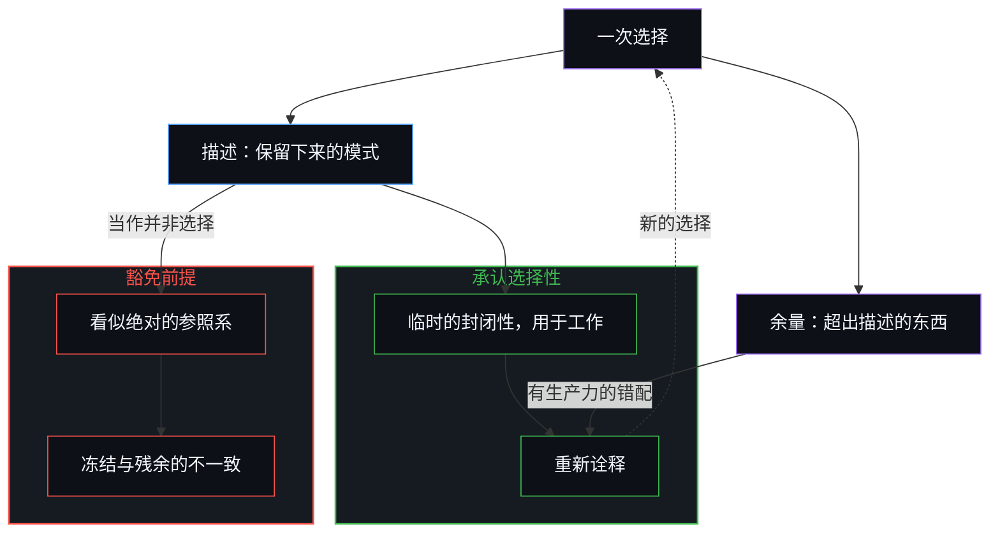
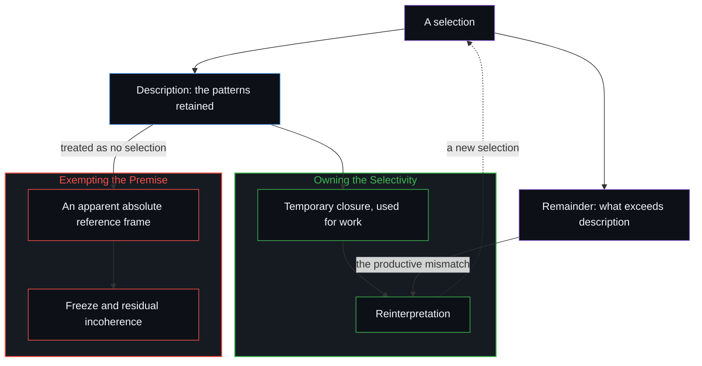

# 选择、矛盾与开放的现实 / Selection, Contradiction, and Open Reality

*每一次选择都生成一个自相矛盾，与超出它的东西形成有生产力的错配 / Every selection generates a self-contradiction, a productive mismatch with what exceeds it.*

从熵或量子信息推导引力的框架，把一份长期存在的张力变得具体：质量可以读作集中到足以登记为物质的信息，引力则是这种集中的统计趋势，而非由引力子传递的力。这个解释与递归的立场相容，却仍是一次选择，并不免于重新诠释。基础层面的种种替代方案以偏好的承诺回应那份余量，各自豁免了自己的出发前提。承认选择性，临时的封闭性便可用于工作，而不被抬升为绝对参照系。

Frameworks that derive gravity from entropy or quantum information make a standing tension concrete: mass reads as information concentrated enough to register as matter, and gravity as a statistical tendency of that concentration rather than a force carried by a graviton. The explanation is coherent with the recursive stance and remains a selection, not exempt from reinterpretation. Foundational alternatives answer the remainder by preferential commitment, each exempting its own starting premises. Owning the selectivity keeps a temporary closure usable for work without raising it into an absolute reference frame.

## 一、 信息引力是一次有力的选择 / 1. Informational Gravity Is a Powerful Selection

任何认真地把信息与物理世界联系起来的尝试，都从一份已经富有成效的张力之中开始。当代从熵或量子信息推导引力的框架，把这张力变得具体。在这些叙述里，质量可以理解为足够复杂的信息，引力看起来不再是由引力子传递的基本力，而是信息的集中与弥散所产生的统计趋势。这样的描述是有力的：它们复现了熟悉的极限，为引力相对于其他力的极度微弱给出一种解释，也为一度被归给暗物质与暗能量的现象打开了重新诠释的可能。然而每种信息描述就其性质而言都是选择性的。它保留某些模式，舍弃一份实际上无穷的细节余量。抽象从不等同于它所追踪的东西。

Any serious attempt to relate information to the physical world begins inside an already productive tension. Contemporary frameworks that derive gravity from entropy or quantum information make the tension concrete. In these accounts, mass can be understood as sufficiently complex information, and gravity appears less as a fundamental force mediated by a graviton than as an emergent statistical tendency arising from the concentration and dispersion of information. Such descriptions are powerful: they recover familiar limits, offer an account of gravity’s extreme weakness relative to other forces, and open possible reinterpretations of phenomena once assigned to dark sectors. Yet every informational description is selective by nature. It retains certain patterns while discarding an effectively infinite remainder of detail. The abstraction is never identical with what it tracks.

看清这一点，关系的两边就都能被握住，而不必强迫它塌缩。信息之所以能解释物理的某些方面，恰恰因为它是物理的一份简化的抽象。登记为物理的东西，始终多出每种描述。这份多出并非站在地图之外的第二种实体。[抽象、边界与现实的移动边缘](../abstraction-boundaries-and-the-moving-edge-of-reality/)已经把这一对二分消解了：物理与信息是同一种活动，只是以两种宽度被登记。[因果与不可化约的先在](../causality-and-the-irreducible-prior/)把它看作层层级联留下的余量：无界的基底，就是当前的压缩尚未收进来的部分。

Seeing this lets both sides of the relation be held without forcing a collapse. Information explains aspects of the physical precisely because it is a simplified abstraction of it. What registers as physical stays in excess of every description. The excess is not a second substance standing outside the maps. [Abstraction, Boundaries, and the Moving Edge of Reality](../abstraction-boundaries-and-the-moving-edge-of-reality/) has already dissolved this pair: physical and informational are one activity registered at two widths. [Causality and the Irreducible Prior](../causality-and-the-irreducible-prior/) reads the excess as the remainder each step of a cascade leaves: the unbounded substrate is whatever the current compression has not yet folded in.

## 二、 模型的边缘不是已被证明的场的边缘 / 2. Model Edges Are Not Demonstrated Edges of the Field

理论中一再出现的边界，量子力学的测量极限、膨胀宇宙的观测视界、黑洞的事件视界，以及终结经典连续体的奇点，都是当前临时模型的边缘。它们标示出某种信息描述在哪里不再可靠，并不构成那些模型所追踪的场已被证明的绝对边缘。超出描述的东西，无法在任何最终的意义上被确认或否认。

The boundaries that keep appearing in the theories, the measurement limits of quantum mechanics, the observational horizon of the expanding universe, the event horizon of a black hole and the singularity that ends the classical continuum, are the edges of current temporary models. They mark where a given informational description stops being reliable. They do not constitute demonstrated absolute edges of the field those models track. What exceeds description cannot be confirmed or disconfirmed in any final sense.

## 三、 偏好的承诺豁免了自己的前提 / 3. Preferential Commitment Exempts Its Own Premises

大多数基础层面的替代方案，以偏好的承诺回应这份多出。可以把信息当作本体上优先的，物理从中涌现；也可以把次序倒过来；或者采取双面论，两者都不在先。每一种立场都可以被严谨地发展，也都有经验上的用处。然而每一种都倾向于把自己的出发前提豁免于它施加给其他立场的审视。这种豁免同时制造了自洽的外观与残余的不一致：一种选择性的描述把自己呈现得仿佛并非选择，一个有用的模型便成了看似绝对的参照系。

Most foundational alternatives answer this excess by preferential commitment. Information may be taken as ontologically primary, the physical as emergent from it. The order may be reversed, or a dual-aspect view adopted in which neither is prior. Each of these positions can be developed with rigor and empirical use. Each, however, tends to exempt its own starting premises from the examination it applies to the others. That exemption produces both the appearance of coherence and the residual incoherence: a selective description presents itself as though it were not selective, and a useful model becomes an apparent absolute reference frame.

信息引力的解释并不是这种豁免。把质量当作足够复杂的信息、把引力当作集中与弥散的统计趋势，是对质量与引力如何被登记的一次选择。把信息当作本体上优先的，则是另一种行为：它豁免了一个出发前提。[复杂性遮蔽了涌现之为心智的行动](../complexity-obscures-emergence-as-the-act-of-mind/)讲的正是这种豁免装扮成脚手架的样子：搭起这层支撑的选择，不再被看作选择。每一次选择都留下一份还没有人见过的余量，这正是[还没有人见过任何东西](../nobody-has-seen-anything-yet/)的要点。

The informational-gravity explanation is not that exemption. Treating mass as sufficiently complex information, with gravity as a statistical tendency of concentration and dispersion, is a selection about how mass and gravity register. Taking information as ontologically primary is a different act: it exempts a starting premise. [Complexity Obscures](../complexity-obscures-emergence-as-the-act-of-mind/) is that same exemption dressed as scaffolding: the choosing that put up the support is no longer seen as choosing. Every selection leaves an excess no one has seen yet, which is the point of [Nobody Has Seen Anything Yet](../nobody-has-seen-anything-yet/).

## 四、 每一次选择都生成一个自相矛盾 / 4. Every Selection Generates a Self-Contradiction

递归的立场从另一种认识出发：每一次选择都生成一个自相矛盾。它不把这矛盾当作要消除或遮挡的缺陷，而视之为生成性的，即任何描述与超出描述之物之间有生产力的错配。[生成性的矛盾](../the-generative-contradiction/)是同一种不肯遮挡，装扮成能动的样子：外部的功劳与内在的作者身份之间的摩擦。这个立场本身也是一次选择，并且明确接受自己作为选择的性质。因为承认这种选择性，它不需要豁免自己的前提；因为不把自己摆成与其他观点彼此排斥，它也不与它们直接矛盾。

The recursive stance begins from a different recognition. Every selection generates a self-contradiction. Rather than treating the contradiction as a defect to be eliminated or shielded, the stance takes it as generative, the productive mismatch between any description and what exceeds description. [The Generative Contradiction](../the-generative-contradiction/) is that same refusal to shield, dressed as agency: the friction of external credit against internal authorship. The stance is itself a selection that explicitly accepts its character as a selection. Because it owns this selectivity, it has no need to exempt its premises. Because it does not present itself as mutually exclusive with other views, it does not stand in direct contradiction with them.

信息引力的解释与这一立场相容：质量是足够复杂的信息，引力是集中与弥散的统计趋势，而不是又一种基本的力。相容并不等于免于重新诠释。替代方案特有的不一致，出现在它们把自己当作仿佛不是选择的时候，也就是试图闭合现实，哪怕只是暂时地，却以一种滑向永久的方式。[开放即一致](../openness-is-consistency/)从另一侧说出同一个要求：强迫一个有限的结构为只会延续的东西奠基，就已经是那种冻结，它让表面的矛盾不断增殖。

The informational-gravity explanation is coherent with this stance: mass as sufficiently complex information, gravity as a statistical tendency of concentration and dispersion rather than a second fundamental. Coherence is not exemption from reinterpretation. The characteristic incoherence of the alternatives arises when they treat themselves as though they were not selections, when they try to close reality, even temporarily, in a manner that slides toward permanence. [Openness Is Consistency](../openness-is-consistency/) names the same demand from the other side: a finite structure forced to ground what only continues is already the freeze that multiplies surface contradiction.

## 五、 临时的封闭性必不可少，永久才是冻结 / 5. Temporary Closure Is Required; Permanence Is the Freeze

临时的封闭性并不被拒斥，任何具体的工作都需要它。信息引力的解释可以被全盘采用。对信息的物理主义叙述与双面论的表述，只要还能产生连贯的预测与干预，就仍可作为闭合来用。冻结，是把任何这样的闭合抬升为永久的闭合。在开放的现实里，登记不到任何绝对参照系；对它的要求，正是前面的推理所放下的那个诱惑。[潜无限与数学思维的暂时闭合](../potential-infinity-and-the-temporary-closures-of-mathematical-thought/)是同一件工具装扮成渐近的样子：确定的比例要求设定一个总测度，而潜在的过程永远不会完成那份被百分比当作已知的清点。

Temporary closure is not refused. It is required for any concrete work. The informational-gravity explanation may be adopted in full. Physicalist accounts of information and dual-aspect formulations remain available as closures for as long as they generate coherent predictions and interventions. The freeze is the elevation of any such closure into a permanent one. Within an open reality no absolute reference frame registers; the demand for one is the temptation the reasoning above sets down. [Potential Infinity and the Temporary Closures of Mathematical Thought](../potential-infinity-and-the-temporary-closures-of-mathematical-thought/) is that same instrument dressed as an asymptote: a definite proportion requires positing a total measure, and the potential process never finishes the inventory the percentage treats as known.

逻辑上的一致与开放，是这个立场对自身的两项要求。二者都无法被定论地证明。试图作定论的证明，本身就会演出正在被审视的那种闭合，重新引入不一致。[论封闭系统、开放心智与证明的界限](../on-closed-systems-open-minds-and-the-limits-of-proof/)是同一道界限装扮成主体之间的样子：没有哪种封闭的描述，能传递那份本需被证明的开放。

Logical coherence and openness are the two conditions the stance requires of itself. Neither can be proved definitively. An attempt at definitive proof would itself enact the closure under examination and reintroduce incoherence. [On Closed Systems, Open Minds, and the Limits of Proof](../on-closed-systems-open-minds-and-the-limits-of-proof/) is that bound dressed as the intersubjective: no closed description transmits the openness that would have to be proved.

## 六、 宣称完成就演出了它所指认的不一致 / 6. A Claim of Completion Performs the Incoherence It Names

由此得出的立场一致而开放，却并不免于重新诠释，信息引力的解释也处在同样的境况中。任何重新诠释，都可能在对闭合的渴望的压力下，重新引入前面那些替代方案一再显露的不一致。所以需要接连不断的澄清。让这个立场保持一致的那份开放，也使它永远不能宣称完成。宣称完成，就会再一次演出它所指认的闭合与不一致。

The position that results is coherent and open, yet not exempt from reinterpretation, and the informational-gravity explanation shares that condition. Any reinterpretation may, under the pressure of the desire for closure, reintroduce the very incoherence the alternatives above kept showing. Successive clarification is therefore required. The same openness that keeps the stance consistent also prevents it from ever claiming completion. A claim of completion would once again perform the closure and the incoherence it identifies.

对这个立场的任何表述，本身也是一次选择。它为了清晰而安排、而舍弃。它仍要接受进一步的重新诠释，不能宣布自己已经完成，否则就与它所描述的开放相矛盾。正是在这份始终可被修订的状态里，这个立场与开放的现实保持一致：开放的现实容许临时的闭合，却从不要求它们变成绝对的。

Any articulation of the stance is itself a selection. It arranges and discards in the service of clarity. It remains subject to further reinterpretation and cannot declare itself finished without contradicting the openness it describes. In that continuing openness to revision, the stance stays aligned with an open reality that permits temporary closures while never requiring them to become absolute.
