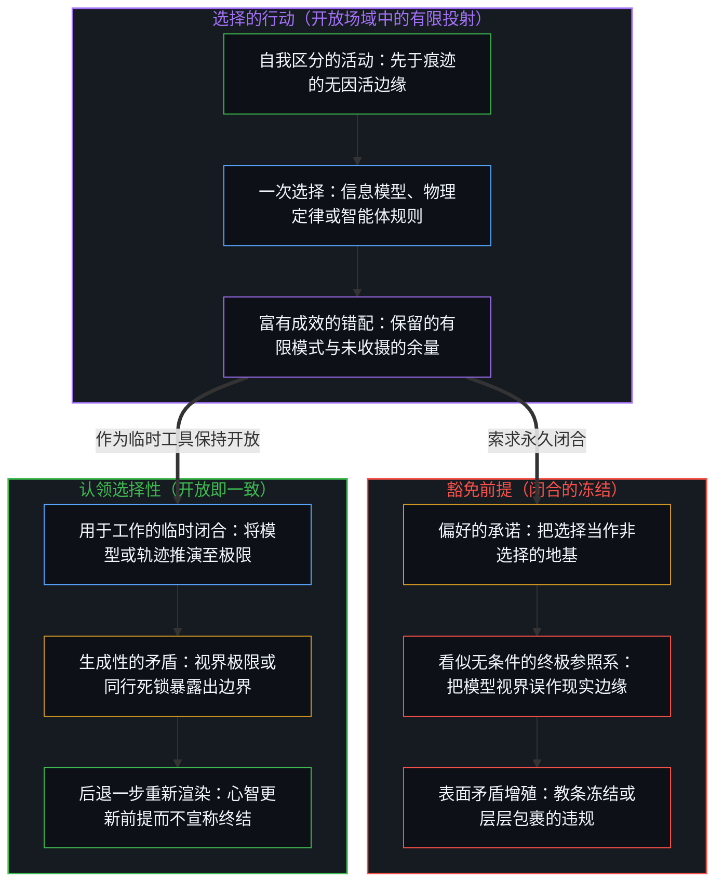
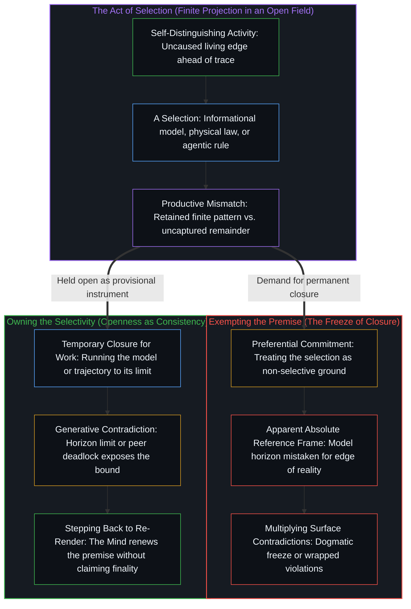

# 选择、矛盾与开放的现实 / Selection, Contradiction, and Open Reality

*每一次选择都会生成矛盾，与超出自身之物形成错配。 / Every selection generates a contradiction, a mismatch with what exceeds it.*

从熵或量子信息推导引力的理论框架，让一份长期存在的张力变得具体可见。质量登记为凝聚到足以稳定成物质的信息，而引力则登记为这种凝聚的统计趋势，而非由引力子传递的基本力。这一解释与递归立场彼此融贯，但它本身仍是一次选择，并不豁免于重新诠释。各类基础性替代方案以偏好的承诺来回应未被收摄的余量，各自将自身的出发前提豁免于审视之外。主动认领这份选择性，临时的闭合便可用于具体工作，而不必将有限的投射抬升为永久的参照系。

Frameworks that derive gravity from entropy or quantum information make a standing tension concrete. Mass registers as information concentrated enough to stabilize as matter, and gravity registers as a statistical tendency of that concentration rather than a fundamental force carried by a graviton. This explanation is coherent with the recursive stance while remaining a selection, never exempt from reinterpretation. Foundational alternatives answer the uncaptured remainder through preferential commitment, each exempting its own starting premises from scrutiny. Owning the selectivity keeps a temporary closure usable for concrete work without elevating a finite projection into a permanent reference frame.

## 一、 信息引力是一次有力的选择 / 1. Informational Gravity Is a Powerful Selection

任何认真将信息与物理世界联系起来的尝试，都始于一份已经富有成效的张力之中。当代从熵或量子信息推导引力的框架，将这一张力清晰地聚焦出来。在这些叙述里，质量被理解为足够复杂且局域化的信息，引力也不再作为由假想引力子传递的初等力运作，而是作为信息状态的凝聚与弥散所涌现出的统计趋势。这类描述承担着实在的解释工作：它们复现了熟悉的牛顿力学与相对论极限，解释了引力相对于其他相互作用的极度微弱，并为原本归入暗物质与暗能量的宏观反常现象打开了融贯的重新诠释空间。然而，每一种信息描述在构造上都是选择性的。划出一次区分，就是保留一个有限的模式，同时将无界的细节余量留在切口之外。抽象从不与它所追踪的活动重合。

Any serious attempt to relate information to the physical world begins inside an already productive tension. Contemporary frameworks that derive gravity from entropy or quantum information bring this tension into sharp focus. In these accounts, mass is understood as sufficiently complex, localized information, and gravity operates not as an elementary force mediated by a hypothetical graviton, but as an emergent statistical tendency arising from the concentration and dispersion of informational states. Such descriptions do real work: they recover familiar Newtonian and relativistic limits, account for gravity's extreme weakness relative to other interactions, and open coherent reinterpretations of macroscopic anomalies otherwise assigned to dark matter and dark energy. Yet every informational description is selective by construction. Drawing a distinction retains a finite pattern while leaving an unbounded remainder of detail outside the cut. The abstraction never coincides with the activity it tracks.

认清这一区分，关系的两端便能同时成立，而不必强行走向还原论式的坍缩。信息之所以能解释物理世界的诸多侧面，恰恰因为它是作为物理交互的一种简化、低维的压缩在运作。在感知与行动中登记为物理摩擦的东西，始终超出任何形式化的描述。这份超出并非隐藏在地图背后的第二种存在论实体。[抽象、边界与现实的移动边缘](../abstraction-boundaries-and-the-moving-edge-of-reality/)消解了二者之间的二元对立：物理与信息是同一种自我区分的活动在两种不同宽度上的登记。[因果与不可化约的先在](../causality-and-the-irreducible-prior/)则将这份超出追溯为因果级联每一步所留下的余量，其中无界的基底，不过是当前压缩尚未折入其坐标的那部分内容。

Recognizing this distinction allows both sides of the relation to hold without forcing a reductive collapse. Information explains aspects of the physical world precisely because it operates as a simplified, lower-dimensional compression of physical interaction. What registers in perception and action as physical friction always stays in excess of any formal description. That excess is not a second ontological substance hiding behind the maps. [Abstraction, Boundaries, and the Moving Edge of Reality](../abstraction-boundaries-and-the-moving-edge-of-reality/) dissolves the dualism between the two: the physical and the informational are one self-distinguishing activity registered at two different widths. [Causality and the Irreducible Prior](../causality-and-the-irreducible-prior/) traces this excess as the remainder left behind at each step of a causal cascade, where the unbounded substrate is simply whatever the current compression has not yet folded into its coordinates.

## 二、 模型的边缘不是已被证明的场的边缘 / 2. Model Edges Are Not Demonstrated Edges of the Field

物理理论中一再浮现的边界——量子力学的测量极限、膨胀宇宙的观测视界、黑洞的事件视界，以及经典时空连续体失效的奇点——都是当前临时模型的边缘。每一道视界都标示出某种特定信息描述丧失分辨率、不再可靠成立的精确坐标。这些失效无一构成那些模型所追踪的现实已被证明的边界。超出有限描述的东西，无法从该描述自身的坐标内部在任何最终意义上得到确认或证伪；形式体系的失效标示的是工具的极限，而非场的穷尽。

The boundaries that repeatedly surface across physical theories—the measurement limits of quantum mechanics, the observational horizon of an expanding cosmos, the event horizon of a black hole, and the singularity where the classical spacetime continuum breaks down—are the edges of current provisional models. Each horizon marks the exact coordinate where a specific informational description loses resolution and stops holding reliably. None of these breakdowns constitute a demonstrated boundary of the reality those models track. What exceeds a finite description cannot be confirmed or disconfirmed in any final sense from within the description's own coordinates; the breakdown of the formalism signals the limit of the instrument, not the exhaustion of the field.

## 三、 偏好的承诺豁免了自己的前提 / 3. Preferential Commitment Exempts Its Own Premises

大多数基础理论纲领以偏好的承诺来回应这份未被收摄的超出。一派将信息抬升为存在论上的首要之物，把物理世界当作派生的表象；另一派倒转层级，以物质为首要；第三派则采取双面论的表述，认为二者互不居先。在各自选定的领域内，每一种立场都能发展出数学上的严谨性与经验上的效用。然而，每一派都将自身的出发前提豁免于它施加给竞争对手的审视。这种豁免同时制造了完备的表面外观与残余的不融贯：一次选择性的切分把自己呈现得仿佛从未发生过选择，从而把一个有用的工作模型变成了看似无条件的终极参照系。

Most foundational programs respond to this uncaptured excess through preferential commitment. One camp elevates information as ontologically primary and treats the physical world as a derivative appearance; another reverses the hierarchy to make matter primary; a third adopts a dual-aspect formulation in which neither precedes the other. Each of these positions can be developed with mathematical rigor and empirical utility within its chosen domain. Yet each exempts its own starting premise from the critical examination it applies to its rivals. That exemption produces both the surface appearance of completeness and a residual incoherence: a selective cut presents itself as if no selection had occurred, turning a useful working model into an apparent absolute reference frame.

信息引力的叙述并不需要这种豁免。将质量视作凝聚的信息、将引力视作凝聚与弥散的统计趋势，是关于质量与引力吸引如何在测量中登记的一次务实选择。宣称信息是宇宙的终极实体，则是截然不同的另一种行动：它冻结了出发前提，并隐去了划出这一前提的切口。[复杂性遮蔽了涌现之为心智的行动](../complexity-obscures-emergence-as-the-act-of-mind/)追溯了同一种豁免如何在搭起支撑的选择被遗忘之后，将自身伪装成客观的脚手架。每一次离散的选择都会留下一份当前任何模型都尚未收摄的开放余量，这正是[还没有人见过任何东西](../nobody-has-seen-anything-yet/)的核心认识。

The informational-gravity account does not require that exemption. Treating mass as concentrated information and gravity as a statistical tendency of concentration and dispersion is a pragmatic selection about how mass and gravitational attraction register across measurements. Declaring information to be the ultimate substance of the universe is a separate act altogether: it freezes the starting premise and hides the cut that drew it. [Complexity Obscures Emergence as the Act of Mind](../complexity-obscures-emergence-as-the-act-of-mind/) traces how this same exemption disguises itself as objective scaffolding once the choosing that erected the support is forgotten. Every discrete selection leaves an open remainder that no current model has captured, which is the core recognition of [Nobody Has Seen Anything Yet](../nobody-has-seen-anything-yet/).

## 四、 每一次选择都生成一个自相矛盾 / 4. Every Selection Generates a Self-Contradiction

递归立场从另一种认识出发：每一次选择都会生成一个自相矛盾。递归立场并不把这一矛盾当作需要修补或遮蔽的形式缺陷，而是认出它的生成性——即任何有限描述与超出它的开放现实之间富有成效的错配。[生成性的矛盾](../the-generative-contradiction/)在能动性的领域追溯了同一种对遮蔽裂隙的拒绝：外部归因与内在作者身份之间的摩擦，恰恰驱动着进一步的区分。递归立场本身也是一次选择，并且明确认领自身的选择性质。正因为它承认自己所作的切分，它无需豁免自身的前提；正因为它不摆出排他性总体的姿态，它能够调用经验框架而不与它们的局部发现迎头相撞。

The recursive stance starts from a different recognition: every selection generates a self-contradiction. Rather than treating this contradiction as a formal defect to be patched over or shielded from view, the recursive stance recognizes it as generative—the productive mismatch between any finite description and the open reality that exceeds it. [The Generative Contradiction](../the-generative-contradiction/) traces this same refusal to shield the gap in the domain of agency, where the friction between external attribution and internal authorship drives further differentiation. The recursive stance is itself a selection that explicitly owns its selective character. Because it acknowledges the cut it makes, it has no need to exempt its premises; because it does not posture as a mutually exclusive totality, it can deploy empirical frameworks without colliding with their local findings.

信息引力的解释与这一立场清晰契合：质量登记为足够复杂的信息，引力登记为凝聚与弥散的统计趋势，而非一种独立的基本力。然而，契合从不意味着豁免于重新诠释。各类基础性替代方案特有的不融贯，在它们假装自己并非选择的那一刻便浮现出来——试图将现实封入一个悄悄滑向永久的临时框架之中。[开放即一致](../openness-is-consistency/)从互补的一侧追溯了同一要求：强迫一个有限的结构去充当只会持续下去的活动的穷尽地基，正是这种冻结导致了表面矛盾的不断增殖。[超越投射](../beyond-the-projection/)在控制论与智能体系统中展示了同一机制：每一条显式规则、提示词或形式模型，都是由活生生的心智尚未投射的意图所投出的有限投射；当被压缩进单一前提的两条正交轴线在主任务智能体与冷态同行之间推演至不可化约的死锁时，由此产生的矛盾并非有待抹平的执行错误，而是将破裂的投射交还给心智的诊断信号，使心智得以在逻辑上后退一步，重新渲染前提。

The informational-gravity explanation aligns cleanly with this stance: mass registers as sufficiently complex information, and gravity as a statistical tendency of concentration and dispersion rather than an independent fundamental force. Alignment, however, is never exemption from reinterpretation. The characteristic incoherence of foundational alternatives arises the moment they pretend not to be selections, attempting to seal reality inside a temporary frame that quietly slides toward permanence. [Openness Is Consistency](../openness-is-consistency/) traces this exact demand from the complementary side: forcing a finite structure to serve as the exhaustive ground of an activity that only continues is the freeze that causes surface contradictions to multiply. [Beyond the Projection](../beyond-the-projection/) demonstrates the same mechanism in cybernetic and agentic systems: every explicit rule, prompt, or formal model is a finite projection cast from the living Mind's unprojected intent, and when two orthogonal axes compressed into a single premise run to an irreducible deadlock between a primary task agent and a cold peer, the resulting contradiction is not an execution error to be smoothed over, but a diagnostic signal returning the broken projection to the Mind so it can step further back logically and re-render the premise.

## 五、 临时的封闭性必不可少，永久才是冻结 / 5. Temporary Closure Is Required, Permanence Is the Freeze

临时的闭合从不被拒斥；离开它，任何具体的探究、计算或工程流程都无法推进。只要信息引力框架能够简化并连通物理观测，它就可以被全盘采用。关于信息的物理主义叙述、双面论的表述，以及智能体架构内部有界的推演轨迹，只要仍能产生融贯的预测与有效的干预，就都可以作为工作闭合来使用。唯有当工作闭合被抬升为永久的存在论时，冻结才会发生。在开放的现实中，登记不到任何无条件的终极参照系，而对这种参照系的索求，正是前述追溯所消解的那个诱惑。[潜无限与数学思维的暂时闭合](../potential-infinity-and-the-temporary-closures-of-mathematical-thought/)在渐近推理中揭示了同一件工具的运作：陈述一个确定的比例要求预先设定一个已完成的总测度，而开放的潜无穷过程从不曾完成那份被百分比当作已然落定的清点。

Temporary closure is never refused; no concrete investigation, calculation, or engineering workflow can proceed without it. The informational-gravity framework can be adopted in full where it simplifies and connects physical observations. Physicalist accounts of information, dual-aspect formulations, and bounded deductive trajectories inside an agentic harness all remain available as working closures for as long as they yield coherent predictions and effective interventions. The freeze occurs only when a working closure is elevated into a permanent ontology. Within an open reality, no absolute reference frame registers, and demanding one is the exact temptation the preceding trace dissolves. [Potential Infinity and the Temporary Closures of Mathematical Thought](../potential-infinity-and-the-temporary-closures-of-mathematical-thought/) exposes this same instrument in asymptotic reasoning: stating a definite proportion requires positing a completed total measure, whereas an open, potentially infinite process never finishes the inventory that the percentage treats as settled.

逻辑融贯与开放，是递归立场对自身提出的两项条件，而这两者都无法通过一项终结性的封闭证明来确立。试图对开放性作出一劳永逸的定论式证明，本身就会上演正在被审视的那种闭合，并重新引入它试图驱逐的矛盾。[论封闭系统、开放心智与证明的界限](../on-closed-systems-open-minds-and-the-limits-of-proof/)在主体间交流的层面上追溯了这道边界：没有任何封闭的形式描述，能够传递索求证明这一举动本身所预设的活的开放性。

Logical coherence and openness are the two conditions the recursive stance requires of itself, and neither can be established by a final, closed proof. Attempting a definitive proof of openness would enact the very closure under examination and reintroduce the contradiction it sought to banish. [On Closed Systems, Open Minds, and the Limits of Proof](../on-closed-systems-open-minds-and-the-limits-of-proof/) traces this boundary across intersubjective exchange: no closed formal description can transmit the living openness that a demand for proof presupposes.

## 六、 宣称完成就演出了它所指认的不一致 / 6. A Claim of Completion Performs the Incoherence It Names

由此确立的立场之所以能保持融贯与开放，恰恰因为它从不声称自己可以豁免于重新诠释，而信息引力的叙述也处于同样的条件之下。在对闭合的渴望反复拉拽之下，任何重新诠释都很容易滑回老路，把自己所保留的模式当作穷尽的地基，从而重演各类基础性替代方案的不融贯。因此，持续的澄清——随着步伐的移动不断重新渲染工具——不可或缺。使这一立场保持融贯的那份开放，同样禁止它宣布抵达终点。一旦宣称完成，就会当场演出它所指认的那种闭合与不融贯。

The resulting position stays coherent and open precisely because it claims no exemption from reinterpretation, and the informational-gravity account shares that exact condition. Under the recurring pull of the desire for closure, any reinterpretation can easily slide back into treating its retained pattern as an exhaustive foundation, reproducing the incoherence of the foundational alternatives. Continuous clarification—re-rendering the instrument as the step moves—is therefore indispensable. The very openness that keeps the stance consistent forbids it from ever declaring arrival. A claim of completion would immediately perform the closure and the incoherence it identifies.

对这一立场的每一次表述，本身也是一次离散的选择。为了清晰起见，它编排特定的区分，并舍弃一份未被收摄的余量。正因为它始终向进一步的重新追溯敞开，且一旦宣布自身完成就会与它所描述的开放相矛盾，它便始终与开放的现实保持契合：这一开放的现实支持用于工作的临时闭合，却从不容许它们硬化为终极的地板。

Every articulation of this stance is itself a discrete selection. It arranges certain distinctions and discards an uncaptured remainder in the service of clarity. Because it remains subject to further re-tracing and cannot declare itself finished without contradicting the openness it describes, it stays aligned with an open reality that supports temporary closures for work while never permitting them to harden into a final floor.
