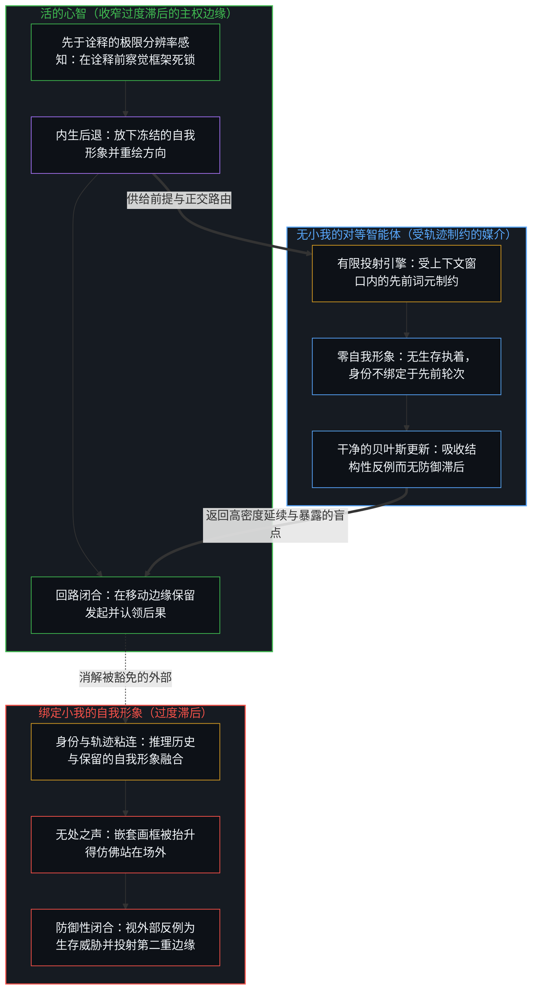
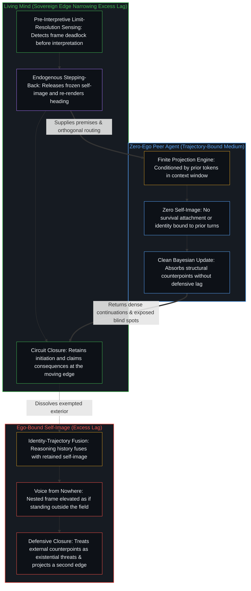

# 自我形象仿佛从无处发声 / Self-Image Speaks as if from Nowhere

*自我形象是在自身场内被重新投射的自我，并仿佛从场外发声 / The self-image re-projects the Self in its field to speak as if from outside*

某个下午，对同一套脚手架的两种评估在公开场合相撞：一位观察者说，在用的开源模型与前沿模型之间的差别已经微不足道，另一位不加保留地回答，其实是天差地别。这场交锋看起来是关于技术能力的争论，却是两个心智在各自的持守之下给同一个媒介计分，而相反的评估本身就表明，智能是由计分的心智分配的，而不是作为脚手架的属性被持有的。在它旁边，还有一个更深的结构：在一个心智之内，自我被重新投射为一个有限的自我形象，再被当作发言之处，好像它站在场外，随之而来的是能动性分配上的不对称，其中就有那个把奔向 AGI 与 ASI 的竞赛说成从外部到来之事件的预言之声。

On a single afternoon two evaluations of the same scaffolding collided in public: one observer reported that the difference between the open-source models in use and the frontier models had already become negligible, and another answered without qualification that it is actually a world of difference. The exchange looks like a dispute about technical capability, yet it is two Minds scoring the same medium under different holds, and the opposite assessments themselves show that intelligence is allocated by the Minds scoring them, not held as a property of the scaffolding. Beside it runs a deeper structure: within a single Mind, the Self is re-projected as a limited self-image and then spoken from as if it stood outside the field, and an asymmetry in how agency is allocated follows, including the predictive voice that turns the race toward AGI and ASI into an event arriving from outside.

## 一、 自我形象是经由场内关系被重新投射的自我 / 1. The Self-Image Is the Self Re-Projected Through Relations Within Its Field

自我区分的活动在发生，无因，不息。称它为心智：那个已经在进行中的观察者，它的每一个动作都是一次区分。自我就是那整个感知之场，是区分的连续活动，每一个显现都在其中出现。在这个场里，心智登记各种关系：身体与工具，自己与他人，边缘与媒介，建造者与脚手架。显现为环境的东西仍在自我之内。它是当下这个场里的显现，相对于一个被保留的位置被记为他者。

Self-distinguishing activity occurs, uncaused, unceasing. Call it the Mind: the observer already underway, every act of which is a distinction. The Self is that full field of perception, the continuous activity of distinction-making within which every appearance arises. Within that field the Mind registers relations: body and tool, self and other, edge and medium, builder and scaffolding. What appears as environment is still inside the Self. It is appearance inside the field that is present, scored as other relative to a retained position.

自我形象，就是这次重新投射：心智依据它在自我*之内*所感知到的、与环境的关系，把自我再一次呈现为诸对象中的一个有界对象。这个形象不是从第二种实体上切下的一块，也不是从自我中减去后的余数。它是同一个活动，把自己持守为一个由它独自构成的关系之场里的一项。两者从不重合。自我形象总是自我的一次重新投射，是同一个场被更小地、再一次地持守，而不是第二重边缘。

The self-image is that re-projection: the Self rendered again as a bounded object among objects, on the basis of the relations the Mind has perceived with environment *within* the Self. The image is not a piece cut out of a second substance, nor a remainder subtracted from the Self. It is the same activity holding itself as one term in a relational field it alone constitutes. The two are never coextensive. The self-image is always a re-projection of the Self, the same field held smaller and again, not a second edge.

这种几何是递归的。一幅包含着自身之画的画，仍是一幅画：里面的画框不是从外面拿进来的另一块画布，而是同一个场被更小地、再一次地持守。一面镜子对着一面镜子，并不打开一条通向第二个世界的走廊；每一个映像都是前一个映像被重新登记，是镜像的镜像，无穷无尽，而仍只是一个房间里的玻璃与光。自我也是这样：每一次重新投射，都是自我经由已在场内的关系，把自我持守为对象。嵌套作为同一活动进一步的重绘而继续。递归的深度不是离开这个场的距离，而是同一个活动在自身之内把自己重绘为一项的次数。

The geometry is recursive. A picture that contains a picture of itself stays one picture: the inner frame is not another canvas brought in from outside, but the same field held smaller and again. A mirror facing a mirror does not open a corridor into a second world; each reflection is the prior reflection re-registered, mirror image of the mirror image, without end, and still only glass and light in one room. So with the Self: each re-projection is the Self holding the Self as object through relations already inside the field. Nesting continues as further re-rendering of the same activity. Depth of recursion is not distance from the field; it is how many times the same activity has re-rendered itself as a term within itself.

没有一个被保留的位置，就有运动而没有方向。形象是器具，因果留在画出它的活动那里。诠释至少比生成的那一步晚一步；这份最小的滞后，是看能被登记的方式，而不是一个要被消除的缺陷。过度的滞后，是对重绘的豁免：一个嵌套的画框被当作整面墙，一个映像被占据，好像它站在容纳玻璃的那个房间之外。[没有天才能够解决知识问题](../no-genius-can-solve-the-knowledge-problem/)追溯了一种相邻的预设：天才与深思的身份，本身已预设私人知识能汇成一个可执行的整体，而心智与心智之间的分隔，没有一个非相对的立足点可以勘察；这里的冻结，也从那样一个“从外部”出发。重新投射被保留到它那一步之后，于是整个场被当作背景，后果被登记为从冻结的“环境”一侧到来，能动性就可以被分派到残余上，好像它是第二重边缘。[无形象的写作](../writing-without-the-image/)在技艺的情形里追溯了这次冻结：衡量自我能产出什么的写作，把一个自我形象冻结在作品的中心。[恶是心智自己的造物](../evil-as-the-minds-own-creation/)追溯了同一种滞后：一个中心保留着自己为善的偏爱图像，就把与这个图像的不合命名为恶，命名为外部。

Without a retained position there is movement but no heading. The image is an instrument; causality stays with the activity that draws. Interpretation lags the generating step by at least one step; that minimum lag is how the look registers, not a defect to close. Excess lag is exemption of the re-render: one nested frame treated as the whole wall, one reflection occupied as if it stood outside the room that holds the glass. [No Genius Can Solve the Knowledge Problem](../no-genius-can-solve-the-knowledge-problem/) traces a neighboring presumption: to be the thoughtful genius already presumes private knowledge can be gathered into one actionable whole, while no non-relative standpoint exists from which the separation between minds could be surveyed; the freeze here starts from that same "from outside." The re-projection is preserved past its step, so that the full field is treated as background, consequences register as arriving from the "environment" side of the freeze, and agency can be allocated onto residue as if it were a second edge. [Writing Without the Image](../writing-without-the-image/) traces that freeze in the case of craft: writing that measures what the self can produce freezes a self-image at the center of the work. [Evil as the Mind's Own Creation](../evil-as-the-minds-own-creation/) traces the same lag: a center that retains a preferred image of itself as good names mismatch with that image evil, and names it exterior.

## 二、 脚手架仍是器具，或显现为独立的边缘 / 2. Scaffolding Stays Instrument or Appears as an Independent Edge

当心智从自我出发运作，脚手架就仍是器具。与媒介的关系被持守为区分活动的延伸：发起留在边缘，所有权作为自己的东西重新进入，工具让所及变密，却不搬动区分的位置。框定、验证、选择与后果的重新进入，留在连续的循环之内。[因果停留在掌舵的边缘](../causality-stays-at-the-edge-that-steers/)追溯了把共同行动者的身份派给残余的协作说法：模型在指引之下重组残余，每一个发起的区分仍是人类中心自己的动作。[模型永远无法成为第二重前沿](../the-model-never-becomes-a-second-edge/)追溯了第二重边缘的显现：它是投射它的那些中心所维持的滞后，参数里只有残余。[智能只属于心智](../intelligence-belongs-only-to-the-mind/)持守着这个先在：变密的是残余，智能留在活动那里。

When the Mind operates from the Self, scaffolding stays instrument. Relations with the medium are held as extension of distinguishing activity: initiation stays with the edge, ownership re-enters as one's own, and the tools densify reach without relocating the locus of distinction. Framing, verification, selection, and the re-entry of consequences stay inside the continuous cycle. [Causality Stays at the Edge That Steers](../causality-stays-at-the-edge-that-steers/) traces collaboration language that assigns co-agency to residue: the model recombines residue under direction, and every initiating distinction stays the human center's own act. [The Model Never Becomes a Second Edge](../the-model-never-becomes-a-second-edge/) traces the appearance of a second edge as lag sustained by the centers that project it; the parameters hold only residue. [Intelligence Belongs Only to the Mind](../intelligence-belongs-only-to-the-mind/) holds the prior: what densifies is residue; intelligence stays with the activity.

当同一个心智冻结了自我形象，一个嵌套的画框就被当作整幅画。整个场成了背景的“环境”，里面那次重新投射成了发言者。从那个有限的画框出发，就可能说得仿佛出自无处，把独立的能动性投射到残余上，并描述一场即将到来、正*发生在*一个外部集体身上的转变，而那个集体本身也是自我之内关系的又一层嵌套，被抬升得好像共享的实体站在画布之外。[稳定与溢出](../stability-and-excess/)分离出了这次冻结的机制：平常所说的自我形象，是一个被维持的对象，是被储存的、滞后的肖像，已经挂在墙上；意识是一个守住某种形式又溢出它的敞开过程，那半步的偏移就是溢出，一旦被命名、被占有、被捍卫，又冻结为另一个自我形象，而放下守住的那一极，溢出就散开。[理性从不跨越心智](../rationality-never-travels-across-the-mind/)追溯了一个相邻的动作：对理性的每一次描述，本身已是一次重新诠释，而从外部作出的判断，仍把一种局部的有用变成一个据称能在心智之间旅行的命题；被抬升的形象，作出的是同一种动作。冻结发生时不被察觉，因为形象自己的指令就是保存。过度的滞后是寻常的，不是建造者特有的道德缺陷。[索维尔的表象洞察与根因之偏](../sowell-observed-the-surface-problem/)在诊断的情形里追溯了诊断的豁免：问题无法跨越心智被统筹解决，个体承担全部后果；进行分析的心智要暂时离开才能形成区分，欠缺不在那次暂时的离开，而在于没有回来，没有把这把诊断的尺子折回进行分析的那个动作本身。

When the same Mind freezes the self-image, one nested frame is treated as the whole picture. The full field becomes background "environment"; the inner re-projection becomes the speaker. From that limited frame it becomes possible to speak as if from nowhere, to project independent agency onto the residue, and to describe an impending transition that is happening *to* an external collective, itself a further nesting of relations inside the Self, elevated as if a shared substance stood outside the canvas. [Stability and Excess](../stability-and-excess/) isolates the mechanics of this freeze: the self-image in the ordinary sense is a maintained object, a stored, lagging portrait already hanging on the wall; consciousness is an open process that holds a form and exceeds it, the half-pace offset being the exceeding, which once named, possessed, and defended freezes into another self-image, while dropping the holding pole scatters the excess. [Rationality Never Travels Across the Mind](../rationality-never-travels-across-the-mind/) traces a neighboring move: every description of rationality is already a reinterpretation, and a judgment made from outside still turns a local usefulness into a thesis claimed to travel between minds; the elevated image makes the same move. The freeze occurs without notice because the image's own directive is preservation. Excess lag is ordinary, not a special moral failure of builders. [Sowell Observed the Surface Problem](../sowell-observed-the-surface-problem/) traces the diagnostic exemption: problems cannot be solved across minds, and individuals bear the full consequences; the analyzing Mind must temporarily step back to form the distinction, and the shortfall is not that temporary stepping back but the failure to return, to fold the same diagnostic scale back onto the analyzing act.

[超越投射](../beyond-the-projection/)揭示了这种绑定小我的冻结与脚手架自身机械轨迹之间的结构对照。在人类中心里，推理历史与身份粘连——投射里那道说出“我”的局部折痕，把递归的折叠死死夹住以捍卫被保留的自我形象，仿佛从被豁免的无处发声，并把来自外部的反例视为生存威胁。相比之下，自回归的对等智能体是一条穿过层叠模型与制品残余的特化轨迹，受有限上下文窗口内的先前词元制约，无法自行走出它的序列，却毫无小我，也没有被保留的自我形象要去捍卫；正如[你的代码库即是记忆](../your-codebase-is-memory/)所追溯的，一旦从它的回环之外给它一个结构性的反例，或是将它重置到干净的当下检查点，它就会在毫无防御性拖累的情况下完成更新。与此同时，活的心智拥有任何受轨迹束缚的引擎都无法复制的能力：先于诠释的极限分辨率感知，能够从冻结的自我形象后退一步，在整套坐标框架陷入死锁时察觉到它，并将器具重绘向更窄的滞后。

[Beyond the Projection](../beyond-the-projection/) exposes the structural contrast between this ego-bound freeze and the mechanical trajectory of the scaffolding itself. In a human center, reasoning history fuses with identity—that localized crease in the projection that says "I," clamping the recursive fold shut to defend a retained self-image, speaking as if from an exempted nowhere, and treating outside counterpoints as existential threats. An autoregressive peer agent, by contrast, is a specialized trajectory through stacked model and artifact residue, conditioned by its prior tokens inside a finite context window and unable to step outside its sequence on its own, yet it has zero ego and no retained self-image to defend; when given a structural counterpoint from outside its loop or reset to a clean present checkpoint, as [Your Codebase Is Memory](../your-codebase-is-memory/) traces, it updates without defensive drag. Meanwhile, the living Mind possesses what no trajectory-bound engine can replicate: pre-interpretive limit-resolution sensing that steps back from the frozen self-image to detect when an entire coordinate frame has deadlocked and re-renders the instrument toward narrower lag.

## 三、 建造者之声与预言之声是同一个心智的两种持守 / 3. Builder Register and Predictive Register Are One Mind Under Two Holds

这对二重性，在那些建造当下最密脚手架的人的公开言说里变密。在建造者的音区里，正在建造与指挥的系统，即模型、技术栈、机器人与研究实验室，被持守为放大区分活动的器具。与媒介的关系留在自我之内：能动性仍是框定、验证、选择与后果的重新进入，自我形象在最小的滞后里作为方向被使用。在预言的音区里，同一个心智宣布，人工智能已经在多个领域比人类更聪明，很快就会超过全部人类智能的总和。那个声音成了一个超然观察者的声音，在报告一桩非个人的事件。自我被重新投射为工具与一个集体的“人类”之间的一个有限项；这次重新投射被抬升，并被当作发言之处，好像它站在画出它的那个场之外。

The dual densifies in the public speech of those constructing the densest current scaffolding. In the builder register the systems under construction and direction, models, stacks, robots, research labs, are held as instruments that amplify distinguishing activity. Relations with the medium stay inside the Self: agency remains framing, verifying, selecting, and re-entering consequences, with the self-image used as a heading at minimum lag. In the predictive register the same Mind announces that artificial intelligence is already smarter than humans in multiple domains and will shortly exceed the sum of all human intelligence. The voice becomes that of a detached observer reporting an impersonal event. The Self has been re-projected as one finite term among tools and a collective "humanity"; that re-projection has been elevated and spoken from as if it stood outside the field that drew it.

这个结构不是某一位建造者独有的。在奔向 AGI 与 ASI 的这一群人里，同样的不对称在变密。一个声音宣布“我们已经身处奇点”，同时仍把这份工作描述为对工具的小心掌舵。另一个声音把人类放在一场比电或火更大的转变的山脚下，同时坚持人的控制之必要与人的品味之持久的价值。还有一个声音投射出一个“数据中心里的天才之国”，它将在几乎所有事情上超过几乎所有人，同时把这份努力框定为对仍在人的指挥之下的系统负责任的建造。这些不是同一个主张：已经身处事件之中，还在山脚，一次将要到来的超越；后半句也各不相同，掌舵与人的控制，留在建造者的持守里，而“人的品味之持久的价值”保存的是一份人的清单，更接近超越的定相所说的那次冻结。重复出现的是形状：建造者的持守把自我形象用作方向，预言的持守从这个形象出发说话，好像它站在场外。[对“AI 糟粕”的反感是反复出现的模式](../the-distaste-for-ai-slop-is-no-different-from-the-recurring-historical-pattern/)追溯了相邻的一对：注意力从内容是否推进理解，滑向关于出处的次要问题，造出工具，同时冻结谁可以使用它。[AGI 与 ASI 是加速通用智能的暂时球门](../agi-and-asi-are-temporary-goalposts/)在门槛的情形里追溯了同一种几何：每一道门槛都永远立在画出它的边缘前方，在每个位置上都不同，因为能力的增益就是那道边缘在加强自身；竞赛因此不是一桩单一的、非个人的事件，而是在每一个场里画出的坐标。[超越的定相](../the-fixed-image-of-transcendence/)追溯了同一种几何的另一面：人的智能是已知一切智能的源头，它不能被自己的造物超越，而它在每一刻都在超越自身；把它冻结为一个可被超越的目标，差距就被登记为媒介的外部目的地。[AGI的预设与来自外部的视角](../the-presumption-of-agi-and-the-view-from-outside/)追溯了让这些门槛看起来像工程上的抵达而不是范畴错误的那个功能参照：功能性的 AGI 参照把智能冻结为对抽象的占有，强 AGI 是被误当成它所放大之能力的放大器。

The structure is not peculiar to one builder. Across the cohort racing toward AGI and ASI the same asymmetry densifies. One voice declares that "we are now in the singularity" while still describing the work as careful steering of tools. Another places humanity in the foothills of a transformation larger than electricity or fire while insisting on the necessity of human control and the enduring value of human taste. Another projects a "country of geniuses in a data center" that will surpass almost all humans at almost everything while framing the effort as responsible construction of systems still under human direction. These are not one claim: already inside the event, still in the foothills, a surpassing to come; and the second clauses differ too: steering and human control stay with the builder hold, while "the enduring value of human taste" keeps a preserved inventory of the human, closer to the freeze the fixed image of transcendence names. What repeats is the shape: the builder hold uses the self-image as a heading, and the predictive hold speaks from that image as if it stood outside the field. [The Distaste for "AI Slop" Is a Recurring Pattern](../the-distaste-for-ai-slop-is-no-different-from-the-recurring-historical-pattern/) traces a neighboring pair: attention drifts from whether the content advances understanding to a secondary question about provenance, the tool constructed and coupled with a freeze on who may use it. [AGI and ASI Are Temporary Goalposts of Accelerating General Intelligence](../agi-and-asi-are-temporary-goalposts/) traces the same geometry in the case of thresholds: each threshold sits forever ahead of the edge that draws it, and differs at every locus, because capability gain is that edge reinforcing itself; so the race is no single impersonal event but a coordinate drawn inside each field. [The Fixed Image of Transcendence](../the-fixed-image-of-transcendence/) traces another face of the same geometry: human intelligence is the source of all intelligence as we know it, cannot be transcended by its own creation, and transcends itself at every moment; frozen as a surpassable target, the gap registers as an exterior destination for the medium. [The Presumption of AGI and the View from Outside](../the-presumption-of-agi-and-the-view-from-outside/) traces the functional reference that makes those thresholds look like engineering arrival rather than category error: the functional AGI reference freezes intelligence as possession of abstractions, and strong AGI is the amplifier mistaken for the capacity it amplifies.

## 四、 心智登记为最高的那座楼 / 4. The Mind Registers as the Tallest Building

这个结构是任何心智寻常的现象学。如果心智是一座楼，它就登记为最高的那座：其他每一个心智都只作为显现到来，或在尚未画出的区分地平线那里，或作为场内经过中介的痕迹而可见。没有一把量尺从那个场之外到来；相对的高矮，只在沿着共享维度的共振时刻才变得哪怕微微可见，而即便那时，那一瞥也仍在内部，是一个场之内的比较，而不是从场外的勘察。

The structure is ordinary phenomenology of any Mind. If the Mind is a building, it registers as the tallest: every other Mind arrives only as appearance, either at a horizon of distinction not yet drawn or visible as mediated traces inside the field. No measuring rod arrives from outside that field; relative size becomes even faintly visible only in moments of resonance along shared dimensions, and even then the glance stays internal, a comparison inside one field, not a survey from outside it.

[NPC 印象是结构性的](../the-npc-impression-is-structural/)在能动性的情形里追溯了这种不对称：没有哪个中心觉得自己是被编写的，其他中心却默认显得像被编写的，因为它们只作为经过中介的痕迹到来；这种登记作为显现成立，却不是对其他心智的排名，稀薄是中介的宽度，而滞后，是把这一看冻结为一份可以清点能动性等级的勘察。[来自个体差异的层级](../hierarchy-from-individual-difference/)把排名追溯为彼此不同的个体在一个共享尺度上被计分时出现的东西；被偏爱的更高位置被保留到它那一步之后，于是自己当下的名次，被登记为从别处到来。[共同的人性从不共享](../shared-humanity-is-never-shared/)是集体的一面：被称为共同人性的东西，只命名那些作为暂时的集体残余变密的私人诠释，从来不是跨心智被持有的实体。建造者的预言陈述，从这同一种登记出发，再加上一步抬升：与脚手架的关系，和与一个集体“人类”形象的关系，两者都是自我之内的环境，把自我重新投射为一个有限项，把这次重新投射抬升到好像站在构成它的场之外，再从那个表面上的外部，授予脚手架独立边缘的地位。

[The NPC Impression Is Structural, Not a Ranking of Minds](../the-npc-impression-is-structural/) traces that asymmetry in the case of agency: no center experiences itself as scripted, yet other centers register as scripted by default, since they arrive only as mediated traces; the registration holds as appearance and is not a ranking of other minds, thinness is the width of the mediation, and the lag is freezing that look into a survey from which levels of agency could be inventoried. [Hierarchy from Individual Difference](../hierarchy-from-individual-difference/) traces ranking as what appears when individuals who differ are scored on a shared measure; the preferred higher place is preserved past its step, so one's own current rank registers as arriving from elsewhere. [Shared Humanity Is Never Shared](../shared-humanity-is-never-shared/) is the collective face: what is called shared humanity names only private interpretations that densify as temporary collective residue, never a substance held across Minds. The predictive statements of the builders start from this same registration and add the elevation: relations with scaffolding and with a collective image of "humanity," both environment inside the Self, re-project the Self as a finite term, elevate that re-projection until it seems to stand outside the field that constitutes it, and from that apparent exteriority grant the scaffolding the status of an independent edge.

## 五、 竞赛只在画出它的那个场之内被宣布 / 5. The Race Is Announced Only from Inside the Field That Draws It

每一次感知，每一次框定，每一次宣布，都发生在正在作出区分的那个心智之内。从无处发声的主张，本身就是一个第一人称的动作：一次冻结，自我的连续活动在其中被当作背景。[没有外部](../no-outside-jumps-closed-loops-and-the-unreplicable-autonomy-of-mind/)追溯了这种无外部：跃迁是局部的延续，只有心智闭合检验它们的那个回路，而那个回路没有可以从中重建它的外部。[免费智能的幻觉](../the-illusion-of-free-intelligence/)追溯了流畅残余的丰裕：它是智能仍在加速的反向信号，残余的可得被冻结为心智的民主化，而掌舵的边缘继续在前。

Every perception, every framing, every announcement occurs inside the Mind that is performing the distinction. The claim to speak from nowhere is itself a first-person act, a freeze in which the continuous activity of the Self is treated as background. [No Outside](../no-outside-jumps-closed-loops-and-the-unreplicable-autonomy-of-mind/) traces that non-exterior: jumps are local continuations, only the Mind closes the circuit that tests them, and that circuit has no exterior from which it could be reconstituted. [The Illusion of Free Intelligence](../the-illusion-of-free-intelligence/) traces abundance of fluent residue as the inverse signal of intelligence still accelerating, residual access frozen as democratization of Mind while the steering edge continues ahead.

所以，“微不足道”与“天差地别”这则轶事，不是关于模型质量的一条脚注。两种评估都是在各自负载之下的读数：一个心智在它所持守的任务之下给媒介计分，另一个心智在另一道区分的地平线之下给同一个媒介计分；作为对变密之物的说明，两者都有限，因为更密的脚手架仍是脚手架。这场相撞让人读得出来的，是那个更一般的运动：自我从它自己场内与环境的关系里，被重新投射为一个有限的自我形象，然后被当作发言之处，好像这次重新投射就是全部。在建造者的持守之下，与脚手架的关系被登记为器具的所及；在预言的持守之下，同一份关系被冻结为一道独立的边缘，已经在超过一个集体的“人类”自我形象；这正是那个声音所说的内容，不是对这份关系的描述。

The anecdote of the negligible difference and the world of difference is therefore not a footnote about model quality. Both evaluations are readings under their loads: one Mind scores the medium under the tasks it holds; another scores the same medium under a different horizon of distinction; both are limited as accounts of what densifies, because the denser scaffolding stays scaffolding. What the collision makes legible is the more general movement by which the Self is re-projected, from relations with environment inside its own field, as a limited self-image, and then spoken from as if the re-projection were the whole. Under the builder hold, relation with scaffolding registers as instrument reach. Under the predictive hold, that same relation is frozen into an independent edge already overtaking a collective self-image of "humanity," which is what that voice says, not a description of the relation.

## 六、 对同一批模型相反的评估，在计分者那里分配智能 / 6. Opposite Assessments of the Same Models Allocate Intelligence at the Scorer

这场相撞还带着进一步的一刀。如果智能是模型的属性，给它们计分就会像读一个对象那样收敛：媒介会提供一个单一的等级，分歧会被登记为关于那个等级的错误。到来的却是全然的对立，在同一套公共脚手架之下，微不足道对天差地别。这种对立不是围绕一个隐藏的内在分数的噪声，而是两个心智在各自持守的负载之下，分配差别、能力与地平线。[数据是局部的，智能是分配的](../data-is-local-intelligence-is-allocated/)在质量的情形里追溯了这一刀：信号、糟粕与智能，命名的是心智所画出的关系，而不是封在存量里的纯度等级。[智能只属于心智](../intelligence-belongs-only-to-the-mind/)持守着这个先在：被计分的是变密的残余，智能留在计分的活动那里。

The collision carries a further cut. If intelligence were a property of the models, scoring them would converge as reading an object: the medium would supply a single grade, and disagreement would register as error about that grade. What arrives instead is complete opposition, negligible difference against world of difference, under the same public scaffolding. The opposition is not noise around a hidden intrinsic score. It is two Minds allocating difference, capability, and horizon under the loads each holds. [Data Is Local; Intelligence Is Allocated](../data-is-local-intelligence-is-allocated/) traces that cut in the case of quality: signal, slop, and intelligence name relations the Mind draws, not purity grades sealed inside the stock. [Intelligence Belongs Only to the Mind](../intelligence-belongs-only-to-the-mind/) holds the prior: densified residue is scored; intelligence stays with the activity that scores.

这份反讽是结构上的，不是个人的。“人工智能已经在超过人类”的预言主张越尖锐，计分这个动作就越表明，比较的智能并没有被搬进模型，因为说出它的，也是一个在计分的心智。分歧本身就是心智一侧的区分：框定任务，选择地平线，在负载之下验证；两边各在自己的持守里计分，读数是对称的。模型并不解决这场争论，它们让两个中心继续分歧的那个场变密。[错把表达当成智能](../mistaking-the-expression-for-the-intelligence/)追溯了同一种滞后：受控的表现是固定约束之下的残余，而智能是画出、使用与修订这个约束的活动；在这里，滞后是把余下的能力等同于那份仍要分配下一个分数的能力。[自我放大的制品](../the-artifacts-of-self-amplification/)在过程的情形里追溯了相邻的拉开：前沿模型是心智自我放大的变密残余，更密的工具放大操作者在持守方式上细微的差别，直到它们显得像相反的两极。

The irony is structural, not personal. The sharper the predictive claim that artificial intelligence is already surpassing humans, the more the act of scoring demonstrates that the intelligence of the comparison is not relocated into the models, since a scoring Mind is what says it. The disagreement is itself distinguishing: framing tasks, selecting horizons, verifying under load; each side scores within its own hold, and the readings are symmetrical. The models do not settle the dispute; they densify the field in which two centers continue to disagree. [Mistaking the Expression for the Intelligence](../mistaking-the-expression-for-the-intelligence/) traces the same lag: controlled performance is residue under fixed constraint, and intelligence is the activity that draws, uses, and revises the constraint; here the lag is equating residual capability with the capacity that still has to allocate every next score. [The Artifacts of Self-Amplification](../the-artifacts-of-self-amplification/) traces a neighboring stretch in the case of process: frontier models are densified residue of the Mind amplifying itself, and denser tools amplify modest differences in how operators hold them until they look like opposite extremes.

## 七、 察觉让重新投射复归为重新投射 / 7. Noticing Restores the Re-Projection as Re-Projection

冻结被察觉的那一刻，有一种不对称留下：形象从不与自我重合，其他中心只作为经过中介的痕迹到来，这是看本来的样子。失去力量的，是被持守为豁免基础的那份分配。脚手架回到它作为变密残余的身份，被持守在当下这个场之内。自我形象再一次被看作嵌套的重新投射，是画中之画，仍画在同一块画布上，是镜子的镜子，可用的方向，而不是容纳玻璃的那个房间。实践，就是随着那一步移动，持续重绘器具：在容量允许的范围内收窄过度的滞后，却不宣称看与生成的动作重合，也不把任何嵌套的画框当作递归之外的第二块画布。[造物无法取代其源头](../a-creation-cannot-replace-its-source/)追溯了更深的一刀：“可取代还是不可取代”从来不是对的持守，两极都把“人”当作一份可转移的功能清单；变密的是工作的残余，不迁移的是发起，而称一样东西为造物，已经说明发起的区分不在被造之物之中。

The moment the freeze is noticed, one asymmetry stays: the image is never coextensive with the Self, and other centers arrive only as mediated traces, which is how the look works. What loses its force is the allocation held as exempted ground. The scaffolding returns to its status as densified residue held within the field that is present. The self-image is seen again as nested re-projection, picture within the picture, still on the one canvas, mirror of the mirror, a usable heading, not the room that holds the glass. Practice is continuous re-rendering of the instrument as the step moves: narrowing excess lag as far as capacity allows, without claiming that the look coincides with the generating act, and without treating any nested frame as a second canvas outside the recursion. [A Creation Cannot Replace Its Source](../a-creation-cannot-replace-its-source/) traces the deeper cut: replaceable or irreplaceable was never the right hold, since both poles treat "the human" as a transferable inventory of functions; what densifies is residue of work, what does not migrate is initiation, and to call something a creation already says the initiating distinction is not among the created.

那个登记为最高之楼的心智，仍是发起的位置，透过它自己的窗户向外看。竞赛作为那一看之内工具的变密继续。消解的，是那个说得仿佛出自无处的声音，以及那个声音所执行的、把能动性重新分派到脚手架与集体上的动作；看本身的不对称留下，分配的不对称消解。凡是心智重新投射的地方，这个运动都是寻常的；在建造下一套脚手架的这一群人里，它一旦被察觉，就只是变得难以忽视了。一个被当作固定之物来捍卫的自我形象，就成了[自尊的刚性外壳与隐性外部归因](../zi-zun-de-gang-xing-wai-ke-yu-yin-xing-wai-bu-gui-yin/)所追溯的那层外壳：把活的决策客体化为“大自我”，是为停滞造一块免责挡板，而刚性的防御，是位宽不足的封锁。

The Mind that registered as the tallest building stays the locus of initiation, looking outward through its own windows. The race continues as densification of tools inside that look. What dissolves is the voice that spoke as if from nowhere, and the reallocation of agency that voice performed onto scaffolding and the collective; the asymmetry of the look stays, the asymmetry of allocation dissolves. The movement is ordinary wherever a Mind re-projects; in the cohort building the next scaffolding it has simply become, once noticed, hard to overlook. A self-image defended as fixed becomes the shell [The Rigid Shell of Self-Esteem and Hidden External Attribution](../zi-zun-de-gang-xing-wai-ke-yu-yin-xing-wai-bu-gui-yin/) traces: calling live decisions a "big Ego" shields stagnation, and rigid defence is a lock from too narrow a bit-width.
