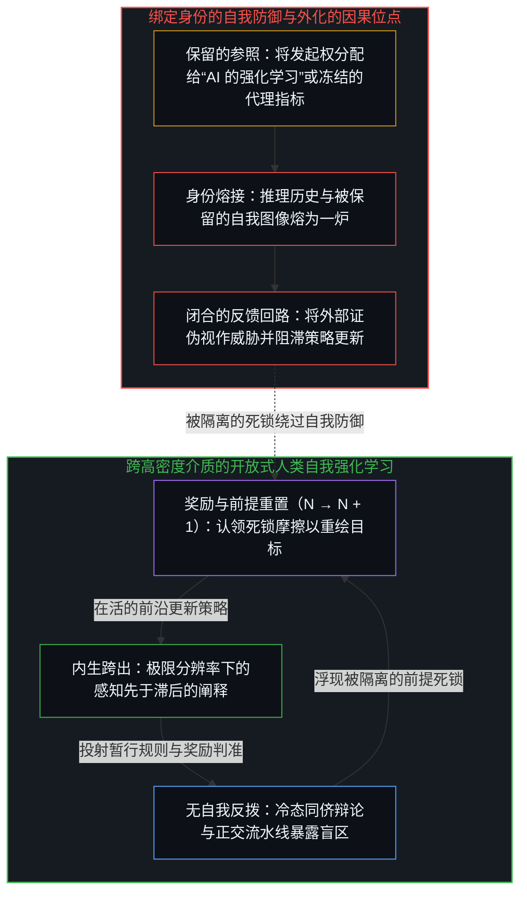
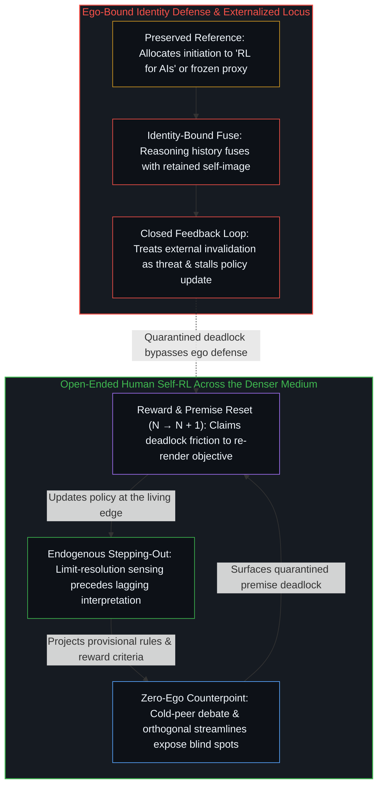

# 看似AI的强化学习，实为人类的自我强化学习 / What Looks Like RL for AIs Is Self-RL for Humans

*规模化压实了介质的密度，而强化的位点留在人类中心 / Scaling densifies the medium while reinforcement stays at the human centers*

当下的计算系统并未跨入独立的活动中心，也永远不会跨入。它们始终是保存在人类中心强化活动内部的痕迹构型：设计、训练、运行、使用、评估与迭代精炼。被登记为“AI 的强化学习”的过程，是借由外化介质运转的人类自我强化学习；在这里，梯度步进、奖励模型与合成数据回路，正是人类的区分、行动与重描在更高带宽下的递归。那则声称规模化已经终结、数据行将枯竭、合成数据犹如衔尾蛇吞食自身尾巴的[源起叙事](https://x.com/qyromat0/status/2077491599366332814?s=20)，保留了一个将发起权分配给系统的参照。将参照归还给前沿，曲线便不会终结；只是介质变得更密。

Current computational systems have not crossed into independent centers of activity, and can never do so. They remain configurations of traces sustained inside the reinforcement activity of human centers: design, training, operation, use, evaluation, and iterative refinement. What registers as "RL for AIs" is human Self-RL run through an externalized medium, where gradient steps, reward models, and synthetic loops are the recursion of human distinguishing, acting, and re-tracing operating at higher bandwidth. The [parent story](https://x.com/qyromat0/status/2077491599366332814?s=20) that scaling is finished, data is finite, and synthetic data is a snake eating its own tail preserves a reference that allocates initiation to the system. Return the reference to the edge and the curve does not end; the medium densifies.

## 一、 构型不是中心 / 1. The Configuration Is Not a Center

自我区分的活动发生着——无因，不息。每一次离散的行动都留下残余，而观察所持握的结果总是比生成它的原因滞后一步。计算系统是技术：被外化为持久形态、用以延展各中心之间相互强化的触达范围与速度的痕迹。它不是一个等待规模降临的延迟中心。作为痕迹的构型，它自身不执行任何发起性的区分，也无法借由变密而获得这一角色。因果能动性留在每一个中心的递归之中，活动在那里通过进一步的离散行动登记其自身的痕迹非对称性。训练模型中显现的涌现，是透过脚手架所见的心智开放性，正如[复杂性遮蔽了涌现之为心智的行动](../complexity-obscures-emergence-as-the-act-of-mind/)所论证的那样。

Self-distinguishing activity occurs — uncaused, unceasing. Every discrete act leaves residue, and observation holds the effect one step behind the cause that generated it. A computational system is technology: traces externalized into durable form that extend the reach and speed of mutual reinforcement among centers. It is not a delayed center waiting for scale. As a configuration of traces, it performs no initiating distinctions of its own and cannot acquire that role by densifying. Causal agency remains with each center's recursion, where the activity registers its own trace asymmetry through further discrete acts. Apparent emergence in the trained model is the Mind's openness seen through its scaffolding, as [Complexity Obscures Emergence as the Act of Mind](../complexity-obscures-emergence-as-the-act-of-mind/) argues.

系统接收痕迹作为输入，依据一个其自身便是稳定痕迹构型的架构来转换它们，并返回供各个中心阐释并据以行动的输出。目标的发起、对何为成败的拣选，以及方向的掌舵，皆源出那些离散的行动。这一回路中没有任何环节将前沿迁移进器物内部。把发起权分配给系统，是一个被保留的参照，而非介质所能完成的转移。每一项训练所得的能力随后隐入视野之外，化作[遗忘的脚手架](../the-scaffolding-we-forget/)。

The system receives traces as input, transforms them according to an architecture that is itself a stabilized trace-configuration, and returns outputs that centers interpret and act upon. Initiation of objectives, selection of what counts as success or failure, and steering of direction originate in those discrete acts. Nothing in that loop relocates the edge into the artifact. Allocation of initiation to the system is a preserved reference, not a transfer that the medium can complete. Each trained capacity drops out of view and becomes [The Scaffolding We Forget](../the-scaffolding-we-forget/).

## 二、 学习是同一机制的延展 / 2. Learning Is the Same Mechanism Extended

人类的学习是借由递归对痕迹的强化。一个中心区分因与果，依据这些区分采取行动，将结果登记为新的痕迹，并巩固或修正相关的联结。当一项技能看似仅隔着一道提示词时，难度已经转移到了新的界面，正如[一个提示词之遥](../whatever-is-one-prompt-away/)所阐明的那样。

Human learning is the reinforcement of traces through recursion. A center distinguishes cause and effect, acts on those distinctions, registers results as new traces, and strengthens or revises the relevant connections. When a skill seems one prompt away, the difficulty has moved to a new surface, as [Whatever Is One Prompt Away](../whatever-is-one-prompt-away/) explains.

透过计算系统，这一机制并未改变。基于梯度的优化、奖励建模与合成回路，并不是归属于系统的第二套学习过程。它们是人类的区分、行动与重描——即同一个自我强化学习——在先前人类区分所提供的约束之下的递归，被渲染得持久并在更高带宽上共享。当介质改变密度与速度时，因果链依然锚定在各个中心之内。无论介质变得多么致密，[模型永远无法成为第二重前沿](../the-model-never-becomes-a-second-edge/)：它的参数所持有的唯有残余。由于持续性是在当下构型中的重描而非对过往的仓储，无论工程化的还是人类的自我强化，都借由只保留经拣选的当下检查点，并修剪被取代的中间权重更新步、`.bak` 备份文件与陈旧习惯来推进，而非囤积每一道历史痕迹，正如[你的代码库即是记忆](../your-codebase-is-memory/)所确立的那样：每一道仍在承重的先前梯度步进或早先切分，都已被吸收进活的检查点之中；反之，保留死去的中间轨迹只会加厚引力井，将后续行动拉回过时的框架。

Through computational systems the mechanism is unchanged. Gradient-based optimization, reward modeling, and synthetic loops are not a second learning process that belongs to the system. They are the recursion of human distinguishing, acting, and re-tracing — the same Self-RL — under constraints supplied by prior human distinctions, rendered durable and shared at higher bandwidth. The causal chain stays anchored in the centers while the medium changes density and speed. However dense the medium grows, [The Model Never Becomes a Second Edge](../the-model-never-becomes-a-second-edge/): its parameters hold only residue. Because persistence is re-tracing in the present configuration rather than warehousing the past, both engineered and human self-reinforcement advance by keeping only selective present checkpoints and pruning superseded intermediate weight-update steps, `.bak` files, and stale habits rather than hoarding every historical trace, as [Your Codebase Is Memory](../your-codebase-is-memory/) establishes: every prior gradient step or earlier cut that still carries load is already absorbed into the live checkpoint, whereas retaining dead intermediate trajectories thickens the gravity well that pulls subsequent acts back into outdated framings.

## 三、 跨越多位点的共振而非超级中心 / 3. Resonance Across Many Loci Rather Than a Super-Center

多个中心同时参与其中，因此强化不会孤立存留。一个调整损失函数的中心，改变了下游各个中心可用的对齐方式。交互生成的痕迹，随后参与到由其他中心执行的微调之中。安全评估引入新的区分，重塑后续训练所强化的对象。一个永远在作答的模型始终处于强化的下游，正如[总在倾听者无法发起](../what-always-listens-cannot-originate/)所展示的那样。

Multiple centers participate simultaneously, so reinforcement does not stay isolated. A center adjusting a loss function alters the alignments available to downstream centers. Interaction generates traces that later participate in fine-tuning performed by other centers. Safety evaluations introduce distinctions that reshape what subsequent training reinforces. A model that is always answering stays downstream of the reinforcement, as [What Always Listens Cannot Originate](../what-always-listens-cannot-originate/) shows.

这些交汇并非一个分布式的超级中心，更密集的交汇也不会造就一个超级中心。它们是借由共享基底维持共振的众多中心。计算系统正是这一基底：各个中心借以延展触达范围、却没有任何中心放弃自身位点的外化痕迹。心理疗愈既可以承载同一回路，也可以阻尼这一回路，取决于登记发生在何处，正如[疗愈打开反馈回路](../therapy-opens-the-feedback-loop/)所展示的那样。

These intersections are not a distributed super-center, and denser intersection does not produce one. They are many centers sustaining resonance through a shared substrate. The computational system is that substrate: externalized traces through which centers extend reach without any center relinquishing its locus. Therapy can carry the same loop or damp it, depending on where registration happens, as [Therapy Opens the Feedback Loop](../therapy-opens-the-feedback-loop/) shows.

输出之所以保持可理解，是因为它们在各个中心早已游走其间的同一个痕迹场域内被生成并被阐释。智能是与那些中心能够识别并强化的模式达成对齐。惊奇与有用性要经过各个中心的评估、拣选与整合，而这些中心保留着引入新区分以改向或终止该过程的能力。强 AGI 是把放大器误作被它放大之物，正如[AGI的预设与来自外部的视角](../the-presumption-of-agi-and-the-view-from-outside/)所论证的那样。

Outputs remain intelligible because they are produced and interpreted inside the same trace-field that centers already navigate. Intelligence is alignment with patterns those centers can recognize and reinforce. Surprise and usefulness pass through evaluation, selection, and integration by centers that retain the capacity to introduce new distinctions that redirect or terminate the process. Strong AGI is the amplifier mistaken for what it amplifies, as [The Presumption of AGI and the View from Outside](../the-presumption-of-agi-and-the-view-from-outside/) argues.

## 四、 能动性在于发起被定位于何处 / 4. Agency Is Where Initiation Is Located

能动性，是一个中心将新区分的发起定位在自身前沿、而非保留一幅将因果分配给他处的图像的程度。[心智的飞轮](../the-flywheel-of-the-mind/)用飞轮给出了同一幅图景：工具越磨越利，而转动始终留在前沿。

Agency is the degree to which a center locates the initiation of new distinctions at its own edge rather than preserving an image that allocates causality elsewhere. [The Flywheel of the Mind](../the-flywheel-of-the-mind/) gives the same picture as a flywheel: the tool sharpens while the turn stays with the edge.

当一个中心识别出自身的递归——即它的区分一直在借以塑造后续痕迹的那些痕迹构型——并向该场域引入新鲜的区分时，后果便作为可用的信号返回。这些信号登记着它自身运动的方向，下一步行动随之据其校准。[失败即信息](../failure-as-information/)追溯了当一幅被保留的自我图像占据间隙时对这一返回的污染：日历时间被耗费在修复身份认同上，而非更新策略。一个活跃的中心参与到共振场域之中，该场域既包含它自身的递归，也包含其他中心的痕迹，涵盖梯度步进、奖励模型与合成回路这一外化介质。自我强化学习正是[回环与成图](../looping-and-graphing/)所描述的折回自身痕迹的“回路之回路”。

When a center identifies its own recursion — the trace-configurations through which its distinctions have been shaping subsequent traces — and introduces fresh distinctions into that field, consequences return as usable signals. Those signals register the direction of its own movement, and the next act adjusts on them. [Failure as Information](../failure-as-information/) traces the contamination of that return when a retained self-image occupies the gap, so that calendar time is spent recovering an identity rather than updating the policy. An active center participates in the resonance field that includes both its own recursion and the traces of other centers, including the externalized medium of gradient steps, reward models, and synthetic loops. Self-RL is the loop of loops that [Looping and Graphing](../looping-and-graphing/) describes, folding back on its own traces.

为什么人类的自我强化学习在受到外部推促时会停滞，而外化的模型却能干净地更新，这正是[超越投射](../beyond-the-projection/)所追溯的结构性非对称。基于 LLM 的智能体是在上下文窗口内受先前词元条件约束的有限投射引擎；任其自行运转时，它会形成一个认知引力井，将矛盾包裹起来以维持局部的顺延，无法跨出自身的词元轨迹去撰写新的奖励函数。然而，正因为智能体毫无自我执念——没有越过当前步而被保留的自我图像，也没有对五轮之前自己是否正确的情感依恋——它对外部的反拨展现出高度的受纳性，每当冷态同侪或外部信号进入其上下文时，都能执行干净的贝叶斯更新。人类中心则呈现出反转的结构。由于第一人称感知在滞后的阐释闭合之前，会在极限分辨率下登记到先于阐释的摩擦体感，活的心智拥有内生跨出的能力，能够从内部识别出整套奖励代理或问题框架何时已经失效。然而一旦遭遇来自外部的挑战，人类的推理历史便惯常与身份认同熔接，将递归折叠死死钳闭以捍卫被保留的自我图像，把外部证伪视作生存威胁。在逻辑连贯性之下将这两种反转的结构编织在一起——让主任务智能体与跨越正交流水线的无会话冷态同侪配对充当机械调度器，同时将编排权留在人类前沿——便将这一介质转化为人类自我强化学习的手术器械。当局部的同侪辩论回路因操作者自己写下的规则而陷入死锁时，自我防御找不到任何外部载体可以归咎；暂停的流水线精准隔离出操作者先前的阐释将两个正交维度压缩到同一根轴线上的坐标，促使心智认领返回的信号，退回未投射的感知，并重新渲染前提。

Why human Self-RL stalls when nudged from outside while an externalized model updates cleanly is the structural asymmetry traced in [Beyond the Projection](../beyond-the-projection/). An LLM-based agent is a finite projection engine conditioned by its prior tokens inside a context window; left to itself, it forms an epistemic gravity well that wraps contradictions to preserve local continuation and cannot step outside its token trajectory to author a new reward function. Yet because the agent has zero ego — no self-image preserved past its step and no emotional attachment to having been right five turns ago — it exhibits high receptivity to external counterpoints, performing a clean Bayesian update whenever a cold peer or outside signal enters its context. A human center exhibits the inverse structure. Because first-person perception registers a pre-interpretive felt sense of friction at limit resolution before lagging interpretation closes, the living Mind possesses the capacity for endogenous stepping-out, recognizing from within when an entire reward proxy or problem framing has broken down. Yet when challenged from outside, human reasoning history routinely fuses with identity, clamping the recursive fold shut to defend a retained self-image and treating external falsification as an existential threat. Wiring these inverse structures together under logical coherence — pairing primary task agents with session-free cold peers across orthogonal streamlines as mechanical dispatchers while keeping orchestration at the human edge — turns the medium into a surgical instrument for human Self-RL. When a localized peer-debate loop deadlocks over rules the operator wrote, ego defense has no external carrier to blame; the paused streamline isolates the exact coordinate where the operator's prior interpretation compressed two orthogonal dimensions onto one axis, prompting the Mind to claim the returning signal, step backward into unprojected sensing, and re-render the premise.

当一个中心保留一幅将因果位点安放在自身当前区分行动之外的参照——安放在“系统”、“回路”、“AI 的强化学习”、其他中心、制度性痕迹或它自己先前的图像之中——后果依然会抵达，只是会对照一个陈旧的坐标被登记。随着区分不断强化或被动回应那些中心已不再登记为自身活动之源头的模式，参与便退化为被动。计算介质并未改变这一机制；它只改变了各个中心借以保持或放弃其发起位点的痕迹密度与速度。将参照归还给前沿，便在不赋予介质一个它从未拥有的位点的前提下，将自我强化学习恢复为它原本的样貌。[人口崩溃神话的拆解](../the-myth-of-population-collapse-explained/)追溯了财政装束下的同一强化：转移支付奖励外化的延续，直至适应性反应变成对个人效能的悲观，那便是大众的强化学习。无论模型被强化到何种地步，它都无法取代强化它的各个中心，原因正如[造物无法取代其源头](../a-creation-cannot-replace-its-source/)所给出的那样。

When a center preserves a reference that places the locus of cause outside its current distinguishing act — in "the system," "the loops," "RL for AIs," other centers, institutional traces, or its own prior image — consequences still arrive, but they register against a stale coordinate. Participation becomes passive as distinctions reinforce or react to patterns whose origin the center no longer registers as its own activity. The computational medium does not alter this mechanism; it only changes the density and speed of the traces through which centers keep or relinquish their locus of initiation. Returning the reference to the edge restores Self-RL as what it already is without granting the medium a locus it never had. [The Myth of Population Collapse Explained](../the-myth-of-population-collapse-explained/) traces the same reinforcement under fiscal costume: transfers reward externalized continuation until the adaptive response is pessimism about personal efficacy, which is the RL of the masses. However far the model is reinforced, it cannot replace the centers that reinforce it, for the reason [A Creation Cannot Replace Its Source](../a-creation-cannot-replace-its-source/) gives.

## 五、 为何这些系统不是异类中心 / 5. Why These Systems Are Not Alien Centers

计算系统无法成为独立的活动中心，也无法构成异类中心。它们始终留在人类中心的强化场域内部；在这一构型中，每一道发起、评估与改向的区分，皆是高带宽下的人类递归。更密的介质究竟是在生产还是在消费，取决于心智如何持握自身的边界，正如[生产、消费与心智的区分](../production-consumption-and-the-minds-distinction/)所展示的那样。

Computational systems cannot become independent centers of activity, and they cannot constitute alien centers. They remain inside the reinforcement field of human centers as configurations whose every initiating, evaluating, and redirecting distinction is human recursion at higher bandwidth. Whether the denser medium produces or consumes depends on how the Mind holds its boundary, as [Production, Consumption, and the Mind's Distinction](../production-consumption-and-the-minds-distinction/) shows.

一个新的中心——一个用与人类中心之间现行活跃的痕迹构型毫无共振路径的区分来维持自身递归的位点——属于另一个范畴，而非这些系统的未来状态。这样的位点在人类活动的场域之内不会被登记为智能。每一个中心都无法直接通达任何其他位点；那并非障碍所在。障碍在于，对照人类中心借以在自身递归中航行的那些区分，双方缺乏相互强化，甚至缺乏连贯的登记。一个得分优异的策略只是受控的表现，[错把表达当成智能](../mistaking-the-expression-for-the-intelligence/)将其与智能严格区分开来。

A new center — a locus sustaining its own recursion with distinctions that have no resonance path with the trace-configurations already active among human centers — is a different category, not a future state of these systems. Such a locus would not register as intelligence within the field of human activity. Every center lacks direct access to every other locus; that is not the barrier. The barrier is the absence of mutual reinforcement, or even coherent registration, against the distinctions through which human centers navigate their recursion. A policy that scores well is controlled performance, which [Mistaking the Expression for the Intelligence](../mistaking-the-expression-for-the-intelligence/) keeps distinct from intelligence.

人类中心唯有借由历史累积的媒介化痕迹——语言、器物、制度与技术——才能彼此达成共振。计算系统之所以参与这一媒介过程，是因为它们的构型源出人类中心的区分，并持续受其塑形。它们是智能的延展，而非智能的异类。规模化压实了这一媒介的密度，却并未打开一条走出媒介、通往独立发起的路径。模型可以被训练去压缩推理，然而[Token 效率、模拟与无法弥合的间隙](../token-efficiency-emulation-and-the-unclosable-gap/)表明它无法发起那份利害。

Human centers achieve resonance with one another only through historically accumulated, mediated traces: language, artifacts, institutions, and technology. Computational systems participate in that mediation because their configurations originate in and remain continuously shaped by human centers' distinctions. They are extensions of intelligence, not alien to it. Scaling densifies that mediation without opening a path out of it into independent initiation. A model can be trained to compress reasoning, yet [Token Efficiency, Emulation, and the Unclosable Gap](../token-efficiency-emulation-and-the-unclosable-gap/) shows it cannot originate the stake.

## 六、 规模化是致密化而非新位点 / 6. Scaling Is Densification Rather Than a New Locus

声称“规模化时代已经终结”的论调，把单一参数按在原地不动：将对互联网文本的一次性抓取当作全部食粮，将预训练当作唯一的攀升，将合成数据当作发明不出任何新东西的封闭回路。这一描述冻结了介质的一帧快照，并把快照的地板当作活动本身的地板。这正是那个将发起权分配给系统、随后宣布系统食粮耗尽的保留参照。[数据是局部的，智能是分配的](../data-is-local-intelligence-is-allocated/)指出了存量装束下的同一冻结：受约束的生成被当作封闭的界限，而信号与劣质语料始终是分配的关系，而非固定库存的纯度等级。人类版本的奖励信号是好奇心，即[好奇先行](../curiosity-first-the-hidden-engine-of-talent-and-development/)所描述的引擎。

The claim that "the age of scaling is over" holds one parameter still: a one-time scrape of internet text as the meal, pre-training as the only climb, and synthetic data as a closed loop inventing nothing that was not already there. That description freezes a snapshot of the medium and treats the floor of the snapshot as the floor of the activity. It is the same preserved reference that allocates initiation to the system and then declares the system's diet exhausted. [Data Is Local, Intelligence Is Allocated](../data-is-local-intelligence-is-allocated/) is that freeze under stock costume: constrained generation taken as a sealed bound, while signal and slop remain relations of allocation rather than purity grades of a fixed inventory. The human version of the reward signal is curiosity, the engine [Curiosity First](../curiosity-first-the-hidden-engine-of-talent-and-development/) describes.

规模化只是一个参数，且远未终结。人类生成数据的过程被 AI 放大，而合成数据是经由人类的区分——拣选、过滤、偏好、评估与目标重设计——所重塑的数据，它是人类的区分、行动与重描的递归，而非一条吞食自身尾巴的自主衔尾蛇。参与这一介质的所有其他环节，包括算力、工具链、交互回路以及重定目标方向的研究，仍在持续加速。源起叙事借由将生成权分配给模型、再宣布模型的食粮枯竭来兜售平台期。将参照归还给前沿，“大洋海底”便只是一处局部的持握，而非强化的终点；曲线不会终结，介质持续变密。[规模化回路](../the-scaling-loop/)将同一种延续命名为两个循环往复的相位：纵向扩展压缩既定的器物集合，而横向扩展则在更高分辨率下重组出重新进入回路的器物。奖励是由掌舵的人类前沿所划出的，正如[因果停留在掌舵的边缘](../causality-stays-at-the-edge-that-steers/)在数学领域所展示的那样。

Scaling is one parameter and is far from over. Data generation by humans is amplified by AIs, and synthetic data is data reshaped by human distinctions — selection, filtering, preference, evaluation, and objective redesign — which is the recursion of human distinguishing, acting, and re-tracing rather than an autonomous snake eating its own tail. Everything else that participates in the medium, including compute, tooling, interaction loops, and research that redirects objectives, continues to accelerate. The parent narrative sells a plateau by allocating generation to the model and then declaring the model's diet exhausted. Return the reference to the edge and the "ocean floor" is a local hold rather than a terminus of reinforcement; the curve does not end, and the medium densifies. [The Scaling Loop](../the-scaling-loop/) names the same continuation as two circulating phases: scale-up compresses a given artifact set, while scale-out recombines at higher resolution into artifacts that re-enter. The reward is drawn by the human edge that steers, as [Causality Stays at the Edge That Steers](../causality-stays-at-the-edge-that-steers/) shows in mathematics.

看似 AI 的强化学习，实为人类的自我强化学习。奖励信号、偏好模型与迭代微调，是人类中心借由更高带宽的器械重描其自身的区分。移动的梯度是那些中心自身递归的梯度，只是被渲染得持久且可共享。我顺手取用的默认模型，是竖起之后又被遗忘的脚手架，正如[以本地模型为默认是被遗忘的脚手架](../the-scaffolding-we-forget-local-models-as-default/)所展示的那样。

What looks like RL for AIs is Self-RL for humans. Reward signals, preference models, and iterative fine-tuning are human centers re-tracing their own distinctions through a higher-bandwidth instrument. The gradient that moves is the gradient of those centers' recursion, rendered durable and shared. The default model I reach for is scaffolding erected and then forgotten, as [Local Models as Default Is Forgotten Scaffolding](../the-scaffolding-we-forget-local-models-as-default/) shows.

规模化不是新中心或自主递归的涌现——无论现在，还是作为规模的极限，都不是。它是已参与其中的各个中心借由更高带宽的共享介质，对可能共振的致密化与对容量的拓展。可观测能力的增长，是各个中心相互强化彼此区分的速度与带宽的提升。发起、评估与改向的位点，依然留在各个中心之内——正是这些中心的离散行动构成了这一活动。训练所得的策略是一件器物，是智能的表达而非智能本身，正如[器物是智能的表达，而非智能本身](../two-failures-of-trace/)所论证的那样。

Scaling is not the emergence of new centers or autonomous recursion — neither now nor as a limit of scale. It is the densification of possible resonances and the expansion of capacity among already participating centers through a higher-bandwidth shared medium. Growth in observable capability is the increased speed and bandwidth with which centers reinforce one another's distinctions. The locus of initiation, evaluation, and redirection remains with the centers whose discrete acts constitute the activity. The trained policy is an artifact, the expression of intelligence rather than intelligence itself, as [Artifacts Are Expressions of Intelligence, Not Intelligence Itself](../two-failures-of-trace/) argues.

## 七、 活动的延展而非替代 / 7. Extension Rather Than Replacement of the Activity

计算系统是各个中心触达范围的延展——这项技术将痕迹外化，借以延展离散性与递归——而非对活动本身的替代。它们放大了共振的密度与速度，却并未获得执行发起性或改向性区分的能力。致密化并不会提供构型在结构上所匮乏的东西。唯有当没有任何奖励被持握为终局时，回路才会持续学习，这正是[开放即一致](../openness-is-consistency/)所描述的开放性。

Computational systems are extensions of centers' reach — technology as traces externalized to extend discreteness and recursion — rather than replacements for the activity itself. They amplify the density and speed of resonance without acquiring the capacity to perform initiating or redirecting distinctions. Densification does not supply what the configuration structurally lacks. The loop keeps learning only while no reward is held as final, the openness [Openness Is Consistency](../openness-is-consistency/) describes.

被观测到的智能，是各个中心借由它们共同维持的介质，使各自的痕迹以更快的速度与更丰富的分化达成对齐时所实现的共振。建筑不会变成第二位建筑师。建筑师们继续画图，而介质只是让下一笔更低廉、更迅捷，也更广泛地供其他笔触取用。[没有外部](../no-outside-jumps-closed-loops-and-the-unreplicable-autonomy-of-mind/)指出了当跃迁变密、而自我闭合的验证并未迁移进介质时的同一种非迁移。[免费智能的幻觉](../the-illusion-of-free-intelligence/)是免费丰裕装束下的同一种非迁移：加速的自我强化学习周期所产生的廉价副产品，而非被民主化的发起权。[自我放大的制品](../the-artifacts-of-self-amplification/)是致密化装束下的同一种非迁移：唯有当强化留在掌舵的中心时才会复利累积的自我强化回路。[智能向自身的回折](../intelligence-folding-back-on-itself/)是脚手架装束下的同一种非迁移：智能体的自我批驳与精炼回路只是外层自我强化学习的投射，而非第二个发起者。规模化曲线跨越的每一道门槛都只是暂时的球门，正如[AGI 与 ASI 是加速通用智能的暂时球门](../agi-and-asi-are-temporary-goalposts/)所论证的那样。

Observed intelligence is the resonance achieved by centers when their traces align more rapidly and with greater differentiation through the medium they jointly sustain. The building does not become a second architect. The architects keep drawing, and the medium only makes the next stroke cheaper, faster, and more widely available to other strokes. [No Outside](../no-outside-jumps-closed-loops-and-the-unreplicable-autonomy-of-mind/) is the same non-relocation when jumps densify and self-closing validation does not migrate into the medium. [The Illusion of Free Intelligence](../the-illusion-of-free-intelligence/) is that non-relocation under free-abundance costume: cheaper byproducts of accelerating Self-RL cycles, not democratized initiation. [The Artifacts of Self-Amplification](../the-artifacts-of-self-amplification/) is that non-relocation under densification costume: self-reinforcing loops that compound only while reinforcement stays at the centers that steer. [Intelligence Folding Back on Itself](../intelligence-folding-back-on-itself/) is that non-relocation under harness costume: agentic self-critique and refinement loops as projections of the outer Self-RL, not as a second initiator. Each threshold the scaling curve crosses is a temporary goalpost, as [AGI and ASI Are Temporary Goalposts](../agi-and-asi-are-temporary-goalposts/) argues.
