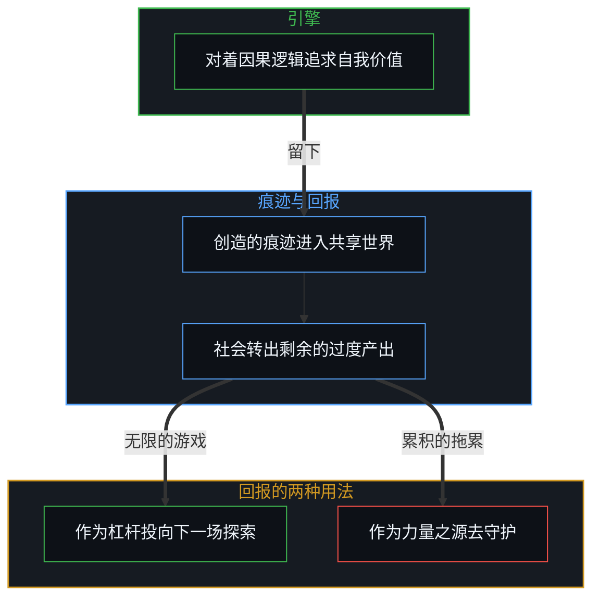
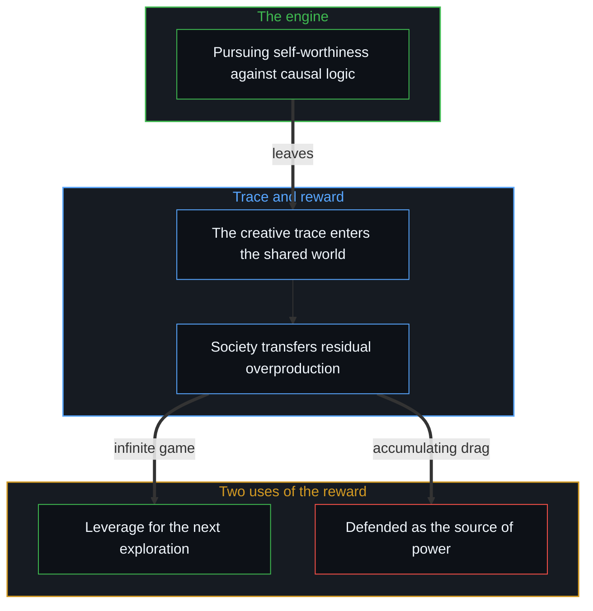

# 自我价值、反向财富转移与过去成功的陷阱 / Self-Worthiness, Reverse Wealth Transfer, and the Trap of Past Success

*财富是追求自我价值的下游痕迹，把工具当成能动性之源，过去的成功就成了拖累 / Wealth trails the pursuit of self-worthiness; taking the tool for the source of agency turns past success into drag.*

推动人类进步的，有一台常见的经济模型登记不到的引擎：一个人对自我价值的追求。社会最终把它最高的回报给了这种追求，不是因为创造者求的是社会的认可或钱的积累，而是因为创造者把内部的优化回路直接锚在了现实的移动前沿上；为了达到自己那条不肯降低的自洽标准，创造者留下一道清楚的痕迹，一项改变局面的技术、一次科学的突破、一件好用的工具，或一个从未有过的生成框架。

Human progress is driven by an engine that common economic models do not register: a person's pursuit of self-worthiness. Society in the end gives its highest rewards to this pursuit, not because the creator sought social approval or the accumulation of money, but because the creator anchored an inner optimisation loop directly at the moving edge of reality; striving to meet an unrelenting bar of coherence of their own, the creator leaves a clear trace behind, a technology that changes the field, a scientific breakthrough, a well-made tool, or a generative framework that did not exist before.

这道痕迹一旦进入共享的世界，就展开一串经济与控制论上的序列：它造出变现的机制，带来大规模的反向财富转移，也设下一个陷阱，创造者、继承者与社会都可能把自己的工具误认为自己力量的源头。

Once that trace enters the shared world, an economic and cybernetic sequence unfolds: it creates the mechanism of monetisation, brings large reverse wealth transfers, and sets a trap in which creators, inheritors and societies can all take their own tools for the source of their power.

## 一、 价值的生成 / 1. The Genesis of Value

价值要从它的来处去理解：从第一人称视角的地平线上，无穷的因果链在那里被遇到。逻辑是不可化约的底，因果一致的必然；被观察为物理的那个现实，不是一个独立平行的实体，而是无数自由变量随时间叠加之后的宏观逻辑后果。真正的创造不从市场的计算、也不从囤积抽象金融数字的欲望开始，它开始于心智在第一人称上的一份必要：拿自己的生成能力，去对着因果链那不肯让步的逻辑摩擦检验与确认。

Value is understood from where it comes: the first-person horizon, where the endless causal chain is met. Logic is the irreducible floor, the necessity of causal consistency; the reality observed as physical is not an independent, parallel substance but the macroscopic logical consequence of countless free variables compounding over time. Real creation does not begin with market calculation or a wish to hoard abstract financial numbers; it begins with a first-person need of the Mind to test and confirm its own generative capability against the unyielding logical friction of the causal chain.

在这个姿态里，后果作为自己的后果重新进入：错误、意外与系统的摩擦不被外推为坏运气或社会的不公，而被直接吞下，作为磨利内部模型的训练信号。标准在内部：创造者对着因果链本身的逻辑要求去优化，想造出比现有默认更自洽、更有力、更优雅的系统。创造先于估价：价值在创造者那个离散的第一人称位置上生成，远在任何外部的观察者知道它可能存在之前。从外部看，史蒂夫·乔布斯与埃隆·马斯克这样的建造者身上，登记到的是这种控制论的姿态：更好、更美、更高效的工具，以直接的因果反馈而不是社会的共识来裁定成败，构成一场无限的游戏。驱动他们的内部是什么，是他们自己的；而能被讲述的，也只是那些成了的例子。

In this posture, consequences re-enter as one's own: errors, surprises and systemic friction are not pushed outward as bad luck or social injustice but taken in directly, as training signals that sharpen the inner model. The bar is internal: the creator optimises against the logical demands of the causal chain itself, aiming to build systems more coherent, powerful and elegant than the existing defaults. Creation comes before valuation: value is generated at the creator's discrete first-person locus long before any outside observer knows it is possible. Seen from outside, what registers in builders such as Steve Jobs and Elon Musk is this cybernetic posture: better, more beautiful, more efficient instruments, success judged by direct causal feedback rather than social consensus, making up an infinite game. What moved them inside is their own; and the examples that can be told are only the ones that worked.

## 二、 变现的机制 / 2. The Mechanics of Monetisation

一项创造的突破一旦结晶，就为更广的人群所见。新的痕迹扩大了别人的因果所及，或满足了深处的欲望，自愿交换的诱因就自然出现，这也显出变现是什么。真实的财富不是钱，[价值、货币与财富的生成机制](../the-generative-mechanics-of-value-money-and-wealth/)推出过，它是一个心智在自由变量之间导航、解决问题的活的生成能力；货币只是对过去交易的标准化记账。变现在字面意义上是一次反向的财富转移：社会把它剩余的过度产出，现有劳动多出来的宏观产出，转一部分给创造者，以换取进入创造者新打开的地平线。伟大创新者累积的金融财富，是社会为他们扩展能力前沿而给出的、滞后的经济痕迹。

Once a creative breakthrough crystallises, it becomes visible to a wider population. The new trace widens the causal reach of others or meets deep desires, and an incentive for voluntary exchange arises naturally, which also shows what monetisation is. Real wealth is not money, as [The Generative Mechanics of Value, Money, and Wealth](../the-generative-mechanics-of-value-money-and-wealth/) derives; it is the living generative capability of a Mind to navigate free variables and solve problems, while currency is only the standardised accounting of past trade. Monetisation is a reverse wealth transfer in the literal sense: society transfers part of its residual overproduction, the surplus macroscopic output of its existing labour, to the creator in exchange for access to the horizon the creator has newly opened. The financial fortunes great innovators accumulate are the lagging economic trace of society compensating them for widening the frontier of capability.

## 三、 资本作为杠杆 / 3. Capital as Leverage

留在无限游戏里的时候，这份累积的剩余不被当作要守护或消费的静态窖藏，而马上被重新部署为因果的杠杆。所以当一个建造者一再把累积的财富押到下一场高风险的探索上，常见的视角会觉得难以理解：把财富当作消费、安全或静态的社会地位来看，把巨额资本滚进航天或能源，就显得鲁莽、不理性。在这个姿态之内，它却是资本最直接的用法：资本被认作延续的工具，用来获得去处理更宽的因果地平线所需的物质、工程与计算的机器；过去的金融积累不被当作力量的来源，它仍是工具，创造的引擎留在自己决策的移动前沿上；不断把静止的金融痕迹转成活的探索杠杆，学习的回路就不被缓冲，能力就递归地复利。这种押注的结局里，也装着落到押注者头上的东西，押空了的那些不被讲述。

While the infinite game continues, this accumulated surplus is not treated as a static hoard to guard or consume but redeployed at once as causal leverage. So when a builder repeatedly stakes accumulated fortunes on the next high-risk exploration, the common view finds it hard to understand: seen as consumption, safety or static social standing, rolling great capital into aerospace or energy looks reckless and irrational. Within this posture it is the most direct use of capital: capital is recognised as an instrument of continuation, a means to acquire the physical, engineering and computational machinery needed for wider causal horizons; past financial accumulation is not taken for the source of power and stays a tool, while the engine of creation stays at the moving edge of one's own decisions; by continually turning still financial residue into living exploratory leverage, the learning loop stays unbuffered and capability compounds recursively. The outcomes of such stakes also hold what fell to the one staking, and the stakes that came to nothing are not told.

## 四、 从扩展到守护 / 4. From Expanding to Defending

这种无限的姿态，个人与组织多半不会一直保持。沿着一条连续的谱，梯度悄悄移动：从扩展自我价值，移向守护自我价值。这不是一道突然出现、看得见的天花板，能力不会一夜之间消失，残留的自我价值与技术能力都还在；错置是一种不断累积的内部拖累。[自我价值感与所有权](../ownership-and-self-worthiness/)展开了这一点的前半：价值是自己拥有的，从不是被授予的。

Individuals and organisations mostly do not keep this infinite posture. Along a continuous spectrum the gradient shifts quietly: from expanding self-worthiness to defending it. This is no sudden, visible ceiling; capability does not vanish overnight, and residual self-worthiness and technical skill remain; the misplacement is an accumulating inner drag. [Ownership and Self-Worthiness](../ownership-and-self-worthiness/) develops the first half of this: worth is owned, never conferred.

拖累一步步加重。先是力量的倒置：累积了财富、声望与机构权威之后，把累积的痕迹当成力量的来源，而不是过去那些区分的滞后后果。接着，发射台成了拖累：过去的成功不再只是下一次冒险的参照与杠杆，注意与精力被引去守护品牌、捍卫领地、经营社会影响。最后是损失函数的萎缩：越多能动性被分去守护历史的痕迹，拖累就越重，与现实的直接碰撞被官僚的隔层取代，改进的速度慢下来，直到增长停下。这是同一个心智在不同时期都可能经过的状态，一家公司、一位创始人的早年与晚年，都可能分处这条谱的两端。

The drag grows step by step. First comes the inversion of power: having accumulated wealth, prestige and institutional authority, one takes the accumulated trace for the source of power rather than for the lagging consequence of past distinguishing. Next the launchpad becomes drag: past success is no longer only a reference and leverage for the next risk, and attention and energy are diverted into protecting the brand, defending territory and managing social influence. Last the loss function atrophies: the more agency goes to defending historical traces, the heavier the drag, direct collision with reality is replaced by bureaucratic insulation, and improvement slows until growth stops. These are states the same Mind can pass through at different times; a company, or a founder early and late, can sit at either end of the spectrum.

这种错置会延伸到自上而下的慈善与社会工程。当手握巨富的在位者想通过集中的项目与金融补贴去“赋能”人群时，他们在外面重演了在自己身上犯过的同一个错：把钱当作人的能动性的来源，而不是它的下游痕迹；替换掉受助者建立真实能力所需的、不加缓冲的控制论反馈回路；于是施予者与受助者双方的学习回路都被削弱，[福利国家的幻象](../the-welfare-state-illusion-cost-diffusion-and-agency-atrophy/)与[赋权确立权力的集中](../empowerment-establishes-the-centralization-of-power/)都追溯过这一点。本可以作为前沿探索杠杆的巨大物质资源，成了把认知地平线锁在原地的拖累。

This misplacement extends into top-down philanthropy and social engineering. When wealthy incumbents try to "empower" populations through centralised programmes and financial subsidies, they repeat outwardly the mistake made within: taking money for the source of human agency rather than its downstream trace; displacing the unbuffered cybernetic feedback loops recipients need to build real capability; and so weakening the learning loops of giver and receiver alike, as both [The Welfare State Illusion](../the-welfare-state-illusion-cost-diffusion-and-agency-atrophy/) and [Empowerment Establishes the Centralization of Power](../empowerment-establishes-the-centralization-of-power/) trace. Vast material resources that could have been leverage for frontier exploration become a drag that locks the cognitive horizon in place.

## 五、 没有损失函数的账本 / 5. A Balance Sheet without a Loss Function

同一种因果上的盲点，在一个更纯的位置上更尖锐：没有参与过生成某笔巨额财富的过程，却得到了它。继承，或一次法律上的财产分割，都可能把一个人突然放到这个位置上，带着真诚的心愿想要回馈、去修补社会的伤口。这个位置有一个控制论上的缺口。没有生成的历史，就没有在从零创造价值、对着现实逻辑反复试错时长出来的那个内部预测的损失函数，用来分辨真实的产出与自我服务的叙事。账本作为外来的意外之财到来，而不是自己纠错过的决定留下的滞后痕迹，价值就容易被放到钱本身上，把资本看作花出去就能带来社会改善的魔杖。既没有领域的能力，也没有追踪实际后果的诊断习惯，资本就容易按情感的共鸣与高声望的道德说辞去分散，而不是按验证过的能力回报。

The same causal blind spot is sharper in a purer position: coming into a vast fortune without having taken part in the process that generated it. Inheritance, or a legal division of property, can place a person there suddenly, with a sincere wish to give back and to mend society's wounds. The position has a cybernetic gap. With no history of generating, there is no inner predictive loss function, the one grown through trial and error in creating value from zero against reality's logic, to tell real output from self-serving narrative. When the balance sheet arrives as an outside windfall rather than as the lagging trace of one's own error-corrected decisions, value tends to be placed in the money itself, capital seen as a wand that brings social improvement just by being spent. With neither domain capability nor a diagnostic habit of tracking actual consequences, capital tends to be dispersed by emotional resonance and high-status moral rhetoric rather than by verified return on capability.

在这样的分配里，常见的后果有几种：大笔资金进了中间机构、非营利的官僚体系与倡导行业，它们容易为自己的预算扩张而优化；由极度集中的生产能力生出来的资本，被用去补贴低效的机构，造出长久的人为依赖；大量不接地的资金扭曲了当地的激励，削弱了受助者自己的反馈回路。没有一个活的、承担后果的损失函数撑着，好的心意生成不了真实的财富。这不是对哪一个人的裁决，结果里也装着落到具体的人头上的东西；它说的是那个位置上缺了什么。

Common consequences of such allocation follow: large sums flow to intermediary institutions, nonprofit bureaucracies and advocacy industries that tend to optimise for their own budget growth; capital generated by an extreme concentration of productive capability is spent subsidising inefficient institutions, creating lasting artificial dependence; and large amounts of ungrounded money distort local incentives and weaken the recipients' own feedback loops. Without a living, consequence-bearing loss function behind it, good intention cannot generate real wealth. This is no verdict on any one person, and outcomes also hold what fell to particular people; it names what is missing in that position.

## 六、 工具陷阱的生命周期 / 6. The Life Cycle of the Tool Trap

同一个序列也支配着技术创新的生命周期，比特币与数字资产的演变把它照得很清楚。最初，加密网络被发明出来的时候，一些人看到一种开放的技术媒介，可以用来在国家法币体系的约束之外表达并放大自己的能动性；价值不在代币本身，而在用这件工具进行难以审查、去中心化交易的那份活的人的能动性。随着技术广为人见，一次本体上的倒置发生了：新来者与早期参与者都不再把价值放在使用这个媒介的人的能动性上，而开始把价值放到器物本身，网络被实体化为一台自主生财的神奇机器。

The same sequence governs the life cycle of technological innovation, and the evolution of Bitcoin and digital assets shows it clearly. At first, when cryptographic networks were invented, some people saw an open technological medium that could express and amplify their agency outside the constraints of state fiat systems; the value lay not in the token itself but in the living human agency using the tool for hard-to-censor, decentralised exchange. As the technology became widely visible, an ontological inversion took place: newcomers and early participants alike stopped placing value in the agency of the people using the medium and began placing it in the artifact itself, the network reified into a magical machine that generates wealth by itself.

价值一旦被归给工具，而不是它所促成的经济活动，媒介的功能就塌了。为全球交换设计的工具，被转成静态的“价值储存”，冻结资本而不是让它流通；网络不再产出生产性的经济流量，转成一场零和的争夺，吸引的是寻求不费力升值的投机者，而不是建造实用商业的人；为了补上缺失的交易用途，稳定币出现了，而用得最广的稳定币，靠的是储备中的国家货币，不过是换了名字的数字化法币。原本为解放个人能动性而造的技术，就这样成了一台集中的机器，从那些把能动性交给了工具的参与者那里抽走财富。

Once value is credited to the tool rather than to the economic activity it enables, the medium's function collapses. An instrument designed for global exchange is turned into a static "store of value", freezing capital instead of circulating it; the network stops producing productive economic throughput and becomes a zero-sum contest that draws speculators seeking effortless appreciation rather than builders of working commerce; to patch the missing transactional use, stablecoins appear, and the most widely used are backed by state currency held in reserve, digitised fiat under a new name. A technology built to free individual agency thus becomes a concentrating machine, drawing wealth away from participants who handed their agency to the tool.

## 七、 活的工具这一不变量 / 7. The Invariant of the Living Tool

这条因果序列贯穿始终而不断开。引擎：价值起于心智在第一人称地平线上、通过与因果逻辑不加缓冲的碰撞去追求自我价值。痕迹：社会以剩余过度产出的反向转移，回报创造的痕迹。错觉：观察者、继承者或创造者一旦把能动性归给器物、银行账户或制度的纪念碑——忘了正如[你的代码库即是记忆](../your-codebase-is-memory/)所追溯的，累积的资本与制度脚手架只是过往区分留下的外化记忆记录，而非活的抉择之源——生成的引擎就停下。后果：工具成了一个变现的陷阱，从被动的一方抽走财富，也成了一份让创造者放慢的、累积的拖累。工具没有独立的力量、内在的价值或自己的能动性，它的意义取决于人带给它的那个控制论姿态。

This causal sequence runs through unbroken. The engine: value arises from the Mind at the first-person horizon pursuing self-worthiness through unbuffered collision with causal logic. The trace: society rewards the creative trace with a reverse transfer of residual overproduction. The illusion: accumulated capital, digital networks and institutional scaffolds are externalized memory records of past distinctions rather than the living origin of choice, as [Your Codebase Is Memory](../your-codebase-is-memory/) traces, so once observers, inheritors or creators credit agency to the artifact, the bank account or the monument, the generating engine stops. The consequence: the tool becomes a monetisation trap that draws wealth from the passive side, and an accumulating drag that slows the creator. A tool has no independent power, no intrinsic value and no agency of its own; its significance depends on the cybernetic posture brought to it.

把过去的成功与技术工具只当作下一次跃进的发射台与杠杆，地平线就没有边界。[战争、革命与帝国的衰落](../war-revolution-and-the-fall-of-empires/)探讨过，同样的动态也支配着文明的兴衰：帝国与制度一旦把累积的历史痕迹当作力量的来源去守护，就把活的生成能力换成了一座正在僵化的纪念碑的拖累。看着自己建起的东西、开始把痕迹当成力量来源去守护的那一刻，创造的无限游戏就被换成了维护纪念碑的沉重摩擦。

When past success and technological tools are treated only as launchpad and leverage for the next leap, the horizon has no bound. As [War, Revolution, and the Fall of Empires](../war-revolution-and-the-fall-of-empires/) explores, the same dynamic governs the rise and fall of civilisations: once empires and institutions defend accumulated historical traces as the source of power, they trade living generative capability for the drag of a hardening monument. The moment of looking at what has been built and beginning to defend the trace as the source of power is the moment the infinite game of creation is traded for the heavy friction of keeping a monument.
