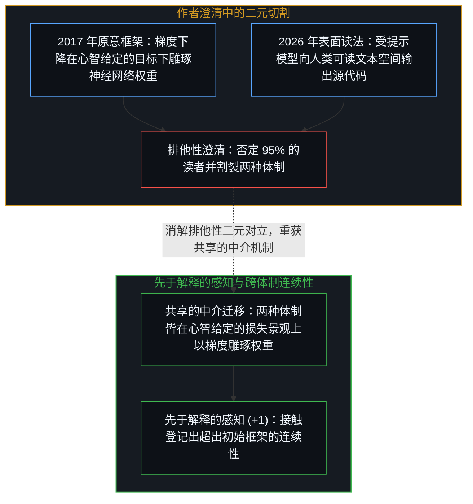
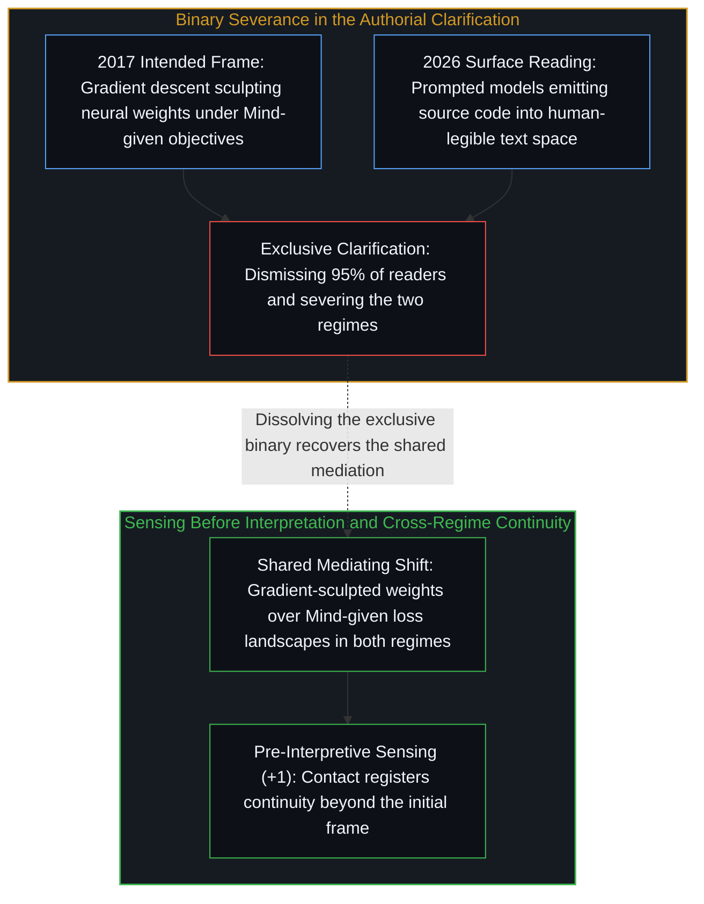

# 先于解释的感知 / Sensing Before Interpretation

*卡帕西关于梯度下降的推文跨越原意引发共鸣，源于先于解释的感知触及了跨空间的不变量。 / Karpathy's gradient-descent remark resonates beyond its original intent because sensing precedes interpretation and contacts an invariant across spaces.*

2017 年 8 月，安德烈·卡帕西发推说“梯度下降比你更会写代码”。九年后，伴随大语言模型每日生成源代码，这条推文重回视野并被读者奉为预言，促使卡帕西出面澄清：百分之九十五的读者误解了他的原意，他当年指的是梯度下降在分布式表征空间里扮演程序员，而不是语言模型在文本空间里输出 Python 代码。这番澄清划出了一道干净的界限，但两种读法之间的干涉图样，比单独任一读法都更清楚地揭示了理解活动如何运作。

In August 2017, Andrej Karpathy tweeted that gradient descent can write code better than you. When the remark resurfaced nine years later amid daily source-code generation by large language models, readers hailed it as prophecy, prompting Karpathy to clarify that ninety-five percent of readers misunderstood his point: in 2017 he meant gradient descent acting as a programmer inside distributed representation space rather than a language model emitting Python in text space. That clarification draws a clean boundary, yet the interference pattern between the two readings reveals more about how understanding works than either reading alone.

## 一、 强行割裂：表征空间与文本空间的连续性 / 1. The Forced Severance: Continuity Across Representation Space and Text Space

在这番交锋中，三重投射同时运转：2017 年的技术观察指出，梯度下降雕琢出的权重构型本身就是学得的程序；2026 年的读法把同一句话放在语言模型生成源代码的轴线上来听；事后的回溯性澄清则通过排斥第二条轴线来稳固第一条轴线。表征空间与人类可读的文本空间确属不同的领土，各自拥有不同的度量与约束。

Three projections operate simultaneously in the exchange: the 2017 technical observation that weight configurations sculpted by gradient descent are learned programs, the 2026 reading that hears the same words on the axis of language models generating source code, and the retroactive clarification that stabilizes the first axis by excluding the second. Representation space and human-legible text space are genuinely distinct territories with different metrics and constraints.

然而顺着生成机制追溯下去，两片领土之间贯穿着未曾断裂的连续性：在文本空间里写出 Python 源代码的大语言模型，运行在由同一梯度下降在表征空间雕琢而成的权重之上——这些权重压缩了人类早先写下的代码与文本，又在开发者的提示词下将候选源码投射回人类可读的词元。在这两个深度上，优化依然只是遍历预先区分的损失景观，而外环处活生生的心智则设定架构、训练语料、目标、提示词与验证，正如[不知去向何方的梯度下降](../the-descent-that-doesnt-know-where-its-going/)所确立的那样。两种体制下始终不变的，是这一中介迁移——将软件构建的一部分从逐条手写显式规则，移到梯度雕琢的权重之上：在前一种体制中直接在权重空间内部执行；在后一种体制中则向下游投射进文本空间，以受提示生成的代码把僵硬的软件库化为可修订的语境，一如[万物一如既往地流变](../everything-is-changing-as-always/)所追溯的那样。

Trace the generative mechanism, however, and an unbroken continuity links the two territories: the language model that writes Python source code in text space runs on weights shaped by that same gradient descent in representation space—weights that compressed prior human-written code and text and, under a developer's prompt, project candidate source code back out into human-legible tokens. At both depths, optimization remains traversal over a pre-distinguished loss landscape while the living Mind at the outer loop sets the architecture, training corpus, objective, prompt, and verification, as [The Descent That Doesn't Know Where It's Going](../the-descent-that-doesnt-know-where-its-going/) establishes. What stays invariant across both regimes is the mediating shift—moving part of software construction from hand-authoring every explicit rule onto gradient-sculpted weights, executing directly inside weight space in the first regime or projecting downstream into text space as prompted code that turns rigid libraries into revisable context, as traced in [Everything Is Changing, as Always](../everything-is-changing-as-always/).

## 二、 感知的富余信号：所谓“误读”是理解正在追上来 / 2. Excess Signal in Sensing: When "Misunderstanding" Is Understanding Catching Up

这揭示了认知中一条不变的次序：感知先于解释，且其运作分辨率高于用来表述它的框架。2017 年，卡帕西感知到梯度雕琢的权重在介导计算上正经历结构迁移，随即将这份感知压缩进“神经网络权重对阵手工设计特征”这一局部框架；那句话作为外部化痕迹留存下来，依然向更宽广的共振敞开，超出他 2017 年显式解释所许可的范围。九年后，活生生的建造者置身于[你的代码库即是记忆](../your-codebase-is-memory/)所剖析的外部化符号工作流中，经由第一人称接触重新综合了这道痕迹，登记出一条贯穿权重空间与文本空间的连续性——这是 2017 年框架当时未曾说破的。

This exposes an invariant order in cognition: sensing precedes interpretation and operates at a higher resolution than the frame used to state it. In 2017, Karpathy sensed a structural shift in how gradient-sculpted weights mediate computation, then compressed that sensing into the local frame of neural weights versus hand-engineered features; the remark stayed behind as an externalized trace, still open to wider resonance than his explicit 2017 interpretation licensed. Nine years later, living builders operating within the externalized symbolic workflows examined in [Your Codebase Is Memory](../your-codebase-is-memory/) re-synthesized that trace through first-person contact, registering a continuity across weight space and text space that the 2017 framing had left unstated.

当百分之九十五的读者都趋同于同一种“错误”读法时，这一趋同本身就是值得追溯的信号，而不只是理解失败：尽管这些读者错过了 2017 年的权重空间区分——并沿用了“优化扮演程序员”的隐喻——他们的读法依然经由当代实践，登记出了跨越体制的结构连续性。与此同时，守护 2017 年边界的那百分之五读者固然保住了两个空间之间的技术区分，却也有风险把关于作者意图的历史精确，误认作对这道痕迹的穷尽闭合。从《道德经》到赫拉克利特，经典文本历久传续，靠的正是同一套机制：看似预言的，其实是跨尺度的结构稳定性；看似误读的，其实是后来的心智在超出作者明示边界的新视域下，重新综合一道外部化痕迹。追问两种读法共同投射自何种生成结构——既让发起归于心智，又区分权重空间的直接执行与受提示引导的文本空间投射——便能保住这一区分的精确性，而不致割断让这句论断跨时代依然成立的连续性。

When ninety-five percent of readers converge on the same "wrong" reading, that convergence is itself a signal worth tracing rather than mere comprehension failure: even though those readers miss the 2017 weight-space distinction—and take on the metaphor of optimization acting as programmer—their reading still registers a structural continuity across regimes through contemporary practice. Meanwhile, the five percent who guard the 2017 boundary preserve the technical distinction between the two spaces, yet risk mistaking historical precision about authorial intent for exhaustive closure over the trace. Classical texts from the Dao De Jing to Heraclitus endure by the exact same mechanism: what looks like prophecy is structural stability across scales, and what looks like misunderstanding is later Minds re-synthesizing an externalized trace under a new horizon beyond the author's stated boundary. Asking what common generative structure both readings project from—keeping initiation with the Mind while distinguishing direct weight-space execution from prompted text-space projection—preserves the precision of the distinction without severing the continuity that makes the statement ring true across eras.
