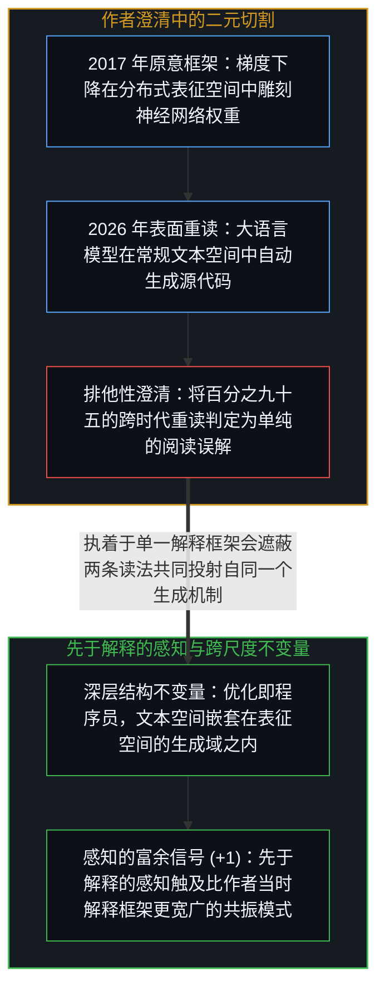
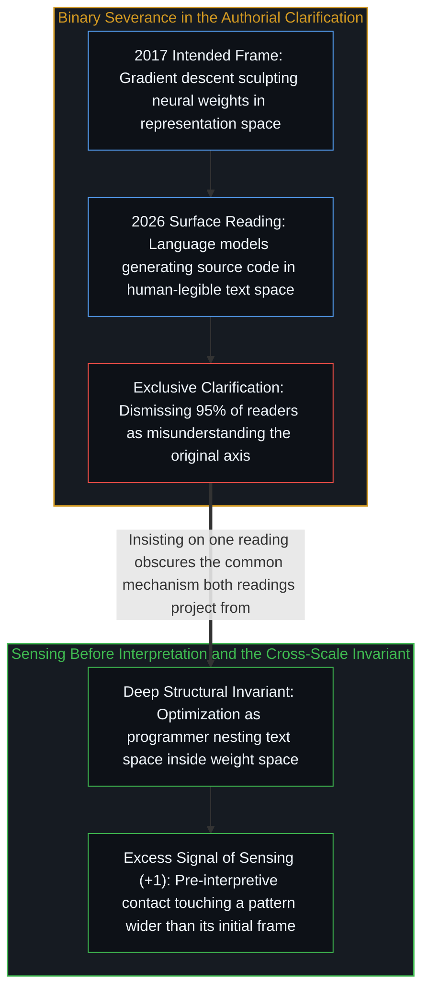

# 先于解释的感知 / Sensing Before Interpretation

*卡帕西关于梯度下降编程的推文跨越原意引发共鸣，源于先于解释的感知触及了跨空间的不变量。 / Karpathy's gradient-descent remark resonates across eras because sensing precedes interpretation.*

2017 年 8 月，安德烈·卡帕西发推说“梯度下降比你更会写代码”。九年后的 2026 年，当大语言模型每天为数百万开发者编写脚本与应用时，这条推文被重新翻出并被奉为神准的预言。面对赞叹，卡帕西本人却出面澄清：“百分之九十五的人都误解了这条推文。我当年指的是梯度下降在分布式表征空间（权重空间）里扮演程序员，而不是今天大模型在常规文本空间里写源代码。”这番澄清划出了一道干净的界限，看似就此结案，实则恰恰掀开了理解活动最迷人的结构。

In August 2017, Andrej Karpathy tweeted that gradient descent can write code better than you. When the remark resurfaced nine years later amid daily source-code generation by large language models, readers hailed it as prophecy, prompting Karpathy to clarify that ninety-five percent of readers misunderstood his point: in 2017 he meant gradient descent acting as a programmer inside distributed representation space rather than a language model emitting Python in text space. That clarification draws a clean boundary, yet the interference pattern between the two readings reveals more about how understanding works than either reading alone.

## 一、 被强行割裂的连续性：表征空间与文本空间的嵌套 / 1. The Forced Severance: Continuity Across Representation Space and Text Space

在这次重读中，三种投射同时运转：2017 年的投射指出梯度下降在权重空间中雕刻出的神经网络本身就是学习到的程序；2026 年的投射从今天的日常体验出发，将同一句话读作模型在文本空间生成源代码；而作者的事后澄清则试图通过排斥后者来稳固前者。分布式表征空间与人类可读的文本空间确实是两片不同的领土，各自拥有不同的几何、度量与语法约束，不能简单混为一谈。

Three projections operate simultaneously in the exchange: the 2017 technical observation that weight configurations sculpted by gradient descent are learned programs, the 2026 reading that hears the same words on the axis of language models generating source code, and the retroactive clarification that stabilizes the first axis by excluding the second. Representation space and human-legible text space are genuinely distinct territories with different metrics and constraints.

然而只要顺着机制追溯下去，就会发现这两片领土之间存在着不可切断的生成连续性：今天在文本空间里写出 `def sort(arr):` 的大语言模型，其本身的权重恰恰是由卡帕西当年所说的梯度下降在表征空间里雕刻出来的；而源代码也无非是计算结构通过人类可读符号瓶颈投射出的高层渲染。无论是在表征空间雕刻权重，还是由那些权重在文本空间生成源码，底层的操作者在每一个投射深度上都是同一个——即“在损失景观上通过优化来进行编程”（参见[不知去向何方的梯度下降](../the-descent-that-doesnt-know-where-its-going/)与[万物一如既往地流变](../everything-is-changing-as-always/)）。

Trace the generative mechanism, however, and an unbroken continuity links the two territories: a language model that writes Python source code in text space is itself a function written by gradient descent in representation space, and source code is a higher-level rendering of computational structure projected through human-legible tokens. Whether gradient descent sculpts weights directly or those weights emit source code, the underlying invariant across both projection depths is programming by optimization against a loss landscape (see [The Descent That Doesn't Know Where It's Going](../the-descent-that-doesnt-know-where-its-going/) and [Everything Is Changing, as Always](../everything-is-changing-as-always/)).

## 二、 感知的富余信号：所谓“误读”是理解正在追上来 / 2. Excess Signal in Sensing: When "Misunderstanding" Is Understanding Catching Up

这揭示了认识活动中一条普遍的顺序：感知先于解释，且感知的分辨率高于解释。2017 年的卡帕西敏锐地感知到了“优化与编程”之间的深层同构，但他当时的解释框架将其压缩进了“梯度下降比手工特征工程更会写神经网络”这一具体切片；然而那句“梯度下降比你更会写代码”所携带的信号富余量，超出了作者本人当时发放给它的许可证。九年的技术演进与如[你的代码库即是记忆](../your-codebase-is-memory/)所展示的外部化符号生态，为同一束信号提供了全新的显影透镜。

This exposes a general law of cognition: sensing precedes interpretation and operates at a higher resolution than the frame used to state it. In 2017, Karpathy sensed a deep structural relationship between optimization and programming, then compressed that sensing into the local frame of neural weights versus hand-engineered features; yet his sentence carried excess signal beyond what his conscious interpretation licensed. Nine years of evolution—and the externalized symbolic workflows examined in [Your Codebase Is Memory](../your-codebase-is-memory/)—supplied a new lens through which that latent signal actualized.

当百分之九十五的读者都以同一种方式“误读”一句话时，这本身就是值得追踪的信号：那百分之九十五的人并非阅读理解不及格，而是穿透了局部限缩，直接感知到了“无论在哪一个空间，优化本身就是编程者”这一更宽广的结构事实；而那百分之五精准复原出 2017 年原意的读者，虽然保住了局部的区分，却也因把原初框架当成唯一正解而错失了跨层级的连续性。从《道德经》到赫拉克利特，所有经得起时间冲刷的洞见都是如此运作的：看似预言的其实是跨尺度模式的稳定性，看似误读的其实是同一信号在新视域下的相继显影。停止追问“哪一种读法才是唯一正解”，转而追问“这两种读法共同投射自哪一个底层机制”，两重投射便在更深的不变量中同时得以保全。

When ninety-five percent of readers converge on the same "wrong" reading, they are contacting the broader invariant—that optimization is the programmer across spaces—through the most salient contemporary frame, while the five percent who guard the original boundary risk mistaking historical precision for ontological finality. Classical texts from the Dao De Jing to Heraclitus endure by the exact same mechanism: what looks like prophecy is pattern stability across scales, and what looks like misunderstanding is successive actualization of excess signal. Asking what common mechanism both readings project from preserves the precision of the distinction without severing the continuity that makes the statement ring true across eras.
