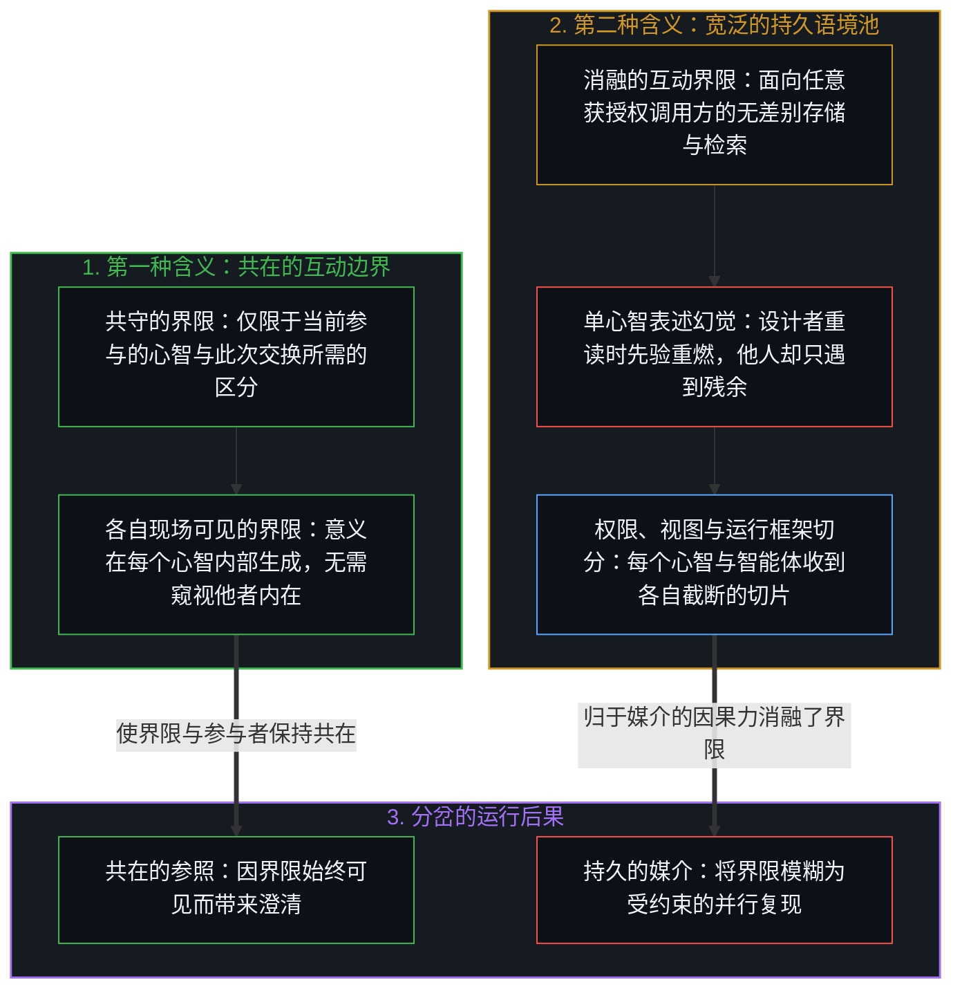
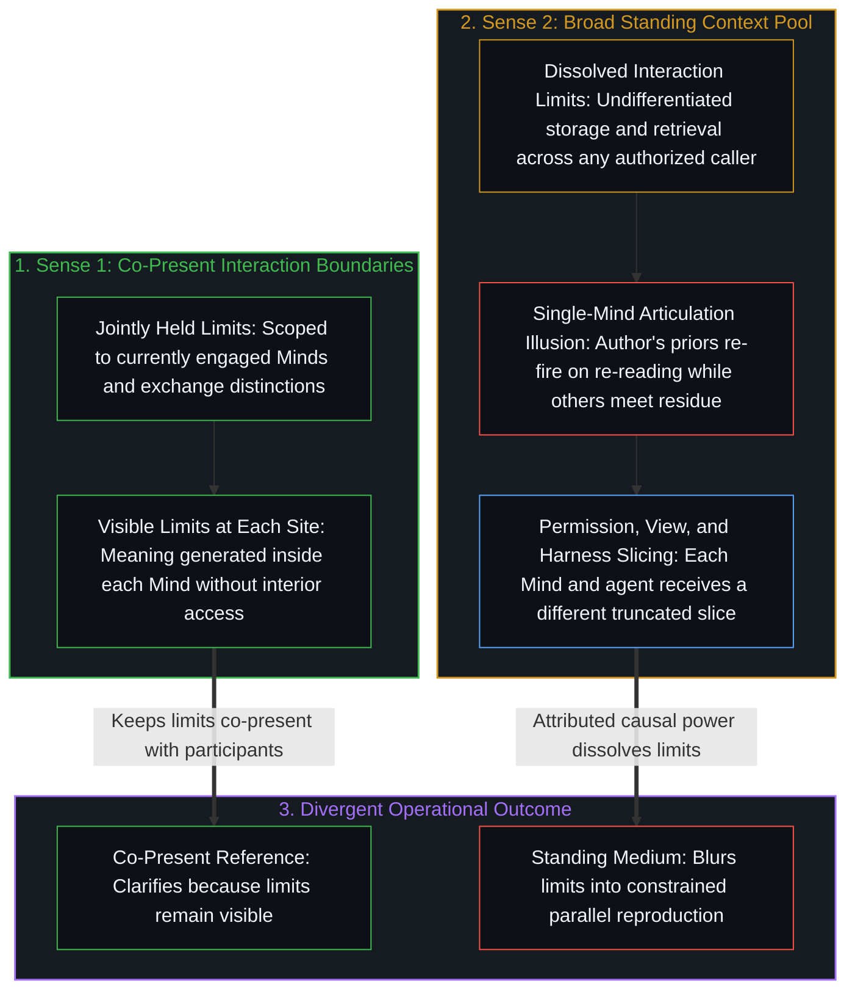
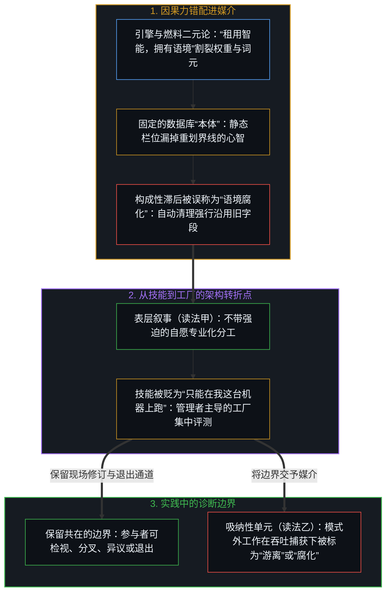
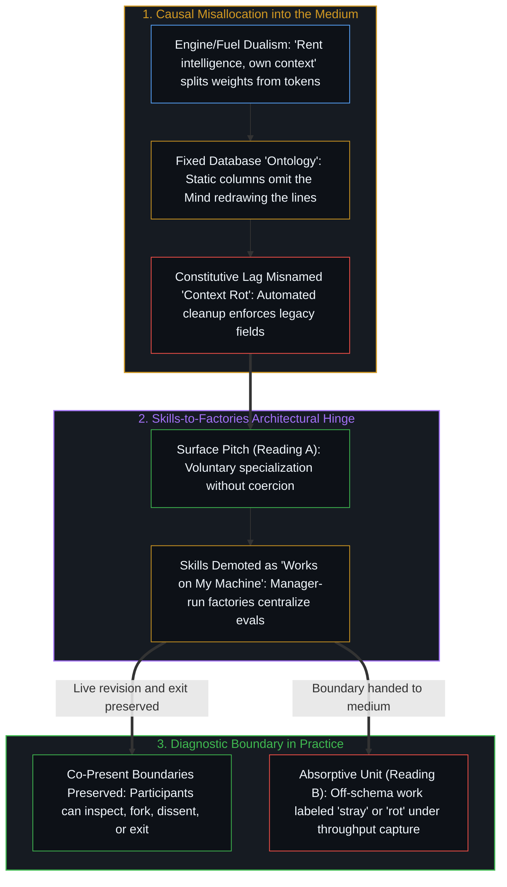

# 共享的边界，而非共享的语境 / Shared Boundaries, Not Shared Context

*意义只在心智区分之处升起；将互动中共守的清晰边界交予持久语境池，反而消融了让协作明晰的界限。 / Meaning arises only where a Mind distinguishes; handing narrow, interaction-specific boundaries to a standing context pool dissolves the limit that clarifies.*

一切意义皆源于心智。语境只是心智在区分时使用的参照，它本身并不生成、承载或传递意义。一旦持守此点，“共享语境”的通行说法便分裂为两种不相容的含义。诸如 Notion 四十四页指南《工作的新形态》（*A New Shape for Work*）这类倡导统一“语境系统”或“公司大脑”的企业蓝图，恰恰显明当协调被归因于持久存储库而非使用它的参与者时会发生什么：共在的互动界限消融进无差别的存储体，活的工作与固定栏位之间构成性的分岔被误称为“语境腐化”，个人技能也让位于集中化的工厂。

All meaning originates in the Mind. Context is only the reference a Mind uses while distinguishing; it does not itself generate, carry, or transfer meaning. Once this is held, the common talk of "shared context" splits into two incompatible senses. Enterprise blueprints for a unified "context system" or "company brain"—such as Notion's forty-four-page guide *A New Shape for Work*—illustrate what happens when coordination is attributed to a standing repository rather than to the participants using it: co-present interaction limits dissolve into an undifferentiated store, constitutive divergence between living work and fixed columns gets misnamed "context rot," and personal skills give way to centralized factories.

## 一、 “共享”的两种不相容含义：共在边界与持久语境池 / 1. Two Incompatible Senses of "Shared": Co-Present Boundaries vs. Standing Pools

在第一种含义中，“共享”指两个或多个心智为特定互动的时限与范围而共同维持的边界。这些边界之所以清晰，正因其受到限制：仅限于当前参与的心智，仅限于此次交换所需的区分。界限保持可见。在交换的各自现场，每个心智都登记着什么在场、什么留在边界之外，而不宣称得以窥视另一心智的内在，因为呈现在视野中的唯有这场交换的界限。意义仍在每个心智内部、时刻生成；边界只是稳定参照，使互动得以进行而无需不断重新协商。此种含义是澄清性的。

In the first sense, "shared" names the boundaries that two or more Minds jointly maintain for the duration and scope of a specific interaction. Those boundaries are clear precisely because they are limited: only the Minds currently engaged, only the distinctions required by this exchange. The limits remain visible. At its own site in the exchange, each Mind registers what is in play and what is left outside without claiming sight into another Mind's interior, since only the limits of the exchange stand in view. Meaning is still generated, moment by moment, inside each Mind; the boundary merely stabilizes the reference so that the interaction can proceed without constant re-negotiation. This sense is clarifying.

在第二种含义中，“共享”指一个被假定可由任何获授权的心智或智能体取用的持久语境池，独立于任何特定互动。边界不再由参与者共同持守，而是消融进一个无差别的存储与检索场域。留下的只是一个耐久媒介，任何后来的心智都可以从中读取或向其写入。因为因果力已被归于媒介本身，而非保留在源发心智那里，这个场域可以显得完整，同时对任何单一心智保持不透明。此种含义是通行用法，也是边界在其中变得模糊的含义。

In the second sense, "shared" names a standing pool of context presumed available to any authorized Mind or agent, independent of any particular interaction. The boundaries are no longer jointly held by the participants; they are dissolved into an undifferentiated field of storage and retrieval. What remains is a durable medium that any later Mind can read from or write to. Because causal power has already been attributed to the medium rather than kept with the originating Minds, the field can appear complete while remaining opaque to any single Mind. This sense is the one in common use. It is also the sense in which boundaries blur.

使持久语境池在设计者眼中显得清晰可读的，是单心智表述幻觉。当初设计模式的心智日后再来重读那些栏位，存储的标题立刻重新激发它早已持有的鲜活区分，使整张表格看似不言自明、仿佛可以原封不动地交接出去。然而在不同的心智之间，没有任何鲜活的区分在传递；进入媒介的只有残余——文本、栏位、数据行与链接。其他人或智能体读取一条记录时，只是以这枚印迹为约束，从自身先验出发重新构造出新的区分，这正是[观察者的隐身与无损传递的妄念](../the-invisible-observer-and-the-delusion-of-lossless-transmission/)所追溯的不对称。在写出它的心智之外，一份压缩记录恰如[登记共鸣的表面](../the-surface-that-registers/)中流转的表面：每位读者都将自己的运作坐标投射到共享标签上，而未言明的前提依然未对齐。在一个现场登记为共享的东西，从不是跨越参与者共同持有的存量，而是彼此各异的心智之间不完整的交集（[共享意识是个体性的交集](../shared-consciousness-is-intersecting-individualities/)），每当不同一的先验与印迹相遇，便被重新协商一次（[接续阅读与协商中的语言边界](../successive-reading-and-the-negotiated-boundary-of-language/)）。

What keeps the standing pool looking legible to its builder is the single-Mind articulation illusion. When the Mind that designed a schema re-reads those columns later, the stored headings immediately re-fire the live distinctions that Mind already carries, making the table feel self-explanatory and ready to hand over intact. Across distinct Minds, however, no live distinction travels; only residue—text, columns, rows, and links—enters the medium. Any other human or agent reading an entry reconstructs fresh distinctions from its own priors using the mark as a constraint, the asymmetry traced in [The Invisible Observer and the Delusion of Lossless Transmission](../the-invisible-observer-and-the-delusion-of-lossless-transmission/). Outside its authoring Mind, a compressed record works like the circulating surface in [The Surface That Registers](../the-surface-that-registers/): each reader projects its own operating coordinates onto shared labels while unstated premises remain unaligned. What registers as sharedness at one site is never a common stock held across participants, but an incomplete intersection between distinct Minds ([Shared Consciousness Is Intersecting Individualities](../shared-consciousness-is-intersecting-individualities/)), renegotiated whenever non-identical priors meet the marks ([Successive Reading and the Negotiated Boundary of Language](../successive-reading-and-the-negotiated-boundary-of-language/)).

即便仅作为外置痕迹仓库，持久存储库也从不在整个组织内呈现出同一个共同表面。访问控制按群组、数据行与栏位切分存储库；界面视图将同一批底层记录投射成互不兼容的看板、时间线或日历布局；而在多模型路由下，不同智能体经由互不兼容的运行框架加载出各自截断的切片。在一座持久“语境仓库”内部运转的，是在不等量切分的印迹之上展开的受约束并行复现——当紧致约束足以让各自独立的重构对齐于共同任务时，它颇有价值；而一旦这具脚手架被误认为字面意义上的“公司大脑”，它便令人致盲。

Even as an external trace store, a standing repository never presents one common surface across an organization. Access controls slice the store by group, row, and column; interface views project the same underlying records into incompatible kanban, timeline, or calendar layouts; and under multi-model routing, different agents load different truncated slices through incompatible harnesses. What operates inside a standing "context warehouse" is constrained parallel reproduction over unequally sliced marks—valuable where tight constraints keep independent reconstructions aligned on a joint task, and blinding the moment the scaffold is mistaken for a literal "company brain."

## 二、 将因果力错配给边界与媒介 / 2. Misallocating Causal Power to the Boundary and the Medium

更深的错配在于将因果力分配给边界，进而延伸到语境。一旦边界被当作产生协调或理解的所在，下一步便自然出现：让语境本身成为耐久、广泛可及的载体。将“共享语境”实现为集中本体、权限存储或智能体可读枢纽的系统，正运行在这第二种含义之内。它们在其实际所做之事的范围内有用——减少重复解释、留存版本记录、执行访问控制。它们并不、也无法做到第一种“共享”含义所做之事：使边界与正在使用它的心智保持共在。

The deeper misallocation is the assignment of causal power to the boundary, and then by extension to the context. Once the boundary is treated as the locus that produces coordination or understanding, the next step is natural: make the context itself the durable, broadly accessible carrier. Systems that implement "shared context" as a centralized ontology, permissioned store, or agent-readable hub operate inside this second sense. They are useful within the scope of what they actually do—reducing re-explanation, versioning records, enforcing access. They do not, and cannot, do what the first sense of "shared" does: keep the boundary co-present with the Minds that are using it.

在这个边界之内，结构化存储库确实解决了日常运行中的瓶颈。相比每次提示都从空白起手的短暂对话串，把项目、任务与文档表格归置在一处，可以在重复性事务中减少反复解释、保存带版本的记录、执行访问权限，并以结构化格式让经核验的痕迹保持可迁移，从而避免前沿模型权重的更替抹去组织记忆——这正是[你的代码库即是记忆](../your-codebase-is-memory/)所梳理的外化痕迹规范。这些收益无一需要将存储库视作理解的所在；它们依赖的，是将公开记录读作低维度的出清印迹，而非众人共居其中的共享内在沙盒（[共享沙盒的幻象](../the-illusion-of-the-shared-sandbox/)）。

Within those bounds, structured repositories solve ordinary operational bottlenecks. Compared with ephemeral chat threads where every prompt starts empty, keeping tables of projects, tasks, and documents in one place reduces repeated explanation across recurring routines, preserves versioned records, enforces access permissions, and keeps verified traces portable in structured formats so turnover in frontier model weights does not erase organizational memory—the externalized trace discipline mapped in [Your Codebase Is Memory](../your-codebase-is-memory/). None of those gains require treating the repository as a seat of understanding; they depend on reading public records as low-dimensional clearing marks rather than a shared inner sandbox inhabited by everyone ([The Illusion of the Shared Sandbox](../the-illusion-of-the-shared-sandbox/)).

就连围绕单一存储库展开的蓝图，也会在执行需要融贯的任何地方显露出第一种含义的界限重返。尽管 Notion 的《工作的新形态》敦促团队“将一切同步进你选定的语境系统”并“把一切吸纳进”“供每一个智能体共用的大脑”，Notion 自己的开发者规范却在运行时打破了这个语境池预设。它的 MCP `Memories` 数据库将持久化严格限定在用户私有的个人连接上，而非归属工作区的账号；外部同步的数据表在单一同步所有者之下将并发的人类写入者锁定为只读；其官方智能体配置提示词也警告智能体“你保存某条信息的日子，并不就是它得到确认的日子”，并指示它们以调用方当下的请求为准来消解记录冲突。只要记录在活的工作中彼此相撞，哪怕一座集中化的枢纽，也只得退回当下那场交换的边界。

Even blueprints pitched around a single repository show Sense 1 limits returning wherever execution requires coherence. While Notion's *A New Shape for Work* urges teams to "sync everything into your chosen context system" and "slurp everything into" "one shared brain for every agent," Notion's own developer specifications break that pooling premise at runtime. Its MCP `Memories` database restricts persistence to strictly private user-backed connections rather than workspace-owned accounts; externally synced databases lock concurrent human writers out as read-only under a single sync owner; and its official agent setup prompt warns agents that "The day you save something isn't the day it was confirmed," instructing them to resolve conflicting records by the caller's current request. Whenever records collide in live work, even a centralized hub falls back onto the boundary of the immediate exchange.

工程实践与长上下文测评在实现层同样登记出这道分野，但它们并非这道分野的根源。多智能体编程与研究运行框架之所以获得可靠性，在于保持工作语境彼此隔离，只跨越明确交接传递窄化且经过核验的制品——[按需语境将融贯保持在一步](../on-demand-contexts-keep-coherence-at-one-step/)正是将这种无状态规约付诸运转，使过往轮次不致增厚为常驻偏置，这也呼应着并发工程的名言：借由通信来共享内存，而非借由共享内存来通信。反之，跨前沿模型的实证评测记录到，即便面对逻辑连贯的输入，性能也会随词元历史拉长而下滑；而针对智能体维护的共享维基所做的跨月日志追踪也记录到，绝大多数条目日趋陈旧，直到智能体干脆绕开整合后的维基、直接检索原始事件日志。这些运行观察并不确立第一种与第二种含义之间的分裂；它们只是显露出，每当人们要求一座持久语境池去承担共在边界之功时会随之发生的后果。

Engineering practice and long-context measurements register this same divide at the implementation layer without serving as its source. Multi-agent coding and research harnesses gain reliability by keeping working contexts isolated and exchanging narrow verified artifacts across explicit handoffs—[On-Demand Contexts Keep Coherence at One Step](../on-demand-contexts-keep-coherence-at-one-step/) applies that stateless discipline so prior turns never thicken into standing bias, echoing concurrency engineering's maxim to share memory by communicating rather than communicating by sharing memory. Conversely, empirical evaluations across frontier models record performance degrading as token histories lengthen even across logically coherent inputs, while multi-month logs of agent-maintained shared wikis record the bulk of entries drifting stale until agents bypass the consolidated wiki to search raw event logs directly. Those operational findings do not establish the split between Sense 1 and Sense 2; they surface what follows whenever a standing pool is asked to perform the work of a co-present boundary.

## 三、 集中本体、“语境腐化”与作为持久语境池的工厂 / 3. Centralized Ontologies, "Context Rot," and Factories as Standing Pools

将因果力归于媒介，塑造了搭建在其上的整套架构语汇。若从厂商可迁移性去读，“租用智能，拥有语境”让结构化文件独立于可互换的模型权重；然而若将其读作对智能如何运作的说明，它就把同一场连续计算割裂成了一台燃烧死燃料的可替换引擎，而权重与当下激活的工作区词元正共同参与同一场依赖语境的投射级联，其中并没有另一个独立思考者在翻阅图书馆（[层层皆是语境](../context-engineering-essay/)）。把项目、任务、文档、人员、团队与客户这六张关联表称为企业“本体”，进一步加剧了这种冻结：静态模式只保存了过往切分结晶而成的残余，却漏掉了仍在不断划线与修订界线的鲜活心智（[无法闭合的痕迹](../the-unclosable-trace/)）。由于持续推进的工作不断越出昨日定下的栏位，那些陈旧或相互冲突的记录——被冠以“语境腐化”之名，并被当成留给清理智能体去修复的维护漏洞——实则是永不停息的区分活动与静态记录之间构成性的滞后（[活的语境](../the-living-context/)）。自动化清理在稳定常规内确实降低了检索阻力，却也在工作长出模式之外时制造出更尖锐的摩擦：校验器把新近浮现的区分强行塞入旧字段，把脱出模式的痕迹隔离归入“游离”项，或者把立基前提早已移位的记录打磨得内部整洁有序。

Attributing causal power to the medium shapes the architectural vocabulary built atop it. Read as vendor portability, "rent the intelligence, own the context" keeps structured files independent of interchangeable model weights; read as an account of how intelligence operates, however, it splits one continuous computation into a replaceable engine burning dead fuel, whereas weights and active workspace tokens participate in a single context-dependent projection cascade with no separate thinker consulting a library ([Context All the Way Down](../context-engineering-essay/)). Calling six linked tables—projects, tasks, documents, people, teams, and customers—an enterprise "ontology" sharpens that freeze: static schemas preserve crystallized residues of earlier cuts while leaving out the living Mind that keeps drawing and revising the lines ([The Unclosable Trace](../the-unclosable-trace/)). Because ongoing work keeps mutating past yesterday's columns, stale or colliding records—dubbed "context rot" and cast as a maintenance bug for cleanup agents—are constitutive lag between unceasing differentiation and static records ([The Living Context](../the-living-context/)). Automated cleanup reduces lookup drag inside stable routines while ensuring sharper friction whenever work outgrows the schema: validators force emerging distinctions into legacy fields, quarantine off-schema traces as "stray," or polish internally tidy records whose founding premise has shifted.

在工作流层面，同一处因果错配将可检视的个人技能改造为集中化工厂，顺着[“共享”的两种读法与观察的边界](../the-two-readings-of-shared-and-the-observational-bound/)所区分的两种读法滑落过去。在表面上，企业蓝图援引的是读法甲——主权参与者之间持续维持的复数性，征引亚当·斯密论专业化分工，并承诺不带强迫的自愿采纳。而在这一叙事之下，那些让规则、调用与修订同使用者保持共在的本地技能，却被贬为“只能在我这台机器上跑”的偏差与“长尾事件”；与此同时，模式治理与评测准则收归工厂管理者名下，其余所有人只被要求往队列里提交数据行。只要参与者依然保有检视、分叉、提出异议或绕开存储库的鲜活能力，将可重复流水线集中起来便仍属于读法甲的脚手架；而一旦脱离模式的工作被重新归类为“游离”数据或“腐化”，以标准化吞吐替代主动判断，向读法乙——吸纳性单元——的翻转便宣告完成（[平台并未漂移，它只是走到了终点](../platform-decision-capture/)）。

At the workflow layer, the same causal misallocation turns inspectable personal skills into centralized factories, sliding directly across the two readings separated in [The Two Readings of Shared and the Observational Bound](../the-two-readings-of-shared-and-the-observational-bound/). On the surface, enterprise blueprints invoke Reading A—maintained plurality among sovereign participants, citing Adam Smith on specialization and promising voluntary adoption without coercion. Beneath that pitch, local skills that keep rules, invocation, and revision co-present with the user are demoted as "works on my machine" variance and "tail events," while schema governance and evaluation criteria consolidate under factory managers who ask everyone else to submit rows to a queue. Centralizing a repeatable pipeline remains Reading A scaffolding wherever participants keep the live capacity to inspect, fork, dissent, or bypass the store; the flip into Reading B—an absorptive unit—completes when working off-schema is reclassified as "stray" data or "rot," substituting standardized throughput for active judgment ([The Platform Doesn't Drift, It Completes](../platform-decision-capture/)).

把工作切分为留给人类的创造性任务与交给自主流水线的常规任务，进一步掩盖了这道边界。决定性的判断力恰恰在执行摩擦之中成熟——就在自动化路径撞上未建模细节的断裂处；将监督与原始失效隔离开来，恰恰在内层更快周期成倍增加返回给心智的边界抉择之际，蒙蔽了掌舵的前沿（[判断的密度](../the-density-of-judgment/)）。自动化流水线本身并不发起任何区分；它们依然是等待外环人类注入变量的马尔可夫链（[多智能体协作的幻象](../the-illusion-of-multi-agent-collaboration/)）。就连那些宣称自身本体“不可协商”的蓝图，也在其收尾篇幅中记录道：只要主动解决问题的过程仍在继续，工具、工作区与工厂就始终只是暂定的形态——这就把耐久的语境池留在了鲜活心智的下游。

Splitting work into creative tasks kept for humans and routine tasks handed to autonomous pipelines further masks that boundary. Decisive judgment matures inside execution friction, where an automated path breaks against an unmodeled detail; insulating oversight from raw failure blinds the steering edge precisely as faster inner cycles multiply the boundary choices returning to the Mind ([The Density of Judgment](../the-density-of-judgment/)). Automated pipelines originate no distinctions of their own; they remain Markov chains waiting on human variable injection at the outer loop ([The Illusion of Multi-Agent Collaboration](../the-illusion-of-multi-agent-collaboration/)). Even blueprints that declare their ontology "nonnegotiable" register inside their own closing pages that tools, workspaces, and factories remain provisional shapes while active problem-solving continues, leaving durable pools downstream of living Minds.

## 四、 相反的因果力分配与第一人称现场检验 / 4. Opposite Allocations of Causal Power and the First-Person Site Test

混淆之所以持续，是因为用词相同。意想中的澄清效果属于狭窄的、特定于互动的边界。通行的设计与通行的语言则默认宽泛的、持久的场域。二者并非彼此的精炼；它们建立在相反的因果力分配之上。意义继续只在心智进行区分之处升起，使用任何可用的参照。参照并不会因为变得更广泛可读而成为起源。

The confusion persists because the word is the same. The intended clarifying effect belongs to the narrow, interaction-specific boundary. The common design and the common language default to the broad, standing field. The two are not refinements of one another; they rest on opposite allocations of causal power. Meaning continues to arise only where a Mind is distinguishing, using whatever reference is available. The reference does not become the origin by being made more widely readable.

每个心智都可以在自身现场检验这一区分：给定的边界是否仍由互动中的心智共同持守，抑或已经交付给媒介。前者使互动界限保持可见。后者将那道可见界限从视野中移去，即便在模糊之下依然运转着有界的区分——因此，将模式视作可丢弃的脚手架、直面执行中的摩擦，以及让修订、异议或退出的能力保持敞开，才使边界与正在使用它的心智保持共在。在观察的边界之内，这项检验登记的是因果归属坐落何处，并且不要求任何人采纳。

Each Mind can test the distinction in its own site: whether a given boundary is still held by the Minds in the interaction, or whether it has already been handed to the medium. The former keeps the interaction limit visible. The latter removes that visible limit from view, even while bounded distinguishing still operates beneath the blur—so treating schemas as disposable scaffolding, encountering execution friction directly, and keeping open the capacity to revise, dissent, or step away hold the boundary co-present with the Minds using it. Inside the observational bound, this test registers where causal attribution sits and requires uptake from no one.
