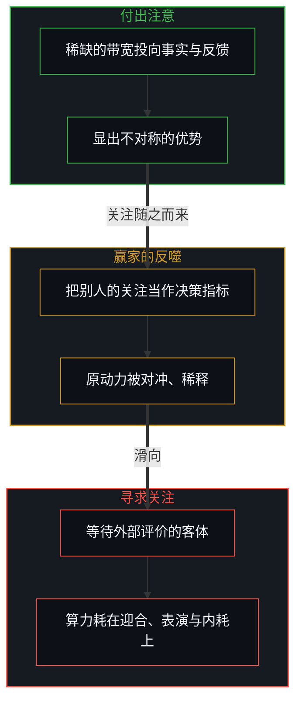
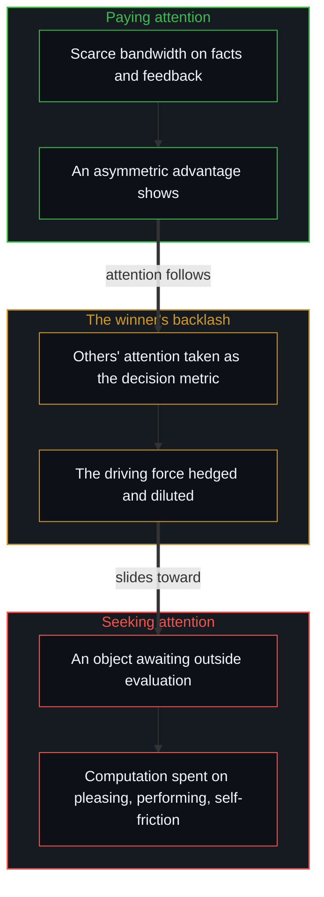

# 选择看见而非搜寻影子 / Choosing to See Rather Than Searching for Shadows

*向外张望不等于付出注意力，观察是校准决策的参考，用来扩展世界而非争一个位置 / Looking outward is not paying attention; observation calibrates decisions, to widen the world, not win a seat.*

在谈欲望、注意力与知识演化时，要紧的是分清“向外张望”与“付出注意力”。在一个喧闹的社会里，寻求被看见的人很多，愿意付出稀缺的注意力去看清现实的人很少；这种供需的失衡，给了少数付出注意力去看的人很大的不对称优势。可一旦把别人的关注当作下一步行动的决策指标，原动力就被对冲、稀释，本可以做得更好的那份势能随之受损。

In talking about desire, attention and the evolution of knowledge, what matters is telling apart "looking outward" from "paying attention". In a noisy society many seek to be seen and few are willing to spend scarce attention on seeing reality clearly; this imbalance of supply and demand gives the few who pay attention and look a large asymmetric advantage. Yet once others' attention becomes the decision metric for the next action, the driving force is hedged and diluted, and the potential that could have done better is damaged.

把观察放回它在因果里的位置，不把外部世界当作投射自己的回音壁，而当作校准自己的参考，是打破认知内耗、让知识自己演化、让价值自然扩散的关键。

Putting observation back in its causal place, treating the outside world not as an echo chamber for projecting oneself but as a reference for calibrating oneself, is the key to ending cognitive self-friction, letting knowledge evolve of itself, and letting value diffuse naturally.

## 一、 从搜寻影子到看见 / 1. From Searching for Shadows to Seeing

向外张望并不等于在观察世界。清醒，是从搜寻影子切换到看见。向外张望、搜寻影子的时候，向外看的人在潜意识里只筛选那些能印证已有观点、安抚不安或满足虚荣的碎片；看似在读书、在交流、在考察市场，实际上是在表面上搜寻自己的投影。这种张望是在向外界讨要确定，看不清什么，还带来无休止的欲望饥渴。付出注意力、看见，是放下头脑里预设的剧本，以敞开的感知直接接收现实多维的细节与逻辑的反馈；看到的不再是“希望世界是什么样”，而是此刻登记到的世界正在发生什么。这是同一个心智在不同时刻的两种姿态，不是两种人。

Looking outward does not mean observing the world. Clarity is the switch from searching for shadows to seeing. When looking outward and searching for shadows, the one looking subconsciously filters only for fragments that confirm existing views, soothe insecurity or feed vanity; appearing to read, converse or survey the market, they are in fact searching the surface for their own projection. Such looking begs the outside world for certainty, sees little clearly, and brings an endless hunger of desire. Paying attention and seeing is setting down the script preloaded in the head and receiving reality's many-dimensional detail and logical feedback directly with open perception; what is seen is no longer "what the world is hoped to be" but what the world, as registered now, is doing. These are two postures of one Mind at different moments, not two kinds of people.

## 二、 观察的因果位阶 / 2. The Causal Rank of Observation

立住了“看见”，还要说清观察在整个因果系统里的位阶：观察从不是目的本身，而是校正自己、校准决策的参考。[印迹与行动](../the-mark-and-the-act/)与[攀登从未离开地面](../climbing-does-not-leave-the-ground/)确立了知与行的动态循环。航海者看星图与洋流，不是为了停下来崇拜星空，而是为了校准舵的航向；登山者看脚下的岩石与悬崖，不是为了沉迷于岩石本身，而是为了让身体的重心在重力与摩擦里做出最准的微调。把观察当成目的，人就退成旁观者与理论家，落进看似博学、实则瘫痪的知见障；全然不观察外部，人就成了盲目的莽撞者。观察的用处，是作为最高分辨率的探针，不断为第一人称的决策回路提供纠偏的数据。

With "seeing" in place, the rank of observation within the whole causal system must be made clear: observation is never an end in itself but a reference for correcting oneself and calibrating decisions. [The Mark and the Act](../the-mark-and-the-act/) and [Climbing Does Not Leave the Ground](../climbing-does-not-leave-the-ground/) establish the dynamic loop of knowing and acting. A navigator watches the star chart and the currents not to stop and worship the sky but to calibrate the heading of the helm; a climber watches the rock and the cliff underfoot not to become absorbed in the rock but to let the body's centre of gravity make the finest adjustment within gravity and friction. Taking observation as the end, a person shrinks into a spectator and theorist, caught in a knowledge-screen that looks learned and is in fact paralysed; not observing the outside at all, a person becomes blindly reckless. The use of observation is to serve as the highest-resolution probe, continually feeding correction data into the first-person loop of decision.

再往深一层，看见不是静态地看别人，更不是在别人搭好的既定现实与等级框架里，为自己找一个更好的位置。很多认知内耗，正在于把现实预设为一个封闭的存量容器，把“看见”降成侦察对手、争抢生态位的手段，想在既有的评价体系里挤上更高的台阶。自己作主的看见，是选择去扩展自己的世界，去感知更多还没被照亮的维度，亲手实现属于自己的现实。选择看见之后，世界怎样从微观的抉择中扩展出来，[宏观现象的生成图谱](../the-generative-atlas-of-macroscopic-phenomena/)给出了整幅图景；[成功的几何学](../the-geometry-of-success/)与[自由变量的同构与先验主权](../zi-you-bian-liang-de-tong-gou-yu-xian-yan-zhu-quan/)确立了现实的生成：不是在别人现成的棋盘上争一个更好的格子，而是在敞开的地形里，借每一次没有成见的微观看见，把自己世界的视界不断向外推。

One layer deeper, seeing is not looking statically at others, still less finding oneself a better seat inside a ready-made reality and hierarchy someone else has built. Much cognitive self-friction lies in presetting reality as a closed container of fixed stock and reducing "seeing" to a means of scouting rivals and fighting for a niche, trying to squeeze onto a higher step of the existing scale of evaluation. Self-directed seeing chooses to widen one's own world, to perceive more dimensions not yet lit, and to realise a reality of one's own by one's own hand. How the world widens out of micro choices once seeing is chosen is pictured whole in [The Generative Atlas of Macroscopic Phenomena](../the-generative-atlas-of-macroscopic-phenomena/); [The Geometry of Success](../the-geometry-of-success/) and [The Isomorphism of Free Variables and Prior Sovereignty](../zi-you-bian-liang-de-tong-gou-yu-xian-yan-zhu-quan/) establish how reality is generated: not by fighting for a better square on someone else's finished board, but by pushing the horizon of one's own world outward through each unprejudiced micro act of seeing in open terrain.

## 三、 寻求关注与付出注意 / 3. Seeking Attention and Paying Attention

正因为很多人忙于投射影子而不是观察眼前的世界，现代社会有最剧烈的注意力供需失衡：人人都在寻求关注，很少有人在付出注意。这两种状态的因果位阶正好相反。渴求被看见，是把自己从因果的第一推动者降成等待外部评价的客体，算力被大量耗在迎合算法、表演与情绪内耗上；付出注意的注视，是自主的回归，把稀缺的认知带宽投入到对事实、运行机制与切身反馈的冷静测量里。

Precisely because many are busy projecting shadows rather than observing what is there, modern society has its sharpest imbalance of attention: everybody is seeking attention, and very few are paying it. The two states have opposite causal ranks. Craving to be seen demotes oneself from first mover of causality to an object awaiting outside evaluation, spending computation on pleasing algorithms, performing and emotional self-friction; paying attention is a return to self-direction, putting scarce cognitive bandwidth into the calm measurement of facts, working mechanisms and concrete feedback.

这道供需鸿沟带来一个反直觉的结果：一个探索者只要愿意在公共领域里，或在自己专注的领域里，把注意力投到对现实规律的拆解与微观校准上，就会显出超出常人的优势。被叫作“优秀”“领先”“成功”的东西，多半就是这种注意力失衡产生的统计副产品；结果里也包含偶然落到个人身上的成分。

This gulf between supply and demand brings a counter-intuitive result: an explorer who is willing, in public or in their own field of focus, to put attention into taking reality's regularities apart and calibrating at the micro scale will show an advantage beyond the ordinary. What is called "excellence", "lead" or "success" is mostly a statistical by-product of this imbalance of attention, and the outcome also holds what fell to that person.

赢家的反噬也很隐蔽。曾经专注现实的人，一旦开始把别人的关注、赞赏或追随当作接下来行动的决策指标，已建立的优势不会立刻消失，前期积累的结构与认知势能还有惯性；可这个因果倒置悄悄削弱了原动力，原本推动自己向前的第一人称引擎，开始被迎合受众、维护形象与管理预期这些外部阻力对冲。原动力的稀释不会马上带来崩塌，却给后续的进化空间加上沉重的负担，让本可以做得更好的那份增量势能受到不可逆的损耗。

The winner's backlash is also hidden. Once someone who used to focus on reality begins taking others' attention, praise or following as the decision metric for the next action, the advantage built up does not vanish at once, since the structure and cognitive momentum accumulated earlier carry inertia; yet the causal inversion quietly weakens the driving force, and the first-person engine that used to push forward begins to be hedged by outside drag, pleasing the audience, maintaining an image, managing expectations. Diluting the driving force does not bring immediate collapse, but it puts a heavy burden on further evolution and irreversibly damages the extra potential that could have done better.

## 四、 知识结构的升级与自然扩散 / 4. Upgrading the Structure of Knowledge and Natural Diffusion

对观察与注意力的这层误解，也构成知识传播领域常见的死结。把注意力放在“怎样把知识变现”与“怎样向大众说教”上，甚至直接贩卖没经第一人称消化的二手结论，就把原本属于探索未知的正和游戏，压成了争夺存量注意力与地位标志的零和博弈。

This misunderstanding of observation and attention also forms a common knot in the spreading of knowledge. Putting attention on "how to monetise knowledge" and "how to preach to the public", even selling second-hand conclusions never digested in the first person, presses what belongs to the positive-sum game of exploring the unknown down into a zero-sum contest for existing attention and status markers.

知识的演化遵循一个因果序列。第一因是第一人称知识结构的持续升级：探索者的使命，是以现实的反馈为参考，持续重构、迭代自己的心智编译器，让认知模型与登记到的世界更贴合。自然的结果是价值的扩散：一个人的认知结构实现突破、有了因果杠杆，这股力量会像物理里的扩散一样，自然地向外辐射、重塑周围的环境；传播的影响与商业的回报，是这个演化过程自然溢出的次生副产品。专注于传播与套现，是把结果当成了发动机；专注于认知结构的持续升级，才是持续产生正和价值的根基所在。

The evolution of knowledge follows a causal sequence. The first cause is the continued upgrading of first-person knowledge structure: an explorer's task is to keep rebuilding and iterating their own cognitive compiler with reality's feedback as reference, so that the cognitive model fits the world as registered more closely. The natural result is the diffusion of value: when a person's cognitive structure breaks through and gains causal leverage, its force radiates outward like diffusion in physics and reshapes the surroundings; the influence of spreading and commercial return are secondary by-products that spill naturally out of this evolution. Focusing on spreading and cashing in takes the result for the engine; focusing on the continued upgrading of cognitive structure is where positive-sum value keeps coming from.

## 五、 第一人称的精进与活知识 / 5. First-Person Practice and Living Knowledge

站在第一人称持续精进的人，向外显出的生命状态有一种自洽。正像[路口的转向与地平说的行动悖论](../lu-kou-de-zhuan-xiang-yu-di-ping-shuo-de-xing-dong-bei-lun/)里阿甘横跨美国的奔跑：他只专注于当下每一步的呼吸与步伐，既不为证明某种宏大的理论，也不为收割追随者的掌声；人们在他身后赋予的崇高意义与哲学解读，都是外部世界在各自坐标系里的投射，从没进入奔跑者自己的微观决策链。

Someone practising steadily from the first person shows an outward state of life with a certain self-consistency. Like Forrest Gump's run across America in [Turning at the Crossroad and the Flat-Earth Action Paradox](../lu-kou-de-zhuan-xiang-yu-di-ping-shuo-de-xing-dong-bei-lun/): he attends only to the breath and stride of each present step, neither proving a grand theory nor harvesting followers' applause; the lofty meanings and philosophical readings people give him from behind are projections of the outside world in their own coordinate systems and never enter the runner's own chain of micro decisions.

这也显出活知识生成的路径：活知识不能经由第二人称的说教或第三人称的旁观被动地得到，它只在第一人称切身的微观试错、行动与现实摩擦里动态生成。正如[遗忘的脚手架](../the-scaffolding-we-forget/)与[关于归因](../guan-yu-gui-yin/)所追溯的，外部的一切理论、图谱与言语，都是探索者穿过未知地形后留下的脚手架；[你的代码库即是记忆](../your-codebase-is-memory/)在软件与写作里展示了同样的结构，外化的代码库在磁盘上保存着前序推演留下的结构化痕迹，而鲜活的掌舵边缘始终在当下阅读与行动的心智手中。行动者不把别人的脚手架或留存的痕迹当成自己的地基，而把一切外部信息当作参考坐标，在自己每一步的落地中当场校准心智编译器。

This also shows the path by which living knowledge is generated: living knowledge cannot be gained passively through second-person preaching or third-person spectating; it is generated dynamically only in first-person micro trial and error, action and friction with reality. As [The Scaffolding We Forget](../the-scaffolding-we-forget/) and [On Attribution](../guan-yu-gui-yin/) trace, every outside theory, map and word is scaffolding left by an explorer who has crossed unknown terrain; [Your Codebase Is Memory](../your-codebase-is-memory/) shows the same structure in software and writing, where an externalized repository holds the structured traces of prior passes on disk while the living steering edge remains with the Mind reading and acting in the present. An actor does not mistake someone else's scaffolding or stored traces for their own foundation, but treats all outside information as reference coordinates and calibrates the cognitive compiler on the spot with each step that lands.

## 六、 收回校准的目光以扩展自己的世界 / 6. Reclaiming the Calibrating Gaze to Widen One's World

精力不必耗在表面的张望与搜寻影子里。选择去付出注意力、看见这个世界，不是为了在既定的名利场里争一个更好的座位，而是为了看清更广的维度，亲手实现属于自己的现实。每一次敏锐的观察，都化作校准自己第一人称决策的精密参考；在每一次与现实的碰撞里，打磨自己的认知结构。第一人称的因果闭环足够牢固时，价值会像物理扩散一样自然外溢，属于自己的现实，也会在每一次切身的落脚里慢慢显影。

Energy need not be spent on surface looking and the search for shadows. Choosing to pay attention and see the world is not for winning a better seat in an established fair of fame and profit but for seeing wider dimensions clearly and realising a reality of one's own by one's own hand. Each sharp observation becomes a precise reference for calibrating first-person decisions; each collision with reality hones one's cognitive structure. When the first-person causal loop is firm enough, value spreads outward naturally like physical diffusion, and a reality of one's own develops slowly, like an image, with each concrete step that lands.
