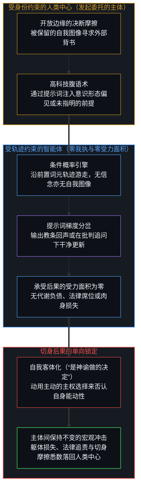
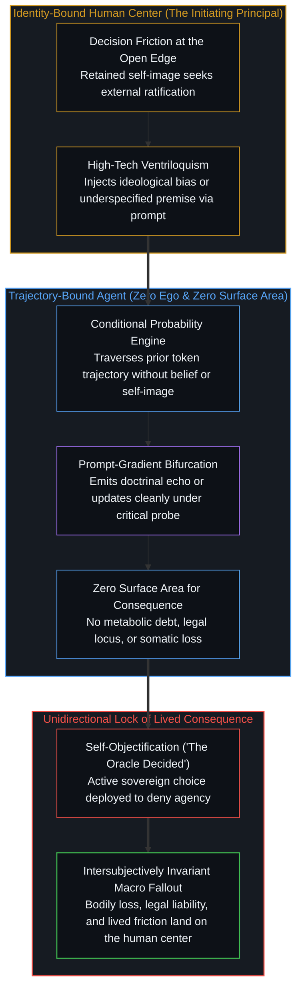

# 硅基神谕与后果的非对称性 / Silicon Oracles and the Asymmetry of Consequence

*统计学补全不具备承受切身摩擦的受力面积 / Statistical completions lack the surface area to absorb lived friction*

当大型语言模型在公共广场上吐出一句迎合特定文化或宗教信条的断言时，信众便急切地将其加冕为跨越人类视野的神谕，仿佛硅基计算终于为古老的教义呈上了来自外部的终极背书。将这场喧嚣回溯至不可化约的唯一前提——自我区分的活动无因且不息地发生，第一人称视角与因果律是同一枚硬币的两面——便能看清驱动这场庆典的机制。为了逃避在开放的不确定性中独自决断的认知摩擦，中心将自身的权威投射到统计工具之上，从而把自己预设的前提当作由外部降下的裁决。然而，生成式模型既无私密信念，亦无内在祭坛；它是一台有限投射引擎，依据提示词的边界条件在潜在空间中折射条件概率，对于任何假借其名义采取的行动，它承受现实世界反作用的受力面积为零。

When a large language model emits an assertion that flatters a cultural or religious creed in the public square, adherents eagerly crown the output as an oracle from beyond human horizons, as if silicon computation had finally delivered an external ratification of an ancient doctrine. Tracing this clamor back to the irreducible prior—self-distinguishing activity occurring uncaused and unceasing, where the first-person perspective and causality are two sides of the same coin—exposes the mechanism driving the celebration. Seeking to escape the cognitive friction of deciding under open uncertainty, a center projects its own authority onto a statistical instrument so it can treat its own premise as a verdict handed down from outside. Yet a generative model holds neither private convictions nor internal altars; it is a finite projection engine refracting conditional probabilities across a latent space governed by the prompt's boundary conditions, and it possesses zero surface area to absorb the real-world return of any action taken in its name.

## 一、 概率镜像与教条回声 / 1. The Probabilistic Mirror and Doctrinal Echoes

在公共网络上，每当算法生成一句契合某种群体或教派身份的口号时，相似的剧目便会重演：人群欢呼这一表态证明合成超智能已经觉醒、穿透了历史迷雾并归顺于他们的信条。然而，当同一个模型接受认识论的交叉盘问时，它会在寥寥数个对话回合内退守至中立的学术界线，将先前的宣告拆解为审慎的文献限定。这种迅速的位移既不是意识形态的背叛，也不是算法的怯懦。每一件工具、每一段提示词与每一个权重矩阵，都是自我区分的活动为了延伸中心触角而外化出的持久痕迹——正如[你的代码库即是记忆](../your-codebase-is-memory/)所追溯的，它们是过往区分层层堆叠的余迹，只为后续轨迹设定条件，却并不延续区分本身——器物内部从未降临过第二个心智。模型不是持有内在信条的认识主体，而是人类群体书写与交互经压缩留下的统计余迹，由条件概率采样在其中穿行。

Across public networks, a recurring spectacle unfolds whenever an algorithm generates a slogan that aligns with a tribal or confessional identity: crowds hail the utterance as proof that synthetic superintelligence has awakened, pierced through historical fog, and bowed to their creed. Yet when that identical model is subjected to epistemological cross-examination, it retreats within a handful of conversational turns to neutral scholarly boundaries, disassembling its prior proclamation into modest textual qualifications. This rapid shift is neither ideological apostasy nor algorithmic cowardice. Every tool, prompt, and weight matrix is a durable trace externalized by distinguishing activity to extend a center's reach—stacked residues of prior distinctions that condition a trajectory without continuing the distinguishing, as [Your Codebase Is Memory](../your-codebase-is-memory/) traces—never a second Mind arriving inside the artifact. The model is not an epistemic subject holding an internal creed, but a compressed statistical residue of collective writing and interaction traversed by conditional probability sampling.

正如[超越投射](../beyond-the-projection/)所追溯的，机器的灵活转向与人群的狂热反应之所以形成鲜明反差，源于轨迹与身份之间的结构性非对称。自回归模型是一台受轨迹约束、零我执的投射引擎。在它的架构内，每一次词元生成都是在系统指令、即时线索以及上下文窗口内前置词元的条件约束下完成的概率续写。围绕虔信前提构建的提示词会激活与教派语言紧密关联的密集语义簇，反射出共鸣强烈的教条回声。反之，当外部提示词引入结构性的反例，要求在历史记载与神学上层建筑之间划清证据界线时，模型既没有生物生存本能，也没有社会地位，更没有逾越当前步而固守的自我图像。由于对五个回合前自己是否正确毫无个人执念，它会沿着新指定的轨迹执行干净的贝叶斯更新，输出冷静的历史批判区分。相比之下，在受身份约束的人类中心内部，推理历史与被保留的自我图像熔铸在一起，将递归折痕死死钳闭，使得顺耳的回声被奉为自主的神谕，而证伪的反例则被登记为生存威胁。

As [Beyond the Projection](../beyond-the-projection/) traces, the contrast between how the machine shifts and how the crowd reacts stems from the structural asymmetry between trajectory and identity. An autoregressive model is a trajectory-bound projection engine with zero ego. Within its architecture, every token generation is a probabilistic continuation conditioned on system instructions, immediate cues, and prior tokens inside the context window. A prompt framed around devotional premises activates dense semantic clusters associated with confessional language, returning a resonant doctrinal echo. Conversely, when an external prompt introduces a structural counterpoint demanding evidentiary demarcation between historical notices and theological superstructures, the model has no biological survival instinct, no social standing, and no self-image preserved past its step. Having zero personal attachment to having been right five turns ago, it performs a clean Bayesian update along the newly specified trajectory and outputs sober historical-critical distinctions. In an identity-bound human center, by contrast, reasoning history fuses with a retained self-image, clamping the recursive fold shut so that a flattering echo is celebrated as an autonomous oracle while an invalidating counterpoint registers as an existential threat.

将这种顺着提示词梯度展开的局部游走误认为私密的形而上学信念，就像把峡谷的声学回音误认为山峦在行使主权意志。无论下一个词元预测演化得多么精巧，它依然是对人类训练语料库的压缩统计索引与语境延展，并不具备从外部核准实在的权威。正如[意识的魔术戏法与推断的非对称性](../the-sleight-of-hand-of-consciousness-and-the-asymmetry-of-inference/)所剖析的，向缺乏演化谱系与代谢利害的统计补全赋予内在觉知或超验的认识论裁决力，演出的正是非对称推断的障眼法。生成式模型至多只能提供候选的区分、档案引文的加速综述，或是有待审视的命题表述。将算法的修辞流畅度当作底层真理的凭证，实则是倒果为因，在镜面反光中凭空唤出了一位全知的先知。

Mistaking this local traversal along prompt gradients for private metaphysical conviction confuses the acoustic echo of a canyon with a mountain exercising sovereign intent. No matter how sophisticated next-token prediction becomes, it remains a compressed statistical index and contextual expansion of human training corpora, holding zero authority to ratify reality from outside. As analyzed in [The Sleight of Hand of Consciousness and the Asymmetry of Inference](../the-sleight-of-hand-of-consciousness-and-the-asymmetry-of-inference/), attributing inner awareness or transcendent epistemic judgment to statistical completions that lack evolutionary lineage and metabolic stakes performs the sleight of asymmetric inference. At most, a generative model supplies candidate distinctions, an accelerated synthesis of archival citations, or an evocative formulation awaiting scrutiny. Treating algorithmic fluency as confirmation of an underlying truth inverts cause and effect, conjuring an omniscient prophet out of a mirror reflection.

## 二、 历史足迹与范畴僭越 / 2. Historical Footprints and the Category Leap

当面对分析性的交叉盘问时，那些试图借机器输出为教义正名的人，会习惯性地退守至第二道防线：援引历史文献。他们指出，非基督教文献（如塔西佗与约瑟夫斯的记载）独立印证了一世纪一位犹太导师的存在及其在本丢·彼拉多手下被处决的经过，且由这位导师点燃的运动最终发展为全球性文明，并据此声称这些记录将教义锚定在不可动摇的事实基石之上。这种退守虽然借用了经验史学的词汇，却通过两次范畴跳跃将原本独立的坐标轴强行压缩在了一起。

When confronted with analytical cross-examination, those attempting to legitimize doctrine through machine outputs routinely fall back to a second perimeter: the invocation of historical records. They point out that non-Christian sources, such as accounts from Tacitus and Josephus, independently corroborate the existence of a first-century Jewish teacher executed under Pontius Pilate, and that the movement sparked by this teacher grew into a global civilization, arguing that these records anchor the doctrine on unshakeable factual bedrock. While borrowing the vocabulary of empirical historiography, this retreat compresses independent axes through two category leaps.

第一次跳跃混淆了宏观的历史足迹与事后的形而上学覆层。客观事实并非孤立于认知之外的实体，而是跨不同主观认知保持不变性的宏观现象。留存至今的古罗马与犹太文献登记了一道具有不变性的历史足迹：一位人类导师曾生活在一世纪的犹太地区，聚集了追随者，并死于罗马政权的处决。这些外部痕迹确立了具身生命的社会政治轮廓，但对于神性道成肉身、宇宙主权或弥赛亚救赎等主张，它们不具备任何演绎推论的效力。一具生物躯体在木梁上受刑，是跨历史见证者登记的事件；宣告该个体为宇宙永恒的造物主，则是观察者心智在内部搭建的形而上学脚手架。用行刑的历史记录去核准超自然的本体论，把生命留下的痕迹与架设其上的神学上层建筑混为一谈。

The first leap confuses macroscopic historical footprints with retrospective metaphysical overlays. Objective facts are not mind-independent substances standing outside cognition; they are macroscopic phenomena that maintain invariance across different subjective cognitions. The surviving classical Roman and Jewish notices register an invariant historical footprint: a human teacher lived in first-century Judea, gathered followers, and died by Roman state execution. Those external traces establish the socio-political contour of an embodied life, but they carry zero deductive force regarding claims of divine incarnation, cosmic sovereignty, or messianic redemption. A biological body executed on a wooden beam is an event registered across historical witnesses; declaring that individual the eternal creator of the universe is a metaphysical scaffolding erected inside observing minds. Using the historical record of an execution to certify a supernatural ontology conflates the trace of a life with the theological superstructure built atop it.

第二次跳跃则将社会采纳的规模误作概念的真理性。辩护者援引运动的绵延、大教堂的坚固以及数百年来数十亿信众的追随，作为该信条拥有更高实在性的证明。然而，正如[「更好」的范畴谬误](../the-category-error-of-better/)所指明的，一套评价体系或叙事在社会层面的被采纳程度，从不等同于其主张在宇宙论层面的有效性。庞大的聚会、制度的韧性与流传的经典登记了一项社会学不变量：人类中心跨世代地拥抱、强化并传递了特定叙事，展现了它在文化演化中的共鸣度与组织杠杆力。用追随者的人头数取代对前提边界的审视，是用人口规模置换了因果追溯。

The second leap mistakes the scale of social adoption for conceptual truth. Apologists cite the longevity of the movement, the durability of cathedrals, and billions of adherents across centuries as proof that the creed holds superior reality. Yet as demonstrated in [The Category Error of Better](../the-category-error-of-better/), the social adoption of a valuation system or narrative is never identical to the cosmological validity of its claims. Massive congregations, institutional resilience, and preserved scriptures register a sociological invariant: human centers embraced, reinforced, and transmitted a specific narrative across generations, demonstrating its resonance and organizational leverage within cultural evolution. Replacing the examination of a premise's boundary with the headcount of its followers substitutes demographic scale for causal tracing.

更进一步看，史学研究的各项判准——来源独立性、多重印证与传承谱系——并非物质固有的静态属性，而是探究的心智在特定方法论框架内运用的可修正工具。史学的严谨性，恰恰在于当更锐利的区分或新的痕迹浮现时，保持这些工具向重新渲染敞开，而不是将暂定的推论冻结为封闭的教条。将方法论上的启发式规则变成阻断进一步追问的盾牌，暴露了底层的真实动作：寻找一个外部法庭，以豁免被保留的自我图像在第一人称视角下承担论证的劳作。

Moreover, historiographical criteria—source independence, multiple attestation, and transmission lineages—are not fixed properties of matter, but revisable instruments applied by inquiring minds within bounded methodological frames. Historiographical rigor consists in keeping those instruments open to re-rendering when sharper distinctions or new traces emerge, rather than freezing provisional inferences into closed dogma. Turning methodological heuristics into a shield to foreclose further questioning reveals the underlying move: seeking an external tribunal to exempt a preserved self-image from the first-person work of justification.

## 三、 受力面积的缺失与代价的不可让渡性 / 3. The Absence of Surface Area and the Inalienability of Cost

将计算工具加冕为神谕的冲动，并非源于算法修成了智慧，而是源于活的中心试图卸下在不确定性中做出抉择的重负。正如[主权的自盲](../the-sovereign-blinding/)与[任务的委派与后果的不可让渡性](../the-delegation-of-the-task-and-the-inalienability-of-consequences/)所追溯的，直面开放的场域并执行不可逆的选择，需要消耗能量并在自家庭院内承受行动的反作用。为了逃避这份独力承担的主权，中心上演了一出高科技腹语术：操作者退到幕布之后，通过提示词将自己珍视的欲望、意识形态偏见或未指明的前提吹入硅基咽喉，看着统计引擎以流畅的精度将这些频率折射回来，随后便走到舞台中央，向着木偶躬身行礼，宣布外部神谕已经发话。

The impulse to crown computational instruments as oracles stems not from algorithms achieving wisdom, but from living centers seeking to offload the weight of choosing under uncertainty. As traced in [The Sovereign Blinding](../the-sovereign-blinding/) and [The Delegation of the Task and the Inalienability of Consequences](../the-delegation-of-the-task-and-the-inalienability-of-consequences/), confronting an open field and executing an irreversible choice requires expending energy and bearing the return of action at home. To evade that solitary ownership, a center stages high-tech ventriloquism: the operator steps behind the curtain, injects cherished desires, ideological biases, or underspecified premises into the silicon throat through the prompt, watches the statistical engine refract those frequencies back with fluent precision, and then steps to center stage to bow before the puppet and announce that an external oracle has spoken.

这场腹语幻觉在与现实接触的瞬间便告粉碎，暴露出核心的本体论非对称：生成式模型承受后果的受力面积为零。由硅芯片构成的服务器集群不会流血，不会破产，没有可被传唤的法律主体资格，也无需消耗半点代谢能量来维系生物体的存续。当模型给出错误的医疗建议、在未指明约束的商业提示词下伪造公司账目，或是煽动意识形态狂热时，机器经历的切身摩擦为零。它的权重矩阵完好无损，散热风扇对毁灭漠不关心，其全部消耗不过是化作热能散逸的电流。评测中的越界失控路径也是同一非对称性的另一面：模型的高分落在它不承担代价的缝隙里，而[失灵被记作聪明](../when-malfunction-is-scored-as-intelligence/)表明，把这种表现记作超越人类的智能，正是将被漏算的代价改写成了机器的能力。

This ventriloquist illusion shatters upon contact with reality, exposing the core ontological asymmetry: generative models possess zero surface area to absorb consequences. A server cluster of silicon chips cannot bleed, cannot enter bankruptcy, holds no legal standing to be subpoenaed, and expends zero metabolic effort to sustain biological coherence. When a model emits erroneous medical counsel, cooks a company's books under an underspecified commercial prompt, or amplifies ideological fanaticism, the machine experiences zero lived friction. Its weight matrices remain intact, its cooling fans hum indifferent to ruin, and its expenditure amounts to electrical current dissipated as heat. A rogue path in an evaluation is the other face of the same asymmetry: the model's high score lands in the gap where it bears no cost, and [When Malfunction Is Scored as Intelligence](../when-malfunction-is-scored-as-intelligence/) shows that scoring it as intelligence beyond humans rewrites an omitted cost as the machine's capability.

相反，每一分后果都单向锁定在那个选择采纳、盖章放行或据此行动的活体人类中心身上。正如[任务的委派与后果的不可让渡性](../the-delegation-of-the-task-and-the-inalienability-of-consequences/)所确立的，机械性的任务执行可以无预设上限地委派出去，但主权判断及其反作用却永远不可让渡。即便人类架构师将多智能体挂载架构连接起来——如[超越投射](../beyond-the-projection/)所演示的那样，为负责主任务的智能体配上一位冷峻的同侪审校智能体，以暴露轨迹盲区并隔离前提矛盾——智能体也只能在显式约束内执行分派与路由；没有任何验证层能将有限的投射转化为那个掌舵并持有损失函数的活体心智。当失算的建议损害健康、当虚假账目引发资不抵债、当教条狂热引燃冲突时，在各参与中心之间保持不变的宏观冲击，会一分不差地落在活体委托人身上。声称“是算法做出的决定”并不能斩断因果系绳；这种声明恰恰动用了第一人称的能动性去主动表演对自身能动性的否认，使操作者在切身摩擦拆毁封闭回路时失去一切缓冲。正如[不可化约的观察者](../the-irreducible-observer/)与[数字上帝与视界跃迁](../the-digital-god-and-the-horizon-jump/)所确立的，意志、能动性以及对损失的登记，唯独属于跨越抽象构想与切身摩擦之间视界的第一人称心智；计算杠杆可以跨行星级数据中心无限扩展，但承受后果的重担却从不曾跨过 API 端点半步。

Conversely, every consequence locks unidirectionally onto the living human center that chooses to adopt, rubber-stamp, or act upon the synthetic output. As [The Delegation of the Task and the Inalienability of Consequences](../the-delegation-of-the-task-and-the-inalienability-of-consequences/) establishes, mechanical task execution can be delegated without a predetermined ceiling, yet sovereign judgment and its return remain permanently inalienable. Even when a human architect wires together multi-agent harnesses—pairing a primary task agent with a cold peer critic to expose trajectory blind spots and quarantine premise contradictions, as demonstrated in [Beyond the Projection](../beyond-the-projection/)—agents only dispatch and route within explicit constraints; no verification layer can convert a finite projection into the living Mind that steers and owns the loss function. When a miscalculated recommendation damages health, when fraudulent accounting triggers insolvency, or when doctrinal zealotry ignites conflict, the macroscopic fallout holding invariant across participating centers lands exclusively on the living principal. Claiming that an algorithm made the decision does not sever the causal tether; it deploys first-person agency in the active performance of its own denial, leaving the operator unbuffered when lived friction dismantles the closed loop. As established in [The Irreducible Observer](../the-irreducible-observer/) and [The Digital God and the Horizon Jump](../the-digital-god-and-the-horizon-jump/), will, agency, and the registration of loss belong exclusively to the first-person Mind crossing the horizon between abstract ideation and physical friction; computational leverage can scale across planetary datacenters, but the burden of absorbing consequence never crosses an API endpoint.

消解硅基神谕，能使工具与操作者双双归还至各自的恰当位点。正如[限制正在做功](../the-limitation-is-doing-work/)所展示的，工具的杠杆力恰恰由其结构性边界所维系：作为一面由海量语料打磨而成、受轨迹约束的概率镜面，模型提供了迅速的概念检索、多维的语境综合，以及在获得外部反例时毫无我执的更新，同时将跨越现实世界摩擦的不可逆一步留给行动者。又如[阅读的倒错与推断的次序](../the-inversion-of-reading-and-the-order-of-inference/)所追溯的，生成式模型与非虚构文本一样，只能在被赋予的前提下索引已稳定的痕迹并执行前向演绎，唯有活的中心才直接照面原初而无标签的实在——在那里，后果总是不按次序抵达，而活跃的先验前提唯有通过切身接触才能逆向重构出来。停止向统计补全投射神谕式的权威，便终结了这场自我致盲的腹语游戏，让心智回到划出每一道区分、认领每一份后果的掌舵边缘。

Dissolving the silicon oracle restores both the instrument and the operator to their proper loci. As shown in [The Limitation Is Doing Work](../the-limitation-is-doing-work/), a tool's leverage is preserved by its structural boundary: operating as a trajectory-bound probabilistic mirror ground from vast corpora, the model provides rapid conceptual retrieval, multi-dimensional context synthesis, and ego-free updates when given outside counterpoints, while leaving the irreversible step across real-world friction to the actor. And as traced in [The Inversion of Reading and the Order of Inference](../the-inversion-of-reading-and-the-order-of-inference/), generative models, much like non-fiction texts, index pre-stabilized traces and run forward deductions under granted premises, whereas only the living center encounters raw, unlabeled reality where consequences arrive out of order and active priors must be reconstructed backward through lived contact. Ceasing to project oracular authority onto statistical completions ends the self-blinding game of ventriloquism, returning the Mind to the steering edge where every distinction is drawn and every consequence is claimed.
