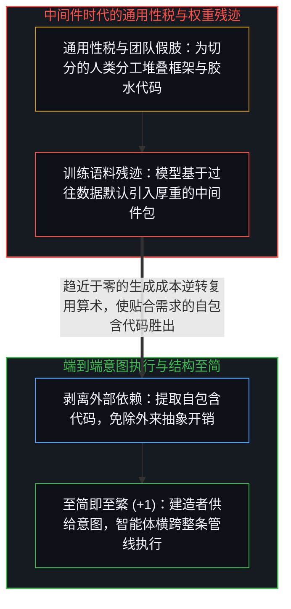
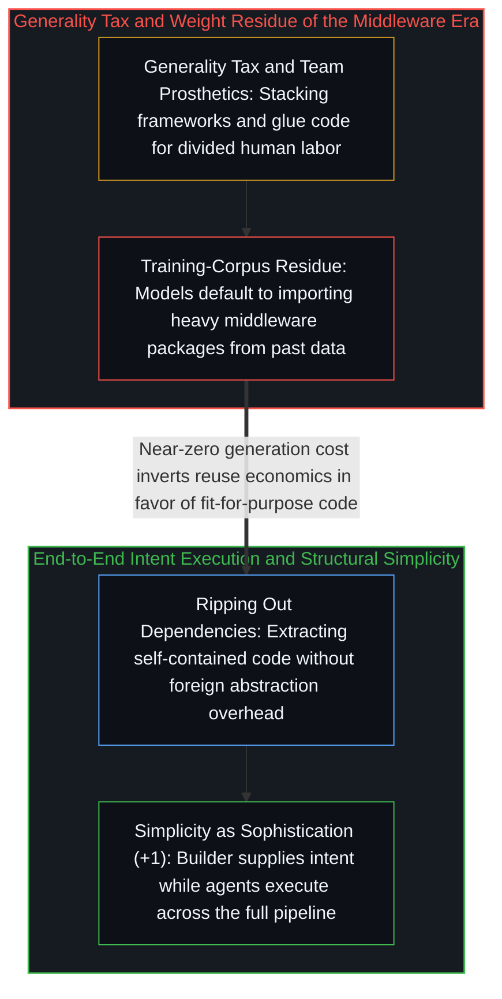

# 至简即至繁 / Simplicity Is the Ultimate Sophistication

*中间件本是弥补团队认知局限的假肢，而智能体端到端执行让至简成为至繁。 / Middleware compensated for team cognitive limits, whereas end-to-end agents make simplicity supreme.*

整部软件开发史就是一部中间件不断堆积的历史：每一代工程师为了解决协调瓶颈，都会在意图与执行之间插入一层新的中介——数据库中介存储，API中介服务，前端框架中介浏览器渲染，容器编排器中介容器。每一层在当时都有其道理，但每一层也都征收着一笔复利累加的抽象层、故障模式与专职团队之税，直到“让一件事从头到尾跑通”的初衷退隐到了重重中介背后。

The history of software development is a history of middleware accumulation: each generation solved a coordination bottleneck by inserting a new layer between intent and execution—databases mediating storage, APIs mediating services, frameworks mediating browser rendering, and orchestrators mediating containers. Every layer was rational at the time, yet every layer levied a compounding tax of abstractions, failure modes, and specialist teams until the original aim of making something work end-to-end receded behind intermediaries.

## 一、 作为认知带宽假肢的中间件与通用性税 / 1. Middleware as a Cognitive-Bandwidth Prosthetic and the Generality Tax

软件架构之所以堆叠出如此多的层级，并不是因为层级本身具有天然美德，而是因为没有任何未经增强的人类开发者能把用户意图、数据建模、界面渲染与部署同时握在工作记忆里。中间件正是每当执行主体无法握住整条管线时所架起的假肢，借此将认知劳动切分给不同的专职团队。与此同时，通用型中间件逃不开“通用性税”——它为所有人而建，因而不为任何具体对象量身定制，必然在提供实际所需的那一个操作之余，一并塞来用不上的配置表面与外来的架构成见；任务原本只需要一扇门，它却把一整部建筑规范塞给了建造者。

Software architecture accumulated layers not because layers are intrinsically virtuous, but because no single unaugmented human developer could hold user intent, data modeling, interface rendering, and deployment in working memory at once. Middleware is the prosthetic erected whenever executing agents cannot hold the whole pipeline, partitioning cognitive labor across specialist teams. At the same time, general-purpose middleware cannot escape the generality tax: built for everyone and therefore tailored to no one in particular, it ships unneeded configuration surfaces and foreign assumptions alongside the single operation actually needed—handing the builder an entire building code when the task called for a door.

人工智能智能体通过一种结构性不对称改写了这一等式：智能体可以同时握住端到端管线的完整语境，却无法自己产生意图——它知道“如何建造”，却不知道“什么值得建造”，因为对结果的在乎属于栖居于世的活生生的心智（参见[智能只属于心智](../intelligence-belongs-only-to-the-mind/)）。当一个抱持清晰意图的建造者如[你的代码库即是记忆](../your-codebase-is-memory/)所追溯的那样，在外部化的认知代码库之上直接指挥智能体时，工作的基本单元便从组件转向管线，行动主体也从专职团队收敛回个体，消解了曾经为中间件层级提供依据的协调开销。

Artificial intelligence agents restructure this equation through a fundamental asymmetry: an agent can hold the full context of an end-to-end pipeline simultaneously, yet it does not originate intent—it knows how to build, but not what is worth building, because caring about an outcome belongs to a living Mind inhabiting the world (see [Intelligence Belongs Only to the Mind](../intelligence-belongs-only-to-the-mind/)). When a single builder carrying clear intent directs agents across an externalized cognitive repository as traced in [Your Codebase Is Memory](../your-codebase-is-memory/), the unit of work shifts from component to pipeline and the unit of agency shifts from specialist team to individual, dissolving the coordination overhead that once justified middleware layers.

## 二、 成本倒置、权重残迹与端到端的贴合 / 2. Cost Inversion, Weight Residue, and End-to-End Fit

在手写代码成本高昂的时代，引入现成库是合理的默认选择；而当代码生成的边际成本趋近于零时，成本等式发生倒置——直接生成贴合目标、自包含的代码，比背负外部依赖的集成摩擦与外来假设更加低廉。然而，由于当下的模型是在数十年中间件时代的代码库上训练出来的，它们的权重里留存着旧成本结构的残迹，若不加引导便会默认调用厚重的框架。因此，建造者的职责也包括纠偏模型的训练惯性——正如卡帕西指挥智能体在五分钟内从庞大的代码库中剥离出一个一百五十行的自包含模块，在消除外部依赖的同时让运行速度提升了百分之三（参见[万物一如既往地流变](../everything-is-changing-as-always/)与[是脚手架还是特化语境](../scaffolds-or-specialized-contexts/)）。

When hand-writing code was expensive, importing someone else's library was the rational default; as code generation approaches zero marginal cost, the cost equation inverts so that generating fit-for-purpose, self-contained code becomes cheaper than carrying the integration friction and foreign assumptions of an external dependency. Because current models were trained on decades of middleware-era repositories, however, their weights carry the residue of the old cost structure, defaulting to heavy frameworks unless steered otherwise. The builder's role therefore includes correcting for the model's training bias—just as Andrej Karpathy directed an agent to rip a 150-line self-contained module out of a sprawling library in five minutes, eliminating the dependency while running three percent faster (see [Everything Is Changing, as Always](../everything-is-changing-as-always/) and [Scaffolds or Specialized Contexts](../scaffolds-or-specialized-contexts/)).

零成本的特化非但不会让软件生态萎缩，反而扩展了贴合具体语境的长尾应用，并让清楚自身需求的终端用户能够跨过中介直接动手建造。真正被取代的，是为切分的人类团队而存在的协调仪式，以及在自包含闭环内重复智能体已握有内容的冗余封装；至于问题本身与运行环境所要求的边界条件——诸如安全隔离、数据主权，或任务超出单次会话语境后所需的显式记忆与检索结构——则如[转移原因的比较](../the-comparison-that-relocates-the-cause/)所追溯的那样，依然是承重结构而非翻译赘余。达·芬奇那句“至简即至繁”在此作为一道结构切口而非审美口号发挥作用：对于任何给定的需求与时间跨度，最具能力的架构，正是在深知自身所求的心智与将其付诸实现的执行基底之间插入最少不必要翻译层的那一个。

Far from shrinking the software ecosystem, zero-cost specificity expands the long tail of applications tailored to exact contexts and empowers end users who know what they need to build directly without intermediaries. What gets displaced is the coordination ceremony that existed for divided human teams and the redundant wrappers that duplicate what an agent already holds inside a self-contained loop, whereas boundary conditions required by the problem and operating environment itself—security isolation, data sovereignty, or explicit memory and search structure once a task outruns a single session's context—remain load-bearing rather than translation bloat, as traced in [The Comparison That Relocates the Cause](../the-comparison-that-relocates-the-cause/). Leonardo's maxim that simplicity is the ultimate sophistication operates here as a structural cut rather than an aesthetic slogan: for any given requirement and horizon, the most capable architecture is the one that interposes the fewest unnecessary translation layers between the Mind that knows what it wants and the execution substrate that brings it into being.
