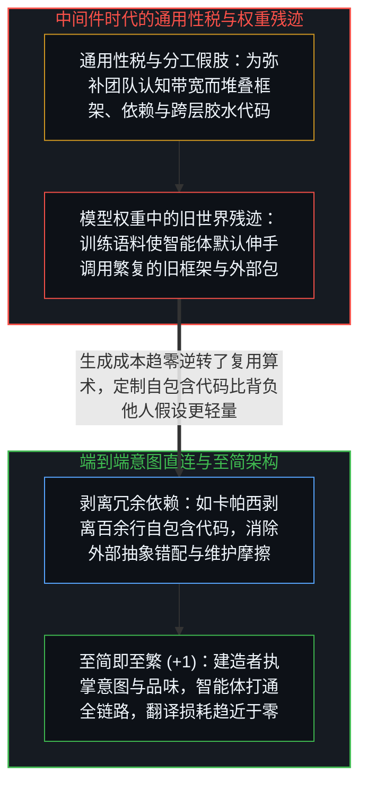
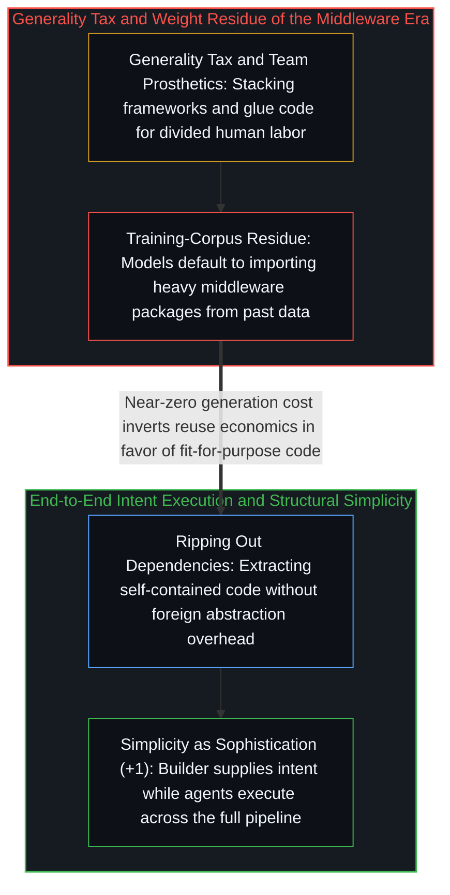

# 至简即至繁 / Simplicity Is the Ultimate Sophistication

*中间件本是弥补人类认知带宽与团队分工的假肢，而智能体端到端执行让最少翻译层的架构成为至繁。 / Middleware compensated for team cognitive limits, whereas end-to-end agents make simplicity supreme.*

整部软件开发史就是一部中间件不断堆积的历史：每一代工程师为了解决协调难题，都会在“意图”与“执行”之间插入一层新的中介——数据库中介内存与检索，应用程序接口（API）中介服务与服务，前端框架中介开发者意图与浏览器渲染，容器编排器中介底层算力。每一层在当时都是必要的，但每一层也都是一笔复利累加的税收。随着抽象层、故障模式、学习曲线与专职团队层层叠加，原本用来解决问题的方案变成了基础设施，基础设施又变成了你必须绕着它施工的庞然大物，而“让一件事从头到尾跑通”的初衷则退隐到了重重中介背后。

The history of software development is a history of middleware accumulation: each generation solved a coordination bottleneck by inserting a new layer between intent and execution—databases mediating storage, APIs mediating services, frameworks mediating browser rendering, and orchestrators mediating containers. Every layer was rational at the time, yet every layer levied a compounding tax of abstractions, failure modes, and specialist teams until the original aim of making something work end-to-end receded behind intermediaries.

## 一、 作为认知带宽假肢的中间件与通用性税 / 1. Middleware as a Cognitive-Bandwidth Prosthetic and the Generality Tax

软件架构之所以堆叠出如此多的层级，并不是因为层级本身值得推崇，而是因为单个生物大脑无法同时握住从用户意图、数据建模、接口设计、界面渲染到部署观测的整条管线。中间件正是当执行者看不见全局时不得不安装的假肢：每一道抽象层都对应着团队分工切碎后的一块认知盲区。与此同时，通用型中间件永远逃不开“通用性税”——为了兼容成千上万种假想场景，它必须把你永远用不到的配置表面与别人的架构成见一并打包塞给你；你原本只想要一扇门，却被迫背回了一整套建筑规范。

Software architecture accumulated layers not because layers are intrinsically virtuous, but because no single unaugmented human developer could hold user intent, data modeling, interface rendering, and deployment in working memory at once. Middleware is the prosthetic erected whenever executing agents cannot hold the whole pipeline, partitioning cognitive labor across specialist teams. At the same time, general-purpose middleware cannot escape the generality tax: built for everyone and therefore tailored to no one in particular, it ships unneeded configuration surfaces and foreign assumptions alongside the one operation you actually wanted—handing you an entire building code when you asked for a door.

人工智能智能体的到来打破了这一平衡：智能体可以同时握住整条管线的完整语境，却无法自己产生意图——它知道“如何建造”，却不知道“建造什么”，因为“建造什么”源于栖居于世的心智对结果的在乎与品味（参见[智能只属于心智](../intelligence-belongs-only-to-the-mind/)）。当一个抱持清晰意图的建造者直接指挥能够横跨全栈执行的智能体、并依托如[你的代码库即是记忆](../your-codebase-is-memory/)所揭示的高密度外部代码库时，工作的基本单元便从“局部组件”变回了“端到端管线”，行动主体也从“多工种团队”收敛回了“个体建造者”，曾经为服务团队分工而存在的协调层随之失去结构必要性。

Artificial intelligence agents restructure this equation through a fundamental asymmetry: an agent can hold the full context of an end-to-end pipeline simultaneously, yet it does not originate intent—it knows how to build, but not what is worth building, because caring about an outcome belongs to a living mind inhabiting the world (see [Intelligence Belongs Only to the Mind](../intelligence-belongs-only-to-the-mind/)). When a single builder carrying clear intent directs agents across an externalized cognitive repository as traced in [Your Codebase Is Memory](../your-codebase-is-memory/), the unit of work shifts from component to pipeline and the unit of agency shifts from specialist team to individual, dissolving the coordination overhead that once justified middleware layers.

## 二、 成本倒置、权重残迹与端到端的精确贴合 / 2. Cost Inversion, Weight Residue, and End-to-End Fit

在手写代码极其昂贵的时代，“能复用就不重写”是铁律；而当代码生成的边际成本趋近于零时，这笔经济账发生了倒置——直接生成贴合当前需求的自包含代码，远比引入一个背负着他人假设、安全漏洞面与版本升级摩擦的外部依赖包更加低廉。然而有趣的是，今天的语言模型是在整个中间件时代的历史语料上训练出来的，它的权重里沉淀着旧世界的思维残迹：只要你不加约束，它的默认本能依然是伸手安装十几个依赖包、搭起一套为百人团队准备的微服务架子。因此，今天优秀的建造者不仅要给出意图，还要主动纠偏模型权重里的中间件惯性——正如卡帕西指挥智能体在五分钟内从庞大的通用库中剥离出一百五十行零依赖、运行反而快上百分之三的浮点训练代码那样（参见[万物一如既往地流变](../everything-is-changing-as-always/)与[是脚手架还是特化语境](../scaffolds-or-specialized-contexts/)）。

When hand-writing code was expensive, importing someone else's library was the rational default; as code generation approaches zero marginal cost, the cost equation inverts so that generating fit-for-purpose, self-contained code becomes cheaper than carrying the integration friction and foreign assumptions of an external dependency. Because current models were trained on decades of middleware-era repositories, however, their weights carry the residue of the old cost structure, defaulting to heavy frameworks unless steered otherwise. The builder's role therefore includes correcting for the model's training bias—just as Andrej Karpathy directed an agent to rip a 150-line self-contained module out of a sprawling library in five minutes, eliminating the dependency while running three percent faster (see [Everything Is Changing, as Always](../everything-is-changing-as-always/) and [Scaffolds or Specialized Contexts](../scaffolds-or-specialized-contexts/)).

这不仅不会让软件生态萎缩，反而会引爆长尾：原本因开发成本高昂而只能靠通用软件勉强凑合的无数具体场景，如今都能获得量体裁衣的即时实现，甚至终端用户本人也开始跨过中间商直接指挥智能体将原始输入转化为所需结果。达·芬奇那句“至简即至繁”在此不再是审美修辞，而是可检验的结构预判：真正高明的架构，正是需要最少架构层级的那一个；把知晓“要什么”的心智与掌握“怎么做”的计算基底直接连通，每剥离一层多余的翻译，意图就少一分失真。

Far from shrinking the software ecosystem, zero-cost specificity expands the long tail of applications tailored to exact contexts and empowers end users who know what they need to build directly without intermediaries. Leonardo's maxim that simplicity is the ultimate sophistication operates here as a structural law rather than an aesthetic slogan: the most capable architecture is the one that requires the fewest translation layers between a mind that knows what it wants and the execution substrate that brings it into being.
