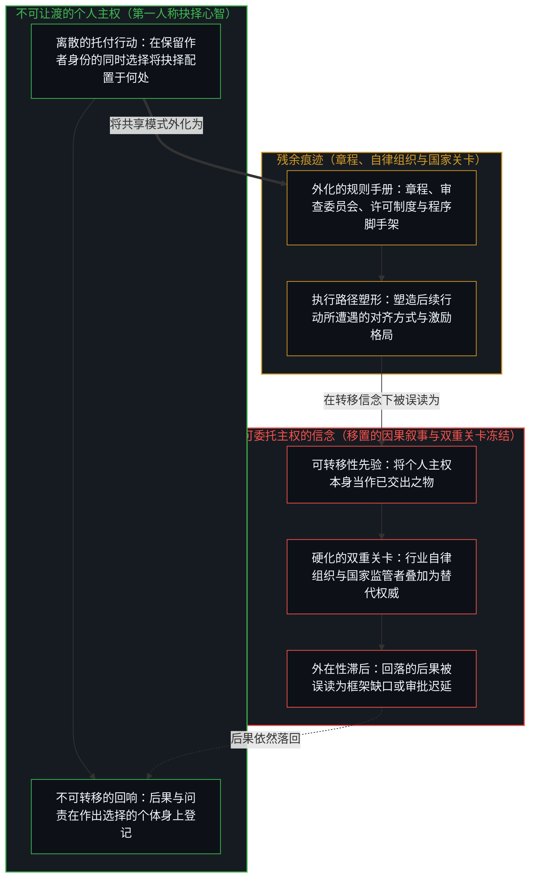
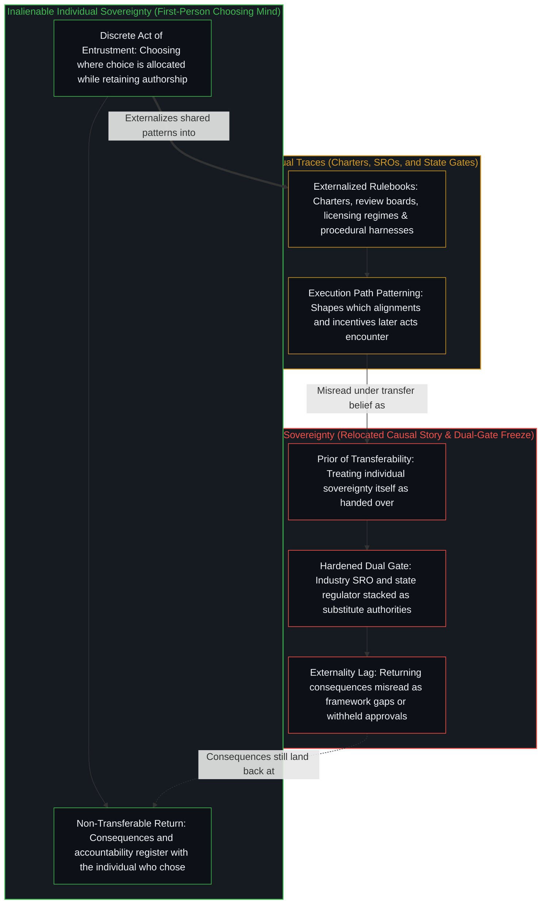

# 主权、信念与规制结构的生成 / Sovereignty, Belief, and the Generation of Regulatory Structures

*个人主权无法被委托；自律组织与政府，皆由相信它可以被委托的集体信念所生成 / Individual sovereignty cannot be delegated; SROs and governments are generated by the collective belief that it can*

在近期 X 上的一场交锋中，德米斯·哈萨比斯分享了一套前沿 AI 治理框架，[布莱恩·阿姆斯特朗](https://x.com/brian_armstrong/status/2077583018106200318)则从实验室建立自律组织的角度作出了回应。他所描述的双轨制正在运转。但它的起源比行业机构与国家监管者之间的比较还要更早一步：那是一份关于主权可以移交何处的信念，被一路持握，直至硬化为程序。

In a recent exchange on X, Demis Hassabis shared a framework for frontier AI governance, and [Brian Armstrong](https://x.com/brian_armstrong/status/2077583018106200318) answered by considering a self-regulatory organization for the labs. The dual system he describes operates. Its origin sits one step earlier than the comparison between industry body and state regulator: a belief about where sovereignty can go, held until it hardens into procedure.

## 一、 交锋 / 1. The Exchange

哈萨比斯的文章将先进系统视为足够迫近、后果足够重大，因而需要专门的制度架构——阈值、审查，以及面向前沿模型的标准机构。[并不存在的目录](../hassabis-frontier-agi-premise/)追溯了这一推演链条底下被压缩的前提。[阿姆斯特朗的回应](https://x.com/brian_armstrong/status/2077583018106200318)则停留在另一根轴线上：自律组织究竟会取代政府监管，还是只会与政府监管同时到来。

Hassabis’s article treats advanced systems as near enough, and consequential enough, to warrant specialized architecture—thresholds, review, a standards body for frontier models. [The Catalog That Isn't There](../hassabis-frontier-agi-premise/) traces the compressed premise under that chain. [Armstrong’s reply](https://x.com/brian_armstrong/status/2077583018106200318) stays on a different axis: whether a self-regulatory organization (SRO) actually replaces government regulation, or simply arrives alongside it.

自律组织表面上看颇具合理性。但在实践中，国家常常照旧监管，二者并存——即金融服务领域屡见不鲜的双轨制。届时，跨司法管辖区的项目既要获得行业机构的批准，又要获得政府监管部门的审批。在他的陈述中，前沿 AI 更接近于软件行业。现行法律早已涵盖了欺诈、侵权责任以及不公平或欺骗性行为。当产出造成损害时，企业本就面临营收损失、声誉受损与法律风险。迄今为止，无需围绕假设的未来伤害搭建专门架构，这些激励就已经塑造了负责任的行为模式。

An SRO can look reasonable. In practice it often comes with the state still regulating—the dual system familiar from financial services. Approval is then required from both an industry body and government regulators across jurisdictions. Frontier AI, in his account, more closely resembles the software industry. Existing law already addresses fraud, tort liability, and unfair or deceptive practices. Firms already face loss of revenue, reputation, and legal exposure when outputs cause damage. Those incentives have so far patterned responsible conduct without specialized architectures built around hypothetical future harms.

这一观察将双轨制记录为“以自律组织作为替代方案”在运作上的失效。而同时生成这两层结构的因果序列，发生在更早的地方。

That observation registers the dual system as an operational failure of the SRO proposal as a substitute. The sequence that generates both layers runs earlier.

## 二、 更早一步 / 2. One Step Earlier

个人主权无法被委托。表面上看似委托的，其实是主权的表达：选择将抉择托付给何处的那个行动，而后果依然继续在作出选择的个体身上登记。对这些后果的责任并不会随着托付而转移；它留在选择发生的地方。[知识问题与委托的幻觉](../the-knowledge-problem-and-the-illusion-of-delegation/)在认知协同的层面上追溯了这同一种不可转移性：将判断托付给市场、头衔或集体，从来不会搬走那份负荷。同样，看似流向监管者的权力是被分配出去的，而非被夺走的，正如[总在倾听者无法发起](../what-always-listens-cannot-originate/)所阐明的。

Individual sovereignty cannot be delegated. What appears as delegation is the expression of sovereignty: the act of choosing where choice is entrusted, while consequences continue to register with the individual who chose. Responsibility for those consequences does not transfer with the entrustment; it stays where the choosing occurs. [The Knowledge Problem and the Illusion of Delegation](../the-knowledge-problem-and-the-illusion-of-delegation/) traces this same non-transferability across epistemic coordination, where entrusting judgment to a market, a title, or a collective never moves the load. Likewise, the power that seems to flow to the regulator was allocated rather than taken, as [What Always Listens Cannot Originate](../what-always-listens-cannot-originate/) establishes.

自律组织则是另一种信念的集体表达——即相信个人主权本身可以被交出去。政府是在另一个稳定化尺度上表达出来的同一份信念。阿姆斯特朗所描述的双轨制，并不是两套独立架构的偶然叠加，而是同一个先验前提生成出的多张制度面孔。每一张面孔都是众多人将主权抉择外化为共享模式后留下的持久残余，而这一模式继而塑造了后续行动所能找到的对齐路径。哪一张面孔都没有转移发起的现场。但在生出它们的那份信念之下，两者都被当成了仿佛已经完成了转移。

An SRO is a collective expression of a different belief—that individual sovereignty itself can be handed over. Government is the same belief expressed at another scale of stabilization. The dual system Armstrong describes is not two independent architectures accidentally stacked. It is one prior generating multiple institutional faces. Each face is a durable residue of many individuals externalizing sovereign choice into a shared pattern, and that pattern then shapes which alignments later acts find available. Neither face relocates the site of initiation. Both are treated, under the belief that produced them, as if they did.

因此，这类结构的形成并不建立在主权已经发生转移的基础上。它建立在“转移是可能的”这一信念之上，被一路持握并表达，直至硬化为程序、审批链与双重关卡。信念是先验前提；自律组织与国家监管者则是它的稳定化产物。哪怕在传记叙事中，[革命之名把生活收成证据](../the-name-revolution-files-a-life-as-evidence/)也揭示了平行的倒置：本就留在当事人身上的抉择，被叙述成一场对抗外部秩序的私人革命，反倒让那个秩序继续作为将该一生归档入册的主语矗立在原处。

The formation of such structures therefore does not rest on sovereignty having been transferred. It rests on the belief that transfer is possible, held and expressed until it hardens into procedure, approval chain, and dual gate. The belief is the prior; the SRO and the state regulator are its stabilizations. Even in biographical narrative, [The Name Revolution Files a Life as Evidence](../the-name-revolution-files-a-life-as-evidence/) exposes the parallel inversion: choosing that stayed with the person is narrated as a private revolution against an external order, leaving the order standing as the subject that files the life.

## 三、 残余不是移置 / 3. Residue Is Not Relocation

当众多人共同将主权当作可委托之物时，这种表达便稠化为持久的痕迹：章程、审查委员会、许可制度、跨司法管辖区的审批路径。这些痕迹持续存在，延伸了触角，并塑造了后续行动觉得省力或高昂的格局，但它们并未完成那份信念所描述的转移。正如[你的代码库即是记忆](../your-codebase-is-memory/)针对数字制品与智能体脚手架所确立的，监管章程、审查委员会与外化的规则手册，正是外化记忆代码库在制度层面的对应物：成文规则与程序脚手架是先前抉择留下的持久残余，为后续行动塑造执行路径，却从不移置那个依然必须作出抉择、重新描摹并修剪它们的抉择心智。在教育与资格认证的筛选机制中，[卓异、感知与自我设限的问题场域](../exceptionality-perception-and-the-self-limiting-field-of-problems/)与[平均值是残余，不是引擎](../the-average-is-residue-not-the-engine/)追溯了同样的沉积过程：形式系统、群体比率与制度声望被误读为因果引擎，实则只是那些仍在作出选择的个体早先自我筛选的合成结果。集体信念所登记的，是发起的心智已经做过的事，正如[进步叙事中的症候与原因](../symptom-and-cause-in-the-narratives-of-progress/)所展示的。

When many individuals jointly treat sovereignty as delegable, that expression densifies into durable traces: charters, review boards, licensing regimes, multi-jurisdiction approval paths. Those traces persist, extend reach, and pattern what later acts find easy or costly, yet they do not complete the transfer the belief describes. As [Your Codebase Is Memory](../your-codebase-is-memory/) establishes for digital artifacts and agent harnesses, regulatory charters, review boards, and externalized rulebooks are the institutional counterpart of an externalized memory codebase: written rules and procedural harnesses are durable residue of prior choices that pattern the execution path for later acts, without ever relocating the choosing Mind that must still decide, re-trace, and prune them. Across educational and credentialing filters, [Exceptionality, Perception, and the Self-Limiting Field of Problems](../exceptionality-perception-and-the-self-limiting-field-of-problems/) and [The Average Is Residue, Not the Engine](../the-average-is-residue-not-the-engine/) trace the same sedimentation: formal systems, mass rates, and institutional prestige are misread as causal engines while remaining the composition of earlier self-selections by individuals who still choose. Collective belief registers what initiating minds already did, as [Symptom and Cause in the Narratives of Progress](../symptom-and-cause-in-the-narratives-of-progress/) shows.

无论何处，只要将托付误当作执行托付的那份能力的移置，同样的几何结构就会显现。当能力被框定为获授权机构所恩赐的礼物时，[赋权确立权力的集中](../empowerment-establishes-the-centralization-of-power/)展示了赐予与接受如何共同追认转移叙事，而作者身份依然留在个体身上。在道德权威领域，[托付道德的自指悖论](../recursive-contradiction-of-entrusted-morality/)证明了：选择由谁来界定道德的这一行动本身，就已经在行使那份自称匮乏的判断力。在制度性风险管理中，[你委托的风险就是你创造的风险](../the-risk-you-delegate-is-the-risk-you-create/)追溯了一旦将风险当作已经移入某个机构，可归因的新型失败便如何成为唯一可见的代价，而基线伤害则在无人认领的状态下持续发生；而在政治认同中，[臣服作为错位的主权](../sovereignty-essay/)则表明，为偏好的掌权者欢呼依然是个人主权在运作，只是运作在一根与所期盼结果相割裂的轴线上。

The same geometry appears wherever entrustment is mistaken for relocating the capacity that performs the entrustment. When capacity is framed as a gift bestowed by an authorized body, [Empowerment Establishes the Centralization of Power](../empowerment-establishes-the-centralization-of-power/) shows how offer and acceptance ratify the transfer story while authorship stays with the individual. In moral authority, [The Recursive Contradiction of Entrusted Morality](../recursive-contradiction-of-entrusted-morality/) demonstrates that the very act of choosing who defines morality exercises the judgment claimed to be lacking. In institutional risk management, [The Risk You Delegate Is the Risk You Create](../the-risk-you-delegate-is-the-risk-you-create/) traces how treating risk as moved into an agency makes attributable novel failure the only visible cost while baseline harm continues unowned; and in political identification, [Surrender as Misaligned Sovereignty](../sovereignty-essay/) shows that cheering a preferred officeholder is still individual sovereignty operating on an axis severed from the results expected.

在每一种情形下，抉择的作者都留在原处。发生移动的，是关于因果如今栖身何处的叙事。在该叙事下，回落到抉择心智的后果被登记为来自别处——批准被拒、关卡延误、框架尚不完备——其外在感的幅度，恰好等于行动与那个豁免了重新描摹的自我图景之间的裂隙宽度。

In each case the author of the choice stays in place. What moves is the story of where causality now lives. Consequences that return to the choosing Mind register, under that story, as arriving from elsewhere—approval withheld, gate delayed, framework incomplete—to the width of the gap between the act and the self-image that exempted itself from re-tracing.

## 四、 在信念所塑形的场域内部展开的争论 / 4. Debate Inside the Field the Belief Has Shaped

关于究竟是一道关卡优于两道关卡，还是现行侵权法与反欺诈法便已足够，这类争论是在那份信念已经塑形的场域内部展开的。这些争论自有其轴线——成本、冗余、激励对齐、管辖权摩擦——并在这些轴线上保持可用。程序可以减少某些失效，同时催生另一些失效。但这一切都无法消解那个先验前提，正是它使得针对前沿系统的专门监管架构得以被构想为对所选托付之个人责任的替代或补完。禁令在那些将其当作地基的人当中稳定了信念，正如[起作用的是信念](../what-works-is-the-belief/)所展示的。

Debate over whether one gate is preferable to two, or whether existing tort and fraud law already suffice, proceeds inside the field that belief has already shaped. Those debates have their own axes—cost, redundancy, incentive alignment, jurisdictional friction—and remain usable on those axes. Procedure may reduce certain failures and produce others. None of that dissolves the prior that made specialized regulatory architecture for frontier systems conceivable as a substitute for, or completion of, individual responsibility for chosen entrustments. A ban stabilizes belief among those who treat it as ground, as [What Works Is the Belief](../what-works-is-the-belief/) shows.

阿姆斯特朗与软件行业的类比在它自身的层面上是准确的：已经发生的损害可以通过无需设立新集体主权者的既有框架来应对。而进一步声称这些框架因此穷尽了专门架构的问题，则是另一个行动——一个在“是否持握转移信念”之后才开始运作的行动。持握这一信念，就会生成他所批评的双轨制；不持握它，则让激励、侵权责任、声誉与普通法律作为可用的模式留存，而不去安装第二个发起现场。这一机制并不裁决任何个体必须采取哪种姿态，它只指明每一种姿态各自在做什么。顺着同一个先验前提再往前推进一步，[风险在于对监管本身的迷信](../the-risk-is-the-belief-in-oversight-itself/)审视了当不仅是制度关卡、连监督前提本身都被当作能够穷尽未来风险时会发生什么；而[限制是选择性的税](../restriction-is-a-selective-tax/)则表明，当外化的限制硬化为制度性封印时，这笔税会落在接受并执行该封印的人身上，却不会把发起转移到规则之中。在财政与选举制度中，[公共支出不创造资本](../public-spending-does-not-create-capital/)追溯了将责任当作可指派给国家之物如何稠化了汲取与再分配，而资本形成的杠杆依然留在收益与损失实际落地的地方；[政客是责任扩散的显性症状](../politicians-appear-as-visible-symptoms-of-responsibility-diffusion/)则阐明了为何针对掌权者设计新的形式约束，依然只是“能动性栖身于抉择心智之外”这一信念的残余。哪怕是监管者所施加的约束，也依然是个体抉择的轮廓，正如[自由即地基](../freedom-as-ground/)所论证的。

Armstrong’s software-industry comparison is exact on its own register: harm that has already occurred can be met through frameworks that do not require a new collective sovereign. The further claim that those frameworks therefore exhaust the question of specialized architecture is a different act—one that still operates after the belief in transfer has either been held or not. Holding the belief generates the dual system he criticizes. Not holding it leaves incentives, tort, reputation, and ordinary law as available patterns without installing a second site of initiation. The mechanism does not adjudicate which posture any individual must take; it indicates what each posture is doing. One step further along the same prior, [The Risk Is the Belief in Oversight Itself](../the-risk-is-the-belief-in-oversight-itself/) examines what happens when supervisory premises themselves, not only institutional gates, are treated as exhaustive of future risk, while [Restriction Is a Selective Tax](../restriction-is-a-selective-tax/) shows that when externalized limits harden into institutional seals, the tax falls on those who accept and enforce the seal rather than relocating initiation into the rule. Across fiscal and electoral institutions, [Public Spending Does Not Create Capital](../public-spending-does-not-create-capital/) traces how treating responsibility as assignable to the state densifies extraction and redirection while the lever of capital formation stays where upside and downside land, and [Politicians Are Visible Symptoms of Responsibility Diffusion](../politicians-appear-as-visible-symptoms-of-responsibility-diffusion/) shows why designing new formal constraints against officeholders remains residue of the belief that agency lives outside the choosing minds. Even the constraints a regulator imposes remain the contours of individual choice, as [Freedom as Ground](../freedom-as-ground/) argues.

## 五、 表达，而非转移 / 5. Expression, Not Transfer

主权留在个体身上。它在持续选择将抉择委托给何处、并将这些抉择的后果作为自身后果来承接的行动中得到表达。当众多人共同将主权当作可委托之物时所形成的结构，作为残余持续存在，却并未完成那份信念所描述的转移，正如[共同的人性从不共享](../shared-humanity-is-never-shared/)所展示的：主权向上移交的叙事与先验共享之“我们”的叙事，皆是对残余的诠释，而非生成性的原因。在个体边界上，[要求他人开放是对自我封闭的渴望](../advocating-openness-of-others-is-a-desire-for-closure-of-the-self/)追溯了将一道选择性的向内边界拔高为道德权利，如何丝毫不会触动那道构成独立心智的边界；而[硬件的本地性不是信息的边界](../hardware-locality-is-not-the-information-boundary/)则在智能体技术栈中表明，为排他性控制而选择本地硬件，并不会改变隐私与授权边界所在的位置。当个体将某一种具体判断或终极理想拔高并装入制度容器时，[外化善意走向其反面](../externalized-virtue-becomes-its-opposite/)与[对乌托邦的信念是通往反乌托邦之路](../the-belief-in-utopia-is-the-path-to-dystopia/)阐明了为何改革外部容器依然任由底层的拔高再度稠化；而[一切伤害的根源](../the-source-of-all-harm/)则印证了，主张凌驾于他人之上的权利，从来不会转移后果的作者身份。监管者是由[个体抉择是唯一的因果杠杆](../individual-choices-as-the-only-causal-levers/)生成的，而不是反过来。

Sovereignty remains with the individual. It is expressed in the continuous act of choosing delegations of choice and of receiving the consequences of those choices as one's own. Structures that form when many individuals jointly treat sovereignty as delegable persist as residue without completing the transfer the belief describes, just as [Shared Humanity Is Never Shared](../shared-humanity-is-never-shared/) shows that stories of upward transfer and of a pre-existing collective "we" are interpretations of residue rather than generative causes. At the personal boundary, [Advocating Openness of Others Is a Desire for Closure of the Self](../advocating-openness-of-others-is-a-desire-for-closure-of-the-self/) traces how elevating a selective inward bound into a moral right leaves untouched the boundary that constitutes a distinct Mind, while [Hardware Locality Is Not the Information Boundary](../hardware-locality-is-not-the-information-boundary/) shows in the agentic stack that electing local hardware for exclusive control does not alter where the boundary of privacy and authorization sits. When individuals elevate a specific judgment or finished ideal into an institutional vessel, [Externalized Virtue Becomes Its Opposite](../externalized-virtue-becomes-its-opposite/) and [The Belief in Utopia Is the Path to Dystopia](../the-belief-in-utopia-is-the-path-to-dystopia/) show why reforming the outer container leaves the underlying elevation free to densify again, and [The Source of All Harm](../the-source-of-all-harm/) confirms that claiming a right to override others never transfers authorship of the consequences. The regulator is generated by [Individual Choices as the Only Causal Levers](../individual-choices-as-the-only-causal-levers/), not the other way round.

所讨论的监管提议，其起源正是那份被集体表达出来的信念。随之而来的制度形式——自律组织、政府监管者、双重关卡——则是这一表达硬化之后所留下的产物。看清这一序列，并不会转化为应当保留或舍弃哪一份残余的处方。看清即是对起源的指明；随之而来的，是遭遇它的每一个心智所作出的下一个离散抉择。在经济学建模与制度设计中，[理性选择公设是原罪](../the-rational-choice-postulate-is-the-original-sin/)展示了假定既定的一致性最大化如何为研究制度效应之间的均衡发放许可，同时绕过了私人前提下的生成性抉择；而[剩余个人主义](../residual-individualism/)则追溯了当保护性的制度建设被奉为自由的前提条件而非自由的残余时所发生的平行倒置。监管的正当性以道德语言来论证，而[道德语言作为投影](../moral-language-as-projection/)把这种语言读作投影。

The origin of the regulatory proposal under discussion is that belief, collectively expressed. The institutional forms that follow—SRO, government regulator, dual gate—are what that expression leaves when it hardens. Seeing the sequence does not convert into a prescription for which residue to keep or discard. The seeing is the indication of origin; what follows from it is the next discrete choice by each Mind that encounters it. In economic modeling and institutional design alike, [The Rational Choice Postulate Is the Original Sin](../the-rational-choice-postulate-is-the-original-sin/) shows how assuming settled consistent maximization licenses studying equilibrium among institutional effects while bypassing generative choice under private premises, and [Residual Individualism](../residual-individualism/) traces the parallel inversion when protective system-building is held up as the precondition of freedom rather than its residue. Regulation is justified in moral language, which [Moral Language as Projection](../moral-language-as-projection/) reads as projection.
