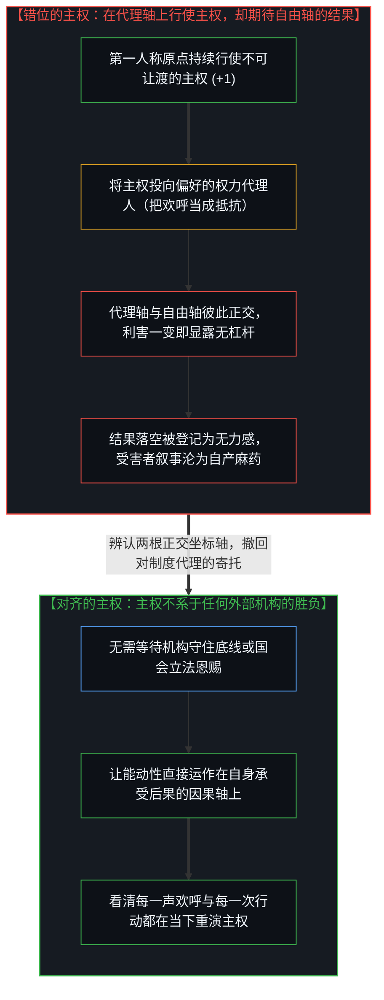
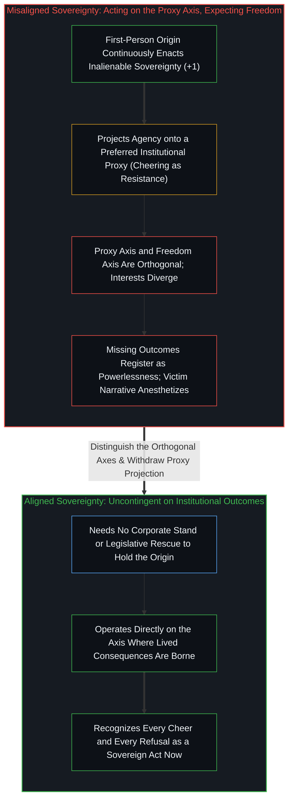

# 臣服作为错位的主权 / Surrender as Misaligned Sovereignty

*主权在每次选择中重演；臣服是在代理轴上行使主权，却期待在自由轴上收获结果。 / Sovereignty is enacted in every choice; surrender exercises it on a proxy axis while expecting freedom.*

主权不是某件你能够保管或遗失的物品，而是你在每一次选择中——包括在“选择臣服”这一行动本身中——持续重演的活动。围绕 Anthropic 与五角大楼对峙所展开的公共喧嚣，并不仅是一出关于企业勇气对抗国家越权的剧目，也不是一场关于 AI 安全与国家安全的公投；它是一面镜子，照出人们在把自己的处境叙述为“被外力所害”的同时，在自身原点处亲手做着什么。

Sovereignty is not an object you keep or lose; it is an activity you continuously enact in every choice—including the choice to surrender it. The public drama surrounding the Anthropic-Pentagon standoff is not merely a story about corporate courage versus state overreach, nor a referendum on AI safety versus national security; it is a mirror showing people what they are doing at their own origin while they narrate it as something being done to them.

## 一、 坐标轴的错位 / 1. The Coordinate Misalignment

症结不在于能动性的缺席，而在于**能动性运作在一根坐标轴上，却期待在另一根正交的坐标轴上收获结果**。

The problem is not an absence of agency; it is **agency operating on one coordinate axis while expecting outcomes on an orthogonal axis**.

那个为 Anthropic 的拒绝而欢呼雀跃的看客，实际上是在向自己偏好的某一个制度权力持有者让渡杠杆——因为那个掌权者眼下公开宣称的价值观恰好与他合拍——同时却期待在“个人自由”的坐标轴上收获果实。然而这两根坐标轴并不共享坐标：在第一根轴上做出的任何举动，都不会在第二根轴上产出自由。当期待的结果迟迟没有到来，这道结构性落差在内部体验中便被登记成了“无力感”。

The spectator who cheers Anthropic's refusal surrenders leverage to a preferred holder of institutional power—one whose stated values currently align with theirs—while expecting results on the axis of personal freedom. Those two axes do not share coordinates: no action on the first produces freedom on the second. When the expected results fail to arrive, that structural gap registers internally as powerlessness.

与你所偏好的权力代理人达成暂时的口径一致，只是偶发的巧合，而非结构性的保障。一旦该机构的自身利害发生偏离，那个欢呼的看客就会蓦然发觉自己手里毫无杠杆；于是他又转身去寻找下一个更合心意的代理人，并再次献上欢呼。这并非机制出了故障，而是当能动性持续在错误的坐标轴上发力时，机制按其自身几何必然产出的结果。

Preferred alignment with a proxy holder of power is contingent rather than structural. The moment institutional interests diverge, the spectator discovers they hold no lever, goes looking for the next preferred proxy, and cheers again. That is not a malfunction of the mechanism; it is the mechanism operating as designed whenever agency keeps pushing along the wrong axis.

向另一个代理人臣服并不能化解这一几何困局：在与目标正交的方向上无论施加多大的量级，都无法抵达靶心。

Surrendering to a different proxy does not resolve the geometry: no magnitude applied in an orthogonal direction reaches the target.

## 二、 臣服究竟是什么 / 2. What Surrender Actually Is

臣服并不是主权的丧失，而是**主权以错位的方式在运作**。那个选择臣服的人，所动用的底层力量与那个选择拒绝的人毫无二致。这股力量从未缺席，也无法被外人夺走；它只能在当下被一再重演——重演为拒绝，重演为臣服，或者重演为那种自封为“抵抗”的特殊臣服。[主权、信念与规制结构的生成](../sovereignty-belief-and-regulatory-structures/)追踪了这种臣服在宏观上建造出什么：整套规制结构，恰恰是由“主权可以被交出去”这一信念亲手生成并供养的。

Surrender is not the loss of sovereignty; it is **sovereignty operating misaligned**. The person who surrenders exercises the exact same foundational capacity as the person who refuses. That capacity was never absent and cannot be confiscated; it can only be continuously re-enacted—as refusal, as surrender, or as the particular surrender that calls itself resistance. [Sovereignty, Belief, and the Generation of Regulatory Structures](../sovereignty-belief-and-regulatory-structures/) traces what that surrender builds at scale: regulatory structures generated and sustained by the belief that sovereignty can be handed over.

因此，本就没有什么需要去“夺回来”的东西。那个追问“我该如何找回自己的力量”的人，此刻正站在自己的力量中央，动用着这股力量在发问。受害者叙事本身就是一次主权投射——是由当事者亲自选定、动用着它自称已经失去的那项能力所完成的现场操作。

Consequently, there is nothing to recover. The person asking "how do I get my power back?" is already standing in their power, using it to ask the question. The victim narrative is itself a sovereign projection—chosen and enacted through the very capacity it claims to have lost.

已臣服者与未臣服者之间的差别，不在于能动性的有无或多寡，而在于能动性所运作的那根轴与所求结果所在的那根轴是否对齐：主权照样在行使，只是错位了。

What distinguishes the surrendered from the un-surrendered is neither the presence nor the quantity of agency, but the alignment between the axis where agency operates and the axis where the sought outcomes live: sovereignty exercised, yet misaligned.

## 三、 为什么欢呼感觉像是赋权 / 3. Why Cheering Feels Like Empowerment

“我们这一边顶住了防线！”——这股情绪充能制造出了一种在体感上酷似能动性的兴奋，压制了原本会将这场让渡登记在案的反馈信号。对制度代理人的认同越是鲜活炽烈，底层的几何错位就越是隐而不见。

The emotional charge of "our side is holding the line" produces a visceral sensation that mimics agency, suppressing the feedback signal that would otherwise register the surrender. The more vivid the identification with the institutional proxy, the less visible the geometric error becomes.

维持这种状态无需任何外部操纵：被让渡出去的能动性自己就在分泌麻醉剂。牢笼由此变得舒适宜人；而当臣服在体感上最像是一场抵抗的时刻，臣服恰恰陷得最深。

No external manipulation is required to maintain this state: surrendered agency generates its own anesthetic. The cage grows comfortable, and the surrender deepens at the exact moment it feels most like resistance.

## 四、 未曾臣服的人与镜中倒影 / 4. The Un-Surrendered and the Mirror

那个未曾臣服的个体，不需要等待 Anthropic 去替他守住哪条防线，不需要等待国会去替他立下哪部法案，也不需要等待外部结构条件先行改变。他的主权不系于任何机构的胜负结果，因为他从一开始就没有把自己的主权存放在那里。

The individual who has not surrendered does not need Anthropic to hold a line, Congress to pass a statute, or macro-institutional conditions to be rearranged first. Their sovereignty is not contingent on institutional outcomes because they have not deposited it there.

整场关于“如何修补体制”的公共讨论，都处在这场坍缩的下游——人们在谈判自己被圈养的条款细则，并把这场讨价还价称作政治。而从坍缩之外望过去，这一切不过是在如实描摹：人们正如何动用自己从未停止握有的力量，去亲手加固那座围栏。

The public discourse around "fixing the system" sits downstream of the collapse—participants negotiating the terms of their captivity and calling the negotiation politics. Seen from outside the collapse, it is simply a live demonstration of what minds are choosing to do with power they have never stopped holding.

这一点无法作为操作指令被直接灌输给他人，因为你必须先能把两根坐标轴拆开看清，才能辨认出自己正踩在哪一根轴上。指点可以发生，而看清要么发生、要么不发生——这两种结果同样都是主权的体现。

This recognition cannot be handed over as a prescriptive instruction, because one must already distinguish the two axes to see which axis one is standing on. The pointing can happen, while the seeing either occurs or does not—and both outcomes remain sovereign acts.

表面上看似是在追问“哪一个权力中心终将获胜”，镜子映出的却是那阵欢呼声所极力掩盖的真相：每一声欢呼都是一次行动，每一次行动都在行使主权。正如[你的代码库即是记忆](../your-codebase-is-memory/)所揭示的，一切企业宪章、法案条文与公共阵营剧本都只是过往切分留下的外化记忆痕迹，它们自身毫无意志；唯一的问题在于，此刻立在第一人称掌舵前沿（`+1`）的心智究竟把自己的行动投向了哪一个维度，以及那个维度是否通向你真正要承担的结果。

What presents itself as the question of which power center wins reveals what the cheering conceals: every cheer is an act, and every act expresses sovereignty. Corporate constitutions, statutes, and partisan scripts are dead externalized traces of prior cuts with zero will of their own ([Your Codebase Is Memory](../your-codebase-is-memory/)); the only live question is which dimension the mind at the first-person steering edge (`+1`) chooses to operate on, and whether that dimension connects to where the results are expected to appear.
