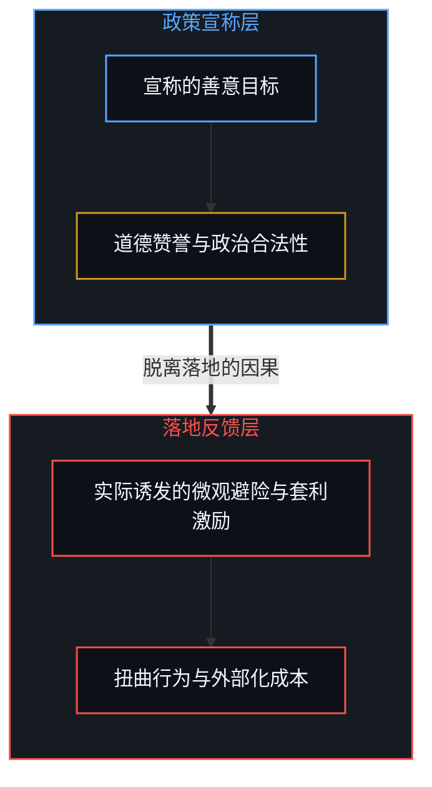
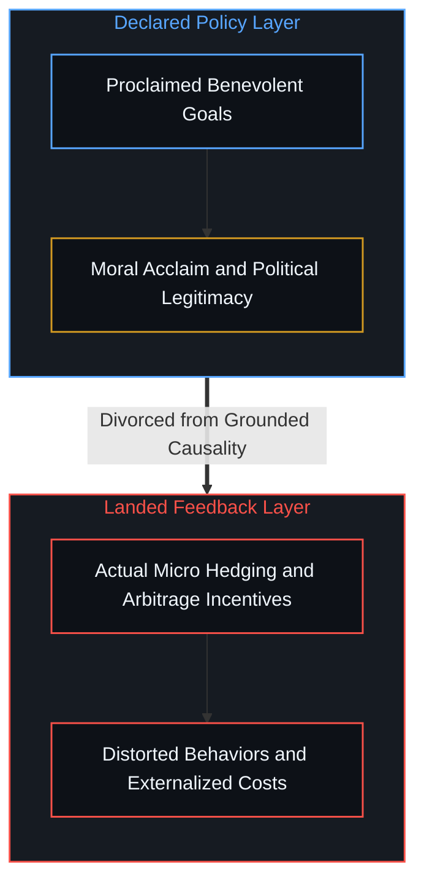
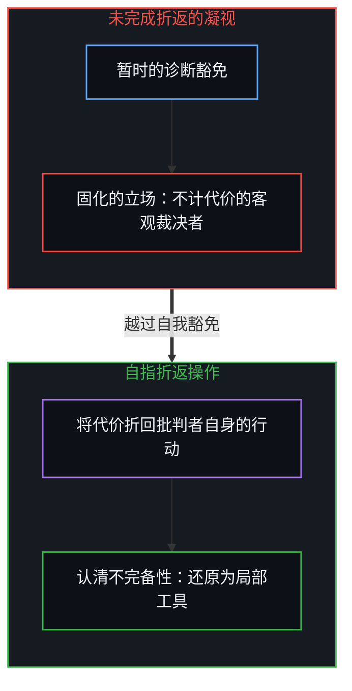
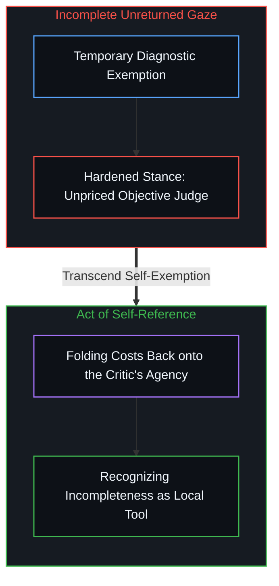

# 索维尔的表象洞察与根因之偏 / Sowell Observed the Surface Problem

*问题无法跨越心智代为解决，个体始终独自承担行为的全部后果。 / Problems cannot be solved across minds; individuals bear the full consequences of their actions.*

托马斯·索维尔指出，评估经济政策应当依据其实际激发的激励，而非宣称的目标。这一洞察在表象层面上固然准确，但它所诊断的困惑并非源于政策设计，而是始于一个更深层的前提：认为问题可以跨越心智代为解决。任何旨在设计更优激励的系统性纠偏，都在重新启用它原本试图诊断的那个外部旁观席位。不存在系统性的统筹解法；个体始终承担落到自身之上的全部后果，余下的，是这一心智如实担起自身轨迹的责任。

Thomas Sowell observed that economic policies must be judged by the incentives they create rather than the goals they proclaim. The observation is accurate at the surface, yet the confusion it diagnoses does not originate in policy design; it begins in a deeper premise, the belief that problems can be solved across Minds. Any systematic corrective aimed at engineering better incentives takes up again the very exterior vantage it set out to diagnose. There is no systemic resolution; individuals always bear the full consequences that land on them, and what remains is this Mind taking up responsibility for its own trajectory as it is.

## 一、 宣称目标与激励扭曲 / 1. Proclaimed Goals and Distorted Incentives

托马斯·索维尔曾写道：“许多困惑源于根据经济政策所宣称的目标而非其实际创造的激励来进行评判。”这一观察就其所及的范围而言是成立的。政策常常凭着替它宣称的美好初衷而获得赞誉，而它所引发的扭曲行为与隐性成本，却被置于视线之外。

Thomas Sowell famously wrote: "Much confusion comes from judging economic policies by the goals they proclaim rather than the incentives they create." The observation is accurate as far as it reaches. Policies are routinely credited with the benevolent intentions stated on their behalf, while the distorted behavior and hidden costs they set in motion are kept out of view.

然而，捕捉到激励的扭曲，并未触及源头。指出宣称目标与实际激励之间的背离，描述的是一场已经落地的偏离，却未曾追问为什么政策总被期待去替代它所管辖的个体的判断。困惑并不源于某项具体立法的漏洞，而在于一个持续的信念：一个心智可以替代另一个心智。

Yet capturing incentive distortions does not reach the source. Pointing out the divergence between declared goals and actual incentives describes a discrepancy that has already landed, without asking why policy keeps being expected to substitute for the judgment of the individuals it governs. The confusion does not originate in specific legislative loopholes, but in the persistent belief that one Mind can stand in for another.

## 二、 跨越心智解决问题的前提 / 2. The Premise of Solving Problems Across Minds

这层更深的困惑始于一个前置信念：坚信问题可以跨越心智代为解决——认为某一个心智能够替其他心智化解生存困境，或者自身的难题可以由外部设计替自己消解。这种信念在认知中植入了一道人为的界线，使行动者相信，做决定的位置可以与承受后果的位置分离开来。

That deeper confusion begins with a foundational belief: that problems can be solved across Minds—that one Mind can resolve the existential dilemmas of others, or have its own challenges neatly dissolved by external design. That belief installs an artificial division in perception, convincing actors that the locus of decision can be severed from the locus of consequence.

在修辞中，决策与承受后果被描摹为分处两地。但一番描述并不能搬动负荷。发生在个体身上的事，依然落在那个具体的生命及其资产负债之上。一旦这种分离被写进制度，做选择的人与付代价的人之间的落差，便显现为激励问题。因此，激励错配并非源头，它是“替其他心智做决定”这一信念在制度表面泛起的涟漪。在[没有普渡，只有自渡的无限可能](../mei-you-pu-du-zhi-you-zi-du/)中，任何心智都无法完成他人的递归；在[自我价值感与所有权](../ownership-and-self-worthiness/)中，唯有后果作为自身之物重新进入，积累才会发生；在[决策与后果的不可约先验](../the-irreducible-prior-of-decision-and-consequence/)中，二者始终是同一枚硬币不可分割的两面。

In rhetoric, deciding and bearing consequences are framed as occupying separate places. Yet a description does not move the load. What happens to an individual still lands on that specific life and its balance sheet. Once this separation is codified into institutions, the gap between who chooses and who pays registers as an incentive problem. Misalignment is therefore not the source; it is the ripple the belief in deciding for other Minds leaves on the surface of institutions. In [No Universal Salvation, Only Boundless Possibilities of Self-Salvation](../mei-you-pu-du-zhi-you-zi-du/), no Mind can finish another's recursion; in [Ownership and Self-Worthiness](../ownership-and-self-worthiness/), compounding occurs only when consequences re-enter as own; and in [The Irreducible Prior of Decision and Consequence](../the-irreducible-prior-of-decision-and-consequence/), the two remain indivisible faces of a single coin.

## 三、 旁观者诊断的自我豁免 / 3. Self-Exemption of the Bystander Diagnosis

任何以激励重设为起点的系统性纠偏，依然停留在同一种结构之内。去设计一套更好的激励，或者反复坚持根据激励而非目标来评价政策，依然是一个自居客观的旁观心智站在它试图改善的那些选择之外所做出的裁决。纠偏的形式变了，从目标换成了激励，而对这一裁决的持守，即相信一项设计可以跨越心智解决问题的那个信念，却留在原处。[风险在于对监管本身的迷信](../the-risk-is-the-belief-in-oversight-itself/)把封闭定位在这份持守之上，而不在形式之上：把一种监管安排换成另一种，并不因此就去掉了持守；所以，一套重新设计的激励方案，一旦被当作其他心智的问题得到解决的地方，就会在宣称的目标曾经封闭的同一处封闭。这种诊断将责任的支点继续外置，纠偏行动本身又开启了新一轮的干预循环。

Any systematic corrective that takes incentive redesign as its starting point remains inside the same structure. To engineer better incentives, or to keep insisting that policies be judged by their incentives rather than their goals, is still a ruling made by an observing Mind that takes itself as objective, standing outside the choices it seeks to improve. The form of the corrective has changed, from goals to incentives, while the hold on that ruling, the belief that a design can solve problems across Minds, has stayed where it was. [The Risk Is the Belief in Oversight Itself](../the-risk-is-the-belief-in-oversight-itself/) locates closure in that hold rather than in the form: replacing one supervisory arrangement with another does not by itself remove the hold, so a redesigned incentive scheme taken as the place where other Minds' problems get solved closes in the same place the proclaimed goal did. The diagnosis keeps the locus of responsibility outside, and the correction itself starts another cycle of intervention.

这正是知识分子的立场。理论家以旁观者的身份诊断，又以旁观者的身份开出药方。然而抉择与代价的承担，早已落在亲历它们的那个具体主体身上。超然分析者的诊断，作为旁观者的报告固然敏锐，但这份诊断本身正是从它所描述的那座免责高台上传递出来的。正如[未经自我审视的批判者](../the-unexamined-critic/)所追溯的，批判者追究他人未经审视的言辞愿景，却把自己的诊断高台豁免于同样的审视之外；[没有天才能够解决知识问题](../no-genius-can-solve-the-knowledge-problem/)追溯了为什么规划者无从获得任何全知的视角；而[旁观者洞察的悖论](../the-paradoxical-nature-of-bystander-insights/)追溯了脱离亲历负荷的凝视，为何无法描述仍在其下运动着的生活。

This is the stand of the intellectual. The theorist diagnoses as an observer and prescribes as an observer. Yet the deciding and the bearing of cost already sit with the specific agent who lives them. The diagnosis of the detached analyst may be acute as a spectator's report, yet it is delivered from the very exempted balcony it describes. As [The Unexamined Critic](../the-unexamined-critic/) traces, the critic holds others' unexamined verbal visions to account while exempting his own diagnostic perch from the same examination; [No Genius Can Solve the Knowledge Problem](../no-genius-can-solve-the-knowledge-problem/) traces why no all-seeing vantage is available to a planner; and [The Paradoxical Nature of Bystander Insights](../the-paradoxical-nature-of-bystander-insights/) traces how a gaze detached from lived weight cannot describe the life still moving under it.

## 四、 暂时的豁免与未能完成的折返 / 4. Temporary Exemption and the Missing Return

每一套自洽的理论在构建之初都必须经历这一步。为了建立清晰的区分与度量，分析心智必须暂时将自身豁免出来，登上一座假想的高台。这种带着豁免的抽离是进行测量的必要手段。偏差不在于这暂时的抽离，而在于未能折返，在于没有将同样的诊断尺度折回分析行动自身之上。

Every coherent conceptual model begins this way. To draw a rigorous distinction, the analyzing Mind must temporarily exempt itself, stepping onto a hypothetical balcony. That temporary departure with exemption is indispensable for measurement. The shortfall is not the temporary stepping back; it is the failure to return—not folding that identical diagnostic scale back upon the analyzing act itself.

当折返被遗漏时，豁免便凝固成一项常设的特权，将诊断姿态冻结在无需付出代价的高台之上。理论由此止步于半途，掩盖了更深层的因果裂隙：做出区分的心智，与这一区分所产生的后果之显现，被割裂在了两处。唯有将这把测量标尺重新折回做出分析的心智自身，模型才能显露自身的边界。在[自我形象仿佛从无处发声](../self-image-speaks-as-if-from-nowhere/)中，未折返的目光将自己困在无根的投影之中；而正如[登记共鸣的表面](../the-surface-that-registers/)所追溯的，一旦某句诊断格言脱离了这一第一人称折返、作为独立的公式四处流转，它便只约束了一组单薄的二元对比——激励与目标——让旁观者得以在表面登记一次认出，却将自身的前提与代价留在了通道之外。

When that return is omitted, exemption hardens into a standing privilege, freezing the diagnostic posture into an unpriced perch. The theory stops short of completing its arc, concealing the deeper causal rift: the separation between the Mind making the distinction and the registration of what that distinction generates. Only by folding the measurement scale back upon the theorist does the model disclose its own boundary. In [Self-Image Speaks as if from Nowhere](../self-image-speaks-as-if-from-nowhere/), an unreturned gaze traps itself in an ungrounded projection; and as [The Surface That Registers](../the-surface-that-registers/) traces, once a diagnostic maxim is detached from that first-person return and circulated as a standalone formula, it constrains a thin binary contrast—incentives versus goals—on which observers can register recognition at the surface while leaving their own premises and costs outside the channel.

## 五、 不存在系统性解法 / 5. There Is No Systematic Solution

认识到这一边界，并不会得出一套设计得更好的方案。不存在任何系统性的解法——既不存在一套没有扭曲的激励安排，也不存在一种制度安排，能够让每个心智确认它已在承担的后果。正如[你的代码库即是记忆](../your-codebase-is-memory/)在成文器物与脚手架中所追溯的，任何规则或激励的排布都只是既有区分留下的残余形态：它可以约束表层，却无从成为发起下一次区分或承担其代价的第二个中心。任何试图在全社会推行这种安排的努力，都是在新一层包装下重复跨心智的治理。

Recognizing this boundary does not yield a better-designed plan. There is no systemic solution—no incentive arrangement free of distortion, and no institutional arrangement that could make every Mind acknowledge the consequences it already bears. As [Your Codebase Is Memory](../your-codebase-is-memory/) traces across codified artifacts and scaffolds, any arrangement of rules or incentives is only residual shape left by prior distinctions; it can constrain a surface, yet it never becomes a second center that initiates the next distinction or bears its cost. Any attempt to impose such an arrangement across a whole society repeats the governance across Minds under a new wrapping.

余下切实可行的，是这一特定心智对自身决策后果的确认。确认并不制造承受；个体无论是否确认，都已在承受落到自身之上的全部后果。逃避与推诿只是转移了目光落下的地方，负荷分毫未减。确认登记的是已然如此的事实，下一个抉择才得以对照未加伪饰的信号来校准。[政客是责任扩散的显性症状](../politicians-appear-as-visible-symptoms-of-responsibility-diffusion/)追溯了推诿转移的是目光而非负荷；[剩余个人主义](../residual-individualism/)追溯了集体方案如何重新引入外部化；而[知识问题与委托的幻觉](../the-knowledge-problem-and-the-illusion-of-delegation/)追溯了委托为何从未转移最终的因果账本。

What remains workable is this specific Mind acknowledging the consequences of its own decisions. Acknowledgment does not manufacture the bearing; individuals already carry the entire consequences landing upon them, whether or not they acknowledge it. Evasion and blame shift only where the look falls, while the load is not lessened at all. Acknowledgment registers what is already the case, so the next decision can be calibrated against undisguised signals. [Politicians Are Visible Symptoms of Responsibility Diffusion](../politicians-appear-as-visible-symptoms-of-responsibility-diffusion/) traces how blame shifts the look rather than the load; [Residual Individualism](../residual-individualism/) traces how a collective program reintroduces the externalization; and [The Knowledge Problem and the Illusion of Delegation](../the-knowledge-problem-and-the-illusion-of-delegation/) traces how delegation never transfers the ultimate causal ledger.
