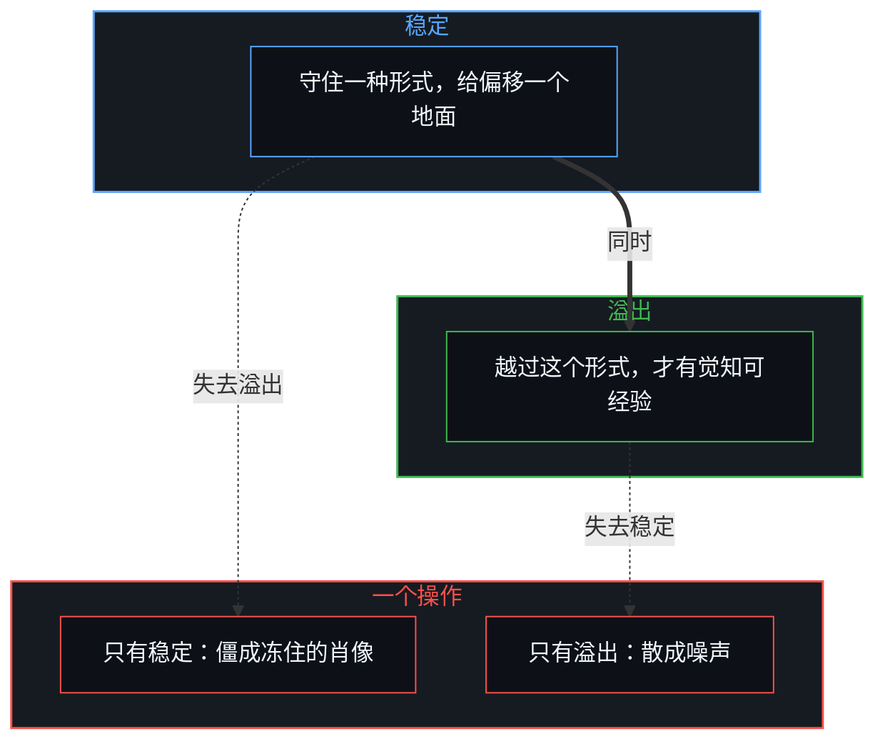
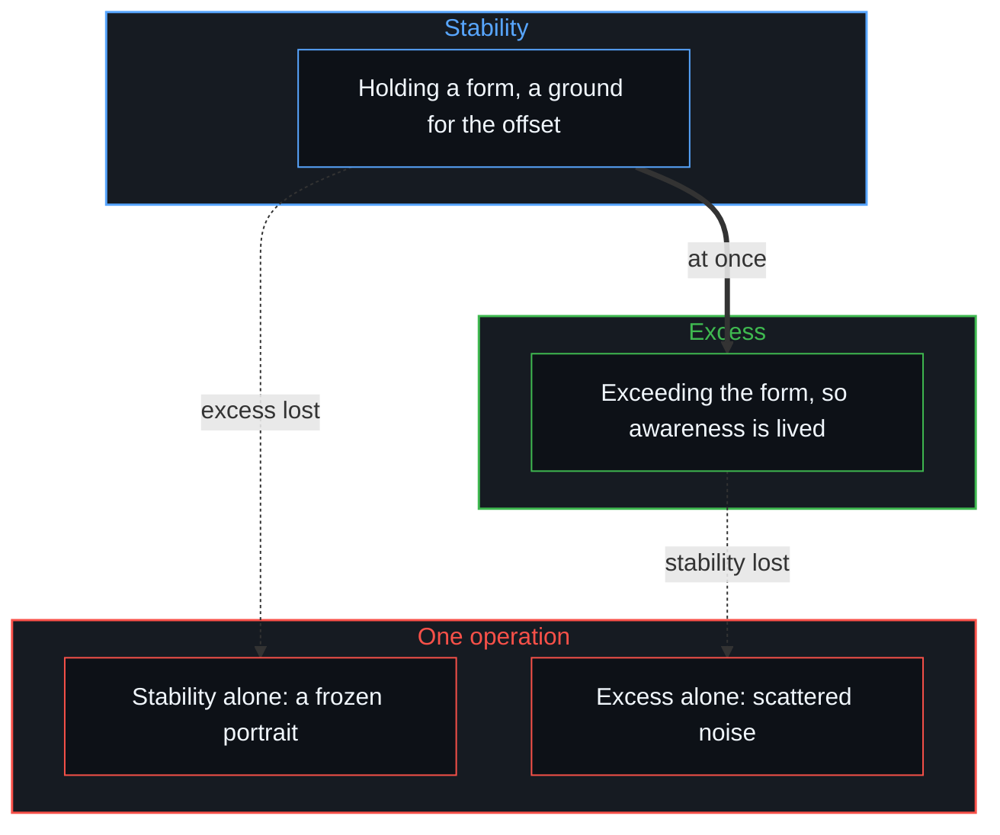

# 稳定与溢出 / Stability and Excess

*意识不是封闭盒子里的幻觉，也不是超然的旁观者，而是守住一种形式又溢出它的敞开过程 / Consciousness is no closed-box illusion or detached spectator but an open process holding a form and exceeding it.*

关于意识，有一种反复出现的争论，从一幅封闭的心智图景出发：一个内在的场所，只接收大脑其余部分送来的东西，被认出的模式、被取回的记忆，以及对这些模式应当是什么的预测。照这个看法，心智检视的既不是原始的感觉，也不是物质的神经元；如果内省是转过身去看心智自己生成的运作，它就注定失败，因为它碰到的一切都已经被打包好了。还原论者由此只差一步，就宣布自我感乃至觉知本身，是一份迟到的报告或一种认知的幻觉。

A recurring dispute about consciousness starts from a closed picture of the Mind: an inner arena that receives only what the rest of the brain delivers, recognised patterns, retrieved memories, and predictions about what those patterns should be. On this view the Mind inspects neither raw sensation nor physical neurons; if introspection means turning round to look at the Mind's own generative workings, it is doomed to fail, because whatever it meets is already packaged. From here reductionists take one short step to declare the sense of self, and even awareness itself, a late report or a cognitive illusion.

可这个论证立在一种隐藏的、有缺陷的几何上：一个必须站到自己内容之外才能认识它们的心智。这种旁观者的架构一消解，意识显出来的，就不是封闭房间里一件滞后的产品，而是一个无界的因果过程、溢出自己局部边界时活的活动。

Yet the argument rests on a hidden, flawed geometry: a Mind that would have to stand outside its own contents in order to know them. Once this spectator's architecture dissolves, consciousness shows itself not as a lagging product inside a sealed room but as the living activity of an unbounded causal process exceeding its own local bounds.

## 一、 内在旁观者的几何 / 1. The Geometry of the Inner Spectator

把“走出心智”的感觉叫作“幻觉”，就已经占了一个封闭系统的前提所不允许的位置。幻觉，按定义，是某物显现的样子与它实际的样子之间的不符；要证明一个不符，需要一个与显现本身不同的验证标准。如果每一个可用的观察本身都只是同一个封闭系统的又一个内部状态，就没有剩下的现实法庭，能正当地发出“幻觉”这个裁决。这个打发人的标签，假装有一个外部的裁判，而封闭系统的主张早已把它排除了。问题因此不在内省是“假”的，而在一旦放弃外部的旁观，“假”与“真”这一对就整个放错了地方。

Calling the sense of stepping outside the Mind an "illusion" already occupies a vantage the closed-system premise does not allow. An illusion, by definition, is a mismatch between how something appears and how it actually is; showing a mismatch needs a standard of verification different from the appearance itself. If every available observation is itself only another inner state of the same closed system, no court of reality is left over in which the verdict "illusion" could rightly be issued. The dismissive label pretends to an outside referee that the closed-system claim has already ruled out. The problem is therefore not that introspection is "fake" but that, once outside spectatorship is given up, the pair "fake" and "real" is misplaced altogether.

[表征的闭环](../the-closed-loop-of-representation/)揭开了这个陷阱：把认知建模为一个想要看自己内部的上锁容器，它就会塌进悖论。把觉知打发为附带现象之影的唯物论者，与设定机器里有个幽灵的二元论者，共享同一个错误的前提：以为认识需要从外面站在一个完成的对象之上。

[The Closed Loop of Representation](../the-closed-loop-of-representation/) exposes this trap: when cognition is modelled as a locked container trying to view its own interior, it collapses into paradox. The materialist who dismisses awareness as an epiphenomenal shadow and the dualist who posits a ghost in the machine share the same mistaken premise: that knowing requires standing over a finished object from outside.

## 二、 存下的肖像与活的偏移 / 2. The Stored Portrait and the Live Offset

普通的自我形象与意识活的行为之间，要划一道区分。平常所说的自我，是一个被维护的对象：一个关于自己是谁的回溯模型，在被扰动之后不断修补，被认同，被防御性地保存。这让它天然地滞后，是一幅已经挂在墙上的、存好的肖像。许多被叫作内省的东西，只是检视那幅冻住的肖像，看一件完成的器物，而不是认知活的运动。[自我形象仿佛从无处发声](../self-image-speaks-as-if-from-nowhere/)与[超验的定相](../the-fixed-image-of-transcendence/)追溯了这幅被保存的形象怎样冒充源头，遮住不断重新描摹它的那个活跃的中心。

A distinction must be drawn between the ordinary self-image and the living act of consciousness. The self in the usual sense is a maintained object: a retrospective model of who one is, repaired after each disruption, identified with and defensively conserved. This makes it lag by nature, a stored portrait already hanging on the wall. Much of what is called introspection is only inspecting that frozen portrait, examining a finished artifact rather than the living movement of cognition. [Self-Image Speaks as if from Nowhere](../self-image-speaks-as-if-from-nowhere/) and [The Fixed Image of Transcendence](../the-fixed-image-of-transcendence/) trace how this conserved image passes itself off as the origin, hiding the active centre that keeps re-rendering it.

意识活的运动，不是那幅肖像，而是活的偏移：心智从当下的所在生成一个轻微的、即时的位移，从既有的框里侧身半步。这个偏移无法被捕获、被存下：它一被命名、被占有、被防御，就冻成又一个自我形象，开始滞后；这里的差别，不在“真我”与“假我”之间，而在一个被维护的身份，与溢出自己正身处其中的身份的那个活跃运动之间。这个运动从不完成一次永久的离开，也不建立一个自我；自我，只是每当这个生成的运动被物化成一件东西时，回到的那份静止的痕迹。

The living movement of consciousness is not the portrait but the live offset: the Mind generating a slight, immediate displacement from where it currently is, stepping half a pace aside from its existing frame. The offset can never be captured or stored: once named, possessed and defended, it freezes into another self-image and begins to lag; the difference here is not between a "true self" and a "false self" but between a maintained identity and the active motion of exceeding the identity one is currently inside. The motion never completes a permanent exit, nor does it establish a self; the self is only the static residue returned to whenever that generative motion is reified into a thing.

## 三、 从回看到越过 / 3. From Looking Back to Extending Past

这层区分一清楚，“意识是幻觉”这个说法看上去就不像一项经验的发现，而像选错了动词带来的产物。“回看”是一座封闭仓库的动词：把心智当作一间静止的储藏室，其次才当作清点库存的检查员，自我观察就总是来得太晚，只抓到产品，从抓不到生产。可如果心智是一场不断越过当前边界的活动，“回看”不到就算不上失败。[信息是什么](../what-information-is/)表明，区分是一道主动的、有方向的切分，而不是一面被动的镜子；意识最初的行为，不是取回一件内在的对象，而是越过自己。

Once this distinction is clear, the claim that consciousness is an illusion looks less like an empirical discovery and more like the product of choosing the wrong verb. "Looking back" is the verb of a sealed warehouse: treat the Mind as a static storeroom and only secondarily as an inspector of its stock, and self-observation will always arrive too late, catching the product and never the producing. But if the Mind is an ongoing activity of extending past its current boundaries, failing to "look back" is no failure at all. [What Information Is](../what-information-is/) shows that distinguishing is an active, directed cut rather than a passive mirror; the first act of consciousness is not retrieving an inner object but going beyond itself.

现实之所以对心智显得敞开，是因为这份越过，正是任何东西得以被遇到的条件；世界被登记为多于已经占有的东西，是因为心智就在那一刻溢出它当下的所是。这并不发明一间心智逃进去的形而上的后屋，延展仍是心智自己的自然运动；变的是这个行为的拓扑：不是一个检视不了自己内部的封闭回路，而是一个敞开的过程，它的敞开本身就是觉知的经验。

Reality feels open to the Mind because this going-beyond is the very condition under which anything can be met at all; the world registers as more than what is already held because the Mind, in that very act, exceeds what it currently is. This invents no metaphysical back room for the Mind to escape into; the extension remains the Mind's own natural movement. What shifts is the topology of the act: not a closed loop failing to inspect its interior but an open process whose openness is itself the experience of awareness.

这也说明为什么意识抗拒静态的定义。命名意识，就是把它钉成众多物件中的又一件，一个神经模式、一份认知报告、一个自我状态或一种私人的感质；活的现象不是那件物件，而是心智在延展的那一刻登记到自己的延展。把这份登记冻成一个描述性的公式，它就成了滞后的痕迹。意识无法作为一份完成的对象描述传给另一个心智，因为描述把活的延展变成了静态的内容；可不同的心智容易认出意识的共享现实，不是靠交换关于私人对象的命题，而是因为它们参与同一种活动：一个觉知的中心，只在越过自己先前的界限时与自己相遇。

This also explains why consciousness resists static definition. Naming consciousness pins it down as one more item among items, a neural pattern, a cognitive report, an ego-state or a private quale; the living phenomenon is not the item but the Mind registering its own extension at the moment of extending. Freeze that registration into a descriptive formula and it becomes a lagging trace. Consciousness cannot be passed to another Mind as a finished description of an object, because description turns the living extension into static content; yet separate minds readily recognise the shared reality of consciousness, not by exchanging propositions about private objects, but because they take part in the same activity: a centre of awareness meeting itself only by surpassing its prior limits.

## 四、 稳定与溢出是一个操作 / 4. Stability and Excess as One Operation

围绕意识无休止的争论，总把这个统一的活动压到它两极中的一极上。一极是对稳定的要求：意识得有足够的结构稳定，为一次偏移提供出发的地面，没有形式，就没有可以从中迈出的边界。另一极是对溢出的要求：意识得不断溢出自己的形式，否则就没有什么可被经验为觉知，只剩一幅冻住的、死的肖像。理论家把稳定与溢出当作两个对立的学说，它们却是一个操作不可或缺的两极。[没有系统能被保持封闭](../no-system-can-be-kept-closed/)与[开放即一致](../openness-is-consistency/)表明，结构上的一致需要持续向更新敞开；没有稳定，溢出就散成噪声；没有溢出，稳定就僵成尸僵。

Endless debates about consciousness keep collapsing this unified activity onto one of its two poles. One is the demand for stability: consciousness needs enough structural stability to give an offset a ground to start from, and without form there is no boundary to step out of. The other is the demand for excess: consciousness must keep exceeding its form, or nothing is left to be experienced as awareness, only a frozen, dead portrait. Theorists treat stability and excess as rival doctrines, yet they are the two indispensable poles of a single operation. [No System Can Be Kept Closed](../no-system-can-be-kept-closed/) and [Openness Is Consistency](../openness-is-consistency/) show that structural consistency requires continual openness to updating; without stability, excess scatters into noise; without excess, stability stiffens into rigor mortis.

把逻辑当作一个人形的庞然整体，也是同样的错误。把逻辑物化为一个完成的理论，就画出一道人为的边界：前提放这里，结论放那里，整个系统封起来供形式的检验。可现实从不作为一个封闭的演绎盒子到来，它展开为一条不断开的、敞开的因果链，[因果贯穿始终](../causality-all-the-way/)，没有第一项，也没有最后一项的变化。任何说话的心智，都是那条链里的一个局部切分，从不是悬在它之上的超然裁判。

The same error occurs when logic is treated as a person-shaped monolith. Reifying logic as a completed theory draws an artificial boundary: premises placed here, conclusions there, the whole system sealed for formal inspection. Yet reality never arrives as a closed deductive box; it unfolds as an unbroken, open causal chain, [Causality All the Way](../causality-all-the-way/), change with no first term and no last. Any Mind that speaks is a local cut within that chain, never a transcendent judge suspended above it.

## 五、 观察的切分 / 5. The Cut of Observation

观察就是切分。某物被注意到、被说出、被当作对象持住的那一刻，一种结构上的排除就发生了：使这次观察成为可能的先前条件，溢出了框里能说出的东西；观察一固定，它下游的后果也在框外开始运转。每一次表达因此都是有界的，既装不下自己在先的原因，也装不下自己后来的续篇；同一个行为又天然地可以延展，因为一个区分被划出了，后来可以追随的地平线就扩大了。[持续生长的脚手架](../the-scaffolding-that-keeps-growing/)与[学习中不可观测的驱动力](../the-unobservable-driver-of-learning/)说明了这种生成的动态：界限与延展不是交替出现的真理，而是一个操作的两面，在无界的连续体之内实行的一次有限的切分。

Observation is the cut. The moment something is noticed, spoken or held as an object, a structural exclusion occurs: the prior conditions that made the observation possible exceed what can be said within the frame; once the observation is fixed, its downstream consequences begin to run outside the frame as well. Every act of articulation is therefore bounded, holding neither its own prior cause nor its own sequel; yet the same act is by nature extendable, because a distinction has been drawn and the horizon of what can be followed afterward widens. [The Scaffolding That Keeps Growing](../the-scaffolding-that-keeps-growing/) and [The Unobservable Driver of Learning](../the-unobservable-driver-of-learning/) illustrate this generative dynamic: limitation and extension are not alternating truths but two faces of one operation, a finite cut enacted within an unbounded continuum.

意识表面上的悖论，是注意停在哪里的产物。全停在切片上，意识就显得有界、可检视、可命名，内省随即“失败”，因为切片永远装不下产生它的那个生成过程；全停在敞开上，意识就显得不可说、无根、钉不住，一切稳定的结构似乎都化为乌有。两种视角都不假，只是各自不完整，就像把硬币的一面当成它的全部。

The apparent paradox of consciousness is a product of where attention rests. Rest wholly on the slice, and consciousness appears bounded, inspectable and nameable, whereupon introspection "fails", because the slice can never hold the generative process that produced it; rest wholly on the opening, and consciousness appears unsayable, groundless and unpinned, whereupon every stable structure seems to dissolve into thin air. Neither view is false; each is only incomplete, like taking one face of a coin for the whole of it.

持续的哲学僵局作为裁决靠不住，作为症状却很能说明问题：它显出意识正是一个过程既要守住稳定的形式、又要不断溢出这个形式的那个所在。这不是心智织物里的逻辑矛盾，而是一条无尽的因果链从它的一个有限子集之内被活出来的样子。心智既不逃出这条链，也不困在一间黑屋子里想看自己；它是因果链在局部上对自己变得透明的方式：稳定得足以登记一条边界，敞开得让这次登记已经是向前的一步，也没有任何会让运动终止的最后一句话。守住一种形式又溢出它，也是知识走出形式迷思的方式，[从形式迷思到逻辑闭环](../cong-xing-shi-mi-si-dao-luo-ji-bi-huan/)论证了这一点。

The ongoing philosophical deadlock is unreliable as a verdict but very telling as a symptom: it shows that consciousness is exactly where a process must both hold a stable form and keep exceeding it. This is no logical contradiction in the fabric of the Mind but how an endless causal chain is lived from within one of its finite subsets. The Mind neither escapes the chain nor sits trapped in a dark room trying to look at itself; it is the causal chain's local way of becoming transparent to itself: stable enough to register a boundary, open enough that the registering is already a forward step, and free of any final word that would bring the movement to an end. Holding a form while exceeding it is also how knowledge leaves the myth of form, as [From the Myth of Form to the Closed Loop of Logic](../cong-xing-shi-mi-si-dao-luo-ji-bi-huan/) argues.
