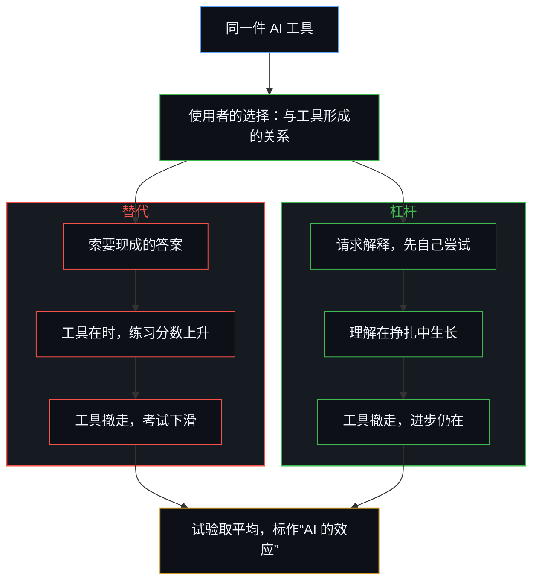
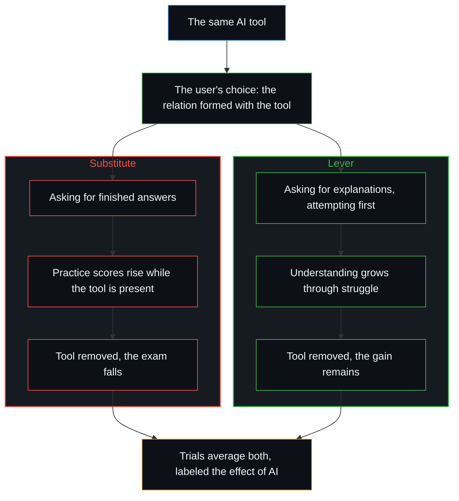

# 研究AI效应重置了因果原点 / Studying the Effect of AI Relocates Causality

*把工具当作因果的施动者，正是数据随后登记下来的那种替代 / Treating the tool as the causal agent is the very substitution the data then register.*

越来越多的随机对照试验与实地实验，考察学生在学习时用上生成式 AI 会发生什么。在一项近千名高中生参与的数学实验中，使用不受限 GPT-4 界面的学生，在工具可用时练习题得分高出约 48%，到了不能用工具的考试，却比从未用过的同伴低了约 17%；一个不直接给出答案的带护栏辅导工具让练习分数更高，无辅助的考试则与对照组在统计上无从区分。实地数据呈现类似的样子，[作业与考试的倒置折射出替代效应](../the-homework-exam-inversion-registers-substitution/)登记到作业分数提高约 18%，闭卷考试成绩下降约 20%。元分析有时报告对短期成绩有中等的正面平均效应，但这些汇总常常把工具在场时的分数与工具撤走后的分数混在一起。

A growing body of randomized trials and field experiments has examined what happens when students are given access to generative AI during learning. In a high-school mathematics experiment of nearly a thousand students, those using an unrestricted GPT-4 interface scored about 48 percent higher on practice problems while the tool was available, then 17 percent lower on an unassisted exam than peers who had never used it; a guarded tutor that withheld finished answers raised practice scores still further and left the unaided exam statistically indistinguishable from the control. Similar patterns appear in the field: [the homework–exam inversion](../the-homework-exam-inversion-registers-substitution/) registers homework gains around 18 percent against closed-book exam losses around 20 percent. Meta-analyses sometimes report moderate positive average effects on short-term achievement, but those aggregates often mix scores taken while the tool remains present with scores taken after it is removed.

## 一、 数据登记的是短期的辅助与无辅助时的下滑 / 1. The Data Register Short-Term Assistance and Unaided Decline

数据本身很能说明问题。它们让一个一致的样子变得可见：短期得到辅助，工具一撤走，独立的表现就变薄。因为这些研究是在一个共同的前提下进行的，它们得出的结论，那个前提早已包含。实验设计与流行的解读建立在同一种分配上：AI 本身是因果的施动者，要么帮助学习，要么损害学习。使用权限被当作自变量，测验成绩被当作因变量。流传的检验是这样的：如果 AI 帮助了学生学习，随机分到使用它的那一组，在无辅助的测验上就该得分更高。在不受限的条件下，他们并没有。

The data themselves are revealing. They make visible a consistent pattern of short-term assistance followed by thinner independent performance once the tool is withdrawn. Because the studies were conducted under a shared premise, they generate the conclusion that premise already contained. Both the experimental designs and the popular interpretation rest on the same allocation: the AI itself is the causal agent that either helps or harms learning. Access is treated as the independent variable and test performance as the dependent variable. The circulating test of the claim runs: if AI helped students learn, a randomly assigned group using it would score better on unaided tests. In the unrestricted condition, they do not.

在这一共同的假定下，这些发现几乎不言自明。一旦相信做功的是工具，人就会减少自己的投入。认知负荷被卸下，挣扎被避开，独立表现所需的能力随之变薄。等到工具被撤走，分数就掉下来。数据揭示的不是这项技术某种出人意料的属性，而是把工具当作施动者的可预见的后果。

Under that shared assumption the findings become almost self-explanatory. Once individuals believe the tool is what does the work, they reduce their own effort. Cognitive load is off-loaded, struggle is avoided, and the capacities required for independent performance thin. When the tool is later removed, scores fall. The data do not reveal a surprising property of the technology. They reveal the predictable consequence of treating a tool as an agent.

## 二、 研究隔离出的是工具与已有姿态的相互作用 / 2. The Studies Isolate a Tool Interacting with a Posture Already Adopted

更深一层的错置，在前提本身。研究隔离出的不是一件工具的效应，而是一件工具与个人已经带来的习惯、意图和姿态之间的相互作用；这些姿态本身也是一次次相继的选择，而不是工具后来遇上的第二天性。当学生把 AI 当作认知努力的替代，向它要现成的答案，让它扛起推理的负荷，用它来避开挣扎，工具就放大了这个选择。拐杖在时，表现上升；拐杖一撤，表现就塌下来。工具看似的失败，其实是替代的成功。

The premise itself is where the deeper misallocation sits. The studies do not isolate the effect of a tool. They isolate the effect of a tool interacting with whatever habits, intentions and postures the individual already brings, and those postures are themselves successive choices, not a second nature the instrument then meets. When students treat the AI as a substitute for cognitive effort, asking it for finished answers, letting it carry the load of reasoning, using it to avoid struggle, the tool amplifies that choice. Performance rises while the crutch is present and collapses when it is removed. The apparent failure of the tool is substitution succeeding.

反过来，当一个人把同一件工具当作杠杆，请它解释，用它检验理解，在求助之前先刻意面对难处，同样的技术就放大了进步。差别不在模型的权重里，而在这个人选择与工具形成的关系里。[放大悖论](../amplification-paradox/)是工具越来越密时的同一层几何：同一件工具在不同的人手里产生截然不同的结果，因为选择始终在使用者那里。[因果停留在掌舵的边缘](../causality-stays-at-the-edge-that-steers/)是同一种定位装扮成发现的样子：模型重组的是余留，每一个发起的区分仍是使用者自己的行为。

Conversely, when an individual uses the same tool as a lever, requesting explanations, testing understanding, deliberately confronting difficulty before consulting it, the identical technology amplifies improvement. The difference is not located in the model weights. It is located in the relationship the person chooses to form with the instrument. [The Amplification Paradox](../amplification-paradox/) is that geometry as tools densify: the same instrument in different hands produces radically different outcomes because selection stays with the user. [Causality Stays at the Edge That Steers](../causality-stays-at-the-edge-that-steers/) is the same placement dressed as discovery: the model recombines residue, and every initiating distinction remains the user's own act.

同一项实验里的带护栏辅导工具，仍是这层几何，只是晚了一步。交互日志显示，不受限的使用者索要并照抄答案，辅导工具的使用者则请求帮助，或自己尝试作答。论文把考试成绩的差别读作护栏的属性。护栏塑造的是哪些对齐方式可用，并不替人写出下一步行动。把解方放在设计得更好的工具上，是把原先的前提作为政策重走一遍。

The guarded tutor in the same experiment is still this geometry, one step later. Interaction logs showed unrestricted users asking for and copying solutions, and tutor users asking for help or attempting answers themselves. The paper reads the exam difference as a property of guardrails. Guardrails pattern which alignments are available. They do not author the next act. Locating the remedy in a better-designed tool is the original premise retraced as policy.

## 三、 替代与杠杆都是自己施加的 / 3. Substitute and Lever Are Both Self-Imposed

所以替代与放大都是自己施加的。工具从不发起其中任何一种状态，它接收并放大的是已经采取的姿态。[验证中因果权能的分配](../the-allocation-of-causal-power-in-validation/)追踪的是哪一边被当作提供下一步的一方：一旦答案被当作从工具那里到来，学生自己的跟进就不再是延续的源头。对使用者取平均的随机对照试验，必然是在这些相反的姿态之间取平均。为零或为负的平均结果，并不证明工具是惰性的或有毒的，它显示的是，在总体上，自己施加的替代压过了自己施加的放大。[理性选择公设是原罪](../the-rational-choice-postulate-is-the-original-sin/)是同一种取平均装扮成经济学的样子：均值重新分配已经产生出来的余留，又把它标成仿佛是它写出了这个样式。这里被重新标注的，是相反关系的均值，它被叫作 AI 的效应。

Both substitution and amplification are therefore self-imposed. The tool never initiates either condition. It receives and magnifies the posture already adopted. [The Allocation of Causal Power in Validation](../the-allocation-of-causal-power-in-validation/) tracks which side is treated as supplying the next step: once the answer is treated as arriving from the tool, the student's own following is no longer the source of continuation. Randomized trials that average across users necessarily average across these opposing postures. The null or negative average result does not prove the tool is inert or toxic. It shows that, in the aggregate, self-imposed substitution outweighed self-imposed amplification. [The Rational Choice Postulate Is the Original Sin](../the-rational-choice-postulate-is-the-original-sin/) is that averaging dressed as economics: the mean redistributes residue already produced and re-labels it as if it authored the pattern. Here the mean of opposed relations is re-labeled as the effect of AI.

## 四、 研究工具的效应，重走了同一种替代 / 4. Studying the Effect of the Tool Retraces the Same Substitution

把研究与公共讨论聚焦在“AI 的效应”上，进一步固化了原先的前提。它引人把因果放到自己之外，等待一件更好的工具，而不是审视自己如何投入，由此复制出数据所揭示的那个样子。[个体抉择是唯一的因果杠杆](../individual-choices-as-the-only-causal-levers/)是同一种回返装扮成社会的样子：向外归因的解释，本身也是一个个离散的行为，它们挪动了选择被登记的位置。这里被挪过去的名字，是使用权限。

Focusing research and public discussion on "the effect of AI" further entrenches the original premise. It invites people to locate causality outside themselves, to wait for a better tool rather than examine their own engagement, and thereby reproduces the very pattern the data reveal. [Individual Choices as the Only Causal Levers](../individual-choices-as-the-only-causal-levers/) is the same return dressed as the social: externalizing explanations are themselves further discrete acts that relocate where the choice registers. Here the relocated name is access.

这些研究之所以仍有价值，恰恰因为数据很能说明问题。它们测量的不是技术的威力，而是能动性在使用者之间的分布。把隐藏的前提放到一边，实际的含义就倒了过来：起决定作用的变量从来不是工具，而是个人一再做出的选择，把工具当作放大器而不是替代品。[学习中不可观测的驱动力](../the-unobservable-driver-of-learning/)把这个选择推广到工具之外：教学、课程与研究设计都受到同一种分配，观察所能握住的只有下游的分数。

The studies remain valuable precisely because the data are revealing. What they measure is not the power of the technology but the distribution of agency among the people using it. Once the hidden premise is set aside, the practical implication inverts: the decisive variable is never the tool. It is the individual choice, repeatedly made, to treat the tool as amplifier rather than replacement. [The Unobservable Driver of Learning](../the-unobservable-driver-of-learning/) generalizes that choice past the instrument: instruction, curriculum and study design receive the same allocation, and observation holds only the downstream scores.
