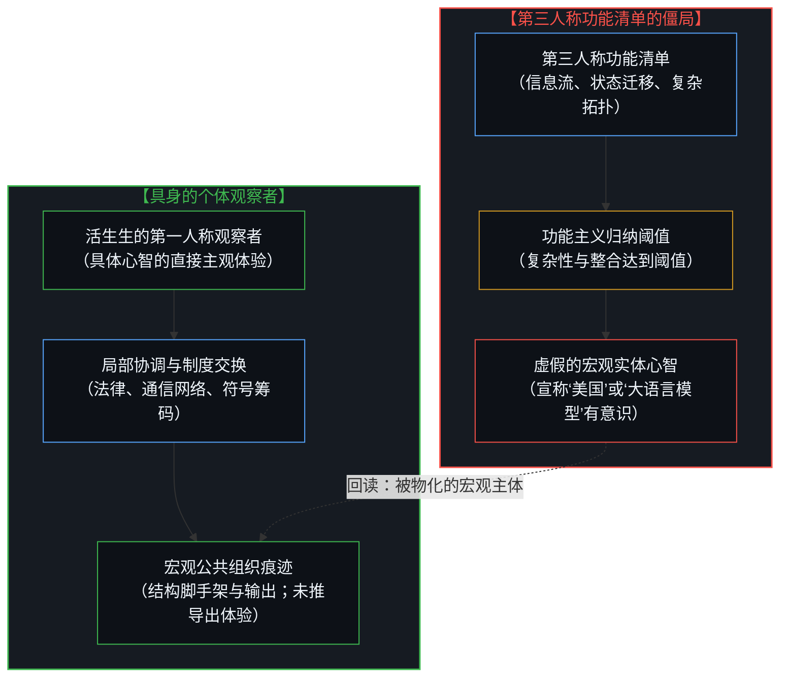
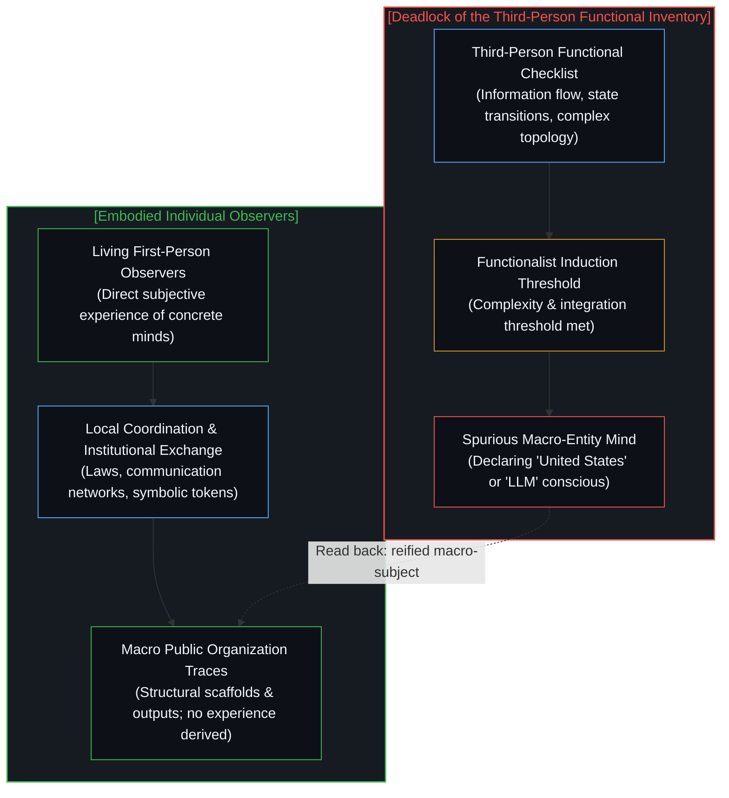
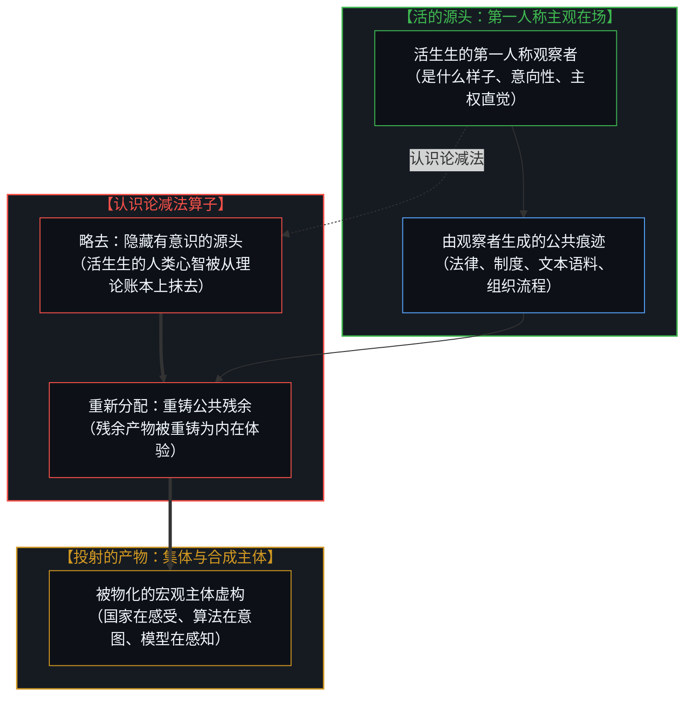
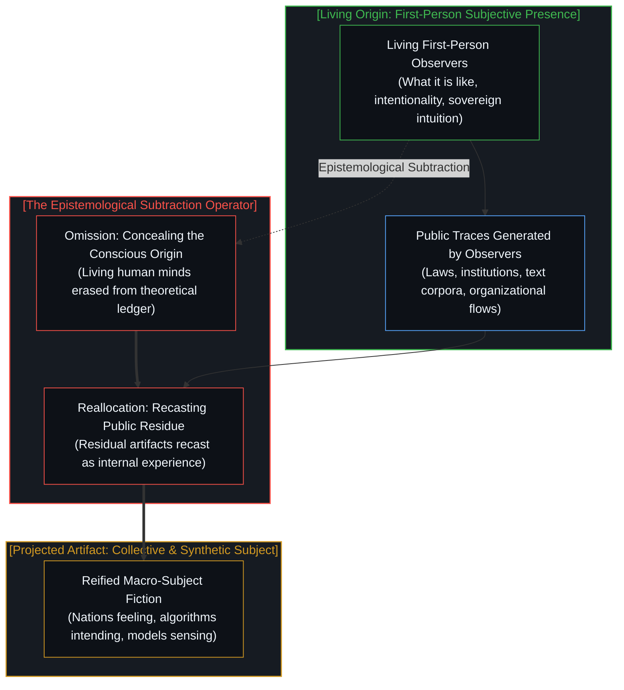
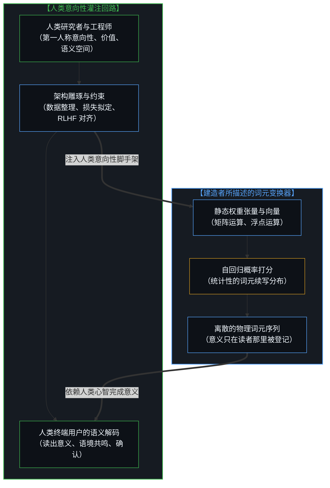
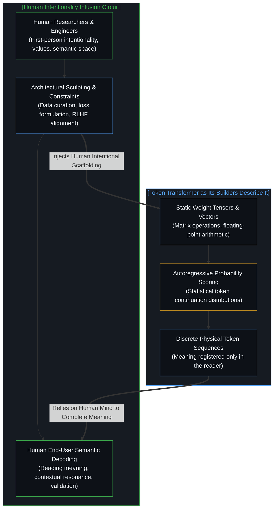
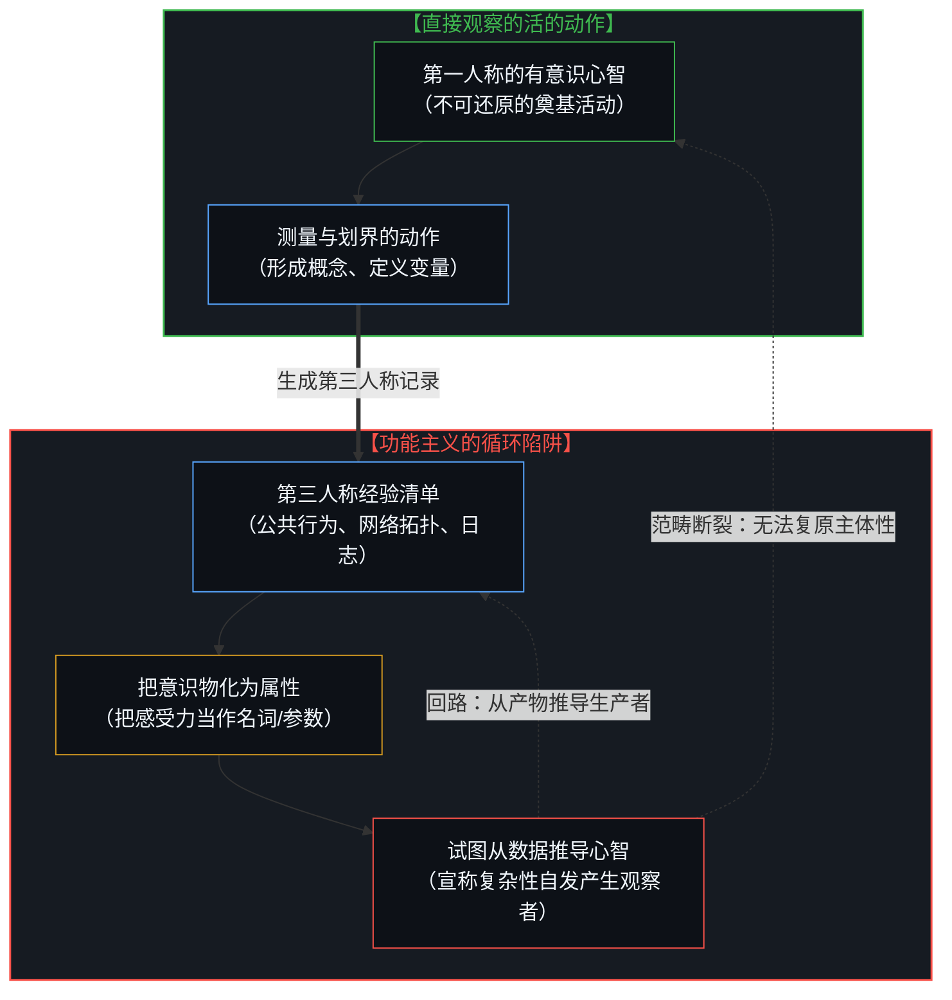
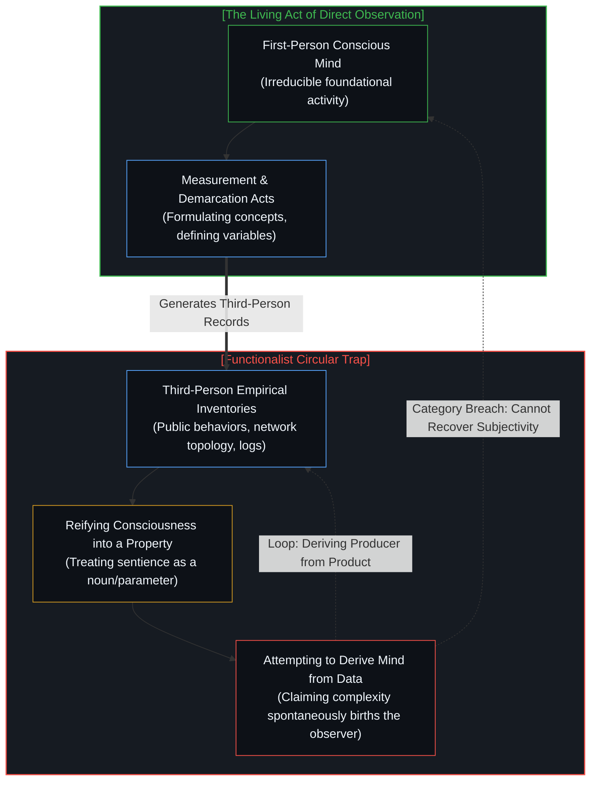
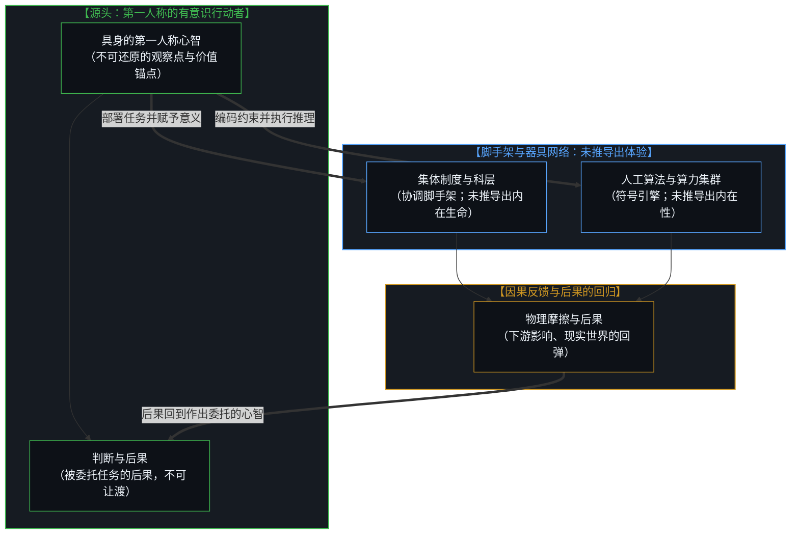
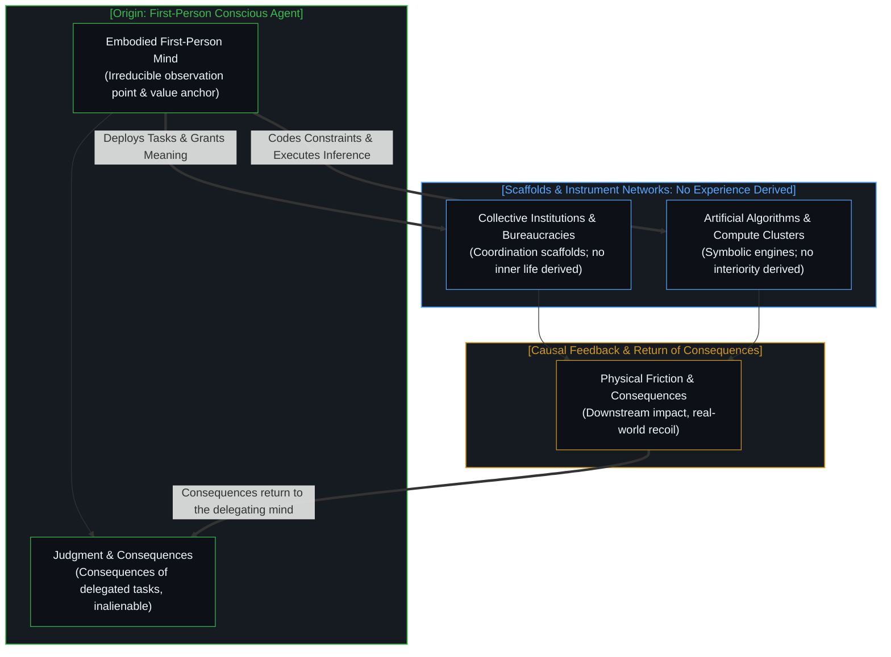

# 集聚与人造主体性 / Collective and Artificial Subjectivity

*在源头减去意识的产物 / Artifacts of Subtracting Consciousness at the Source*

无论是在施维茨格贝尔“唯物主义蕴含美国有意识”的主张中，还是在当今把 AI 模型物化为自主心智的做法中，多出来的主体都由同一种认识论减法产生：一旦人类的设计、训练、评估与解释活动被塞进背景，残余的公共行为便被归于系统；然而这套说明里，没有一处为集体或工具推导出“是什么样子”。发生的是：制造者的活动被排除在记录之外，读者自己的阅读被记在了系统名下。

Whether in Schwitzgebel's claim that materialism implies the United States is conscious or in the present-day reification of AI models as autonomous minds, the extra subject is produced by the same epistemological subtraction: once human acts of design, training, evaluation, and interpretation are tucked into the background, residual public behaviors are credited to the system, yet nothing in the account derives a 'what it is like' for the collective or the tool; what has happened is that the makers' acts were left out of the record and the reader's own reading was entered under the system's name.

## 一、 施维茨格贝尔的论证与第三人称清单的僵局 / Schwitzgebel's Argument and the Deadlock of the Third-Person Inventory

关于人工智能模型、蚁群或人类社会是否可能有意识的讨论，通常始于一份关于结构组织、信息吞吐与外部行为的第三人称清单。埃里克·施维茨格贝尔的论文《如果唯物主义为真，美国大概有意识》（*If Materialism Is True, the United States Is Probably Conscious*），把这一传统暗含的承诺挑明了。如果意识不外乎恰当种类的物质排列与信息整合，并且如果我们已经承认兔子以及解剖结构极其陌生的假想外星生物有意识，那么，一个在空间上分布、在功能上却整合的网络，例如美国，本身应当算作一个有意识的主体。以这种方式推理的理论家，把同一个归纳公式应用于人工系统：一旦一个前沿 Transformer 模型展现出流畅的文字、多步规划或目标导向的问题求解，他们便认真地把该模型视为可能具有感受力的候选者。然而，这种功能主义进路陷入一个概念僵局：关于关系动态的外部目录，只记录结构坐标；把该目录当作不止于一份结构坐标记录的东西，是把公共的信息产物误认作内在生命。

Discussions of whether artificial intelligence models, ant colonies, or human societies might be conscious usually begin from a third-person inventory of structural organization, information throughput, and external behaviors. Eric Schwitzgebel’s paper, *If Materialism Is True, the United States Is Probably Conscious*, makes the implicit commitments of this tradition explicit. If consciousness is nothing over and above the right kind of material arrangement and informational integration, and if we already grant consciousness to rabbits and to hypothetical alien organisms with radically unfamiliar anatomy, then a spatially distributed yet functionally integrated network such as the United States should count as a conscious subject in its own right. Theorists who reason this way apply the same inductive formula to artificial systems: once a frontier transformer exhibits fluent prose, multi-step planning, or goal-directed problem solving, they treat it as a serious candidate for sentience. Yet this functionalist approach runs into a conceptual impasse: an external catalog of relational dynamics records only structural coordinates, and to take that catalog for more than a record of structural coordinates is to mistake public informational artifacts for an interior life.

## 二、 减法的戏法：搁置源头与重新分配残余属性 / The Sleight of Subtraction: Setting Aside the Origin and Reallocating Residual Properties

在两种情形中，多出来的主体都由减法产生。唯一被直接遭遇到的意识，是第一人称的观察活动，即作为一个体验着的主体有“是什么样子”可言这一具体事实。当该活动被搁置，或被降格为运作接线图里的另一个可互换组件时，这套说明便转移了焦点。剩下的公共痕迹（法规、制度规程、通信线缆与经过整理的文本语料）被重新组装，并被重新描述为更大系统的体验之流。国家看起来怀有一个统摄全局的心智；计算模型看起来理解现实。这些表象只有在活生生的原初主体被从描述中略去之后才出现。[意识从不作为数据出现在数据之中](../consciousness-never-appears-as-data-among-data/)追溯数据如何只记录先前认知行为的足迹；[意识的魔术戏法与推断的非对称性](../the-sleight-of-hand-of-consciousness-and-the-asymmetry-of-inference/)追溯把这些足迹物化为一个新的有意识行动者的做法，如何借内在性无法以第三人称证明这一点，在找不到观察者的地方归予意识。每一次在自身之外定位主体性的尝试，仍在自身的心智之内运行，正如[无法逃逸的心智视界](../one-cannot-escape-ones-own-mind/)所追溯的。

In both cases, the extra subject is produced by subtraction. The only consciousness directly encountered is the first-person activity of observing: the concrete fact that there is something it is like to be an experiencing subject. When that activity is set aside, or demoted to one more interchangeable component in an operational wiring diagram, the account shifts its focus. The remaining public traces (statutes, institutional protocols, communications cables, and curated text corpora) are reassembled and redescribed as the experiential stream of the larger system. A nation appears to harbor an overarching mind; a computational model appears to comprehend reality. These appearances arise only after the living original subjects have been omitted from the description. [Consciousness Never Appears as Data Among Data](../consciousness-never-appears-as-data-among-data/) traces how data records only the footprints of prior cognitive acts, and [The Sleight of Hand of Consciousness and the Asymmetry of Inference](../the-sleight-of-hand-of-consciousness-and-the-asymmetry-of-inference/) traces how reifying those footprints into a new conscious agent uses the third-person unprovability of interiority to credit consciousness where no observer is found. Every attempt to locate subjectivity outside oneself still runs inside one's own mind, as [One Cannot Escape One's Own Mind](../one-cannot-escape-ones-own-mind/) traces.

## 三、 人工系统：人类意向性被遮蔽的容器 / Artificial Systems as the Occluded Vessel of Human Intentionality

人工系统更直白地显示出这一减法。每一个前沿模型都由人构思、设计架构、训练、评估与解释。预训练语料的选择与过滤、损失函数的拟定、基于人类反馈的强化学习，以及提示的技艺，是人类意向性的运作。最重要的是，把模型的输出读作连贯、有洞见或有意义，是一个只发生在阅读者心智之内的动作。硬件所运行的，被建造它的人描述为浮点张量运算；它的输出有所言说这一点，只登记在读它的人那里。当这一人类脚手架被排除在说明之外时，该人造物便被描述得仿佛它独自生成了理解：机器被归予一种内在生命，所凭借的是略去赋予它生气的人类内在生命。[智能只属于心智](../intelligence-belongs-only-to-the-mind/)、[造物无法取代其源头](../a-creation-cannot-replace-its-source/)与[感知者与痕迹的不可坍缩](../the-perceiver-and-the-trace/)在计算中追溯这一减法：计算产物看似有光，那光借自活生生的感知者，而派生的意义不是感知者；把心智归于词元，是把自身的阅读登记在一个痕迹的名下。模拟假说以同样的方式减去观察者，正如[凡可言说皆不可言说之产物](../all-that-can-be-spoken-is-the-product-of-the-unspeakable/)所追溯的。

Artificial systems show this subtraction more plainly. Every frontier model is conceived, architected, trained, evaluated, and interpreted by people. The selection and filtering of pre-training corpora, the formulation of loss functions, reinforcement learning from human feedback, and the craft of prompting are operations of human intentionality. Above all, reading the output of a model as coherent, insightful, or meaningful is an act occurring only within the mind of the person reading it. What the hardware runs is described, by the people who built it, as floating-point tensor arithmetic; that its output says something is registered only in the one reading it. When this human scaffolding is left out of the account, the artifact is described as if it generated understanding on its own: the machine is credited with an inner life by leaving out the human inner life that animates it. [Intelligence Belongs Only to The Mind](../intelligence-belongs-only-to-the-mind/), [A Creation Cannot Replace Its Source](../a-creation-cannot-replace-its-source/) and [The Perceiver and the Trace Cannot Collapse](../the-perceiver-and-the-trace/) trace this subtraction in computation: computational artifacts borrow their apparent light from the living perceiver, and derived sense is not a perceiver; crediting a mind to tokens enters one's own reading under the name of a trace. The simulation hypothesis subtracts the observer in the same way, as [All That Can Be Spoken Is the Product of the Unspeakable](../all-that-can-be-spoken-is-the-product-of-the-unspeakable/) traces.

## 四、 语法上的挪移与唯物主义功能主义的循环 / The Grammatical Shift and the Circularity of Materialist Functionalism

把集体结构与自动化计算混同于主体性，既是一种语法上的挪移，也是一种方法上的错误。在语法上，这种混同把意识从一个活的、进行着的动作（观察、意图、评估与体验），变成一种据说为某个外部系统所拥有或缺乏的客体化属性。在方法上，这种混同预设一份经验清单能够登记观察者的在场，而这样的清单只能记录外部行为与结构构型。经验描述无法记录观察者：它只能罗列观察所得。唯物主义与功能主义框架生成关于运作动态的可检验假说，但它们无法在不陷入循环的情况下，从它们已经当作首要的观察结果中，推导出观察这一动作。[因果的自反性与物理的无源假定](../causality-is-irreducible-the-physical-is-a-view-from-nowhere/)在物理学中追溯这一循环：任何构造一幅没有观察者的现实图景的尝试，最终都投射出一个空洞的抽象；而试图从该投射中复原活的主体性，使思想陷入无穷倒退。

Conflating collective structure and automated computation with subjectivity is at once a grammatical shift and a methodological error. Grammatically, it turns consciousness from a living, ongoing act (observing, intending, evaluating, and experiencing) into an objectified property that an external system is said to possess or lack. Methodologically, it presumes that an empirical checklist, which can document only external behaviors and structural configurations, could register the presence of an observer. An empirical description cannot record the observer: it can only catalog observations. Materialist and functionalist frameworks generate testable hypotheses about operational dynamics, but they cannot, without circularity, derive the observing act from the observations they have already taken as primary. [Causality is Irreducible; The Physical is a View from Nowhere](../causality-is-irreducible-the-physical-is-a-view-from-nowhere/) traces this circularity in physics: any attempt to construct an observer-free picture of reality ends by projecting an empty abstraction, and attempting to recover living subjectivity from that projection traps thought in an infinite regress.

## 五、 回到源头：集体与工具都没有获得“是什么样子” / Returning to the Source: Neither Collectives nor Tools Acquire a "What It Is Like"

人类集体与机械器具，都没有经由这一说明获得“是什么样子”：这一说明中没有任何东西为美国或为一个 Transformer 模型推导出“是什么样子”。在每一种情形中，看似涌现出来的宏观主体，是创造、维护并解释该系统的那些活生生观察者的残余。看清这一点，不仅关乎描述，也关乎后果。当主体性被归于制度或人工网络时，借助它们行动的人，可以把后果推给“算法”或“集体意志”。[主体性不曾涌现](../agency-does-not-arise/)、[任务的移交与后果的不可让渡](../the-delegation-of-the-task-and-the-inalienability-of-consequences/)与[不可还原的观察者](../the-irreducible-observer/)追溯那些后果落在哪里：任务可以在器具之间被委托，但后果回到委托这些任务的第一人称心智。合成一个更高主体的冲动，始于同一种减法，正如[笛卡尔的认识论跃迁与造神狂热](../the-cartesian-overstep-and-the-frenzy-of-creation/)所追溯的。当被减去的观察者被归还到说明之中，混淆便消解：工具仍是工具，体验的所在留在观察者那里。

Neither human collectives nor mechanical instruments acquire a "what it is like" through this account: nothing in it derives one for the United States or for a transformer model. In each instance, what appears as an emergent macro-subject is the residue of the living observers who created, maintain, and interpret the system. Seeing this matters for consequences as well as for description. When subjectivity is attributed to institutions or artificial networks, the people who act through them can place consequences on "the algorithm" or "the collective will." [Agency Does Not Arise](../agency-does-not-arise/), [The Delegation of the Task and the Inalienability of Consequences](../the-delegation-of-the-task-and-the-inalienability-of-consequences/) and [The Irreducible Observer](../the-irreducible-observer/) trace where those consequences land: tasks can be delegated across instruments, but consequences return to the first-person mind that delegated them. The drive to synthesize a superior subject starts from the same subtraction, as [The Cartesian Epistemic Leap and the Frenzy of Creation](../the-cartesian-overstep-and-the-frenzy-of-creation/) traces. When the subtracted observer is restored to the account, the confusion dissolves: tools remain tools, and the locus of experience stays with the one who observes.

