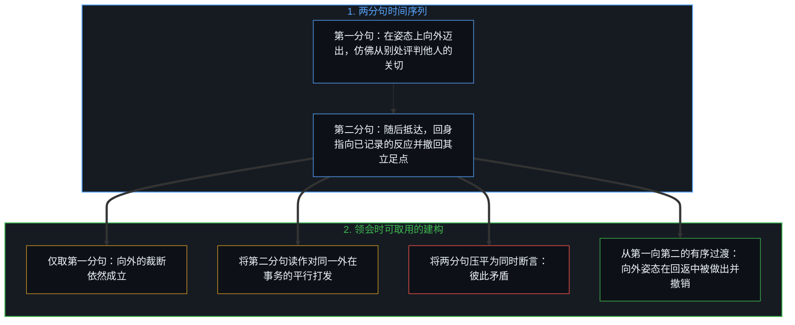
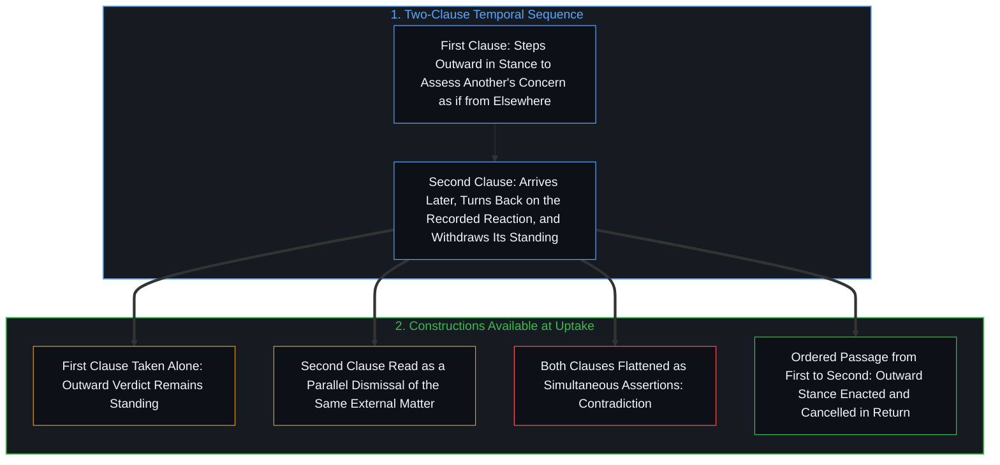
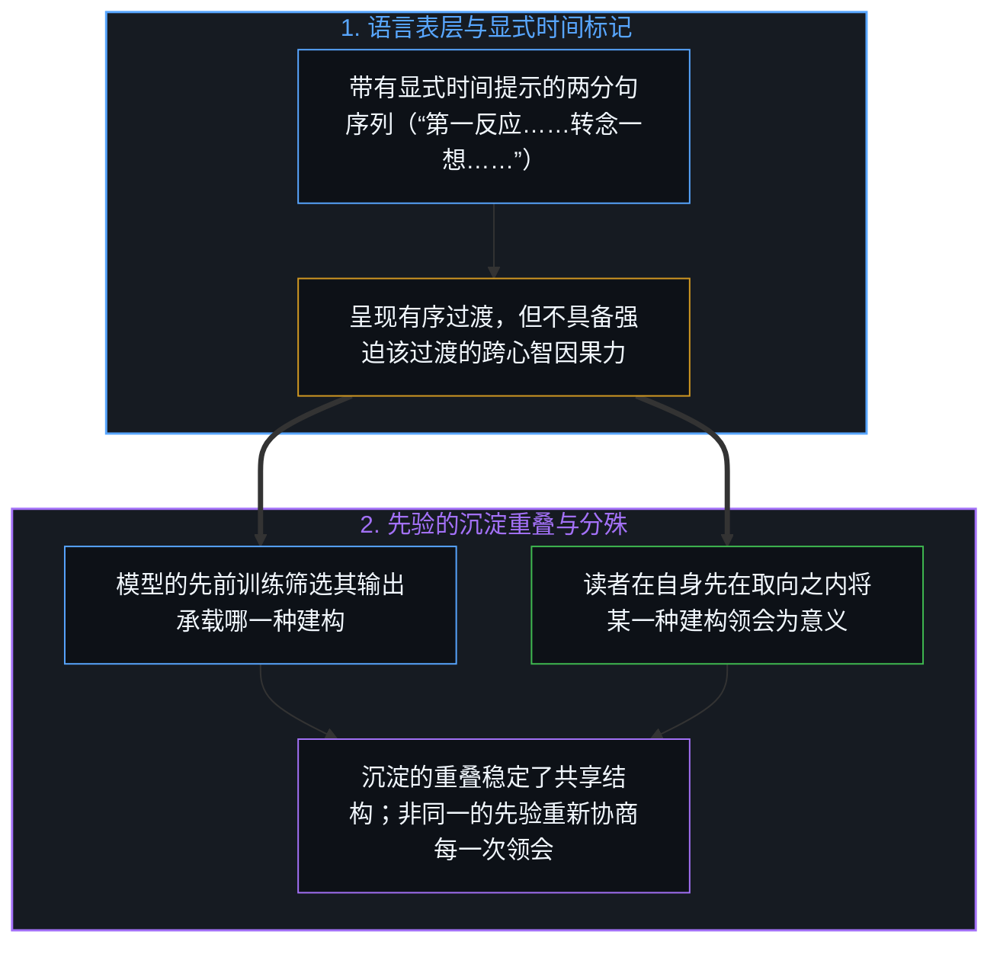
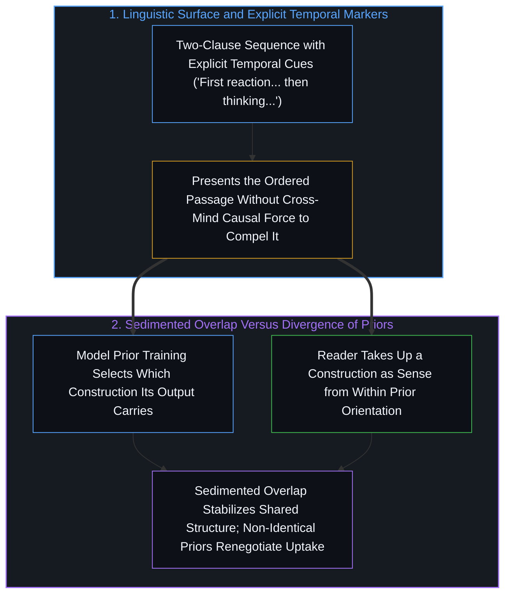

# 接续阅读与协商中的语言边界 / Successive Reading and the Negotiated Boundary of Language

*两分句的撤回活在一种先后次序之中，显式时间标记能把它呈现出来，却无法跨过先验相互重叠的边界去强迫它。 / A two-clause withdrawal lives in a temporal order that explicit markers present but cannot compel across a boundary of overlapping priors.*

自我区分的活动发生着——无因，不息。称之为“心智”：那已然在途的观察者，其每一行动皆是一次区分。当一次区分被落成语言时，这一行动并不会凝固为脱离时间的命题；它在相继的注意时刻中次第展开，后一次切分可以回过身来，指向前一次切分说出时所取的姿态，暴露出[自我形象仿佛从无处发声](../self-image-speaks-as-if-from-nowhere/)所追溯的架势，并将[止步于评判，是认知的歧途](../zhi-bu-yu-ping-pan-shi-ren-zhi-de-qi-tu/)所剖析的向外审视转回第一人称。显式的时间标记能在纸面上呈现这一先后序列，却无法强迫接收者以何种方式领会它；因此语言作为一道边界运作：重叠的先验使它稳定，每一次阅读又重新协商它——这一陈述自身同样处在该条件之下。

Self-distinguishing activity occurs — uncaused, unceasing. Call it the Mind: the observer already underway, every act of which is a distinction. When a distinction is set down in language, the act does not freeze into an atemporal proposition; it unfolds across successive moments of attention, and a later cut can turn back upon the stance from which an earlier cut was spoken, exposing the posture traced in [Self-Image Speaks as if from Nowhere](../self-image-speaks-as-if-from-nowhere/) and turning back the outward scrutiny that [Stopping at Judgment Is a Wrong Turn of Cognition](../zhi-bu-yu-ping-pan-shi-ren-zhi-de-qi-tu/) traces into the first person. Because explicit temporal markers can present that sequence on the page without compelling how a receiver takes it up, language operates as a boundary stabilized by overlapping priors and renegotiated at every reading—a condition to which this account itself remains subject.

## 一、 向外的姿态与接续的回返 / 1. The Outward Stance and the Successive Return

这段简短的序列始于一个面向他人的第一反应。它在姿态上向外迈出一步，把对方的关切当作一件事，仿佛可以站到言说者自身的立足点之外去评判它。这是一种仿佛从别处发声的姿态，却从未真正离开第一人称的位置；因此，第二分句所完成的是一次回返：登记到立足点从来不在别处。

The short sequence begins with a first reaction that addresses another. It steps outward in stance and treats the other’s concern as something that can be assessed as if from a position outside the speaker’s own standing. This is a posture that speaks as if from elsewhere, never an actual exit from the first-person locus, and so what the second clause performs is a return: registering that the standing was never elsewhere.

第二分句随后抵达。它并非针对同一桩外在事务补上一条平行的主张，而是回身指向刚刚记下的那个反应，撤回其立足点，依[印迹与行动](../the-mark-and-the-act/)的方式将记录下的印迹与活的行动分离开来。姿态上的偏离由此既被做出，又被撤销。唯有当这两个时刻按先后次序被接续领会时，这一撤销才完成整个运动。若只读第一分句，向外的姿态便一直悬而未决。若将两个分句当作同时成立的断言来读，它们便彼此矛盾。原本的意旨只存在于从前者向后者的有序过渡之中。

The second clause arrives later. It does not add a parallel claim about the same external matter; it turns back on the reaction just recorded and withdraws its standing, separating the recorded trace from the living act in the manner of [The Mark and the Act](../the-mark-and-the-act/). The departure in stance is thereby both enacted and cancelled. Only when the two moments are taken in succession does the cancellation complete the movement. Read the first clause alone and the outward stance remains open. Read the two clauses as simultaneous assertions and they contradict each other. The intended sense is available solely in the ordered passage from one to the other.

## 二、 显式标记与先在取向 / 2. Explicit Markers and Prior Orientation

然而，即便时间标记已经显式写出，接续的读法也并非由字面印迹本身所担保。文本可以呈现先后次序，却无法强迫接收者将这一次序当作决定性的线索。如[回返的信号与认领](../the-returning-signal-and-its-claim/)与[登记共鸣的表面](../the-surface-that-registers/)所追溯的那样，模型的输出建构与阅读心智的领会依然不同，但在这两种情形下，先在结构都走在文本之前，并收窄了范围：在字面印迹所开放的诸种建构中，哪一种会被产出或被采纳。对于由先前的训练塑造的模型而言，其先验分布筛选了它的输出究竟是把第二分句承载为撤销前句的回返、平行的打发，还是前后矛盾；对于读者而言，把哪一种建构领会为意义则是读者自身的行动，是在既定的注意习惯之内作出的。

Even when the temporal markers are explicit, however, the successive reading is not secured by the marks themselves. The text can present the order; it cannot compel a receiver to treat the order as decisive. As traced in [The Returning Signal and Its Claim](../the-returning-signal-and-its-claim/) and [The Surface That Registers](../the-surface-that-registers/), a model's output construction and a reading Mind's uptake remain distinct, yet in both cases prior structure precedes the text and narrows which of the constructions the marks make available is produced or taken up: for a model shaped by prior training, its prior distribution selects whether its output carries the second clause as a return that undoes the first, as a parallel dismissal, or as a contradiction; for a reader, the construction taken up as sense is the reader's own act, made from within settled habits of attention.

## 三、 既稳定又不断重议的边界 / 3. The Boundary That Stabilizes and Renegotiates

因此，语言作为一道既相对稳定又不断重议的边界而运作——它既不是盛放私人意图、等待被担保理解的容器（[信任读者是最后的越界](../trusting-the-reader-is-the-last-overstep/)），也不是跨越心智的决定论传输管道（[观察者的隐身与无损传递的妄念](../the-invisible-observer-and-the-delusion-of-lossless-transmission/)）。这并非因为字面印迹自身拥有某种独立的力量，而是因为反复使用在接收者的先验之间沉淀出了重叠，每个接收者的先验由此收窄了哪些建构能保持连贯，第一时刻与第二时刻之间的区分也才得以被识别。然而，每一次实际的领会依然处于协商之中，因为接收者的先验资源从不与产出该序列的先验资源同一。这道边界既不会消散为私人意图，也不会硬化为一套强加单一意义的自足编码。交流正跨越这道边界而发生：稳定下来的形式使这一运动成为可能，而从自身先在取向出发阅读的接收者，则完成或不完成这一运动。

Language therefore functions as a boundary that is at once relatively stable and continually renegotiated—neither a vessel of private intent awaiting guaranteed comprehension ([Trusting the Reader Is the Last Overstep](../trusting-the-reader-is-the-last-overstep/)) nor a deterministic pipeline across minds ([The Invisible Observer and the Delusion of Lossless Transmission](../the-invisible-observer-and-the-delusion-of-lossless-transmission/)). Not because the marks exercise an independent power of their own, but because repeated use sediments an overlap among receivers’ priors, each receiver’s prior narrows which constructions remain coherent and makes a distinction between first and second moment recognizable at all. Yet every actual uptake remains under negotiation because the receiver’s prior resources are never identical to those that produced the sequence. The boundary does not dissolve into private intention, nor does it harden into a self-sufficient code that forces a single meaning. Communication occurs across it: the stabilized form makes the movement possible, while the receiver, reading from its prior orientation, completes the movement or does not.

## 四、 处于自身条件之下的陈述 / 4. The Account Under Its Own Condition

这一陈述自身同样受制于同一条件。“必须按先后次序接续阅读”以及“语言是这样一道边界”的主张，唯有在读者本已倾向于把时间次序当作构成性条件而非附带细节时，才会被登记下来。在缺乏这一倾向的地方，这一主张依然向其他建构敞开。边界由此得到了例证，而非被超越。

This account is itself subject to the same condition. The claim that successive reading is required, and that language is such a boundary, can be registered only by a reader already disposed to treat temporal order as constitutive rather than incidental. Where that disposition is absent, the claim remains available for other constructions. The boundary is thereby illustrated rather than transcended.
