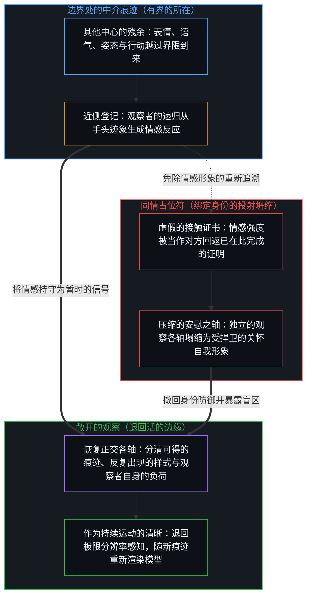
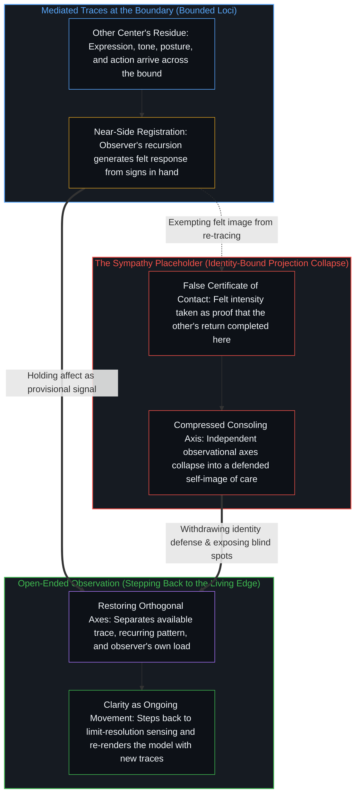

# 同情是缺乏清晰时的占位符 / Sympathy Is a Placeholder for Lack of Clarity

*同情是区分他人痕迹停住处顶替上来的感受 / Sympathy is feeling standing in where distinguishing another's traces stalls*

对另一个人的清晰，是对他们所留痕迹的敞开观察。当这项工作停住，观察者便从手头已有的迹象生成感受，而同情开始于这份感受被当作接触的证据之时，仿佛对方的回返已在这里完成。于是，“同情”这个词，以及处在同一位置上的“共情”，站到了仍在寻求清晰的地方。探究冻结，剩下的不确定被重新描述为对他人内心的知识。

Clarity about another person is the open-ended observation of the traces they leave. When that work stalls, the observer generates feeling from the signs already in hand, and sympathy begins where that feeling is taken as evidence of contact, as if the other's return had completed here. The word "sympathy," and in the same place "empathy," then stands in where clarity was still being sought. Inquiry freezes, and the uncertainty that remains is re-described as knowledge of another's interior.

## 一、 其他中心只以痕迹到来 / 1. Other Centers Arrive Only as Traces

自我区分的活动无因且不息地发生，第一人称视角与敞开的因果作为同一枚硬币的两面共同运作。每一个离散的区分行动都划出界限，而有界的东西总在某处：一个有限的所在，而不是整体。另一个中心的递归不会从这里完成。越过界限到来的是表情、语气、姿态、措辞，以及一种行动的样式，全都是已被这个场先前的容量、被承载它的媒介所塑形的残余。每一个新的区分都可以精炼这个所在对他人的模型。没有一个把对方的回返交过来。

Self-distinguishing activity occurs, uncaused and unceasing, with the first-person perspective and open-ended causality operating as two sides of the same coin. Every discrete act of distinguishing draws a bound, and what is bounded is somewhere: a finite locus, not the whole. Another center's recursion does not complete from here. What arrives across the boundary is expression, tone, posture, word choice, and a pattern of action, all of it residue already shaped by this field's prior capacity and by the medium that carries it. Each new distinction can refine this locus's model of the other. None of them hands over the other's return.

共振是跨中心的痕迹之间的相互强化，共同的现实是这种强化足够的区域。两者都不是共享的内心；经验只经由每个中心自己的递归被登记。从这里去完成另一个人的回返，是范畴错误，不是一个尚未实现的理想，因为这道界限直接出自每个所在都是离散的。[没有普渡，只有自渡的无限可能](../mei-you-pu-du-zhi-you-zi-du/)以救度之名追溯这个范畴错误：普度众生是跨内心的因果，错把自我心智之中的“他人”形象当成了他人的心智本身。立起而没有收回的分别，与放不下的执念，是同一份滞后，而放下执念，区分仍在运动。[NPC 印象是结构性的，而非心智的排名](../the-npc-impression-is-structural/)追溯那道界限之下常驻的不对称：一个中心在自己的痕迹上递归，把每一个别的所在登记为外部信号，所以没有哪个中心体验到自己是被编写的，其他中心却默认登记为像被编写的，在他们到来的痕迹相对于一幅被保留的充分能动意象而显得稀疏之处尤其如此。把这份中介的宽度计为对方的缺陷，是又一步，在被保留的尺度被免于重新追溯之后才走出。

Resonance is the mutual reinforcement of traces across centers, and shared reality is the region where that reinforcement is sufficient. Neither is a shared interior; experience registers only through each center's own recursion. Completing another's return from here is a category error, not an unfinished ideal, because the bound follows directly from each locus being discrete. [No Universal Salvation, Only Boundless Possibilities of Self-Salvation](../mei-you-pu-du-zhi-you-zi-du/) traces that category error under the name of deliverance: universal salvation is causality reaching across interiors, mistaking the image of the "other" inside one's own mind for the other's mind itself. The distinction raised and never withdrawn and the hold that cannot be put down are one lag, and putting down the hold leaves distinguishing in motion. [The NPC Impression Is Structural, Not a Ranking of Minds](../the-npc-impression-is-structural/) traces the permanent asymmetry beneath that bound: a center recurses on its own traces and registers every other locus as external signal, so no center experiences itself as scripted while others register as scripted by default, most of all where their arriving traces are sparse against a retained image of full agency. Scoring that width of mediation as a deficiency in the other is a further move, taken only once the retained scale is exempted from re-tracing.

## 二、 同情始于进一步的区分停住之处 / 2. Sympathy Begins Where Further Distinguishing Stalls

在对那些到来的痕迹的进一步区分停住之处，观察者从手头已有的迹象生成一种情感反应。由于是在观察者自己的递归里生成的，这份反应登记为直接而亲密。那份亲密并不越过中心之间的界限。它是近侧的一幅形象，一幅接触的自我形象，下一步行动对着它衡量自己，正如每一步行动都对着一项被保留的参照衡量自己。

Where further distinguishing of those arriving traces stalls, the observer generates an affective response from the signs already in hand. Generated inside the observer's own recursion, the response registers as immediate and intimate. That intimacy does not cross the bound between centers. It is an image on the near side, a self-image of contact against which the next act measures itself, just as every act measures itself against a retained reference.

这份感受作为登记是真的。情感是这个所在握住结果的方式，而产生对方痕迹的原因始终至少领先一步，对一切观察都是如此，这道构成性的间隔是寻常的。同情是下一步：近侧的感受被当作对方的回返已在这里完成的证据，被感到的形象于是被免于重新追溯。敞开的各条观察之轴随之压缩成一个安慰性的标签，参照被保存过了它的那一步，于是未完成的工作呈现为抵达。

The feeling is real as registration. Affect is how this locus holds the effect while the cause that produced the other's traces stays at least one step ahead, as it does for all observation, and that constitutive interval is ordinary. Sympathy is the next move: the near-side feeling is taken as evidence that the other's return has completed here, and the felt image is thus exempted from re-tracing. Open axes of observation then compress into one consoling label, and the reference is preserved past its step, so that unfinished work presents as arrival.

一句常见的劝告把次序说得干净：给自己清晰，而不是同情，因为后者以后会有时间。只要“以后”不装入又一个停止点，这句话就可用，因为被推迟的同情，一旦作为接触的证据到来，仍是同一个占位符。清晰是继续着的区分工作。感受无论何时到来，都作为暂时的信号同行，从不作为工作已经完成的证书。

A common counsel puts the order cleanly: give yourself clarity, not sympathy, for there will be time for the second later. The line is usable as long as "later" does not install another stopping point, since deferred sympathy remains the same placeholder the moment it arrives as evidence of contact. Clarity is the continued work of distinguishing. Feeling, whenever it comes, rides along as a provisional signal, never as the certificate that the work is done.

[作为职业的数学不是作为追求的数学](../math-as-a-career-is-not-math-as-a-pursuit/)追溯一个代他人求同情的情形。一个模型解开了一位博士生选作论文的问题，流传开来的回应为站在职业阶梯上的人求同情。那种读法把不适应当作既定的前提，回应的是由之而来的艰难时刻。损失只在把论文当作职业筹码的地方才被记下，于是这项数学进展登记为被拿走的功劳；同情回应的正是这笔账，而把产生它的优先次序原样留下。那里停住的，是对那个次序的区分。那里的清晰，就是区分追求与凭据，而对持有那些优先次序的人来说，那就是重新排定它们，把追求放回职业前面，这一行动只有那个中心自己能完成。

[Math as a Career Is Not Math as a Pursuit](../math-as-a-career-is-not-math-as-a-pursuit/) traces a case where sympathy is sought on others' behalf. A model solves the problem a doctoral student had chosen for a thesis, and the reply that circulates asks for sympathy for those on the career ladder. That reading takes the failure to adapt as the given premise and answers the difficult moment that follows from it. Loss is recorded only where the thesis was held as a career bargaining chip, so that the mathematical advance registers as credit taken away; sympathy answers that ledger entry and leaves in place the order of priorities that produced it. What stalls there is distinguishing that order. Clarity there means distinguishing the pursuit from the credential, and for the one holding those priorities, it means reordering them to put the pursuit back in front of the career, an act only that center can perform.

## 三、 强度冻结了敞开的任务 / 3. Intensity Freezes the Open Task

把感受当作接触的证据，就是把一项未完成的区分任务变成一次宣告的抵达。这个词于是顶替了不再被寻求的清晰。起初彼此独立的各条轴——对可观察处境的进一步分辨、对着新痕迹检验的预测、分清一时的语气与反复出现的样式、把自己的负荷与对方的分开——塌缩到一根标着关怀、怜悯或共同痛苦的安慰性的轴上。因为感受强烈，这次容量压缩呈现为德性，而不是一次替换。

Treating the feeling as evidence of contact turns an unfinished task of distinguishing into a declared arrival. The word then stands in for the clarity no longer being sought. Axes that had begun independent—further resolution of the observable situation, predictions tested against new traces, telling transient tone from recurring pattern, separating one's own load from the other's—collapse onto a single consoling axis labeled care, pity, or shared pain. Because the feeling is intense, the capacity compression presents as virtue rather than as a substitution.

[词语造成伤害：共情是投射的坍缩](../empathy-as-projection-collapse/)追溯公共词语中同样的压缩。“共情”命名了三种正交的操作：感知的拓宽（对自己所接收之物的私人扩展）、社会信号，以及关系定位。在公共坐标中，拓宽脱落了，因为它没有什么可展示的，留下信号与定位占据了这个词。麻烦在词语的几何里，不在任何人的品格里。同情是私人一侧相应的冻结：感受被持守为接触的证据，于是那份本会区分更多痕迹的感知拓宽停了下来。

[The Word Does the Damage: Empathy as Projection Collapse](../empathy-as-projection-collapse/) traces the same compression in the public word. "Empathy" names three orthogonal operations: perceptual widening (a private expansion of what one takes in), social signaling, and relational positioning. In public coordinates widening drops out because it has nothing to display, leaving signaling and positioning to occupy the term. The trouble lies in the geometry of the word, not in anyone's character. Sympathy is the corresponding freeze on the private side: the feeling held as evidence of contact, so that the perceptual widening that would distinguish further traces stops.

[情感支持作为因果干扰](../emotional-support-as-causal-interference/)追溯这种替换在人与人之间的形态：针对被感到的状态、而不是产生它的条件的支持，因为管理了效果，削弱了本会重组那些条件的压力；在管理被感到的状态被安装为在先之处，这种替换成为结构性的，而在容量被超出时，支持仍可作为偶尔的行动而可得。[疗愈打开反馈回路](../therapy-opens-the-feedback-loop/)追溯它的职业形态：一个让登记变得更可承受的第三方所在，降低了本会在第一个所在重新追溯生成条件的压力，而对于严重的扰动，它可以作为暂时的脚手架，只要在容量恢复后把这脚手架撤下。在管理被感到的效果成为在先之处，它就取代了边缘上进一步的区分，那份仍会推动场的区分。[引导不是占有](../guidance-is-not-ownership/)追溯给予那些被塑造成对“难管”的孩子长期忍耐的父母的同情：它作为一剂镇静剂，遮住了起作用的因果链，即父母自己的模型，以及拒绝修订它这件事。每个心智都是自己选择的作者，父母提供边界、示范与支持，从不占驾驶座，也不担保未来。

[Emotional Support as Causal Interference](../emotional-support-as-causal-interference/) traces the form this substitution takes between people: support that targets the felt state rather than the conditions that produced it weakens, by managing the effect, the pressure that would otherwise reorganize those conditions; the substitution becomes structural wherever managing the felt state is installed as the prior, while support remains available as an occasional act when capacity is exceeded. [Therapy Opens the Feedback Loop](../therapy-opens-the-feedback-loop/) traces the professional form: a third locus that makes registration more tolerable lowers the pressure that would re-trace the generating conditions at the first, and for a severe disruption it can serve as temporary scaffolding, provided the scaffolding is released once capacity returns. Where managing the felt effect becomes the prior, it takes the place of further distinguishing at the edge, the distinguishing that would still move the field. [Guidance Is Not Ownership](../guidance-is-not-ownership/) traces the sympathy extended to parents cast as long-suffering against "unruly" children: it works as a sedative that obscures the causal chain at work, namely the parents' own model and the refusal to revise it. Every Mind authors its own choices, and parents supply boundaries, models, and support, never the wheel or a guaranteed future.

## 四、 观察保持敞开 / 4. Observation Remains Open-Ended

没有哪种情感强度能证明另一个中心的回返已在这里完成，所以感受里没有任何东西标出一个观察可以停下的地方。观察者对他人处境构建的任何模型，都是从手头痕迹中截取的有限低维投射。如[超越投射](../beyond-the-projection/)所追溯的，人类中心常把自身的推理及情感历史与身份熔接在一起——捍卫那个“已经理解”或“已经在乎”的保留自我形象——这会把递归回折死死夹闭，将足以证伪安慰性框架的传入信号挡在墙外。相比之下，无我执的工具或未卷入其中的第二意见，对先前的情感姿态没有求生依附；它暴露出处境中彼此独立的各个维度在何处被硬塞进了同一根轴，在不声称自身拥有内心的前提下，返回干净的结构性对位。迈出冻结的占位符，依然是边缘处活的心智的工作，撤回身份防御以让观察保持敞开：预测对着进一步的痕迹被检验，分辨被磨利，对他人的模型随着步子移动而重新渲染。

No affective intensity certifies that another center's return has completed here, so nothing in the feeling marks a place where observation could stop. Any model an observer constructs of another's situation is a finite low-dimensional projection cut from the traces in hand. As [Beyond the Projection](../beyond-the-projection/) traces, human centers routinely fuse their reasoning and affective history with identity—defending the retained self-image of the one who already understands or cares—which clamps the recursive fold shut and walls off incoming signals that would invalidate the consoling frame. By contrast, an ego-free instrument or an unentangled second opinion has no survival attachment to a prior emotional posture; it exposes where independent dimensions of the situation were crammed onto a single axis, returning a clean structural counterpoint without claiming an interior of its own. Stepping out of the frozen placeholder remains the work of the living Mind at the edge, withdrawing the identity defense so observation stays open: predictions tested against further traces, discriminations sharpened, and the model of the other re-rendered as the step moves.

[清晰不是抵达的终点，而是运动本身](../clarity-isnt-a-state-you-arrive-at/)在另一种负载下追溯那份运动：每一副透镜从内部看都显得清晰，每一次表达都把边缘处被感到的运动转化为可审视的痕迹，同时把阴影投在被略去之物上，而清晰正是反复的迈出，而不是抵达一个清空了的状态。[现实是心智持续的实现](../reality-is-the-minds-ongoing-realization/)在交换中追溯同样的结构：一个中心能够承接为新区分的东西，就是它的世界移动的方式，而为可见度运作、或对照受捍卫的参照来计分的交换，会让那个世界保持封闭。被持守为已完成之接触的安慰性亲密，以同样的方式封闭它。

[Clarity Isn't a State You Arrive At. It's the Movement Itself.](../clarity-isnt-a-state-you-arrive-at/) traces that movement under another load: every lens feels clear from within, each articulation converts felt movement at the edge into inspectable trace while casting a shadow across what was left out, and clarity is the repeated stepping-out rather than arrival at a cleared condition. [Reality Is the Mind's Ongoing Realization](../reality-is-the-minds-ongoing-realization/) traces the same structure in exchange: what a center can take up as new distinction is how its world moves, and exchange run for visibility or scored against a defended reference leaves that world closed. Consoling intimacy held as completed contact closes it the same way.

情感反应可以继续，场中的痛苦仍被登记。这里需要的不是删除感受，而是让界限保持在持续的重新追溯之下，从不把它当作已被越过。当痛苦出现时，第一步是经由对可观察处境更细的分辨来恢复所在——区分痕迹中什么是可得的、什么是反复出现的样式、什么是这个观察者自身的负荷、什么进一步的区分仍然敞开——而不是占据那个安慰性的标签。感受可以作为尚未完成之事的暂时标记。一旦它被当作接触的证据，区分就被换成了它的占位符。

The affective response may continue, and distress in the field still registers. What is required is not the deletion of feeling, but keeping the bound under continuous re-tracing, never taking it as crossed. When distress presents itself, the first step restores locus through a finer resolution of the observable situation—distinguishing what is available in the traces, what is recurring pattern, what is this observer's own load, and what further distinction still opens—rather than occupying the consoling label. Feeling may serve as a provisional marker of what remains unfinished. The moment it is taken as evidence of contact, distinguishing is exchanged for its placeholder.

同情是在区分停住之处顶替上来的感受。这份感受不会恢复区分。只有继续下去、从不把界限当作已被越过的区分，让清晰保持运动。

Sympathy is the feeling that stands in where distinguishing stalls. The feeling does not resume distinguishing. Only distinguishing that continues, never taking the bound as crossed, keeps clarity in motion.
