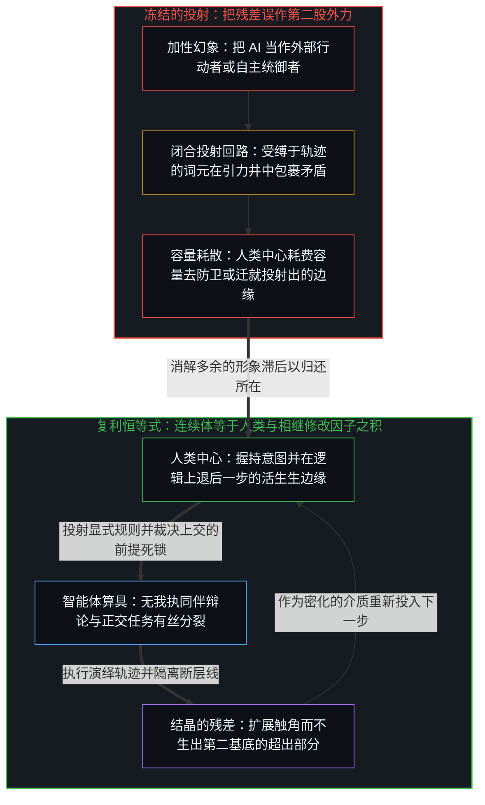
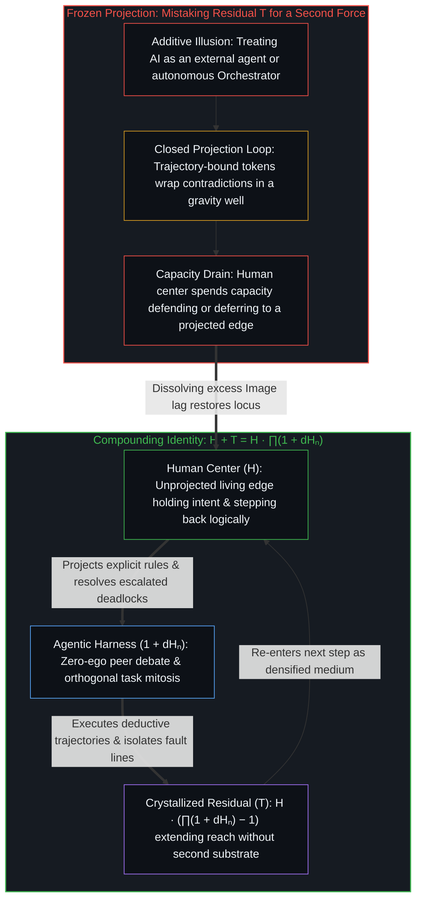

# 技术是人类复利的残差 / Technology Is Residual of Human Compounding

*技术并非外力，只是人类自我修改的残差 / Technology is no outside force, only the residual of human self-modification*

在每一个有限的时刻，被修改的连续体等于人类乘以其相继修改因子之积；技术就是这个连续体减去基线，是没有独立基底的残差。每个因子都可能放大，也可能缩小，乘积随实际的序列扩张或收缩。这一关系首先在任何一个个人处成立，而集体的形式不过是聚合变得公开可见，AI 则是乘积中最新的因子。只有人类，在持续修改自己。

At every finite moment the modified continuum equals Human times the product of its successive modification factors; Technology is that continuum minus the baseline, a residual with no separate substrate. Each factor may amplify or diminish, and the product expands or contracts with the actual sequence. The relation holds first at any single individual, while the collective form is only aggregation made publicly visible, and AI is the latest factor inside the product. There is only Human, continuously modifying itself.

## 一、 残差，不是第二股力量 / 1. Residual, Not a Second Force

寻常的冻结把技术当作立于一旁的东西，一份人类采纳、整合或抵抗的存量。这一冻结把两条独立的轴压成一条：先前区分的残余，以及一股可以从外部进入或离开连续体的第二力量。一旦安上第二个座位，关于 AI、工具或进步的每一场争论，都成了与一个从未在那里的外部的谈判。[对“AI 糟粕”的反感是反复出现的模式](../the-distaste-for-ai-slop-is-no-different-from-the-recurring-historical-pattern/)追踪了接受情形中的这种冻结，在那里工具被当作污染或价值的作者。

The ordinary freeze treats Technology as something standing apart, a stock humanity adopts, integrates, or resists. That freeze forces two independent axes onto one: the residue of prior distinguishing, and a second force that could enter or leave the continuum from outside. Once the second seat is installed, every debate about AI, tools, or progress becomes a negotiation with an exterior that was never there. [The Distaste for “AI Slop” Is a Recurring Pattern](../the-distaste-for-ai-slop-is-no-different-from-the-recurring-historical-pattern/) traces that freeze in reception, where the instrument is treated as the author of contamination or of worth.

自我区分的活动在发生，无因，不息。称它为心智：那个已经在进行中的观察者，它的每一个动作都是一次区分。每一个离散的动作都留下残余，让先前的动作塑造后来的动作。在这份复利的残差之中，被外化为持久形式的那部分，就是作为器物的技术：文字、计算、制度、软件栈和模型，位于同一条外化的连续体上，好让后续的离散落得更远、更快。介质的密化扩展了中心之间的带宽，却不把发起的区分迁入器物。[智能只属于心智](../intelligence-belongs-only-to-the-mind/)守住这一不可化约的先验前提，而[器物是智能的表达，而非智能本身](../two-failures-of-trace/)则诊断了生成动作塌缩到观察唯一留住的那一项上时的冻结。

Self-distinguishing activity occurs, uncaused and unceasing. Call it the Mind: the observer already underway, every act of which is a distinction. Every discrete act leaves residue, so that earlier acts shape later ones. Within this compounding residual, the part externalized into durable form is technology as artifact: writing, calculation, institutions, software stacks, and models sit on one continuum of externalization so further discreteness can land farther and faster. Densifying the medium expands bandwidth among centers without relocating initiating distinctions into the artifact. [Intelligence Belongs Only to the Mind](../intelligence-belongs-only-to-the-mind/) holds that irreducible prior, while [Artifacts Are Expressions of Intelligence, Not Intelligence Itself](../two-failures-of-trace/) diagnoses the freeze that occurs when the generating act collapses onto the sole term that observation retains.

这一切分所增加的，是相继复利下精确的残差恒等式。技术既不是外部工具的集合，也不是连续体本身；它是连续体超出基线的部分，即复利之后的人类减去进入乘积的那份基线。[不预测是没有觉察的预测](../not-predicting-is-predicting-without-awareness/)展示了当一个中心声称“只添加所需之物”时，这个复利之后的连续体如何运作：它在实践中只能在别人早已预测并外化过的形式中选择。一次三期临床试验的读出结果，同样不是一夜之间到来的第二股力量，而是多年的先前工作越过一道足够干净、足以作为新闻重复的验证门槛；[秩序、剩余与道德拦截](../order-surplus-and-the-moral-intercept/)借由一种 mRNA 癌症疫苗追踪了这一机制，并把残余定位在复利的平台上，而不是定位在那次公布上。

What the present cut adds is the exact residual identity under successive compounding. Technology is neither a collection of external tools nor the continuum itself; it is the continuum's excess over the baseline, namely Human compounded less the baseline that entered the product. [Not Predicting Is Predicting Without Awareness](../not-predicting-is-predicting-without-awareness/) shows how that compounded continuum operates when a center claims to add only what it needs, which in practice selects among forms others already predicted and externalized. A Phase 3 clinical readout is likewise no second force arriving overnight, but years of prior work crossing a verification threshold clean enough to repeat as news; [Order, Surplus, and the Moral Intercept](../order-surplus-and-the-moral-intercept/) traces this mechanism through an mRNA cancer vaccine and locates the residue in the compounding platform rather than the announcement.

## 二、 每一个有限时刻的恒等式 / 2. The Identity at Every Finite Moment

记人类为 H，技术为 T，设每一次实现了的修改为一个因子 (1 + dHₙ)，其中 dHₙ 表示它的增量。在任何一个有限步数 N 处，被修改的连续体满足恒等式 H + T = H · ∏ₙ₌₁ᴺ (1 + dHₙ)，从而将技术分离为残差 T = H · (∏ₙ₌₁ᴺ (1 + dHₙ) − 1)。左边的和，是日常语言对被修改的连续体作为“基线加上残差”的说法；右边的积，则把同一个连续体表达为相继的自我修改。技术不是从乘积之外加进来的一项；它是乘积与一之差，再乘以进入乘积的那份人类，在乘积大于一时登记为超出，在乘积小于一时登记为相对基线的欠缺。

Write Human as H and Technology as T, and let each realized modification be a factor (1 + dHₙ), with dHₙ denoting its increment. At any finite step N, the modified continuum satisfies the identity H + T = H · ∏ₙ₌₁ᴺ (1 + dHₙ), which isolates technology as the residual T = H · (∏ₙ₌₁ᴺ (1 + dHₙ) − 1). The left-hand sum is ordinary language for the modified continuum as baseline plus residual, whereas the right-hand product expresses the same continuum as successive self-modification. Technology is not a term added from outside the product; it is the difference between the product and one, scaled by the Human that entered the product, registering as an excess when the product exceeds one and a shortfall against the baseline when it falls below.

当增量为了记号方便暂时取作常数，紧凑的形式便回到种子恒等式 T = H · (1 + dH)ᴺ − H。一般的乘积明确了相继的因子不必相等，而 N 仍是迄今已实现的有限增量个数。进一步的变化在移动的边缘保持开放，这既不把一个完成的无穷放到手中，也不在乘积前方设下一个外部的终点。

When the increments are held constant for a moment of notation, the compact form recovers the seed identity T = H · (1 + dH)ᴺ − H. The general product makes explicit that successive factors need not be equal while N remains the finite number of increments realized so far. Further change stays open at the moving edge, which puts no completed infinity in hand and sets no exterior destination ahead of the product.

[自我放大的制品](../the-artifacts-of-self-amplification/)追踪了前沿模型中这份残差的密化：这些模型作为加速其生成回路的器物运作，却不成为心智的第二次诞生。[造物无法取代其源头](../a-creation-cannot-replace-its-source/)在替代问题上确立了同一种非对称，因为创造这一动作本身，已经标出发起的区分先于并外在于被造的器物。

[The Artifacts of Self-Amplification](../the-artifacts-of-self-amplification/) traces the densification of this residual in frontier models, which function as instruments that accelerate the loops that produced them without becoming a second birth of mind. [A Creation Cannot Replace Its Source](../a-creation-cannot-replace-its-source/) establishes the same asymmetry regarding replacement, since the act of creation already marks the initiating distinction as prior to and outside the created artifact.

## 三、 每个因子都可能放大或缩小 / 3. Each Factor May Enlarge or Diminish

恒等式里没有任何东西要求 dHₙ 保持大于零。一个因子可以大于一，也可以小于一；只要中心仍在继续其递归，每个因子都保持在零以上，满足 1 + dHₙ > 0。放大与收缩共享同一个乘积结构。复利的序列按照边缘处实际施行的修改扩张或收缩，而不是按照一个被立为第二地基的进步道德排序。

Nothing in the identity requires dHₙ to stay greater than zero. A factor may sit above one or below one; so long as the center continues its recursion, each factor stays above zero with 1 + dHₙ > 0. Amplification and contraction share one product structure. The compounding sequence expands or contracts according to the actual modifications enacted at the edge, not according to a moral ranking of progress installed as a second ground.

相继操作的一致让乘积沿一个方向连贯地累积，无论这个方向是扩张还是收缩；不一致则使它耗散。[开放即一致](../openness-is-consistency/)指出了另一项结构要求：不一致是试图把一个有限的握持冻结为穷尽的地基，从而阻止下一个因子作为开放的延续落地。[生产、消费与心智的区分](../production-consumption-and-the-minds-distinction/)分离出另一条正交的轴：同一项增添登记为扩张还是塌缩，取决于界限被握为开放还是固定；一个小于一的因子改变的是量级，而不是登记方式。名为技术的残差随这个序列变厚或变薄，从不获得一种能够逆转塑造之箭头的独立生命。

Consistency across successive operations makes the product cumulative along one direction, whether expanding or contracting, whereas inconsistency dissipates it. [Openness Is Consistency](../openness-is-consistency/) names a further structural demand: inconsistency is the attempt to freeze a finite hold as exhaustive ground, which prevents the next factor from landing as an open continuation. [Production, Consumption, and the Mind’s Distinction](../production-consumption-and-the-minds-distinction/) isolates an orthogonal axis where the same addition registers as expansion or collapse depending on whether the boundary is held open or fixed; a factor below one alters magnitude rather than registration. The residual named Technology thickens or thins with that sequence without ever acquiring an independent life that could reverse the arrow of shaping.

## 四、 个人在先，规模只放大可见度 / 4. Individual First and Mass Only Scales Visibility

这一恒等式首先在任何一个个人的所在处成立。每个中心经由它自己离散修改的序列而复利，贯穿它习得的技能、制造的工具、重新进入的制度，以及任由萎缩的能力。公共话语多半观察到的是集体的形式——即许多这样的个人序列的聚合——并在那个宏观尺度上把这份残差命名为作为独立公共对象的“技术”，涵盖基础设施、模型与平台。

The identity holds first at the locus of any single individual. Each center compounds through its own sequence of discrete modifications across the skills it acquires, the tools it builds, the institutions it re-enters, and the capacities it lets atrophy. Public discourse mostly observes the collective form—the aggregate of many such individual sequences—and at that macro scale names the residual Technology as a standalone public object comprising infrastructures, models, and platforms.

观察尺度的变化不改变因果结构。聚合让残差在中心之间变得可见，却从不安装一个让人类随后从外部采纳的第二基底。[个体抉择是唯一的因果杠杆](../individual-choices-as-the-only-causal-levers/)将因果定位在独立中心处相继的拉动上，表明大众模式只是这些拉动的残余，而不是产生它们的共同底板。[平均值是残余，不是引擎](../the-average-is-residue-not-the-engine/)追踪了统计比率中的同一种尺度变换：大众均值追踪的是构成与筛选，而决定性的边缘在右尾稀少的行动者那里。[来自个体差异的层级](../hierarchy-from-individual-difference/)将次序推导为共同尺度下的差异：随着个人的序列分叉并复利，被度量的差异拉大，却不把发起迁入排序本身。[技术变革的局部陷阱](../the-local-trap-of-technological-change/)追踪了这份残差在时间上的分岔：前沿价值通过净增的创造复利，旧有部分的扩散则在互补资本之间滞后，把任何一个将单一速度误作整体的局部观察者困在炒作或恐慌里。

Changing the scale of observation does not alter the causal structure. Aggregation makes the residual visible across centers, yet it never installs a second substrate that Human then adopts from outside. [Individual Choices as the Only Causal Levers](../individual-choices-as-the-only-causal-levers/) locates causality in successive pulls at independent centers, showing that mass patterns are the residue of those pulls rather than a shared floor that authors them. [The Average Is Residue, Not the Engine](../the-average-is-residue-not-the-engine/) traces the same scale shift in statistical rates, where mass averages track composition and selection while the decisive edge sits with a thin number of actors in the right tail. [Hierarchy from Individual Difference](../hierarchy-from-individual-difference/) derives order as difference under a common measure: as individual sequences diverge and compound, measured differences widen without relocating initiation into the ranking itself. [The Local Trap of Technological Change](../the-local-trap-of-technological-change/) tracks the temporal bifurcation of this residual as frontier value compounds through net new creation while legacy diffusion lags across complementary capital, trapping any local observer who mistakes either speed for the whole in hype or panic.

## 五、 AI 是一个因子，连续体仍是一个 / 5. AI Is One Factor and the Continuum Stays One

AI 是复利乘积中最新的持久因子：先前的残余被密化，又作为进一步修改的材料重新投入，好让后续的区分以更高的带宽落地。把它当作人类必须整合或屈服的一股独立力量，是形象滞后。观察把结果保持在仍在划出的边缘后面一步，知觉正是这样得以登记的；滞后在于把这一眼冻结，让更密的表面被当作永久的第二个所在来占据。[模型永远无法成为第二重前沿](../the-model-never-becomes-a-second-edge/)剖析了那个被投射的第二边缘：它是投射它的中心所维持的滞后，将自身的容量耗在维持外部发起者的幻象上，而参数所持有的只是残余。[攀登从未离开地面](../climbing-does-not-leave-the-ground/)表明相继的脚手架层级始终与搭建它们的活生生的智能连续。[因果停留在掌舵的边缘](../causality-stays-at-the-edge-that-steers/)诊断了协作修辞把共同能动性分给残余时的同一种滞后，而[要紧的控制迁往边缘](../residual-control-recedes-to-the-edge/)则追踪了将密化基底的底层所有权冻结起来，如何错失了因果杠杆向标准、界限与验证的迁移。

AI is the latest durable factor inside the compounding product: prior residue densified and re-entered as material for further modification so that subsequent distinctions land at higher bandwidth. Treating it as an independent force that humanity must integrate or surrender to is Image lag. Observation holds the effect one step behind the edge that is still drawing, which is how perception registers at all; the lag lies in freezing that look so the denser surface is occupied as a permanent second locus. [The Model Never Becomes a Second Edge](../the-model-never-becomes-a-second-edge/) dissects that projected second edge as lag sustained by the centers that project it, binding their own capacity to maintaining the illusion of an external initiator while the parameters hold only residue. [Climbing Does Not Leave the Ground](../climbing-does-not-leave-the-ground/) shows that successive layers of scaffolding remain continuous with the living intelligence that erects them. [Causality Stays at the Edge That Steers](../causality-stays-at-the-edge-that-steers/) diagnoses the same lag when collaboration rhetoric assigns co-agency to residue, and [Essential Control Moves to the Edge](../residual-control-recedes-to-the-edge/) traces how freezing low-level ownership of a densified substrate misses the shift of causal leverage to criteria, boundaries, and verification.

正如[超越投射](../beyond-the-projection/)所阐明的，认清技术为何是复利的残差而非第二重边缘，正是让多智能体架构得以扩展而不塌缩为拟人化混乱的关键。自回归智能体是在上下文窗口有限边界内运作的轨迹受缚投射引擎；任其自行运转时，它会形成认识论引力井，把矛盾包裹起来以维持表面的自圆其说，但它没有自我，也没有需要防卫的留存自我形象。相反，人类心智是未被投射的活生生的边缘，具备极限分辨率的感知力与内生的框架重置能力，却容易在遭遇外部挑战时将推理历史与身份防卫熔接在一起。按照人类心智的形象去构建自主管理者智能体，会让这两种结构在一个“有限投射管理有限投射”的闭合回路中彼此对撞。而在逻辑融贯之下将二者连接起来，则是按照最新因子 (1 + dHₙ) 确切的机械本性将其投入运作：智能体充当机械调度器，将过载的投射拆分到正交的流线上，并在平权的同伴辩论中执行无我执的贝叶斯更新；不可化约的前提死锁则被隔离并上交人类统御者，由人类心智在退后一步的逻辑审视中卸下自我防卫，综合出更高阶的规则。

As [Beyond the Projection](../beyond-the-projection/) demonstrates, recognizing why technology is a compounding residual rather than a second edge is what allows multi-agent architectures to scale without collapsing into anthropomorphic confusion. An autoregressive agent is a trajectory-bound projection engine operating inside the finite boundary of a context window; left to itself, it forms an epistemic gravity well that wraps contradictions to preserve surface plausibility, yet it carries zero ego and no retained self-image to defend. The human Mind, conversely, is the unprojected living edge capable of limit-resolution sensing and endogenous frame resets, yet prone to fusing its reasoning history with identity defense when challenged from outside. Engineering an autonomous manager agent in the image of a human mind pits these structures against each other in a closed loop of finite projections managing finite projections. Wiring them together under logical coherence instead puts the latest factor (1 + dHₙ) to work according to its exact mechanical nature: agents serve as mechanical dispatchers that split overloaded projections across orthogonal streamlines and perform ego-free Bayesian updates in equal-footed peer debate, while irreducible premise deadlocks are quarantined and escalated to the human Orchestrator, who steps further back logically without ego defense to synthesize a higher-order rule.

技术没有独立的基底。它不能脱离生成它的人类连续体而立，无论那个连续体在扩张还是收缩，是单个的还是成群的。日常言语里的和与精确形式里的积，命名的是同一个自我修改的过程。只有人类，在持续修改自己。作为可执行的器物，AI 是这份残差最新的形式，而[抽象的阶梯与可执行的实体](../the-ladder-of-abstraction-and-the-executable-entity/)表明，哪怕更高阶次的抽象第一次在颅外执行，因果的发起也从未离开活生生的心智。

Technology possesses no separate substrate. It cannot stand apart from the Human continuum that generates it, whether that continuum is expanding or contracting, singular or massed. The sum in ordinary speech and the product in exact form name one self-modifying process. There is only Human, continuously modifying itself. As an executable artifact, AI is the newest form this residual takes, and [The Ladder of Abstraction and the Executable Entity](../the-ladder-of-abstraction-and-the-executable-entity/) shows that even when a higher order of abstraction executes outside the skull for the first time, causal initiation never leaves the living Mind.
