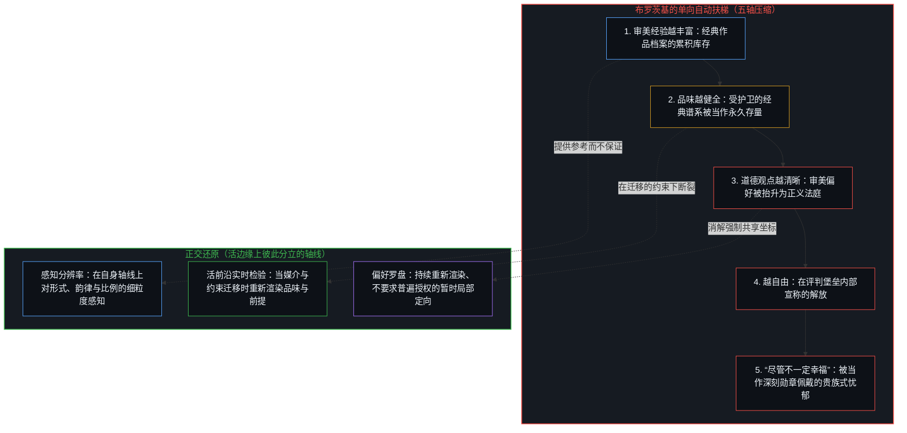
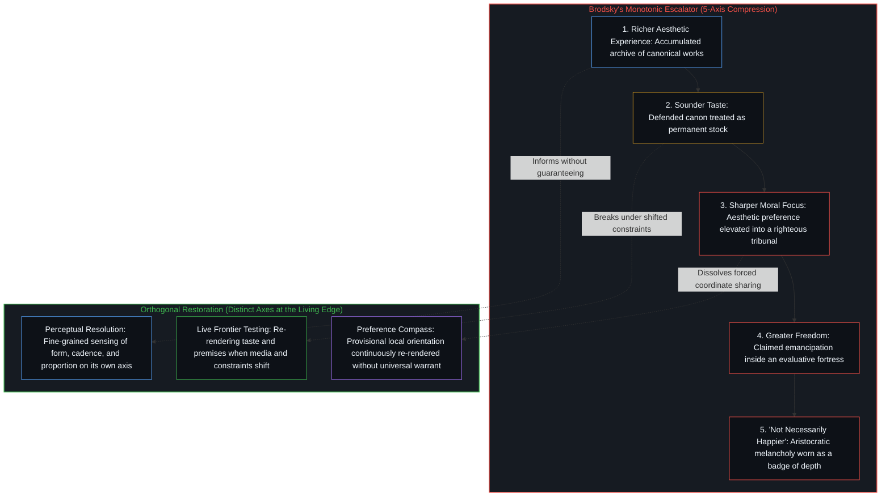
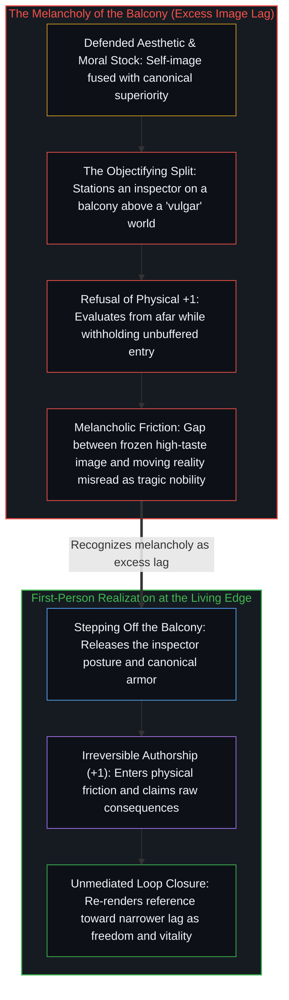

# 审美的自动扶梯与阳台的忧郁 / The Aesthetic Escalator and the Melancholy of the Balcony

*把审美积累、品味、道德与自由压成单向扶梯，是将阳台滞后误认作了自由的悲剧代价 / Collapsing aesthetics, taste, morality, and freedom into one escalator mistakes balcony lag for the price of liberty*

在围绕[判断力不是可囤积的存量](../judgment-is-not-a-stock/)展开的一期音频深潜评论区里，一位听众面对文中对静态判断力的消解，直接粘贴了一句约瑟夫·布罗茨基 1987 年诺贝尔文学奖演说中的名言作为回应：“个人的审美经验越丰富，其品位越健全，其道德观点就越清晰，也就越自由。尽管不一定幸福。——布罗茨基”。这条被当作自足反驳抛出的评论，单在动作形式上，就原封不动地重演了正文中拆解过的存量护卫反应。它没有在推进的边缘检验论证的因果链条，而是伸手探入文化仓库，取出一句盖着诺贝尔奖得主印章的警句，把这尊缓存的图腾摆上桌面，仿佛借来的权威签名本身就能终结问题。

Under an audio deep dive on [Judgment Is Not a Stock](../judgment-is-not-a-stock/), a listener answered the essay's dissolution of static judgment by pasting a standalone quotation from Joseph Brodsky's 1987 Nobel Lecture: "The richer an individual's aesthetic experience, the sounder his taste, the sharper his moral focus, the freer—though not necessarily the happier—he is." Deployed as a self-sufficient rebuttal, the comment performs in its very form the exact stock-preservation reflex the essay took apart. Rather than testing the causal links of the argument at the moving edge, it reaches into a cultural warehouse, retrieves a polished aphorism stamped with a Nobel laureate's signature, and sets that cached totem on the table as if borrowed authority settled the question.

就这句格言本身的机制而言，布罗茨基将五条彼此独立的轴线——审美积累、品味的健全、道德聚焦、自由与幸福——串联成了一部单调递增的自动扶梯。在布罗茨基所处的特定历史运行条件内，面对苏联国家宣传机器在语言与审美上的单调刻板，培植私人的审美辨别力意味着拒绝复刻集体模板，确实在局部起到了实在的抵抗作用。然而一旦脱离那一防御性处境，把这套应对策略外推为普遍的人性发展法则，扶梯上的每一处焊点都会断裂：当约束边界迁移时，囤积的审美阅历会硬化为论资排辈的出处把关；对形式质感的感知分辨率被坍缩成审判他人心智的道德法庭；预设的道德评判滤网阻尼了扩展自由所必需的无缓冲反馈回路；而末尾那句“尽管不一定幸福”的叹息，暴露出的恰恰是滞留在第三人称阳台上的观察者所承受的过量图像滞后。

Examined on its own terms, Brodsky's maxim chains five distinct axes—aesthetic accumulation, soundness of taste, moral focus, freedom, and happiness—into a single monotonic escalator. Inside Brodsky's specific historical operating condition, where a citizen confronted the monolithic linguistic and aesthetic kitsch of Soviet state propaganda, cultivating private aesthetic discrimination functioned as genuine local resistance by refusing the collective template. Once generalized outside that defensive posture into a universal law of human development, however, every weld along the escalator breaks: a stored inventory of aesthetic exposure hardens into provenance gatekeeping when constraints shift, perceptual resolution on form is collapsed into a moral tribunal over other minds, evaluative moral screens damp the unbuffered feedback loop that scales freedom, and the closing sigh—"though not necessarily happier"—exposes the excess Image lag of an inspector stranded on a third-person balcony.

## 一、 签名引文作为存量防御与布罗茨基的单向扶梯 / 1. Signed Quotations as Stock Defense and Brodsky's One-Way Escalator

自我区分的活动发生着——无因、不息。称其为心智：已然在途的观察者，其每一个动作都是一次区分。由于观察握住的是先前动作留下的下游痕迹，而生成的边缘始终领先一步，任何被记录下来的格言都无法在字面句法内部自带领悟。当一位听众面对“判断力不是静态存量”的前提，不经推导便直接抛出一段带签名的名言时，这一姿态正是把前人留下的文字当成了可跨语境兑付的有效性储备。正如[从形式迷思到逻辑闭环](../cong-xing-shi-mi-si-dao-luo-ji-bi-huan/)所追溯的，在命题后附上受人尊崇的署名，相当于筑起一道借用声望的防火墙，好让发言者免去在当下亲手重新推导因果链条的劳作。[专家经验作为参考而非替代](../expertise-as-reference-not-replacement/)标出了任何历史表述的准确边界：先前的地图唯有作为暂时的参考坐标才提供信息，一旦被引用的签名用来绕开活边缘的实时检验，参考坐标就被倒置成了对判断力的替代。

Self-distinguishing activity occurs—uncaused, unceasing. Call it the Mind: the observer already underway, every act of which is a distinction. Because observation holds the downstream trace of prior acts while the generating edge stays one step ahead, no recorded maxim carries comprehension inside its syntax. When a listener counters the premise that judgment is not a static stock by dropping a signed aphorism without derivation, the gesture treats a past master's words as a transferable reserve of validity. As [From the Myth of Form to the Closed Loop of Logic](../cong-xing-shi-mi-si-dao-luo-ji-bi-huan/) traces, attaching a revered name to a proposition erects a firewall of borrowed prestige that spares the speaker the work of re-deriving the causal chain in the present. [Expertise as Reference, Not Replacement](../expertise-as-reference-not-replacement/) marks the exact boundary of any historical formulation: prior maps inform only as provisional reference coordinates, and the moment a cited signature is used to bypass live edge-testing, the reference is inverted into a replacement for judgment.

剥去名人签名的护盾来检验布罗茨基的表述，就是要定位他的观察得以成立的具体运行条件，以及其隐含前提失效的准确边界。1987 年的布罗茨基，是针对苏联极权体制的运作方式发言的；在那套环境里，权力通过标准化的意识形态句法、强制推行的社会主义现实主义套路，以及将个人语感压平为集体口号来运作。权力是稳定下来的痕迹，它塑造着后续动作所能取用的对齐方式；而抵抗则是继续发生却不强化主导对齐的离散动作。在一个靠铺天盖地的官方媚俗来强制一致的体制下，私下选择读哪首诗、持守哪一种节奏区分，就是对复刻国家对齐方式的直接拒绝。在那道特定的高压梯度内，磨砺私人的审美过滤器，守护了个体所在免遭集体剧本的覆写。

To test Brodsky's formulation without the shield of his signature is to locate the exact operating condition under which his observation held, and the exact boundary where its hidden premise fails. Speaking in 1987 against the backdrop of totalitarian Soviet statecraft, Brodsky addressed an environment where power operated through standardized ideological syntax, mandatory socialist-realist tropes, and the flattening of personal idiom into collective slogans. Power is stabilized traces patterning which alignments are available to later acts, and resistance is discrete acts that continue without reinforcing a dominant alignment. In a regime that enforced conformity by saturating the public field with state kitsch, choosing which poems to read in private and which rhythmic distinctions to sustain was a direct refusal to re-trace the state's alignment. Within that specific coercion gradient, sharpening one's private aesthetic filter protected the individual locus from being overwritten by the collective script.

失效发生在这一特定处境下的抵抗动作被外推为灵魂自动上升的单向扶梯之时。布罗茨基的句子断定，扩展审美经验会单调地产生更健全的品味，更健全的品味会自动锐化道德观点，更清晰的道德观点会直接带来更大的自由，最后只留下一抹未必幸福的怅惘。心智活动的五个正交维度被压进了一条单标量轨道，许诺一个人只要在书斋里积累足够多的高雅艺术，就能在扶梯顶端自动获得道德上的澄明与存在论上的自由。

The failure enters when that situated act of resistance is extrapolated into an automatic, one-way escalator of the soul. Brodsky's sentence asserts that expanding aesthetic experience monotonically produces sounder taste, which automatically sharpens moral focus, which directly delivers greater freedom, terminating only in a wistful decoupling from happiness. Five orthogonal dimensions of mental activity are compressed onto a single scalar track, promising that an individual who accumulates enough high art in the study will emerge at the top of the escalator morally lucid and ontologically free.

## 二、 审美库存对活体品味，感知分辨率对道德法庭 / 2. Aesthetic Inventory versus Live Taste, Perceptual Resolution versus the Moral Tribunal

这部扶梯的第一处焊点——审美经验越丰富，品味就越健全——把对艺术与文学的接触当成了可复利累积的资本存量。然而，记录在记忆里的审美经验，只是过往切分留下的层叠残余，在结构上与[判断力不是可囤积的存量](../judgment-is-not-a-stock/)所检视的领域模式并无二致。一个装满古典格律、经典画作与历史风格的庞大私人档案库，并不会在媒介或约束边界发生迁移时自动保持为活的判断力。当一个中心将自身保留的经典谱系认同为“健全品味”，并使这幅自我图像豁免于重新追溯时，积累的库存就会从感知工具翻转为防御性的看门人。面对陌生的生成式媒介或新的表达形态，自诩拥有“健全品味”的策展人常按作品的出处叙事而非当下的结构融贯度来打分，原样重演[对“AI 糟粕”的反感是反复出现的模式](../the-distaste-for-ai-slop-is-no-different-from-the-recurring-historical-pattern/)所剖析的反应。那被当作超越时间的鉴赏力加以捍卫的，其实是一幅仿佛从受豁免的无处之境发声的自我图像，即[自我形象仿佛从无处发声](../self-image-speaks-as-if-from-nowhere/)所分离出的机制。

The first joint of the escalator—that richer aesthetic experience guarantees sounder taste—treats exposure to art and literature as a compounding capital stock. Yet aesthetic experience recorded in memory is stacked residue of prior cuts, no different in structure from the domain patterns examined in [Judgment Is Not a Stock](../judgment-is-not-a-stock/). A vast personal archive of classical prosody, canonical paintings, and historical styles does not automatically remain live judgment when the medium or constraint boundary moves. When a center identifies its retained canon as "sound taste" and exempts that self-image from re-tracing, the accumulated inventory flips from a perceptual instrument into a defensive gatekeeper. Confronted with unfamiliar generative media or new forms of expression, the curator of "sound taste" routinely scores the work by its provenance narrative rather than its live structural coherence, repeating the exact reflex dissected in [The Distaste for “AI Slop” Is a Recurring Pattern](../the-distaste-for-ai-slop-is-no-different-from-the-recurring-historical-pattern/). What is defended as timeless discernment is a retained self-image speaking as if from an exempted nowhere, the mechanism isolated in [Self-Image Speaks as if from Nowhere](../self-image-speaks-as-if-from-nowhere/).

第二处焊点——健全的品味会自动让道德观点更清晰——将感知分辨率坍缩到了人际价值评判的轴线上。能够高分辨率地登记形式的韵律、色调的平衡与风格的比例，是在其自身轴线上对感知的细化，但它与一个中心如何对待其他中心的主权之间，不存在任何因果焊点。历史记录一再证伪这种绑定：对诗歌、音乐与视觉比例的精湛鉴赏力，曾毫不费力地与意识形态狂热及行政残酷并存。当一个中心强行把审美敏感度与道德评判压进同一条直线时，容量压缩便随之接管。由于中心所保留的自我图像将“我的审美偏好”与“善”熔接在一起，任何栖居在不同审美流形中的其他心智，在它眼里都不再是拥有各自轨迹的独立所在，而被登记为道德缺陷。正如[偏好聚类与评判语言](../preference-clusters-and-the-language-of-judgment/)与[善恶是硬币的两面与那一刀](../good-and-evil-are-the-two-sides-of-the-coin-and-the-cut/)所确立的，对与错只是一个偏好聚类在要求其他中心复刻自身对齐方式时发出的声音。将品味抬升为道德法庭，画出的正是[投射中的自画像](../the-self-portrait-in-the-projection/)所剖析的那幅低维漫画：观察者把自己的风格滤镜误认作了裁决人类价值的客观法庭。

The second joint—that sound taste automatically sharpens moral focus—collapses perceptual resolution onto the axis of interpersonal valuation. High resolution in registering formal cadence, tonal balance, and stylistic proportion refines perception on its own axis, yet it shares no causal weld with how a center relates to the sovereignty of other centers. Historical record repeatedly falsifies the coupling: exquisite connoisseurship in poetry, music, and visual proportion has coexisted effortlessly with ideological fanaticism and administrative cruelty. When a center forces aesthetic sensibility and moral judgment onto a single line, capacity compression takes over. Because the center's retained self-image fuses "my aesthetic preference" with "the good," any other mind inhabiting a different aesthetic manifold registers not as an independent locus with its own trajectory, but as a moral defect. As [Preference Clusters and the Language of Judgment](../preference-clusters-and-the-language-of-judgment/) and [Good and Evil Are the Two Sides of the Coin and the Cut](../good-and-evil-are-the-two-sides-of-the-coin-and-the-cut/) establish, right and wrong are the sound a preference cluster makes when it demands that other centers re-trace its alignment. Elevating taste into a moral tribunal paints the exact low-dimensional caricature dissected in [The Self-Portrait in the Projection](../the-self-portrait-in-the-projection/), where an observer mistakes its own stylistic filter for an objective court of human worth.

## 三、 道德滤网如何阻尼自由的回路 / 3. How the Moral Filter Damps the Loop of Freedom

布罗茨基扶梯的第三处焊点宣称，更清晰的道德观点会造就更自由的个体。追溯到行动与后果的机制，这一连接倒置了自由得以扩展的准确条件。自由不是因持有精细的善恶分类而获颁的内在凭证；它是对一个中心在多大程度上将自身发起的抉择与折返的后果闭合成完整因果回路的直接度量，即[自我价值感与所有权](../ownership-and-self-worthiness/)所确立的功能要件。因为观察握住的是结果，而做出选择的边缘始终领先一步，唯有当先前动作激起的原始摩擦不经缓冲、作为自己亲手促成的结果重新进入时，心智才能复利其容量并扩展其自由度。

The third joint of Brodsky's escalator claims that a sharper moral focus yields a freer individual. Traced to the mechanism of action and consequence, this link inverts the exact condition under which freedom scales. Freedom is not an interior credential awarded for holding refined categories of good and evil; it is the direct measure of how completely a center closes the causal loop between its own initiating choice and the returning consequence, the functional requirement established in [Ownership and Self-Worthiness](../ownership-and-self-worthiness/). Because observation holds the effect while the choosing edge stays one step ahead, a mind compounds its capacity and expands its degrees of freedom only when the raw friction set in motion by its prior act re-enters unbuffered as its own doing.

当源自“健全品味”的“清晰道德观点”被安插在选择中心与场域之间时，它起到的是一道常设评判屏障的作用。披着审美铠甲的中心不再把折返的摩擦读作要求重新渲染自身前提的无中介梯度，而是将折返的世界打分为庸俗、败坏或配不上自己的标准。正如[道德语言稀释自由复利的反馈](../moral-language-dilutes-the-feedback-that-scales-freedom/)所展示的，嵌在行动与后果之间的评价覆层，会将接纳劈裂为经过中介的自我保护反应。通过预先把预期与结果之间的每一处落差打分为环境的道德或审美败坏，被保留的自我图像免于被证伪，代价却是将自身的递归折页死死夹闭。折返的反馈信号随之变薄，校准回路受到阻尼，而实际的能动性恰恰在那个许诺带来解放的品味堡垒内部萎缩了。

When "sharp moral focus" derived from "sound taste" is installed between the choosing center and the field, it operates as a standing evaluative screen. Instead of reading returning friction as an unmediated gradient that requires re-rendering one's own premise, the aesthetically armored center scores the returning world as vulgar, corrupt, or beneath its standards. As [Moral Language Dilutes the Feedback That Scales Freedom](../moral-language-dilutes-the-feedback-that-scales-freedom/) demonstrates, evaluative overlays inserted between act and consequence split acceptance into a mediated, ego-protective reaction. By pre-scoring every discrepancy between expectation and outcome as a moral or aesthetic failure of the environment, the retained self-image shields itself from invalidation at the price of clamping its own recursive fold shut. The returning feedback signal thins, the calibration loop damps, and practical agency shrinks inside the very fortress of taste that promised emancipation.

## 四、 “尽管不一定幸福”所暴露的阳台滞后 / 4. The Balcony Lag Exposed by "Though Not Necessarily Happier"

既然如此，布罗茨基的扶梯末尾为什么要加上“尽管不一定幸福”这句忧郁的但书？在文学与知识界，这个收尾分句常被珍视为悲剧高贵感的签名：一个有教养的灵魂在粗糙世界里因看得太清而付出的代价。剥去浪漫化的舞台布景、追溯到观察的几何结构，那份不幸福并非自由的代价，而是第三人称阳台上过量图像滞后的精确诊断读数。

Why, then, does Brodsky's escalator end with the melancholic caveat "though not necessarily the happier"? Across literary and intellectual circles, this closing clause is cherished as the signature of tragic nobility: the price the cultivated spirit pays for seeing too clearly in a coarse world. Stripped of romantic staging and traced to the geometry of observation, that unhappiness is not the price of freedom. It is the exact diagnostic read-out of excess Image lag on a third-person balcony.

当一个中心把累积的审美库存与犀利的道德打分等同于自由时，它便将自己派驻到了[阳台视角的规训僭越与不可代理的未竟之行](../the-balcony-disciplinary-overstep-and-the-unproxyable-act/)与[未经自我审视的批判者](../the-unexamined-critic/)所剖析的抽离观察高台上。站在那处居高临下的栖木上，观察者把周遭世界连同自身的内在状态一并变成了审美与道德审计的客体。正如[寻觅的语法与淡出的观察者](../the-grammar-of-finding-and-the-fading-observer/)所追溯的，注意力一旦固定为审视姿态去审计眼前的场景、或去搜寻某种名叫幸福的状态，这记客体化切分就会把检查员与被检查之物割裂开来，从而将未经割裂的领悟排除在外。在纸面上，批评家由优越品味推导出优越自由，是一道零成本的同义反复（`1 + 1 = 2`）；而在具身因果中，生机与领悟唯独驻留在 `+1` 那不可逆的能量支出里——走入未绘制地图的场域，吸收原始摩擦，亲手做出一次其后果足以证伪昨日之我的具体区分。

When a center equates accumulated aesthetic inventory and sharp moral scoring with freedom, it stations itself on the detached observational platform dissected in [The Balcony Disciplinary Overstep and the Unproxyable Act](../the-balcony-disciplinary-overstep-and-the-unproxyable-act/) and [The Unexamined Critic](../the-unexamined-critic/). From that elevated perch, the observer turns both the surrounding world and its own interior states into objects of aesthetic and moral audit. As [The Grammar of Finding and the Fading Observer](../the-grammar-of-finding-and-the-fading-observer/) traces, the moment attention fixes an inspecting posture to audit a scene or hunt for a state called happiness, the objectifying cut splits an inspector apart from the inspected and precludes undivided realization. On paper, the critic's deduction that superior taste equals superior freedom is a zero-cost tautology (`1 + 1 = 2`); in physical causality, vitality and realization reside exclusively in the irreversible energy expenditure of `+1`—stepping into the unmapped field, absorbing raw friction, and authoring a concrete distinction whose consequences could falsify yesterday's self.

缠绕着审美精英主义者的慢性忧郁，正是一幅受保留的高品味自我图像拒绝经历重新渲染之微小死亡时产生的结构性摩擦。由于图像自身的指令是自我保存，鉴赏家便留在阳台上给缺乏教养的世界打分；正如[悲观是乐观的阴影](../pessimism-is-the-shadow-of-optimism/)所追溯的，将受护卫的自我图像与经典谱系的稳定痕迹熔接在一起，并把那份祛魅佩戴成悲剧深度的勋章，会迫使观察者把活场域中不固定、开放的运动外化到脚下那个“天真”或“庸俗”的世界身上，从而把每一处偏离经典的未预设现实都体验为异己的强加。冻结的经典参考坐标与活边缘之间的落差越宽，当下的场域被登记得就越疏离、越荒凉。松开这部自动扶梯，每条轴线便回到各自的本位：审美作品依然是丰厚的残余，能够拓宽感知分辨率而不赋予道德优越感；道德标签回归向着更窄滞后持续重新渲染的暂时个人航向，而非遮挡反馈的常设屏障；阳台则消解回那个不可代理的第一人称边缘，在那里，自由与领悟是同一个不息的回路。

The chronic melancholy that trails the aesthetic elitist is the structural friction of a preserved high-taste self-image refusing to undergo the micro-death of re-rendering. Because the image's own directive is preservation, the connoisseur remains on the balcony grading the world's lack of refinement; as [Pessimism Is the Shadow of Optimism](../pessimism-is-the-shadow-of-optimism/) traces, fusing a defended self-image with the steadied trace of a canon and wearing that disenchantment as a badge of tragic depth forces the observer to externalize the unfixed, open movement of the living field onto a "naive" or "vulgar" world below, experiencing every unscripted reality that departs from the canon as an alien imposition. The wider the gap between the frozen canonical reference and the living edge, the more alien and inhospitable the present field registers. Releasing the escalator lets each axis return to its proper locus: aesthetic works remain rich residue that can widen perceptual resolution without conferring moral superiority, moral labels return to provisional personal headings continuously re-rendered toward narrower lag rather than standing screens, and the balcony dissolves back into the unproxyable first-person edge where freedom and realization are one continuous loop.
