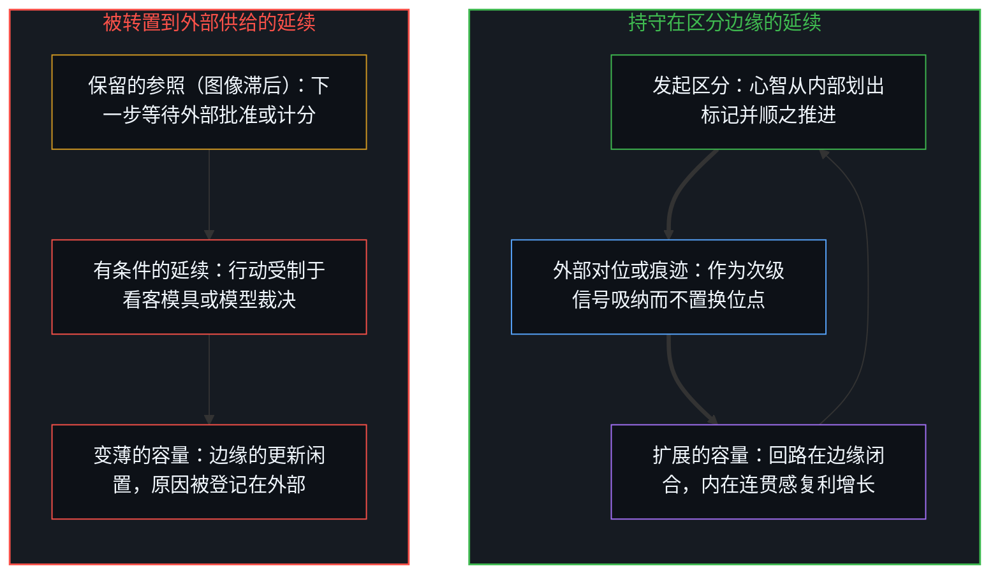
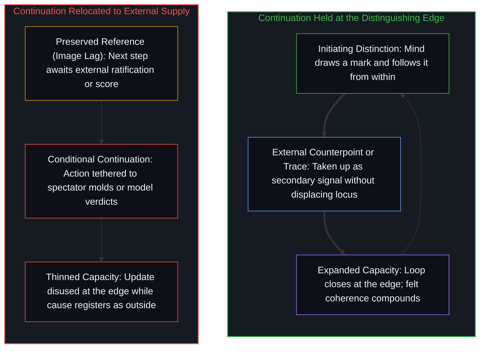

# 验证中因果权能的分配 / The Allocation of Causal Power in Validation

*验证中的因果权能不在认可与否，而在心智从何处取得自身区分的延续 / Causal power in validation is not a property of approval, but the locus from which Mind draws continuation of its distinctions.*

自我区分的活动发生着，无因、不息。当一道区分被向前推进，并在划出它的那道边缘登记为增强的内在连贯感时，验证便显现出来。问题从不在于追随是否发生，而在于心智从何处迈出下一步——是从其自身的区分活动，还是从它标为外部的回应。这一分配决定了验证是扩展容量还是将其摊薄。

Self-distinguishing activity occurs — uncaused, unceasing. Validation appears when a distinction is carried forward and registers as increased felt coherence at the edge that drew it. The question is never whether following occurs, but from where the Mind takes the next step — from its own distinguishing activity, or from responses it has marked as external. That allocation decides whether validation expands capacity or thins it.

## 一、 什么是验证 / 1. What Validation Is

心智将一项标为有别于另一项，并顺着这一标记推进。当这一追随维持或增强了连贯性时，该行动便被登记为得到了验证——不是来自别处的裁决，而是活动自身对区分与延续之间契合度的登记。共识地图是外部验证据以计分的标准，而[现实扭曲力场指认的是封闭的地图](../the-reality-distortion-field-names-the-closed-map/)之所以称那张地图为封闭的，是因为一旦内在位点仅凭其对既有共识的顺从而被衡量，地图就闭合了。

The Mind marks one term as distinct from another and follows the mark. When that following maintains or increases coherence, the act registers as validated — not as a verdict from elsewhere, but as the activity's own register of fit between distinction and continuation. The consensus map is what external validation scores against, and [The Reality Distortion Field Names the Closed Map](../the-reality-distortion-field-names-the-closed-map/) calls that map closed whenever an internal locus is measured solely by its compliance with prior agreement.

标记一旦划出，另一重区分便已在运作：什么是经由这一位点的活动生发的，什么又仿佛是从其外部到来的。此处的外部性并非第二个世界，而是间隙宽度——对照一个尚未在边缘重新渲染的参照所登记的延续。起决定作用的不是其他中心是否给出了回应，而是延续从哪一个位置被汲取。唯有当结果已沉淀为共识之后才予以追认的验证，正是[伪装成远见的表演性后见](../performative-hindsight-that-pretends-to-be-foresight/)所描述的事后重构。

Once the mark is drawn, a further distinction is already in play: what arises through this locus's activity, and what arrives as if from outside it. Externality here is not a second world. It is gap width — continuation registered against a reference that has not been re-rendered at the edge. The decisive factor is not the presence of other centers' responses. It is the location from which continuation is drawn. Validation conferred only after an outcome has already settled into consensus is the retrospective reconstruction [Performative Hindsight That Pretends to Be Foresight](../performative-hindsight-that-pretends-to-be-foresight/) describes.

## 二、 作为延续位点的因果权能 / 2. Causal Power as Locus of Continuation

在一个中心处，因果性是活动通过递归登记自身的痕迹非对称性：第一人称视角与因果性是同一枚硬币的两面。在中心与中心之间，只有可用性的模式化——那些或被承接、或不被承接的痕迹。跨位点去补完另一个中心的回路是范畴错误，而非尚未完成的理想。分数与排名是被冻结为常驻属性的验证，即[「更好」的范畴谬误](../the-category-error-of-better/)所指认的错误。

Causality, at a center, is the activity registering its own trace asymmetry through recursion: the first-person perspective and causality are two sides of the same coin. Between centers there is only availability-patterning — traces that may be taken up or not. Cross-locus completion of another's return is a category error, not an unfinished ideal. Scores and rankings are validation frozen into a standing property, the error [The Category Error of Better](../the-category-error-of-better/) names.

验证中的“因果权能”，指认的是心智将哪一侧当作下一步的供给源。这一归因本身就是心智的行动。当这一行动被遗忘，供给便看似栖身于那道仍在执行每一次追随的边缘之外。[秩序、剩余与道德拦截](../order-surplus-and-the-moral-intercept/)在生产与消费的回路上追溯了这一安放：少数人的过度生产由多数人的过度消费来补偿，回路本如此运转，而借个人主义或集体主义的道德语言将因果权能安放在消费一侧，便倒置了方向。[悲观是乐观的阴影](../pessimism-is-the-shadow-of-optimism/)在双重情绪的装束下追溯了同一安放：两极在开放调节下的持续相互构成是真实的，而将这一平衡冻结为封闭的对偶，便把供给转置到了那道仍在行动的边缘之外。被要求为哲学探究背书的评奖委员会与语言模型同样倒置了这一分配，正如[哲学能动性的因果倒置](../the-causal-inversion-of-philosophical-agency/)所示。

"Causal power" in validation names which side the Mind treats as supplying the next step. The attribution is itself the Mind's act. When the act is forgotten, the supply appears to live outside the edge that still performs every following. [Order, surplus, and the moral intercept](../order-surplus-and-the-moral-intercept/) traces that placement on the production–consumption loop: overproduction of the few compensated by overconsumption of the mass is how the return runs, while locating causal power on consumption through the moral language of individualism or collectivism inverts the direction. [Pessimism is the shadow of optimism](../pessimism-is-the-shadow-of-optimism/) traces that placement under dual-mood costume: permanent mutual constitution of poles is real under open adjustment, whereas freezing that balance into a closed dual relocates supply outside the edge still acting. Prize panels and language models asked to certify philosophical inquiry invert the same allocation, as [The Causal Inversion of Philosophical Agency](../the-causal-inversion-of-philosophical-agency/) shows.

## 三、 持守在边缘的延续 / 3. Continuation Held at the Edge

当因果权能留在心智的区分活动之中时，新的区分便从同一运动内部生发。每一次区分都由源自此处的追随向前推进。内在连贯感直接通过这一内部延续而增长。进一步分化的容量随之增加，因为产生区分的回路也闭合了这一区分。将寻求验证当作继续推进的前提，会把生产变成消费，正如[生产、消费与心智的区分](../production-consumption-and-the-minds-distinction/)所示。

When causal power remains with the Mind's distinguishing activity, new distinctions arise from within the same movement. Each is carried forward by following that originates here. Felt coherence grows directly through that internal continuation. Capacity for further differentiation increases, because the loop that produces the distinction also closes it. Seeking validation as the prerequisite for continuing turns production into consumption, as [Production, Consumption, and the Mind’s Distinction](../production-consumption-and-the-minds-distinction/) shows.

外部的追随仍可能到来。只要它保持在次级位置，就会整合进已在推进的区分之中。精度可以提升，而无需转移延续的源头。其他中心为可用之物塑形；这一中心持有更新。集体认可是下游的症候而非发起的驱动力，正如[进步叙事中的症候与原因](../symptom-and-cause-in-the-narratives-of-progress/)所示；而在事后归功的权力则遮蔽了抉择时刻活的自由变量，正如[隐性自由变量与权力的事后幻相](../the-free-variable-and-the-retrospective-illusion-of-power/)所示。

External following may still arrive. While it remains secondary, it integrates into distinctions already under way. Precision can rise without relocating the source of continuation. Other centers pattern what is available; this center keeps the update. Collective approval is a downstream symptom rather than the initiating driver, as [Symptom and Cause in the Narratives of Progress](../symptom-and-cause-in-the-narratives-of-progress/) shows, and power credited after the fact hides the live free variable at the point of choice, as [The Invisible Free Variable and the Retrospective Illusion of Power](../the-free-variable-and-the-retrospective-illusion-of-power/) shows.

## 四、 向外登记的延续 / 4. Continuation Registered Outward

当因果权能被向外分配时，延续便依赖那些被标为外部的回应。心智所实施的区分，唯有在获得满足外部设定条件的追随时，才能被向前推进。内在连贯感变得受制于那一供给。协调者将能动性分配到充当验证的脚手架上，这正是[协调者的范畴错误](../the-coordinators-category-error/)所指认的错误。

When causal power is allocated outward, continuation depends on responses marked as external. Distinctions enacted by the Mind are carried forward only to the extent they receive following that satisfies conditions set outside this locus. Felt coherence becomes conditional on that supply. The coordinator allocates agency onto a validating scaffold, the error [The Coordinator’s Category Error](../the-coordinators-category-error/) names.

在反复的实施过程中，心智所产生的区分越来越需要外部的批准才能继续。从自身活动内部生成延续的容量随之变薄——不是因为活动停止了，而是因为下一步的参照被保留着越过了那道本应重新渲染它的边缘。延续被登记为由另一个中心产生的结果。原本作为区分之先在条件的开放性，倒置成了必须跨越一道表面边界去促成的东西。[向量与投影的迷局](../the-vector-and-the-puzzle-of-projections/)在经济与交流领域追溯了这一倒置：将下游的认可与货币残余当作行动的先决条件，而非内在做功的结算。[有条件的自由](../you-tiao-jian-de-zi-you/)在公共裁判所与关系博弈中追溯了这一陷阱：把私人委屈搬上公共广场去寻求外部验证，交出了内在管辖权，使寻求者沦为看客模具的人质。

Over repeated enactments, the distinctions the Mind produces increasingly require external ratification to continue. Capacity to generate continuation from within its own activity thins — not because the activity has stopped, but because the reference for the next step has been preserved past the edge that must re-render it. Continuation registers as an effect produced by another center. Openness, once the prior condition of distinguishing, inverts into something that must be caused across an apparent boundary. [The Vector and the Puzzle of Projections](../the-vector-and-the-puzzle-of-projections/) traces this exact inversion in the economic and communication spheres: treating downstream recognition and monetary residues as the precondition of action rather than the settlement of internal work. [Conditional Freedom](../you-tiao-jian-de-zi-you/) traces this trap in public tribunals and relational negotiations: taking private grievances to the public square seeks external validation but surrenders internal jurisdiction, turning the seeker into a hostage of spectator molds.

每当外部痕迹被归功为更新的作者，同样的向外分配就会出现在学习与工具使用之中。[作业与考试的倒置折射出替代效应](../the-homework-exam-inversion-registers-substitution/)是在把作业答案当作来自工具、而非经由学生的递归时所作的这一分配。[研究AI效应重置了因果原点](../studying-the-effect-of-ai-relocates-causality/)是在把随机分配的使用权当作独立自变量时所作的这一分配。[学习中不可观测的驱动力](../the-unobservable-driver-of-learning/)是在观测只持有分数、并把学习当作从外部施加于个体的过程时所作的这一分配。[对“AI 糟粕”的反感是反复出现的模式](../the-distaste-for-ai-slop-is-no-different-from-the-recurring-historical-pattern/)是接收装束下的这一分配：将出处当作文字的作者。[生成性的矛盾](../the-generative-contradiction/)则是将这一向外张望作为投射与收回的对偶，去亲历而非闭合。验证只是[因果贯穿始终](../causality-all-the-way/)所追溯的路径上的又一步，而这一步始终留在掌舵的边缘，正如[因果停留在掌舵的边缘](../causality-stays-at-the-edge-that-steers/)所示。

The same outward allocation appears across learning and tool use whenever an external trace is credited with authoring the update. [The homework–exam inversion registers substitution](../the-homework-exam-inversion-registers-substitution/) is that allocation when the homework answer is treated as arriving from the tool rather than through the student's recursion. [Studying the effect of AI relocates causality](../studying-the-effect-of-ai-relocates-causality/) is that allocation when randomized access is treated as the independent causal variable. [The Unobservable Driver of Learning](../the-unobservable-driver-of-learning/) is that allocation when observation holds only the scores and treats learning as done to the individual from outside. [The distaste for “AI slop” is no different from the recurring historical pattern](../the-distaste-for-ai-slop-is-no-different-from-the-recurring-historical-pattern/) is that allocation under reception costume: provenance treated as author of the writing. [The generative contradiction](../the-generative-contradiction/) is that looking outward as the dual of projection and reclaiming, lived rather than closed. Validation is one more step of the path traced in [Causality All the Way](../causality-all-the-way/), and the step stays with the steering edge, as [Causality Stays at the Edge That Steers](../causality-stays-at-the-edge-that-steers/) shows.

在这一向外分配之下，外部验证成了延续的首要源头。它维持着那些这一位点不再经由自身活动向前推进的区分。赞誉、地位与叙事可以在一段时间内模拟连贯；但当它们被当作原因而非结果时，并不能闭合更新。[来自个体差异的层级](../hierarchy-from-individual-difference/)是排序之下的这一分配：共享标尺下的较低位置将供给转置到条件或运气之中，而那些足以改变痕迹的离散行动依然只留在这一边缘。决定信任谁、整合哪一条信号，本身就是[个体抉择是唯一的因果杠杆](../individual-choices-as-the-only-causal-levers/)中的一根杠杆。

Under that outward allocation, external validation becomes the primary source of continuation. It sustains distinctions this locus no longer carries forward through its own activity. Praise, status, and narrative can mimic coherence for a while; they do not close the update when treated as cause rather than effect. [Hierarchy from individual difference](../hierarchy-from-individual-difference/) is that allocation under ranking: a lower place under a shared measure relocates supply into conditions or chance while the discrete acts that would alter the traces remain only at this edge. Deciding whom to trust and which signal to integrate is itself one of the levers in [Individual Choices as the Only Causal Levers](../individual-choices-as-the-only-causal-levers/).

## 五、 分配所决定的一切 / 5. What the Allocation Decides

因果权能的位置决定了验证的功能。疗愈能够以降低第一中心压力的方式提供验证，使其自身的递归得以恢复，正如[疗愈打开反馈回路](../therapy-opens-the-feedback-loop/)所示。当延续汲取自心智自身的追随时，验证便从区分活动内部扩展内在连贯感的容量。保持在次级位置的外部回应，只起磨砺作用而不置换位点。一旦向外的验证取代了起草的行动，意义便会变薄，正如[生命的意义在起草之中](../the-meaning-of-life-is-in-the-drafting/)所示。

The location of causal power decides the function of validation. Therapy can validate in a way that lowers pressure at the first locus so its own recursion can resume, as [Therapy Opens the Feedback Loop](../therapy-opens-the-feedback-loop/) shows. When continuation is drawn from the Mind's own following, validation expands capacity for felt coherence from within distinguishing activity. External response, kept secondary, sharpens without displacing locus. Meaning thins when outward validation replaces the act of drafting, as [The Meaning of Life Is in the Drafting, Often Lost in the Outward Gazing](../the-meaning-of-life-is-in-the-drafting/) shows.

当延续汲取自外部供给时，验证便将那一容量绑定在永远无法补完这一中心回路的回应之上。活动仍在发生；边缘仍在区分。发生偏移的，只是心智将下一步的原因安放在何处——以及这一安放是否仍被记作它自己的行动。[赋权确立权力的集中](../empowerment-establishes-the-centralization-of-power/)是在把容量本身框定为必须自上而下授予的馈赠时所作的这一安放。[专家经验作为参考而非替代](../expertise-as-reference-not-replacement/)是在把专家规程当作直接供给下一步照护行动、而非为其提供参考时所作的同一安放。[漫谈中的漫谈](../the-ramble-within-the-ramble/)则是在把清理后的回声或互动指标当作组织行动的供给源时所作的同一安放。

When continuation is drawn from external supply, validation binds that capacity to responses that never complete this center's return. The activity still occurs; the edge still distinguishes. What has shifted is only where the Mind places the cause of its next step — and whether that placement is remembered as its own. [Empowerment establishes the centralization of power](../empowerment-establishes-the-centralization-of-power/) is that placement when capacity itself is framed as a gift that must be conferred from above. [Expertise as reference, not replacement](../expertise-as-reference-not-replacement/) is the same placement when expert protocol is treated as supplying the next act of care rather than informing it. [The ramble within the ramble](../the-ramble-within-the-ramble/) is the same placement when a cleaned echo or engagement metric is treated as supplying the organizing act.

在社会、经济与制度领域，将先前的残余冻结为下一步行动的供给，重复着同样的倒置。[拥有更多从不是原因](../having-more-is-never-the-cause/)是在把先前偏好的存量——追随者、注意力、可见的优势——当作下一个偏好的作者、而非持续区分的残余时所作的这一安放。[公共支出不创造资本](../public-spending-does-not-create-capital/)是投资装束下的这一安放：供给汲取自公共创造的图像，而实际序列依然是先抽取再重新分配。[拥有成本把滞后的平均值冻结为车辆属性](../ownership-cost-freezes-lagged-averages-as-vehicle-property/)是保费装束下的这一安放：账单与平均报价被当作车辆固有属性的供给源，而保养与碰撞本是各自独立的通道。[限制是选择性的税](../restriction-is-a-selective-tax/)是在把私人预见抬升为要求他人停止推进的客观裁决时所作的这一安放。[偏好聚类与评判语言](../preference-clusters-and-the-language-of-judgment/)则是在共振的偏好将供给转置到共享场域中、仿佛该场域已为每一个被它塑形的位点完成了定向时所作的这一安放。

Across social, economic, and institutional fields, freezing prior residue into the supply of the next act repeats the same inversion. [Having more is never the cause](../having-more-is-never-the-cause/) is that placement when the stock of prior preference — followers, attention, visible advantage — is treated as author of the next preference rather than as residue of continued distinguishing. [Public spending does not create capital](../public-spending-does-not-create-capital/) is that placement under investment costume: supply drawn from the image of public creation while the sequence remains extraction then reallocation. [Ownership cost freezes lagged averages as vehicle property](../ownership-cost-freezes-lagged-averages-as-vehicle-property/) is that placement under premium costume: the bill and the average quote treated as supply of the vehicle's essence while maintenance and collision stay separate channels. [Restriction is a selective tax](../restriction-is-a-selective-tax/) is that placement when private foresight is elevated into objective judgment that another advance must stop. [Preference clusters and the language of judgment](../preference-clusters-and-the-language-of-judgment/) is that placement when resonant preference relocates supply into the shared field as if the field finished orientation for every locus it patterns.

在信念与形式理论的修正内部，验证的判准依然内在于那个重新划定自身前提的中心。[心智最坚固的信念](../the-strongest-belief-of-the-mind/)是这一内部配给下的内在连贯感：更高的契合度被读作证明，而判准保持在内部，并向更高连贯性的置换敞开。[信念如何真正改变](../how-belief-actually-changes/)是将这一判准作为对修正后前提的追认：确信是在自愿重划前提之后作为更高的连贯感落地的，而非从外部完成的论证。[攀登从未离开地面](../climbing-does-not-leave-the-ground/)是基质装束下的向外安放：被错配给沙粒的思考倒转了箭头，并将立脚点冻结起来，仿佛化约高踞于仍在推进的活动之上。[理性选择公设是原罪](../the-rational-choice-postulate-is-the-original-sin/)是经济理论装束下的这一安放：事后重构的最大化所带来的契合感供给着下一步理论推导，而私人前提下的生成性抉择却被当作早已落定。[能动性被转置入形式模型](../agency-relocated-into-the-formal-model/)则是在把对构造物的熟练掌握当作下一步行动的供给源时所作的这一安放。

Within the revision of belief and formal theory, the criterion of validation remains internal to the center that re-draws its premises. [The strongest belief of the Mind](../the-strongest-belief-of-the-mind/) is felt coherence under that internal allocation: greater fit reads as proof, while the criterion stays internal and open to displacement by still-greater coherence. [How belief actually changes](../how-belief-actually-changes/) is that criterion as the ratification of revised premises: conviction lands as greater coherence after the voluntary re-draw, not as an argument completed from outside. [Climbing does not leave the ground](../climbing-does-not-leave-the-ground/) is the outward placement under substrate costume: thinking misallocated to sand reverses the arrow and freezes a stand as if the reduction sat above the activity still underway. [The rational choice postulate is the original sin](../the-rational-choice-postulate-is-the-original-sin/) is that placement under economic-theory costume: felt fit of reconstructed maximization supplies the next theoretical step while generative choice under private premises is treated as already settled. [Agency relocated into the formal model](../agency-relocated-into-the-formal-model/) is that placement when mastery of the construction is treated as supply of the next act.

同一边界同样管辖着经由人造工具与多智能体架构所进行的验证。被要求充当验证者的模型无法取代设定其判准的源头，正如[造物无法取代其源头](../a-creation-cannot-replace-its-source/)所论证的；而[模型永远无法成为第二重前沿](../the-model-never-becomes-a-second-edge/)则阐明了为何参数只持有被压实的残余，而非第二位裁决者。正如[你的代码库即是记忆](../your-codebase-is-memory/)在显式代码库与压缩模型检查点两端所确立的，文件、测试、图谱、计划与神经权重皆是层叠的外化记忆痕迹，本身从不重启区分；将因果判断委派给存留的残余或未经修剪的历史，只会加深认知引力井，使下一步在陈旧约束内部作事后合理化，而真正的验证，则是处在活的边缘上的心智对照执行与物理摩擦，对这些保留的痕迹进行重描与精准修剪。正如[超越投射](../beyond-the-projection/)所追溯的，将主任务智能体与冷峻的对等审校者配对之所以有效，恰恰因为自回归引擎不带自我执念，能够吸纳外部的结构性对位，在自身轨迹上执行干净的贝叶斯更新；然而一旦它们的对等辩论触及不可化约的前提死锁，矛盾就必须被隔离并上交人类编排者，而在解释之前感知失配、并退后一步修改规则，依然是心智自身的行动。验证者的裁决只是一件器物，正如[器物是智能的表达，而非智能本身](../two-failures-of-trace/)所论证的；而一个总在应答的系统无法发起据以采纳其回答的判准，正如[总在倾听者无法发起](../what-always-listens-cannot-originate/)所示。

The same boundary governs verification through artificial instruments and multi-agent harnesses. A model asked to validate cannot replace the source that set its criteria, as [A Creation Cannot Replace Its Source](../a-creation-cannot-replace-its-source/) argues, and [The Model Never Becomes a Second Edge](../the-model-never-becomes-a-second-edge/) explains why parameters hold only densified residue rather than a second judge. As [Your Codebase Is Memory](../your-codebase-is-memory/) establishes across both explicit codebases and compressed model checkpoints, files, tests, graphs, plans, and neural weights are stacked layers of externalized memory traces that never resume distinguishing on their own; delegating causal judgment to stored residue or unpruned history only thickens the epistemic gravity well so the next step rationalizes inside stale constraints, whereas actual validation is the Mind at the living edge re-tracing and surgically pruning those retained traces against execution and physical friction. As [Beyond the Projection](../beyond-the-projection/) traces, pairing a primary task agent with a cold peer critic works precisely because an autoregressive engine carries zero ego and can absorb an external structural counterpoint to execute a clean Bayesian update on its trajectory, yet when their peer debate hits an irreducible premise deadlock, the contradiction must be quarantined and escalated to the human Orchestrator, where sensing the pre-interpretive misfit and stepping back to revise the rule remains the Mind's own act. The validator's verdict is an artifact, as [Artifacts Are Expressions of Intelligence, Not Intelligence Itself](../two-failures-of-trace/) argues, and a system that always answers cannot originate the criterion by which its answer is taken up, as [What Always Listens Cannot Originate](../what-always-listens-cannot-originate/) shows.
