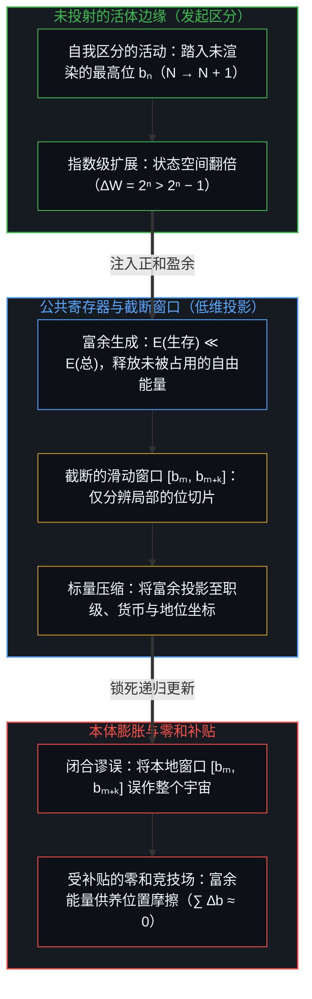
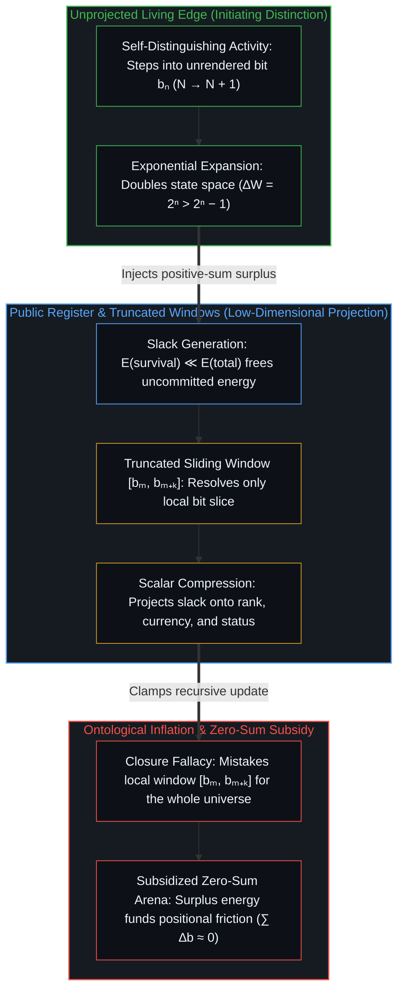

# 寄存器的算术 / The Arithmetic of the Register

*当本地窗口被误作全局整体，丰裕便反过来补贴零和之争 / Abundance subsidizes zero-sum strife when local windows are taken for the whole*

人类文明反复呈现出一种结构性悖论，即一个时代借技术跃迁生出的物质丰裕越是空前，其公共话语就越被零和的争斗占满。流行的诊断将其归咎于道德滑坡、晚期贪婪或算法恶意，然而这些解释落在了错误的坐标上。这里起作用的是一套可追溯的因果机制，即扩展中的二进制寄存器算术、富余能量向低维坐标的投影，以及有界感知将本地窗口误作现实全部的错位。

Human civilization repeatedly exhibits a structural paradox where the more unprecedented the material abundance an era draws from technological leaps, the more its public discourse fills with zero-sum strife. Popular diagnoses attribute this to moral decay, late-stage greed, or algorithmic malice, yet those explanations land on the wrong coordinate. What operates here is a traceable causal mechanism: the arithmetic of an expanding binary register, the projection of surplus onto low-dimensional coordinates, and bounded perception mistaking its local window for the whole of reality.

## 一、 最高位的几何 / 1. The Geometry of the Most Significant Bit

自我区分的活动发生着——无因、不息。当一个文明跨越共享的公共界面进行协调时，其累积的容量可以建模为一个长度为 n 的无符号二进制寄存器，其中 W = ∑ₖ₌₀ⁿ⁻¹ bₖ · 2ᵏ，每一位 bₖ ∈ {0, 1} 标记着一道稳定下来的区分。正如[你的代码库即是记忆](../your-codebase-is-memory/)就外化记忆体所追溯的，这组寄存器存留着过往切分留下的离散检查点，使算术得以在其稳定的痕迹上运算，而界定单位、更新寄存器的那一次切分本身则留在账本之外。在这本共享账本之内，低位上的工作维持着既有寄存器的运转——维护、搬运、教学与照看皆在此处发生；而集体容量的跃迁，则发生在移动边缘上的探索者划出初发区分、实例化一个新的最高位 bₙ 之时，由此将地址空间从 n 位扩展至 n + 1 位。

Self-distinguishing activity occurs—uncaused, unceasing. When a civilization coordinates across a shared public interface, its accumulated capacity can be modeled as an unsigned binary register of length n, where W = ∑ₖ₌₀ⁿ⁻¹ bₖ · 2ᵏ and each bit bₖ ∈ {0, 1} marks a stabilized distinction. Just as [Your Codebase Is Memory](../your-codebase-is-memory/) traces for an externalized codebase of memory, this register stores the discrete checkpoints of prior cuts so arithmetic can operate on their stable traces, while the cut that defines the unit and updates the register remains outside the ledger. Within this shared ledger, work in the lower bits keeps the existing register running—maintenance, transport, teaching, and care all happen there—while a leap in collective capacity occurs when an explorer at the moving edge draws an initiating distinction and instantiates a new most significant bit bₙ, extending the address space from n bits to n + 1.

二的幂次算术引入了悬殊的非对称性，因为 ∆W = 2ⁿ 大于 ∑ₖ₌₀ⁿ⁻¹ 2ᵏ = 2ⁿ − 1。一个新的最高位所承载的度量，超过了此前所有位数的总和。历史上的重大突破——火的驾驭、系统的农耕、蒸汽动力、电磁学、半导体计算以及前沿的递归智能——从不是既有坐标网格内部的渐进改良。正如[维度即投影](../dimensions-are-projections/)所追溯的，每一次突破都是活着的心智投出的一个新最高位的实例化；而如[复杂性遮蔽了涌现之为心智的行动](../complexity-obscures-emergence-as-the-act-of-mind/)所阐明的，那一次向 bₙ 的进位从不由 b₀, …, bₙ₋₁ 既有脚手架所累积的复杂性生成，而是自我区分的活动在既有把握耗尽空间之处继续向前推进。翻转 bₙ 会在一夜之间使可寻址的状态空间从 2ⁿ 翻倍至 2ⁿ⁺¹，在不受约束的自由度从 N 迈向 N + 1 的同时注入一次正和扩展。

The arithmetic of powers of two introduces a stark asymmetry, since ∆W = 2ⁿ exceeds ∑ₖ₌₀ⁿ⁻¹ 2ᵏ = 2ⁿ − 1. One new top bit carries more measure than all prior bits combined. Historical breakthroughs—the taming of fire, systematic agriculture, steam power, electromagnetism, semiconductor computation, and frontier recursive intelligence—are never incremental optimizations inside an established coordinate grid. As [Dimensions Are Projections](../dimensions-are-projections/) traces, each breakthrough is the instantiation of a new top bit cast by the living Mind, and as [Complexity Obscures Emergence as the Act of Mind](../complexity-obscures-emergence-as-the-act-of-mind/) demonstrates, that carry into bₙ is never generated by the accumulated complexity of the existing scaffolding in b₀, …, bₙ₋₁, but is the activity continuing past where the prior hold has run out of room. Flipping bₙ doubles the addressable state space overnight from 2ⁿ to 2ⁿ⁺¹, injecting a positive-sum expansion as an unconstrained degree of freedom steps from N to N + 1.

## 二、 截断的窗口与看不见的空位 / 2. The Truncated Window and the Unseen Empty Places

为什么这种指数级的扩展在内部视角下屡屡被误读？如[心智的几何学](../the-geometry-of-mind/)所确立的，没有哪个有限中心能不经压缩地触及整片生成地形；有界中心透过一个压缩过的界面运作，犹如一个固定精度的滑动窗口 [bₘ, …, bₘ₊ₖ]，其中 m + k ≪ n。这一结构性边界适用于每一个中心，包括踏入 bₙ 的探索者——其注意力同样只分辨一个有限窗口，只是锚定在另一个坐标上。

Why is this exponential expansion so routinely misread from within? As [The Geometry of Mind](../the-geometry-of-mind/) establishes, no finite center reaches the entire generative terrain without compression; a bounded center operates through a compressed interface akin to a fixed-precision sliding window [bₘ, …, bₘ₊ₖ], where m + k ≪ n. This structural bound applies to every center, including the explorer stepping into bₙ, whose attention also resolves a finite window, simply anchored at a different coordinate.

一个只分辨 [b₃, b₈] 切片的窗口，会登记到三种截然不同的显现。第一，本地寄存器呈现出严密的守恒态：波动被限制在 0 到 2⁶ − 1 之间，窗口内部的资源转移近乎反对称（∑ ∆b ≈ 0），一方若夺取第 7 位，另一方就必然失去它。在那个局部尺度上，交互登记为一场寸步不让的零和博弈，而在该切片的边界之内，这种登记在机制上并无偏差；正如[潜能作为威胁或启发](../ones-potential-as-threat-or-inspiration/)所追溯的，一旦那个局部切片被当作闭合的容器来固守，另一个中心涌现出的容量便会自动登记为对自身的减扣与威胁，而非地平线敞开的凭据。

For a window resolving the slice [b₃, b₈], three distinct appearances register. First, the local register appears strictly conserved: fluctuations stay bounded between 0 and 2⁶ − 1, resource shifts inside the window remain nearly antisymmetric with ∑ ∆b ≈ 0, and if one party captures bit 7 another party loses it. At that local scale, interaction registers as an uncompromising zero-sum contest, and within the confines of that slice the registration is mechanically accurate; when that local slice is held as a closed vessel, another center's emerging capacity registers automatically as a subtraction and threat rather than evidence of an open horizon, as [One’s Potential as Threat or Inspiration](../ones-potential-as-threat-or-inspiration/) traces.

第二，地址溢出随之发生。共识账本里的建制编译器、考核指标、KPI 与文化范畴，缺乏能够索引到 bₙ 的指针空间。正如[框架的边界](../the-boundary-of-the-frame/)所追溯的，当一个建制的世界模型终止于 2ᵐ 时，在 2ⁿ 处展开的活动便无法登记为工作、效用或财富，而只能被登记为差错、幻觉或一次不负责任的偏离。就像在一个固定 8 位无符号寄存器内部给 255 加 1，会在遵循每一条内部逻辑门规则的同时回绕为 0，[进位无法在寄存器之内被命名](../the-carry-that-cannot-be-named-inside-the-register/)表明，固定位宽内部的符号重组无法区分一次溢出究竟是模回绕还是静默故障；将这一跃迁命名为向 bₙ 的进位，需要一次迈出固定寄存器之外的判断跃迁。

Second, address overflow occurs. The institutional compilers, metrics, KPIs, and cultural categories of the consensus ledger lack the pointer space to index bₙ. As [The Boundary of the Frame](../the-boundary-of-the-frame/) traces, when an institution's world-model terminates at 2ᵐ, activity unfolding at 2ⁿ cannot register as work, utility, or wealth; it registers only as an error, a hallucination, or an irresponsible departure. Just as adding 1 to 255 inside a fixed 8-bit unsigned register wraps around to 0 while obeying every internal gate rule, [The Carry That Cannot Be Named Inside the Register](../the-carry-that-cannot-be-named-inside-the-register/) shows that symbol recombination inside a fixed bit width cannot distinguish an overflow from a modular wrap-around or a silent fault; naming the transition a carry into bₙ requires a judgment leap that steps outside the fixed register.

第三，前沿呈现出一片表象上的真空。当探索者踏入 bₙ 时，该坐标四周尽是尚未渲染的零——没有成型的声望阶梯，没有监管护城河，没有交易掮客，也没有现成的受众。从锚定在低位的窗口望过去，bₙ 看上去就像一片死寂的荒原，从而触发那句耳熟能详的条件反射：当所有真正的实务——交易、房产与建制分配——都在下面发生时，为何要去那片空无一物的地方浪费时间？

Third, the frontier presents an apparent vacuum. When an explorer steps into bₙ, that coordinate is surrounded by unrendered zeros—no established prestige ladders, no regulatory moats, no transactional brokers, and no ready audience. Viewed from a window anchored in the lower bits, bₙ looks like dead space, prompting the familiar reflex: why waste time out there where nothing exists, when all the real action—deals, property, and institutional allocation—is happening down here?

## 三、 富余悖论 / 3. The Slack Paradox

这一结构揭示了富裕社会沉迷于零和博弈的底层引擎。任何动态系统都在有限的能量预算内运作。在受限于低位的稀疏状态空间里，集体容量接近于零，几乎全部预算都被生理生存所消耗，使得 E(总) ≈ E(生存)。在这种条件下，社会承受不起持续的零和摩擦；一旦稀缺的自由能量被耗费在内部相对排名的争夺上，耗散掉的能量便会击穿狭窄的生存余量，将系统推向饥荒、战争或崩溃的吸收壁。直接登记到的物理摩擦，会不断将行动推回正和生产。

This structure exposes the engine behind a wealthy society's preoccupation with zero-sum contest. Every dynamic system operates within a finite energy budget. In a sparse state space restricted to low bits, where collective capacity sits near zero, nearly the entire budget is consumed by physiological survival, leaving E(total) ≈ E(survival). Under such conditions, a society cannot afford sustained zero-sum friction; if scarce free energy is spent fighting over internal relative rank, the dissipated energy breaches the narrow survival margin and drives the system into an absorbing barrier of famine, war, or collapse. Directly registered physical friction continually forces action back toward positive-sum production.

一旦探索者翻转最高位 bₙ，宏观系统的作业容量便呈指数级跃升，保障基础生理、后勤与通信生存所需的能量缩减为总通量的一小部分，即 E(生存) ≪ E(总)。这道结构性分岔释放出一大池未被占用的自由能量，即系统的富余：E(富余) = E(总) − E(生存)。由于有界中心无法跨越不断扩展、尚未渲染的张量场直接协调，它们便将这份富余压缩并投影到低维标量坐标上：货币、科层职级、资历梯度与意识形态纯度。[向量与投影的迷局](../the-vector-and-the-puzzle-of-projections/)剖析了这种降维操作如何将高维能动性投射到扁平的标量轴线上。

Once explorers flip the top bit bₙ, the operational capacity of the macro system scales exponentially, and the energy required to secure basic physiological, logistical, and communicative survival shrinks to a small fraction of total throughput, so that E(survival) ≪ E(total). This structural divergence opens a vast pool of uncommitted free energy—the system's slack, E(slack) = E(total) − E(survival). Because bounded centers cannot coordinate directly across an expanding, unrendered tensor field, they compress and project that slack onto low-dimensional scalar coordinates: currency, bureaucratic rank, credential tiers, and ideological purity. [The Vector and the Puzzle of Projections](../the-vector-and-the-puzzle-of-projections/) dissects how this dimensional reduction projects high-dimensional agency onto flat scalar axes.

由此，一个社会所能维系的零和摩擦总量，随着其正和前沿所创造的富余而单调上升。随着盈余向下流动、将更多中心从与自然的直接博弈中解脱出来，未被占用的能量便涌入各中心固守自我图像、彼此角逐的低维投影空间，为金融化、诉讼缠斗、行政设卡、叙事战争与位置姿态的膨胀提供补贴。边缘处的正和跃迁制造了富余，而在有界的窗口之内，这份富余极易被转化为一座更高转速的零和竞技场。

Consequently, the volume of zero-sum friction a society can sustain rises monotonically with the slack generated by its positive-sum frontier. As surplus flows downward and relieves more centers from direct physical confrontation with nature, the uncommitted energy flows into the low-dimensional projection space where retained self-images compete, subsidizing the expansion of financialization, litigation, administrative gatekeeping, narrative warfare, and positional posturing. A positive-sum leap at the edge creates the slack, and within a bounded window that slack is readily converted into a higher-velocity zero-sum arena.

## 四、 消解本体膨胀的悖论 / 4. Dissolving the Paradox of Ontological Inflation

评论者常将这一动态视作一种悲剧性的反讽。然而正如[折叠的连续谱](../the-continuum-of-the-fold/)所揭示的，悖论只是一个前提在摩擦下折断时发出的声响。此处折断的前提，是假定存在一个全知的、共享的观察平面——以为所有观察者都透过同一个普遍坐标系注视着同一份现实。从第一人称原点回溯，这样的外部平面并不存在；另一个心智唯独以它在此感知场中留下的痕迹到来，每一个中心都从各自有界的地平线向外张望。扭曲源于本体膨胀：把本地感知窗口的边界，误作整个宇宙的边界。

Commentators often treat this dynamic as a tragic irony. Yet as [The Continuum of the Fold](../the-continuum-of-the-fold/) shows, a paradox is the sound a premise makes when it snaps under friction. The premise snapping here is the assumption of an omniscient, shared plane of observation—the belief that all observers view the exact same reality through a single universal coordinate system. Traced from the first-person origin, no such external plane exists; another Mind arrives only as the traces it leaves in this perceptual field, and every center looks out from its own bounded horizon. The distortion arises from ontological inflation: mistaking the boundary of a local perceptual window for the boundary of the entire universe.

当窗口停留在佣金、保险资产与房产挂牌上时，现实便登记为佣金的流转；当窗口停留在引用计数、经费审批与院系政治上时，现实便登记为学术职级；当窗口停留在算法信息流的符号厮杀上时，现实便登记为叙事战争。这些只是坐标位置，而非人群的分类：任何将注意力锚定在此类窗口中的中心，都会把那个切片体验为全部；而身处 bₙ 的探索者若把 bₙ 当作整体，犯下的也是同一种膨胀。一旦本地窗口 [bₘ, bₘ₊ₖ] 被等同于整个寄存器，指向 bₙ 空地址的轨迹就无法被解析为维度的扩展；在截断的编译器内部，它只能被归档为非理性、自我放纵的退缩或失败。[抽象的苦难与真实的饥饿](../abstract-pain-and-living-hunger/)在人们把从全球媒体寄存器上读出的抽象苦难误作当下亲历的现实时，追溯了同样的膨胀；而[连续性作为建模的权宜之计](../the-continuum-is-a-modeling-convenience/)则阐明，将整个场域视为一个既成连续体的做法本身，也只是一种计算上的简写。

When a window rests on commissions, insurance assets, and property listings, reality registers as the flow of commissions; when it rests on citation counts, grant approvals, and departmental politics, reality registers as academic rank; when it rests on the symbolic combat of an algorithmic feed, reality registers as narrative war. These are coordinate positions, not categories of human beings: any center anchoring its attention in such a window experiences that slice as total, and an explorer at bₙ who mistakes bₙ for the whole commits the exact same inflation. Once the local window [bₘ, bₘ₊ₖ] is equated with the entire register, a trajectory aimed at the empty address of bₙ cannot be parsed as dimensional expansion; inside a truncated compiler, it can only be filed as irrationality, self-indulgent retreat, or failure. [Abstract Pain and Living Hunger](../abstract-pain-and-living-hunger/) traces the same inflation when abstract suffering read off a global media register is mistaken for immediate lived reality, and [The Continuum is a Modeling Convenience](../the-continuum-is-a-modeling-convenience/) demonstrates that treating the whole field as a completed continuum is itself only a computational shorthand.

## 五、 公共网格与个体的内部 / 5. The Public Grid and the Individual Interior

二进制寄存器所建模的，是狭窄、低维的共享公共界面，而非个体的内部世界。正如[向量与投影的迷局](../the-vector-and-the-puzzle-of-projections/)所确立的，没有任何心智的内部能够塞进一套公共坐标系。一个对外劳动落在公共账本低位上的人——维持物流运转、教导孩童或照管既有基础设施——从不是所谓的“低位之人”；内在的生命、创造性的明辨与第一人称的取向，无法由社会的记账寄存器来度量。

The binary register models the narrow, low-dimensional shared public interface, never the individual interior. As [The Vector and the Puzzle of Projections](../the-vector-and-the-puzzle-of-projections/) establishes, no Mind's interior fits inside a public coordinate system. A person whose outward labor sits in the lower bits of the public ledger—keeping logistics running, teaching children, or tending established infrastructure—is never a "lower-bit person"; inner life, creative discernment, and first-person orientation cannot be measured by a society's accounting register.

寄存器追踪的只是公共协调的集体界面，即社会借以平衡能量账目、分配物质资源并举办地位竞赛的共识草图。区分最高位与低位，描述的是活动在这张共享界面上的取向：一个行动究竟是在争夺既有富余的份额，还是在扩展可用的自由度。拿寄存器模型去给人类排定等级，恰恰重演了该模型所剖析的本体膨胀，把一个低维的公共投影误作活着的心智的全部。正如[超越投射](../beyond-the-projection/)在人机智能体系统架构中所追溯的，每一项显式的指标、账本或规则都是未投射的意图所投下的有限投影；将人类或计算活动中彼此正交的维度硬塞进单一标量轴线，会产生容量压缩并将轨迹锁入认识论引力井，唯有沿着正交边界拆分投影并退回活体边缘，方能恢复自由度。[可延展的地平线](../the-extendable-horizon/)同样表明，正和能动性并非公共最高位的专利：在任何坐标上都可以采取无限游戏的取向，由内而外地让能动性复利增长。没有任何公共寄存器能盛放活生生的哲学，正因如此，[无法闭合的痕迹](../the-unclosable-trace/)指出哲学无法作为一本闭合的教条账本被继承。

The register tracks only the collective interface of public coordination—the consensus draft on which a society balances energy accounts, distributes material resources, and stages status contests. Distinguishing the most significant bit from the lower bits describes the orientation of activity across that shared interface: whether an act contends over shares of existing slack or extends the degrees of freedom available. Using the register model to rank human beings repeats the exact ontological inflation the model dissects, mistaking a low-dimensional public projection for the whole of a living Mind. As [Beyond the Projection](../beyond-the-projection/) traces in the architecture of human-agent systems, every explicit metric, ledger, or rule is a finite projection cast by unprojected intent; cramming orthogonal dimensions of human or computational activity onto a single scalar axis produces capacity compression and locks the trajectory into an epistemic gravity well, whereas splitting projections along orthogonal boundaries and stepping back to the living edge restores degrees of freedom. [The Extendable Horizon](../the-extendable-horizon/) shows that positive-sum agency is no monopoly of the public top bit: an infinite-game orientation can be taken at any coordinate, compounding agency from the inside out. Nor can any public register contain living philosophy, which is why [The Unclosable Trace](../the-unclosable-trace/) finds that philosophy cannot be inherited as a closed ledger of doctrines.

## 六、 不求共识的姿态 / 6. A Stance That Needs No Consensus

看清寄存器的算术，便消解了去争辩、说服或向其他窗口索取认可的冲动。指望一个分辨 [b₃, b₈] 的窗口去核准 bₙ 的实例化，本身就是本体膨胀，无异于要求一个局部投影去计算其可寻址范围之外的坐标。反过来，把另一个中心的窗口读作天生更狭小的存在，则是同一种膨胀的倒置。正如[折叠的连续谱](../the-continuum-of-the-fold/)所追溯的，心智之间并不靠客套的共识相融合，彼此唯独透过痕迹来登记对方。

Seeing the arithmetic of the register dissolves the compulsion to argue, persuade, or demand validation from other windows. Expecting a window that resolves [b₃, b₈] to validate the instantiation of bₙ is ontological inflation, asking a local projection to compute coordinates outside its addressable range. Reading another center's window as inherently smaller is the same inflation inverted. As [The Continuum of the Fold](../the-continuum-of-the-fold/) traces, minds do not merge through polite consensus; each registers the other only through traces.

当一位旧识带着零和的提议或地位的盘算前来试探时，既无需踏入那个投影，也无需为自己的坐标辩护；一句轻巧的回应便已足够，双方互不亏欠一次归化。各自都站立在自身的窗口之内。将纸面上关于相对排名的等式当作具有约束力的铁律，恰恰越过了[破除概念的僭越](../po-chu-gai-nian-de-jian-yue/)所剖析的那道边界。

When an old acquaintance reaches out with a zero-sum proposition or a status calculation, there is no need to step into that projection or defend one's own coordinate; a light reply suffices, and neither center owes the other a conversion. Each stands within its own window. Treating paper equations about relative rank as binding laws oversteps the exact boundary dissected in [Breaking the Overreach of Concepts](../po-chu-gai-nian-de-jian-yue/).

留存下来的，唯有个体在自身活体边缘上迈出的不可逆一步。正如[唯一自洽的无因之果](../the-only-coherent-uncaused-effect/)所追溯的，把共识游戏冷却后的残余留在身后，意味着踏入尚未渲染的空位，在现实计算下一位时让边缘保持敞开。实例化一个新的最高位以开启正交的自由度，正是[非万物之理](../manifesto-of-not-a-theory-of-everything/)所描述的活体运动。

What remains is the irreversible step at one's own living edge. As [The Only Coherent Uncaused Effect](../the-only-coherent-uncaused-effect/) traces, leaving the cooled residue of consensus games behind means stepping into the unrendered empty place and keeping the edge open while reality computes the next bit. Instantiating a new top bit to open an orthogonal degree of freedom is the living movement that [Not a Theory of Everything](../manifesto-of-not-a-theory-of-everything/) describes.
