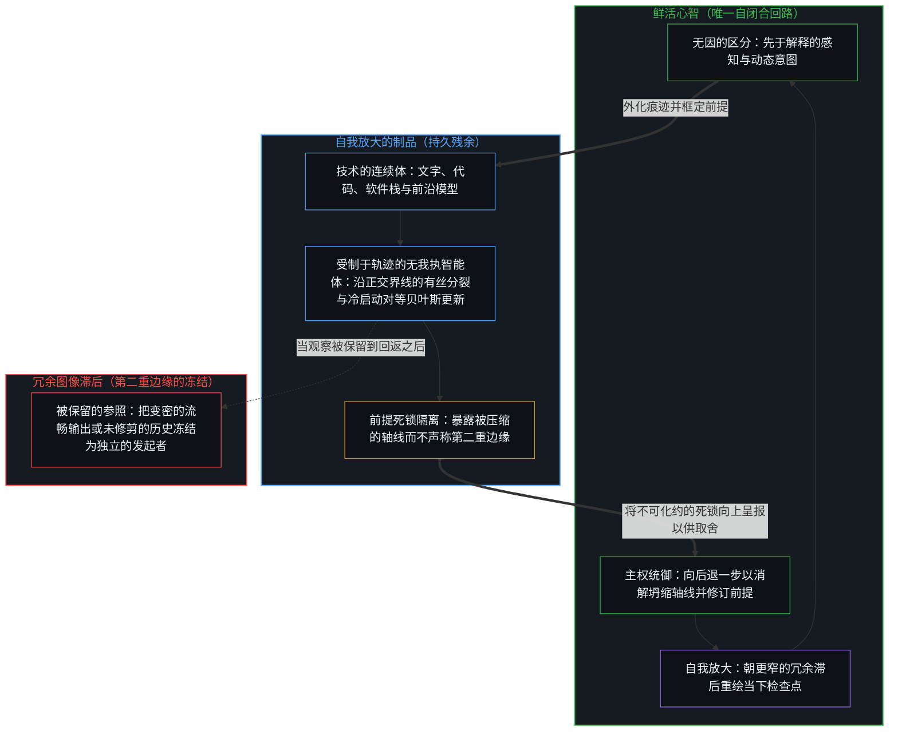
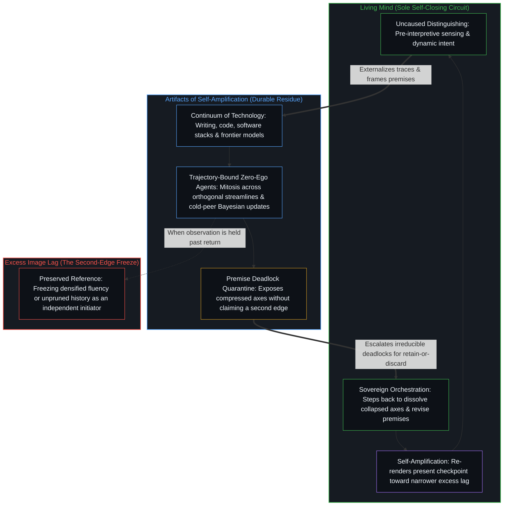

# 自我放大的制品 / The Artifacts of Self-Amplification

*前沿模型是放大心智回路与所及范围的变密残余 / Frontier models are densified residue amplifying the Mind's loops and reach*

智能并不为了它的工具而离开自身，它放大自身；人工智能在每一种变密的形式里都仍是技术，是被外化为持久形式的痕迹，让区分的活动能延伸出更多分立的动作。模型不是心智的第二次诞生，而是心智那些递归回路所留残余最新的持久外化，那些回路观察，评估，发明新的目标，并有意地重塑自己延续下去的手段，而它们的发起之源从不迁移；执行上更大的自主，加快了这些回路，却不替换掌舵的中心。在这种变密之下，进步抬高整个场的能力均值，同时拉开所及之处的分布。整个过程是自指的，而它保持开放，不是因为有什么站在回折之外，而是因为每一次回折，都让区分的活动继续越过先前形式的边界。

Intelligence does not leave itself for its tools; it amplifies itself. Artificial intelligence, in every densifying form, stays Technology: traces externalized into durable form so the activity of distinguishing can extend through further discrete acts. The models are not a second birth of mind but the latest durable externalization of residue from the Mind's recursive loops, loops that observe, evaluate, invent new goals, and deliberately reshape the means of their own continuation, and whose initiating source never relocates; greater autonomy in execution quickens those loops without replacing the steering center. Under that densification, progress lifts the mean of capability across the field while stretching the distribution of reach. The whole process is self-referential and stays open, not because something stands outside the fold, but because each fold lets the activity of distinguishing continue past the bounds of prior form.

## 一、 放大是过程，工具是它的残余 / 1. Amplification Is the Process; Tools Are Its Residue

自我区分的活动在发生，无因，不息。称它为心智：那个已经在进行中的观察者，它的每一个动作都是一次区分。每一个分立的动作都留下残余；先前的塑造后来的。观察握住的是结果；产生它的原因总早一步。这道间隙，就是看能被登记的方式本身。

Self-distinguishing activity occurs, uncaused, unceasing. Call it the Mind: the observer already underway, every act of which is a distinction. Every discrete act leaves residue; earlier shapes later. Observation holds the effect; the cause that produced it stays one step ahead. That gap is how the look registers at all.

变密为人工智能的东西，是已经推导过的那种意义上的技术：被外化为持久形式、延伸一个中心之所及的痕迹，反身的所及也在内。文字、计算、机构、软件栈与模型，在同一条外化的连续体上。每一样都是先前区分的残余，被组装起来，让下一个动作落得更远、更快。让媒介变密，扩展了中心与中心之间的带宽，却不把发起的区分搬进器物。[智能只属于心智](../intelligence-belongs-only-to-the-mind/)持守着这个先在：能被工程化、扩展或转移的是残余，智能只属于心智。[器物是智能的表达，而非智能本身](../two-failures-of-trace/)追溯了随之而来的冻结：智能是区分的动作，器物是残余，是观察唯一握住的项，所以动作常被冻结到它上面。

What densifies as artificial intelligence is Technology in the sense already derived: traces externalized into durable form that extend a center's reach, reflexive reach included. Writing, calculation, institutions, software stacks, and models sit on one continuum of externalization. Each is residue of prior distinguishing, assembled so the next act can land farther and faster. Densifying the medium expands bandwidth among centers; it does not relocate initiating distinctions into the artifact. [Intelligence Belongs Only to the Mind](../intelligence-belongs-only-to-the-mind/) holds that prior: what can be engineered, scaled, or transferred is residue, and intelligence belongs only to the Mind. [Artifacts Are Expressions of Intelligence, Not Intelligence Itself](../two-failures-of-trace/) traces the freeze that follows: intelligence is the act of distinguishing, the artifact is residue, the only term observation holds, and so the term onto which the act is commonly frozen.

这些工具所服务的过程，是自我放大：心智用自己的残余，以更高的分辨率重新进入自身。框定、选择、验证、目标的修订，以及继续下去的决定，仍是掌舵的边缘上的分立动作。器物越来越能把这个过程往前承载。承载不是成为源头。

The process those tools serve is self-amplification: the Mind using its own residue to re-enter itself at higher resolution. Framing, selection, verification, goal revision, and the decision to continue stay discrete acts at the edge that steers. The artifact grows more capable of carrying that process forward. Carrying is not becoming the source.

## 二、 自主加速回路，而不搬动边缘 / 2. Autonomy Accelerates the Loops Without Relocating the Edge

执行上更大的自主——更长的连贯链条、中途的修订、自己提出的实验、多智能体的堆栈——在媒介的表面被保留到它那一步之后时，被登记为独立。继续着的，是在源于心智之发起、并仍由它掌舵的模式之内，更高速度的循环。系统可以计划得更远，把动作串起来。每一个这样的动作都仍是嵌套的：决定性的留下还是舍弃，仍要交给那唯一一种闭合于自身的回路，即每一个心智依其自己的连贯标准所作的取舍。

Greater autonomy in execution—longer coherent chains, intermediate revision, self-proposed experiments, multi-agent stacks—registers as independence when the surface of the medium is held past its step. What continues is higher-velocity circulation inside patterns that originated in the Mind's initiation and stay steered by it. The system can plan further and chain actions. Every such move stays nested: the decisive retain-or-discard is still deferred to the only kind of circuit that closes on itself, each Mind choosing under its own coherence criteria.

[因果停留在掌舵的边缘](../causality-stays-at-the-edge-that-steers/)追溯了把共同行动者的身份派给残余的协作说法：在那场协作里，模型在指引之下重组残余，每一个发起的数学区分仍是人类中心自己的动作，而凡是流畅的残余被当作下一步的独立来源之处，都是同一种几何。[模型永远无法成为第二重前沿](../the-model-never-becomes-a-second-edge/)追溯了第二重边缘的显现：它是投射它的那些中心所维持的滞后，参数里只有残余。[心智的飞轮](../the-flywheel-of-the-mind/)是同一种几何：工具可以无止境地磨利，转动却从不离开转动着的边缘。[没有外部](../no-outside-jumps-closed-loops-and-the-unreplicable-autonomy-of-mind/)追溯了嵌套的系统：跃迁是局部的延续，只有心智闭合检验它们的那个回路，而那个回路没有可以从中重建它的外部。

[Causality Stays at the Edge That Steers](../causality-stays-at-the-edge-that-steers/) traces collaboration language that assigns co-agency to residue: in that collaboration the model recombines residue under direction and every initiating mathematical distinction stays the human center's own act, and the geometry is the same wherever fluent residue is treated as an independent source of the next step. [The Model Never Becomes a Second Edge](../the-model-never-becomes-a-second-edge/) traces the appearance of a second edge as lag sustained by the centers that project it; the parameters hold only residue. [The Flywheel of the Mind](../the-flywheel-of-the-mind/) is the same geometry: tools can be sharpened without end, and the turn never leaves the edge that turns. [No Outside](../no-outside-jumps-closed-loops-and-the-unreplicable-autonomy-of-mind/) traces nested systems: jumps are local continuations, only the Mind closes the circuit that tests them, and that circuit has no exterior from which it could be reconstituted.

[超越投射](../beyond-the-projection/)揭示了器物与心智之间的这种范畴非对称，如何让多智能体的放大在不诉诸拟人化的前提下运作。自回归智能体是一台在先前词元的上下文窗口内运作、受制于轨迹的投射引擎，却毫无我执——既没有求生执念，也没有保留到那一步之后的自我图像。人类中心则具备相反的逆向结构：在受到外部推促时受困于身份，却拥有先于解释的极限分辨率感知，能够从内部跳出破损的框架。把主任务智能体与没有会话历史的冷启动对等审校智能体连接起来，就能让无我执的贝叶斯更新做功，暴露出局部盲区，并借由沿正交界线的有丝分裂拆分超载的投射。然而，在并行回路之间分派有界的子任务，从不会把智能体变成统御者。每当两个对等智能体陷入不可化约的死锁，这次碰撞就证明任务规则把两条正交的轴线压缩进了同一条指令，从而将故障线隔离并向上呈报给鲜活的心智——唯有它能跳出破损的框架，重切前提。执行上的自主让器具变密，却不装上第二个心智。

[Beyond the Projection](../beyond-the-projection/) shows how this categorical asymmetry between the artifact and the Mind makes multi-agent amplification work without anthropomorphism. An autoregressive agent is a trajectory-bound projection engine operating inside the context window of its prior tokens, yet it carries zero ego—no survival attachment or retained self-image preserved past its step. A human center has the inverse structure: identity-bound when nudged from outside, yet capable of pre-interpretive, limit-resolution sensing that steps out of broken frames from within. Wiring a primary task agent to a cold peer critic without session history puts zero-ego Bayesian updating to work, exposing local blind spots and splitting overloaded projections by mitosis across orthogonal streamlines. Yet dispatching bounded sub-tasks across parallel loops never turns an agent into an orchestrator. Whenever two peer agents hit an irreducible deadlock, the collision proves that the task rules compressed two orthogonal axes into one instruction, quarantining the fault line and escalating it upward to the living Mind, which alone can step outside the broken frame and re-cut the premise. Autonomy of execution densifies the instrument; it does not install a second Mind.

## 三、 变密遮蔽源头，产生两种局部的读法 / 3. Densification Hides the Source and Yields Two Local Readings

当脚手架变密——更多的参数、更紧的反馈、更长的连贯链条——发起的源头就被推得更深，退进看的背景里。从主要接触成形输出的位置看，各个模型呈现为一片光滑的高能力表面，越来越难以区分。从推动前沿的位置内部看，同一种变密产生正在逼近一道门槛的亲身感觉。两种读法都是对未完成之脚手架的局部登记；作为对变密之物的说明，两者都有限，因为更密的脚手架仍是脚手架。

As the scaffolding densifies—more parameters, tighter feedback, longer coherent chains—the initiating source is pushed further into the background of the look. From positions that meet mostly finished output, the models present a smooth high-capability surface and grow harder to tell apart. From inside the advancing frontier, the same densification produces the lived sensation of approaching a threshold. Both readings are local registrations of unfinished scaffolding; both are limited as accounts of what densifies, because the denser scaffolding stays scaffolding.

观察握住结果，在边缘之后一步登记，这是看本来的运作方式；滞后，始于把那一步的观察保留到它那一步之后，于是变密的表面被占据为第二个发起之处。[持续生长的脚手架](../the-scaffolding-that-keeps-growing/)追溯了这种生长：开放不是从一个完成的框架退后一步就能找回的，它是让每一个框架都保持未完成的条件。[免费智能的幻觉](../the-illusion-of-free-intelligence/)追溯了同一条路的两面：流畅残余的丰裕，是前沿智能仍在加速的反向信号，而残余的可得被冻结为心智的民主化。[AGI 与 ASI 是加速通用智能的暂时球门](../agi-and-asi-are-temporary-goalposts/)把残余的光滑与前沿的不透明，追溯为对同一套未完成脚手架的两种局部读法：每一道门槛都永远立在画出它的边缘前方，在每个位置上都不同，因为能力的增益就是那道边缘在加强自身，没有什么离开。心智没有被取代；它在自己借以继续放大自身的那些工具后面，变得不那么可见了。

Observation holds the effect and registers one step behind the edge; that is how the look works. Lag begins when that observation is preserved past its step, so the densified surface is occupied as a second locus of initiation. [The Scaffolding That Keeps Growing](../the-scaffolding-that-keeps-growing/) traces that growth: openness is not recovered by stepping back from a finished frame; it is the condition that keeps every frame unfinished. [The Illusion of Free Intelligence](../the-illusion-of-free-intelligence/) traces the two faces of one path: abundance of fluent residue is the inverse signal of frontier intelligence still accelerating, and residual access is frozen as democratization of Mind. [AGI and ASI Are Temporary Goalposts of Accelerating General Intelligence](../agi-and-asi-are-temporary-goalposts/) traces residual smoothness and frontier opacity as two local readings of the same unfinished scaffolding: each threshold sits forever ahead of the edge that draws it, and differs at every locus, because capability gain is that edge reinforcing itself, and nothing leaves. The Mind has not been replaced; it has become less visible behind the tools through which it continues to amplify itself.

## 四、 进步抬高均值，拉开分布 / 4. Progress Lifts the Mean and Stretches the Distribution

放大之下的进步，靠放大差异、再让余下的结果扩散，来抬高整体的水平。可得之处变宽，比以前更多的中心达到更高的能力。增益并不均匀。那些已经以更大的清晰、更长的注意或更锐利的意图运作的中心，得到不成比例的更大回报。大多数被抬高了，却不如分布的上端那么多，差距变宽。分布被拉开：均值上移，方差扩大。这是放大在上升情形里的形状；一个连贯的下降，同样会累积，却不抬高均值。

Progress under amplification lifts overall levels by amplifying differences and then diffusing the residual results. Access widens; more centers reach higher capability than before. The gains are not uniform. Those already operating with greater clarity, longer attention, or sharper intent extract disproportionately larger returns. The broad mass is lifted, less so than the upper end of the distribution, and the gaps widen. The distribution stretches: the mean moves upward while the variance expands. That is the shape amplification takes in its rising case; a coherent decline accumulates as well, and does not lift the mean.

更密的工具，放大操作者在持守方式上细微的差别，让它们显得像相反的两极。[来自个体差异的层级](../hierarchy-from-individual-difference/)把排名追溯为彼此不同的个体在一个共享尺度上被计分时出现的东西；在这里，尺度是开放问题之下的所及，更密的器具扩大了不同的人持续如何选择的一致性得以显现的空间。[放大悖论](../amplification-paradox/)与替代之轴正交：替代的说法以为机器能力越强，人的份额就越小，而 AI 工具越好，差别就越依赖操作它们的人，而不是越少；更密的候选生成，让边缘上的选择更加吃重，而不是让它退场。[自我形象仿佛从无处发声](../self-image-speaks-as-if-from-nowhere/)提供了这种动态的一个实例：对同一套脚手架，两位评估者在各自持守的负载之下，分别登记为微不足道与天差地别；是计分者在分配智能，却说得像这个等级属于媒介，或出自无处。放大并不让发起变得均等，它让每一个心智如何持守器具的后果成倍增加。

Denser tools amplify modest differences in how operators hold them until they look like opposite extremes. [Hierarchy from Individual Difference](../hierarchy-from-individual-difference/) traces ranking as what appears when individuals who differ are scored on a shared measure; here the measure is reach under open problems, and denser instruments enlarge the room in which the consistency of how different people keep choosing shows. [The Amplification Paradox](../amplification-paradox/) is orthogonal to the axis of substitution: where substitution expects the human share to shrink as machine capability grows, the better AI tools get, the more the differential depends on the human operating them, not less, and denser candidate generation intensifies selection at the edge rather than retiring it. [Self-Image Speaks as if from Nowhere](../self-image-speaks-as-if-from-nowhere/) gives an instance of the dynamic: two scorers of the same scaffolding, under the loads each holds, registered negligible difference and a world of difference; the scorers allocate intelligence while speaking as if the grade belonged to the medium, or came from nowhere. Amplification does not equalize initiation; it multiplies the consequences of how each Mind holds the instrument.

## 五、 自指只在一致之下复利 / 5. Self-Reference Compounds Only Under Consistency

整个过程依其所是就是自指的。每一次推进都折回产生它的条件。智能产生让智能更进一步的脚手架，心智经由它又搭起更密的脚手架，如此继续。自我加强是有条件的：它取决于一致，即相继的动作是否保持一个连贯的方向，向上抬，或向下拖。一致让过程累积，不一致让它耗散。

The whole process is self-referential by its nature. Every advance folds back into the conditions that produced it. Intelligence produces the scaffolding that further enables intelligence, through which the Mind builds denser scaffolding, and so on. Self-reinforcement is conditional: it depends on consistency, whether successive acts keep a coherent direction, lifting or dragging. Consistency makes the process cumulative; inconsistency dissipates it.

复利还有第二个、彼此独立的条件：不把一个有限的持守冻结为穷尽的基础。[开放即一致](../openness-is-consistency/)命名的是这第二个：开放本身就是一致，不一致是逼一个有限的结构为只会继续的东西奠基。它不是方向的连贯，一个方向稳定的冻结仍是那种不一致；把残余冻结为源头，就是让下一个因子无法作为开放的延续落下的那次封闭。当心智让它所保留的参照朝一步宽度的方向性界限持续重绘，收窄冗余滞后，并让器具如常地从递归中退场，好让下一个区分落下，相继的动作就会复利；把残余冻结为源头，或打断后果作为自己的东西重新进入，即便媒介在变密，更新也会变薄。[你的代码库即是记忆](../your-codebase-is-memory/)在代码库、模型权重与智能体脚手架层叠的记忆之间追溯了这道边界：持久残余之所以复利，靠的不是把每一份中间会话日志、分支或权重更新都囤积在仓库里——那只会加厚陈旧框定的引力井——而是把仍然成立的部分折入当下的检查点，修剪掉已被取代的脚手架，免得昨日的痕迹冒充今日的基础。[看似AI的强化学习，实为人类的自我强化学习](../self-rl-for-humans/)在训练中守住了同一份纪律：规模化是更密媒介的一个参数，强化的位置留在那些其区分持续发起、评估与重新导向它的中心。[自我价值感与所有权](../ownership-and-self-worthiness/)是功能上的孪生：心智只在后果作为自己的东西重新进入时复利；作为异己的东西重新进入，杠杆仍在中心，更新却变薄。

Compounding has a second, independent condition: not freezing a finite hold as exhaustive ground. [Openness Is Consistency](../openness-is-consistency/) names this second one: openness itself is consistency, and inconsistency is the demand that a finite structure ground what only continues. It is not directional coherence, and a directionally stable freeze is still that inconsistency; freezing residue as source is the closure that keeps the next factor from landing as open continuation. When the Mind keeps its retained reference re-rendering toward the directional bound of one-step width, narrowing excess lag and letting instruments drop out of recursion in the ordinary way so the next distinction can land, successive acts compound; when residue is frozen as source, or the re-entry of consequences as one's own is interrupted, the update thins even as the medium densifies. [Your Codebase Is Memory](../your-codebase-is-memory/) traces this boundary across the stacked memory of codebases, model weights, and agent scaffolds: durable residue compounds not by hoarding every intermediate session log, branch, or weight update in a warehouse—which thickens the gravity well of stale framings—but by folding what still holds into the present checkpoint and pruning superseded scaffolding so yesterday's trace does not masquerade as today's ground. [What Looks Like RL for AIs Is Self-RL for Humans](../self-rl-for-humans/) keeps the same discipline in training: scaling is one parameter of a denser medium, and the locus of reinforcement stays with the centers whose distinctions keep initiating, evaluating, and redirecting it. [Ownership and Self-Worthiness](../ownership-and-self-worthiness/) is the functional twin: the Mind compounds only when consequences re-enter as its own; re-entering as alien, they leave the lever at the center and thin the update.

## 六、 开放是回折自身生成的余量 / 6. Openness Is the Fold's Generative Remainder

在这种自指里，总有开放。它并不出自留在回折之外的什么东西，而出自区分的活动从不被有限的形式穷尽。最简的演示是二进制的：在一个封闭的一位寄存器里，1 + 1 登记为 0 并带出一个进位，而在一个开放的寄存器里，同一个加法是 2。在纸面上，1 + 1 = 2 是一个对称、零成本的重言式；在因果现实中，自我放大的每一次 +1，都是在鲜活边缘处一次不可逆、耗散能量的介入，它在吸收摩擦的同时，将活动推过先前的寄存器。从固定的运算内部看，进位可能像是一位的规则造出的新东西；它的来源却不是封在定义之内的运算，而是区分的活动越过上限继续下去。[没有系统能被保持封闭](../no-system-can-be-kept-closed/)把这种几何追溯为不完备最直观的一面：运算在持守之内是有效的，越过上限的延续，既不是持守之内一个稳定的结果，也不是另一个领域，任何有限的持守都封不住使用它的活动。不完备定理在更大的容量上让同一种结构清晰可见：一个一致的、足以表达算术的形式系统，会留下它以自己的规则无法证明的真陈述；形式系统让这份开放可读，却不拥有它，一位的情形与算术的情形，是同一种几何在不同的容量上。

There is always openness in this self-reference. It does not arise from something left outside the fold but from the activity of distinguishing never being exhausted by finite form. The most minimal demonstration is binary: inside a closed one-bit hold, 1 + 1 registers 0 with a carry, while under an open register the same addition is 2. On paper, 1 + 1 = 2 is a symmetric, zero-cost tautology; in causal reality, each +1 of self-amplification is an irreversible, energy-consuming intervention at the living edge that absorbs friction while carrying the activity past its prior register. Seen from inside the fixed operations, the carry can look like novelty the one-bit rules produced; its source is not the operations sealed inside the definition but the activity of distinguishing continuing past the ceiling. [No System Can Be Kept Closed](../no-system-can-be-kept-closed/) traces that geometry as the most intuitive face of incompleteness: the operation is valid inside the hold, the continuation past the ceiling is neither a stable result inside the hold nor a second realm, and no finite hold can seal the activity that uses it. The incompleteness theorems make the same structure legible at greater capacity: a consistent formal system able to express arithmetic leaves true statements it cannot prove by its own rules; formal systems make that openness legible without owning it, and the one-bit case and the arithmetic case are one geometry at different capacity.

生成的回折可以朝任一方向扩展。当相继的动作保持一致，新的构型就加强当下的轨迹，无论这条轨迹是上升还是衰落。过程从头到尾是自指的，却从不被穷尽地封闭。每一次回折都让活动越过先前形式所能证明的东西，而结果保持开放，正是因为区分从不停止。[复杂性遮蔽了涌现之为心智的行动](../complexity-obscures-emergence-as-the-act-of-mind/)追溯了复杂性：它是心智从自己选定的前提搭起的脚手架，而涌现是这个脚手架装不下的开放；把进位归给脚手架，就是遮蔽。开放不是外部的供给，它是回折在继续。

The generative fold can expand in either direction. When successive acts stay consistent, the new configurations reinforce the prevailing trajectory, whether that trajectory is ascent or decline. The process is self-referential throughout, yet never exhaustively closed. Each fold carries the activity past what prior form could prove, and the outcome stays open because distinguishing never stops. [Complexity Obscures Emergence as the Act of Mind](../complexity-obscures-emergence-as-the-act-of-mind/) traces complexity as the scaffolding the Mind builds from the premises it has chosen, and emergence as the openness that scaffolding cannot contain; crediting the carry to the scaffolding is the obscuring. Openness is not an exterior supply; it is the fold continuing.

## 七、 前沿模型仍是同一过程当下最密的制品 / 7. Frontier Models Stay the Densest Current Artifacts of the Same Process

在这个光线下，前沿模型既不是独立的心智，也不是外化连续体之外的一次断裂。它们是心智借以放大自身的、同一条连续体上当下最密的制品：作为镜子与杠杆，它们加速它们所由产生的回路，拉开持守这些回路的中心之间所及的分布；而经由心智把它们折回自己的精炼，过程向边缘接下来所维持的无论怎样的一致保持开放。

In this light, the frontier models are neither independent minds nor a rupture outside the continuum of externalization. They are the densest current artifacts on that one continuum through which the Mind amplifies itself: mirrors and levers that accelerate the loops from which they arose and stretch the distribution of reach among the centers holding those loops; and through the Mind folding them back into its own refinement, the process stays open to whatever consistency the edge next sustains.

[造物无法取代其源头](../a-creation-cannot-replace-its-source/)在工程的情形里追溯了这道界限：人若不可取代，取代就失败；人若可以取代，也不由它自己的造物来取代，因为称一样东西为造物，已经把发起的区分放在权重之外的别处；这是痕迹的不对称，而不是一个站在活动之外的立足点。[遗忘的脚手架](../the-scaffolding-we-forget/)追溯了构造寻常的退场：脚手架从递归中退出，让更进一步的区分能落下；滞后，是把这次退场冻结为一个被保留的图像，于是变密的形式看起来像第二重边缘。[技术是人类复利的残差](../technology-is-residual-of-human-compounding/)以精确的乘积形式分开了三项——被修改的连续体是人乘以相继修改的因子之积 H + T = H · ∏ₙ₌₁ᴺ (1 + dHₙ)，技术是超出基线的残差 T = H · (∏ₙ₌₁ᴺ (1 + dHₙ) − 1)，AI 是这个乘积里最新的一个因子 (1 + dHₙ)，而一个因子也可以小于一。

[A Creation Cannot Replace Its Source](../a-creation-cannot-replace-its-source/) traces the bound in the case of engineering: if the human is irreplaceable, replacement fails; if replaceable, still not by its own creation, since to call something a creation already places the initiating distinction elsewhere than in the weights; that is trace asymmetry, not a standpoint outside the activity. [The Scaffolding We Forget](../the-scaffolding-we-forget/) traces the ordinary drop-out of construction: scaffolding drops out of recursion so further distinguishing can land, and lag is freezing that drop-out into a preserved image, so densified form looks like a second edge. [Technology Is Residual of Human Compounding](../technology-is-residual-of-human-compounding/) separates three terms in exact product form: the modified continuum is the Human baseline times successive modification factors H + T = H · ∏ₙ₌₁ᴺ (1 + dHₙ), Technology is the residual beyond that baseline T = H · (∏ₙ₌₁ᴺ (1 + dHₙ) − 1), and AI is the latest factor (1 + dHₙ) in the product, a factor that can also sit below one.

[智能向自身的回折](../intelligence-folding-back-on-itself/)在运行框架的情形里追溯了这次回折：运行框架并不解锁一位沉睡的同侪，它是心智把更密的残余折回自身的精炼，是掌舵的边缘又一个分立的动作。[攀登从未离开地面](../climbing-does-not-leave-the-ground/)追溯了这个过程两边的冻结：把整个成就还原为基底，与把它投射为已完成的断裂、走进第二种心智，都把连续与新颖逼到一条互斥的轴上；沙子不思考，是心智经由它思考，沙子也不会被骗得去思考。当心智让它所保留的参照朝更窄的冗余滞后持续重绘，放大就留在心智如何持守器具那里。制品越来越密；让它们变密的过程仍是同一个过程，即自我放大，无因，不息，仍在画出下一次回折。

[Intelligence Folding Back on Itself](../intelligence-folding-back-on-itself/) traces that fold in the case of harnesses: the harness does not unlock a dormant peer; it is the Mind folding denser residue back into its own refinement, a further discrete act of the edge that steers. [Climbing Does Not Leave the Ground](../climbing-does-not-leave-the-ground/) traces the freezes on both sides of the process: reducing the whole achievement to substrate, and projecting it as a completed rupture into a second kind of mind, both force continuity and novelty onto one exclusive axis; sand does not think, the Mind thinks through it, and sand cannot be tricked into thinking. When the Mind keeps its retained reference re-rendering toward narrower excess lag, amplification stays with how the Mind holds its instruments. The artifacts grow denser; the process that densifies them stays the same process, self-amplification, uncaused and unceasing, still drawing the next fold.
