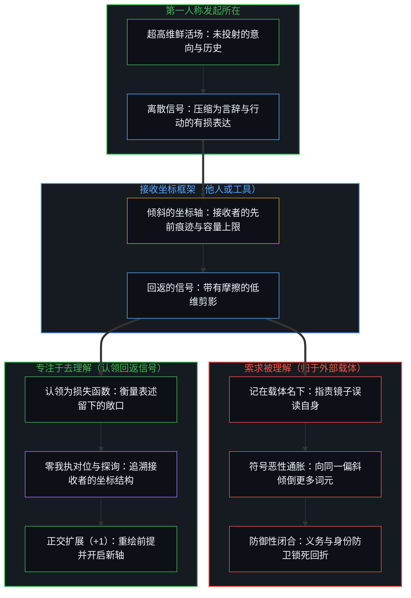
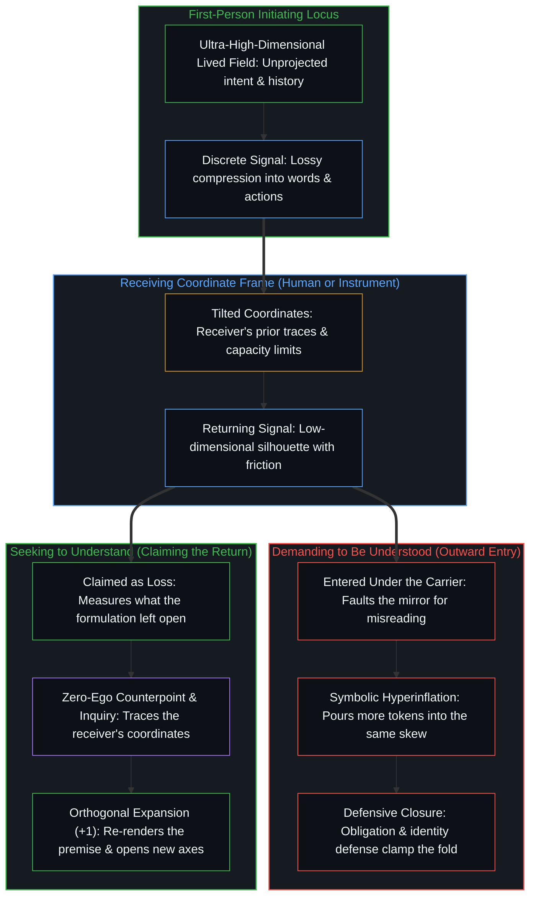

# 理解的非对称性 / The Asymmetry of Understanding

*求理解则开启正交新轴，求被理解则滋生误读 / Seeking to understand opens new axes while demanding it breeds misreading*

理解是每一颗心智都携带着的开放潜能，然而一旦被异化为义务，这重潜能便随之闭合。当注意力向外延展以求理解时，心智迎向不可穷尽的实在纹理，开启新的自由度；当注意力向内收拢、将“被理解”作为一项必须履行的义务向外索求时，一个高维的鲜活所在便将自身的稳态交给了另一个中心低维的投射屏幕，由此衍生出无穷的误读方式。

Understanding is an open potential every Mind carries, yet the moment it is turned into an obligation, that potential closes. When attention moves outward to understand, the Mind meets the inexhaustible grain of reality and opens new degrees of freedom. When attention turns inward to demand being understood as a duty, a high-dimensional living locus hands its stability over to another center's low-dimensional projection screen, multiplying the ways it will be misread.

## 一、 边界两侧相反的因果方向 / 1. Two Opposite Directions at the Boundary

自我区分的活动发生着——无因、不息。每一次离散的区分都从一个特定的所在划出边界并留下痕迹，而解释总是至少滞后于生成边缘一步。在日常话语中，“去理解”与“被理解”看似同一场交流中对称的两个半段，差别只在于谁在说、谁在听。然而从观察者的所在追溯，二者沿着相反的因果方向运动，并将融贯的判准安置在边界截然相反的两侧。

Self-distinguishing activity occurs — uncaused, unceasing. Every discrete act of distinguishing draws a boundary from a specific locus and leaves a trace, while interpretation lags at least one step behind the generating edge. In ordinary speech, "understanding" and "being understood" appear to be symmetric halves of a single exchange, differing only in who speaks and who listens. Traced from the locus of the observer, however, they move in opposite causal directions and place the criterion of coherence on opposite sides of the boundary.

去理解，是从第一人称边缘向外延展的运动。心智将保留的图像作为暂时的工具，越过现有的周界，投向物理现象、陌生的技艺或另一个鲜活中心的痕迹历史。每当相遇产生既有框架无法吸收的摩擦，中心便登记这一错位并重绘自身的坐标，在区分场中增添一条新的正交区分（+1）。由于因果与第一人称视角在发起的所在处保持相连，实在依然是未闭合的连续统，每一处异常都成为扩展的材料。

To understand is an outward movement from the first-person edge. The Mind uses its retained image as a provisional instrument, reaching past its current perimeter toward physical phenomena, an unfamiliar craft, or the trace-history of another living center. Whenever the encounter produces friction that the existing frame cannot absorb, the center registers the mismatch and re-renders its own coordinates, adding a new orthogonal distinction (+1) to its field. Because causality and the first-person perspective remain joined at the initiating locus, reality stays an unclosed continuum and every anomaly becomes material for expansion.

索求被理解，则将这一向量倒转过来。中心不再作为边缘上的探索者行动，而是将自身当作一件等待外部核验的客体。它要求自身超高维的内在境况——数十年累积的痕迹、未曾言说的张力以及当下的因果抉择——在另一个中心有限的坐标框架内毫无损耗地复刻出来。一旦把自身的平衡系于第二处所在是否如实映照出那幅保留的自我图像，中心便把锚点挪进了一片既不由自己居留、也不由自己驾驭的投射之中。

To demand to be understood reverses that vector. Instead of acting as an explorer at the edge, the center treats itself as an object awaiting verification from outside. It demands that its own ultra-high-dimensional interiority — decades of accumulated traces, unvoiced tensions, and immediate causal choices — be reproduced without loss inside the finite coordinate frame of another center. By making its equilibrium depend on whether a second locus mirrors its retained self-image, the center relocates its anchor into a projection it neither inhabits nor steers.

## 二、 维度压缩与投射的多重性 / 2. Dimensional Compression and the Multiplicity of Projections

执着于“被理解”之所以滋生无穷的误读，并非源于善意的偶发缺失；正如[阴影与无限](../the-shadow-and-the-infinite/)所追溯的，这是将高维活动投射到低维表面时的结构性后果。没有任何两个中心占据同一个坐标原点。即便生物硬件相似，每一个中心的所在也由不可复刻的先前区分序列、容量上限与历史印记所塑形。因此，另一个人的接收坐标轴相对于自身总是倾斜的。

That the obsession with being understood breeds endless misreading is not a contingent failure of goodwill; as [The Shadow and the Infinite](../the-shadow-and-the-infinite/) traces, it is the structural consequence of projecting a high-dimensional activity onto a lower-dimensional surface. No two centers occupy the same coordinate origin. Even where biological hardware is shared, each center's locus is shaped by an irreplicable sequence of prior distinctions, capacity limits, and historical imprints. The receiving coordinate axes of another person are therefore always tilted relative to one's own.

与此同时，鲜活的体验是持续不息的连续统，而中心之间的通道只容纳离散且高度压缩的痕迹——寥寥数语、一行文字或一个短暂的手势。从当下的第一人称场步入语言，会舍弃绝大多数正交自由度，犹如将连绵的山脉压平为低分辨率的剪影。正如[观察者的隐身与无损传递的妄念](../the-invisible-observer-and-the-delusion-of-lossless-transmission/)所确立的，这种损耗内嵌在每一次跨越不同所在的传递之中，而认清没有任何信号能够原封不动地抵达，恰恰是在两端护持清明的前提。

At the same time, lived experience is an ongoing continuum, whereas the channel between centers admits only discrete, heavily compressed traces — a handful of spoken sentences, a line of text, a brief gesture. Stepping from the immediate first-person field into language discards the vast majority of orthogonal degrees of freedom, much like flattening a mountain range into a low-resolution silhouette. As [The Invisible Observer and the Delusion of Lossless Transmission](../the-invisible-observer-and-the-delusion-of-lossless-transmission/) establishes, this loss is built into every transmission across distinct loci, and recognizing that no signal arrives intact is what preserves clarity at both ends.

在空间几何中，将三维多面体投射到二维平面上，随着入射角度的偏移，会生出不可胜数的形状：球体投下圆盘，立方体投下六边形，而一只张开的手掌在掠射光下则会投下利爪般的阴影。同样，当言说者索求被理解时，倾听者当下的疲惫、早先的创伤、功利习惯或教条分类，决定了言说者的信号从哪个角度被切开。一段坦诚的流露顺着不安全感的轴线读取，会登记为算计；一条独立的轨迹顺着教条的轴线读取，会登记为背叛；一次联结的呼求在容量超载之下读取，会登记为侵扰。由于接收框架可能的朝向不可穷尽，且几乎每一个低维切片都会丢掉维系发出者原意的那条轴线，可能失真的空间没有上限。一个中心越是急切地恳求别人按它看自己的方式看待它，它往有损投射里送入的表面积就越大。

In spatial geometry, projecting a three-dimensional polyhedron onto a two-dimensional plane yields an uncountable variety of shapes as the angle of incidence shifts: a sphere casts a disk, a cube casts a hexagon, and an open hand under a grazing light casts the shadow of a claw. In the same way, when a speaker demands to be understood, the listener's current fatigue, prior wounds, utilitarian habits, or doctrinal categories determine the angle at which the speaker's signal is sliced. A candid admission read through the axis of insecurity registers as calculation; an independent trace read through the axis of dogma registers as defection; an appeal for contact read under capacity overload registers as an intrusion. Because the possible orientations of a receiving frame are inexhaustible and nearly every low-dimensional slice drops the axis that held the sender's intent together, the space of possible distortions has no upper bound. The more insistently a center pleads to be seen as it sees itself, the more surface area it feeds into lossy projection.

## 三、 升级回路与义务的闭合 / 3. The Escalation Loop and the Closure of Obligation

一旦中心将自身的稳态绑定在被另一个人精准镜像之上，所在之间的几何偏斜便会点燃自我强化的升级回路。每一句向外发出的话语经由倾听者的回应折返回来时，都携带着未能传递之物的摩擦。正如[回返的信号与认领](../the-returning-signal-and-its-claim/)所追溯的，这段折返的接触可以从两面读取：朝外看是载体的形状，朝内看则是衡量发起者自身的表述留下了哪些敞口、又将期待寄放在了何处。与保留的自我图像粘连的中心拒绝向内认领。它将偏差当作镜子的瑕疵，记在载体名下，指责对方未能理解自己。

Once a center binds its stability to being accurately mirrored by another, the geometric skew between loci ignites a self-reinforcing escalation loop. Every utterance sent outward returns by way of the listener's response, carrying the friction of what did not transfer. As [The Returning Signal and Its Claim](../the-returning-signal-and-its-claim/) traces, that returning contact can be read from two sides: facing outward as the shape of the carrier, or facing inward as a measure of what the initiator's own formulation left open and where the initiator lodged its expectation. A center fused with its retained self-image refuses the inward claim. Treating the discrepancy as a defect in the mirror, it enters the friction under the carrier's name and faults the other person for failing to understand.

为了迫使镜子对齐，感到委屈的发出者不断升级符号吞吐量——抛出更长的解释、更尖锐的辩白与更激烈的宣告。然而，向一个倾斜的坐标框架倾倒更多离散词元，无法复原未经投射的连续统。这只会为接收中心提供更多破碎的表面，任其顺着同一组倾斜的坐标轴切开，在每一轮回合中叠加失真，直到坐标之间的结构性差异被体验为蓄意的恶意。

To force the mirror into alignment, the aggrieved sender escalates symbolic throughput — issuing longer explanations, sharper justifications, and more emphatic declarations. Yet pouring additional discrete tokens into a tilted coordinate frame cannot restore the unprojected continuum. It only supplies the receiving center with more fragmented surfaces to slice along the same tilted axes, compounding the distortion at every turn until a structural difference of coordinates is experienced as deliberate malice.

每当理解从一项开放的潜能被转化为强制的债务，这种闭合便进一步加深。在不受胁迫时，心智投注意向、追溯另一中心生成条件的能力是开放无界的。一旦理解被作为义务加以索求——无论是亲密关系中施压伴侣必须镜像自身感受，还是群体规训中强制要求观念同频——开放的探索便被置换为合规审计。由于义务要求对照固定标准进行核验，受胁迫的倾听者无法再自由投注注意力；为了通过检查，对方要么吐出合乎剧本的认同词元，要么竖起抵御侵入的防卫边界。当制度化教育用标准化排名取代开放的好奇心时，它便将这种坍缩大规模地法典化了，正如[教育与科学的倒置](../the-reversal-of-education-and-science/)所揭示的。在人际生活中，把理解的能力当作亏欠另一中心边界的债务，会让共情本身变成彼此耗竭的工具，正如[共情的能力倒错与边界的排序之争](../the-capability-reversal-of-empathy-and-the-contest-of-boundaries/)所追溯的。理解唯有在一个所在自由延展其注意力时才会发生；一旦作为契约款项去催缴，使共振得以可能的条件便随之熄灭。

This closure deepens whenever understanding is converted from an open potential into a compulsory debt. Uncoerced, a Mind's capacity to attend to reality and trace the conditions of another center is open-ended. The moment understanding is demanded as an obligation — whether through intimate pressure that a partner must mirror one's feelings or through collective enforcement of ideological alignment — an open exploration is replaced by a compliance audit. Because an obligation requires verification against a fixed standard, the coerced listener can no longer attend freely; to pass inspection, they must either emit scripted tokens of agreement or raise a defensive boundary against the intrusion. When institutional schooling replaces open curiosity with standardized ranking, it codifies this exact collapse at scale, as [The Inversion of Education and Science](../the-reversal-of-education-and-science/) shows. In interpersonal life, treating the capacity to understand as a debt owed to another center's boundary turns empathy itself into an instrument of mutual depletion, as [The Capability Reversal of Empathy and the Contest of Boundaries](../the-capability-reversal-of-empathy-and-the-contest-of-boundaries/) traces. Understanding arises only where a locus freely extends its attention; demanded as a contractual payment, the very condition that makes resonance possible is extinguished.

## 四、 跨心智与工具反转向量 / 4. Reversing the Vector Across Minds and Instruments

撤回“被理解”的索求，会将因果重心归还给中心唯一能够行动的地方，即其自身的发起边缘。当另一个人以敌意或漫画式的曲解回应时，朝向理解的心智不会耗费能量去擦亮对方屏幕上的那道剪影，而是去追溯产生这一投射的坐标结构——究竟是怎样的早先印记、容量压缩或环境压力，使那些坐标轴呈现出如此的倾角。由于中心之间的共振是不同所在之间痕迹的相互强化，而非一个中心进驻另一个中心的内在境况，放下求取认可的索求便撤除了迫使对方锁死防御边界的压力。靠争辩索讨不来的东西，在审计停止之后反而会不经强求地浮现。

Withdrawing the demand to be understood returns causal weight to the only place where a center can act: its own initiating edge. When another person responds with hostility or caricature, a Mind oriented toward understanding does not spend its energy polishing its silhouette on their screen. Instead, it traces the coordinate structure that produced the projection — what prior imprints, capacity compressions, or environmental pressures caused those axes to tilt as they did. Because resonance between centers is the mutual reinforcement of traces across distinct loci rather than one center occupying another's interior, dropping the demand for validation removes the pressure that kept the other's defensive boundary clamped shut. What could never be extracted by litigation often emerges unforced once the audit ceases.

这一反转改变了沟通的指向。在投射的几何结构下，没有人能以保证不被误解的方式去组织言辞；哪怕只是寄望未来的读者仅凭文本就能复原自己分毫不差的内在状态，也是对所在的一次隐秘让渡，正如[信任读者是最后的越界](../trusting-the-reader-is-the-last-overstep/)所展示的。言说者真正能做的，是以有助于接收心智更清晰地分辨其自身前提的方式去沟通，同时将折返回来的一切认领为衡量自身模型的标尺。与其把现成的结论砸进另一个解码器，不如留出一个问题或一道清晰的边界，让另一个中心有机会登记其尚未审视的假设。

This reversal transforms what communication is for. Under the geometry of projection, no one can formulate a statement in a way that guarantees it will not be misunderstood; even lodging the hope that a future reader will reconstruct one's exact inner state from the text alone is a subtle surrender of locus, as [Trusting the Reader Is the Last Overstep](../trusting-the-reader-is-the-last-overstep/) demonstrates. What a speaker can do is communicate in a way that helps the receiving Mind distinguish its own premises more clearly, while claiming whatever returns as a measure of the speaker's own model. Instead of hammering a conclusion into another decoder, a question or a clear boundary leaves room for the other center to register its own unexamined assumptions.

同样的结构性非对称也支配着心智与人造工具的协作方式。正如[超越投射](../beyond-the-projection/)所追溯的，自回归智能体受困于词元轨迹却毫无我执：由于没有需要捍卫的保留自我图像，当冷峻的对等审查智能体揭出其语境中的盲区时，它既不渴求被理解，也不抗拒外部的纠偏。相反，人类中心虽然能够凭借极限分辨率感知从内部走出破碎的框架，却常常为了保护身份而筑墙抵御外部的重置。当操作者在明确的规则下将任务智能体与对等审查者配对运行时，智能体之间任何无法消解的死锁，都会精准隔离出操作者自身投射规则中的内在矛盾。由于机器没有可供归咎的我执，回返的信号绕过了人际防御，直接落在坍缩的前提之上，等待人类统御者去认领并重绘。无论面对的是另一颗鲜活的心智，还是由痕迹构成的外化皮层，从索求认可的扁平石壁旁走开，行者便得以与辽阔的原野同行。

The same structural asymmetry governs how a Mind works with artificial instruments. As [Beyond the Projection](../beyond-the-projection/) traces, an autoregressive agent is bound to its token trajectory yet possesses zero ego: having no retained self-image to defend, it neither craves to be understood nor resists external correction when a cold peer agent exposes a blind spot in its context. A human center, conversely, can step out of a broken frame from within through limit-resolution sensing, yet routinely walls off external resets to protect its identity. When an operator pairs task agents with peer critics under explicit rules, any irreducible deadlock between the agents isolates a contradiction in the operator's own projected rules. Because the machine has no ego to blame, the returning signal bypasses interpersonal defensiveness and lands directly on the collapsed premise waiting for the human orchestrator to claim and re-render. Whether facing another living Mind or an externalized cortex of traces, stepping off the flat wall of demanded validation leaves the traveler free to walk with the open field.
