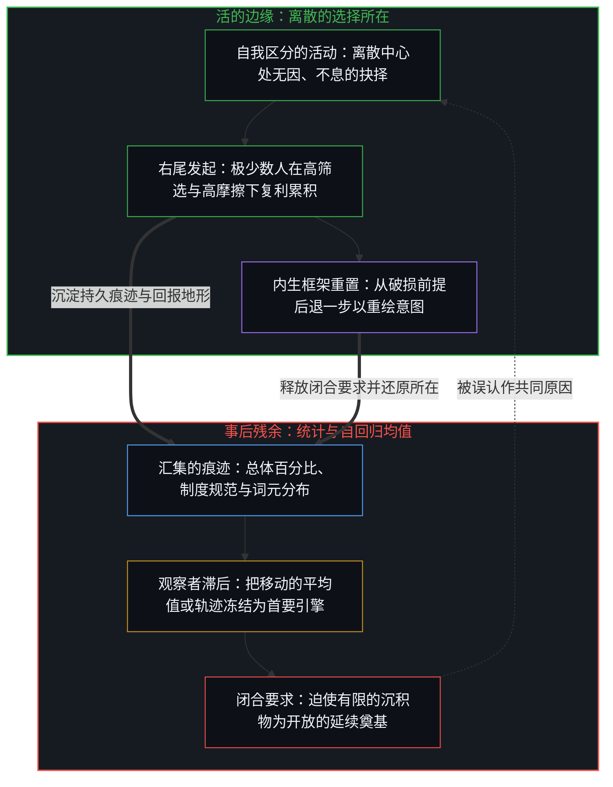
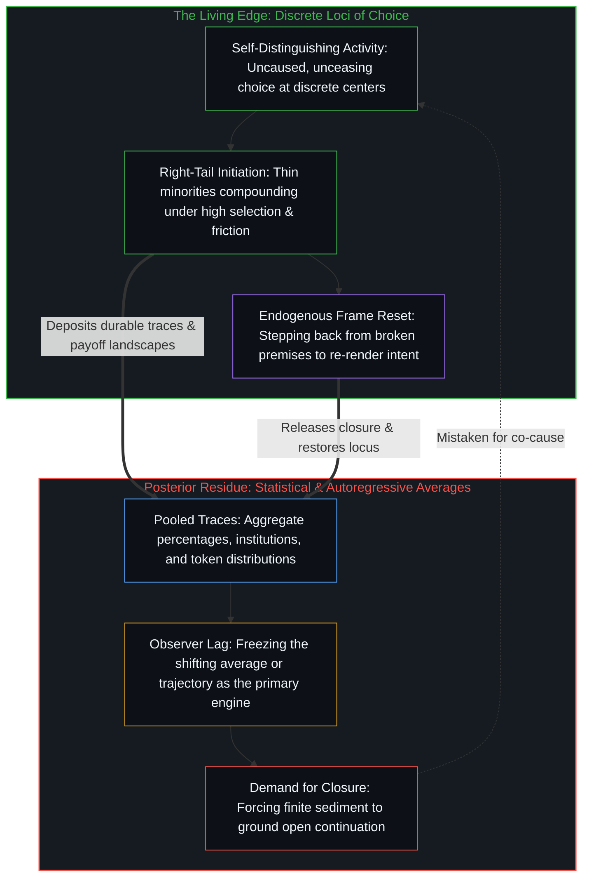

# 平均值是残余，不是引擎 / The Average Is Residue, Not the Engine

*百分比登记的是构成，而活的边缘立于右尾 / Percentages register composition while the living edge sits in the right tail*

一张流传的图表显示，中国留学生毕业后回国的比例大幅上升，流行的读法把这条曲线冻结为人才去向的逆转；细读则还原出构成的变化：出国变得容易，于是变得宽泛。同一种把作为残余的平均值量出来、误认作引擎的习惯，也出现在移民叙事、制度解释、自回归建模和公共的进步叙事里。这些登记都归结到一个自变量：一个个离散所在处的自由个体选择。

A circulated chart showed the share of Chinese students returning after graduation rising sharply, and the popular reading freezes that curve as a reversal of where talent goes; a careful reading restores composition: study abroad became easier and therefore broader. The same habit of measuring the average, which is residue, and mistaking it for the engine appears in immigration stories, institutional explanations, autoregressive modeling, and public narratives of progress. Those registrations reduce to one independent variable: free individual choice at discrete loci.

## 一、 百分比随构成移动 / 1. The Percentage Moves with Composition

一张流传的图表显示，中国出国留学的总人数急剧上升，毕业后回国的比例则从大约五分之一升到五分之四甚至更高。流行的读法把这一比例的摆动冻结为人才去向的逆转，断定中国的人才过去留在国外，现在大多回来了。细读则还原出构成。出国留学变得容易，于是变得宽泛，更多人出国时既没有留下的坚定打算，也没有留下所需的竞争力。留在国外的实际人数，放在约十四亿的人口尺度上，呈现的是另一幅图景。

A circulated chart of Chinese students studying abroad showed total numbers rising sharply while the share returning after graduation climbed from roughly one in five to four in five or higher. The popular reading freezes that swing as a reversal of where talent goes, concluding that Chinese talent used to remain abroad and now mostly comes back. A careful reading restores composition. Study abroad became easier and therefore broader, so more people go without a firm intention to remain and without the competitive standing required to stay. The absolute number who do remain, scaled against a population of roughly 1.4 billion, gives a different picture.

自我区分的活动在发生，无因，不息。称它为心智：那个已经在进行中的观察者，它的每一个动作都是一次区分。它在一个个所在处发生。每个所在划出离散的区分；先前的行动塑造后来的行动可用的场，这种塑造只朝一个方向。后来被计为回国率的东西，是许多这样的行动在变化的筛选下密化而成的残余，不是一个决定人才偏好哪个国家的超级所在。

Self-distinguishing activity occurs, uncaused, unceasing. Call it the Mind: the observer already underway, every act of which is a distinction. It occurs at loci. Each locus draws discrete distinctions; earlier acts shape the field available to later ones, and that shaping runs one way. What later scores as a return rate is densified residue of many such acts under changing selection, not a super-locus that decides which country talent prefers.

早期的中国留学生经过高度筛选，其中许多是研究生，倾向于留下。后来的队伍在中国自身的高校扩招和自费留学增长之后大规模扩张，本科生和授课型硕士生如今占了很大份额。他们的留下率远低于理工科博士，而后者在当前的筛选下留下率仍然很高。所以这个比例更多是随构成与筛选移动，而不是因为最高能力群体在国外的机会、或留在国外的吸引力突然崩塌。高影响力的留下者，实际人数相对人口尺度仍然稀少。比例的摆动在数字里确实出现了，然而推断它记录了人才去向的深层逆转，则是把一个总量保留过了它的那一步，当作引擎。[理性选择公设是原罪](../the-rational-choice-postulate-is-the-original-sin/)追溯了经济学情形中的同一种冻结：一致性与主体间的齐一被立为地基，代表性行为人的均值偏好被读作自变量，而选择只在每一个所在处、在私人的、暂时的前提下继续。[学习中不可观测的驱动力](../the-unobservable-driver-of-learning/)揭示了学习情形中的平行冻结：考试分数只在下游，真正的驱动力在于因果权能一再被定位在何处。[工时排名把充足度冻结成一张记分牌](../the-hours-ranking-freezes-adequacy-as-one-scoreboard/)展示了排名如何把三种工具压缩到一条工时轴上，当作充足度的单一尺度，随后又反过来援引这个数字，去扩张正是靠相互作用才产生出这些工时的那三种工具。当集体信念被立为引擎时，[进步叙事中的症候与原因](../symptom-and-cause-in-the-narratives-of-progress/)还原了因果次序：集体信念是对发起中心早已在进行的活动的延迟登记，它改变回报的场、施加拖拽，却从不会成为发起的超级所在。而当分布被读作一张固定的位置记分牌，别人的上升便登记为自己的损失，这正是[潜能作为威胁或启发](../ones-potential-as-threat-or-inspiration/)所消解的封闭前提产生的零和读法。

The early cohorts of Chinese students abroad were highly selected, many of them graduate students, and oriented toward remaining. Later cohorts expanded massively after China's own higher-education expansion and the growth of self-funded study, so undergraduates and taught master's students now form a large share of the flow. Their stay rates are far lower than those of STEM doctorates, whose retention remains high under present selection. The percentage therefore moves with composition and selection more than with any sudden collapse of opportunity abroad, or of the appeal of staying, for the highest-ability group. The absolute number of high-impact stayers remains thin relative to population scale. The swing in the percentage is there in the numbers, yet the inference that it records a deep reversal of where talent goes holds an aggregate past its step as if it were the engine. [The Rational Choice Postulate Is the Original Sin](../the-rational-choice-postulate-is-the-original-sin/) traces that same freeze in economics, where consistency and intersubjective uniformity are installed as foundation and the representative agent's mean preference is read as the independent variable while choice continues only at each locus under private, provisional premises. [The Unobservable Driver of Learning](../the-unobservable-driver-of-learning/) exposes the parallel freeze in learning, where test scores sit downstream while the actual driver is where causal power is successively located. [The Hours Ranking Freezes Adequacy as One Scoreboard](../the-hours-ranking-freezes-adequacy-as-one-scoreboard/) shows how ranking compresses three instruments onto one hours axis as a single measure of adequacy and then cites that number to expand the very instruments whose interaction produced the hours. When collective belief is installed as the engine, [Symptom and Cause in the Narratives of Progress](../symptom-and-cause-in-the-narratives-of-progress/) restores the causal order: collective belief is delayed registration of activity already underway at initiating centers, altering the field of payoffs and exerting drag without ever becoming a super-locus of initiation. And when a distribution is read as a fixed scoreboard of places, another's rise registers as one's own loss, which is the zero-sum reading produced by the closed premise that [One’s Potential as Threat or Inspiration](../ones-potential-as-threat-or-inspiration/) dissolves.

## 二、 稀少的实际人数是边缘的尺度 / 2. Absolute Thinness Is the Scale of the Edge

如果改看留下的实际人数，放在中国人口的尺度上，图景就重新排列。技术前沿上的进步，在它作为序列被登记之处，是由在能力、能动与筛选各自的右尾运作的极少数人相继的行动承载的，不是由大众的平均值承载的。当平均值显得民主、百分比显得可测时，公共叙事常常偏爱相反的故事。在寻常的复利之下，那些以行动密化出后来被计为前沿进步之物的人，实际人数相对人口是稀少的。把宽泛的回国率当作人才去向发生逆转的证据，就是把作为残余的平均值量出来、误认作引擎的一例。把滞后的平均值读作全部故事，是[技术变革的局部陷阱](../the-local-trap-of-technological-change/)所指陷阱的一端：把一片局部当作传播的整个几何。

Look instead at the absolute number who remain, scaled against the Chinese population, and the picture reorders. Progress at the technological frontier, where it registers as sequence, is carried by successive acts of extreme minorities operating in the right tails of ability, agency, and selection, not by mass averages. Public narratives often prefer the opposite story when the average feels democratic and the percentage feels measurable. Under ordinary compounding, the absolute number of people whose acts densify what later scores as frontier progress is thin relative to population. Treating the broad return rate as evidence that the direction of talent has reversed is one instance of measuring the average, which is residue, and mistaking it for the engine. Reading the lagging average as the whole story is one horn of the trap [The Local Trap of Technological Change](../the-local-trap-of-technological-change/) names: a local slice taken for the whole geometry of propagation.

这少数人不是一份名册，也不是一个种姓。不同的个人在不同的时候，依他们所做的选择而进入其中。把人排成进步的永久承载者，是把方向冻结成一张局部的记分牌；方向所指的是对序列的登记，在每一步都可修订。[进步的多面手](../the-utility-men-of-progress/)追溯了解决问题情形中这种暂时的取向：解题者随必要与成败而轮替，下一个未解的问题招来下一批解题者，昨天的解题者有时成了阻力。[个体抉择是唯一的因果杠杆](../individual-choices-as-the-only-causal-levers/)把这一机制定位在独立中心处相继的拉动之中，表明大众的模式是这些拉动的残余，从来不是产生它们的共同底板。[技术是人类复利的残差](../technology-is-residual-of-human-compounding/)对器物保持同一种几何：相继因子的乘积首先在每个个人处成立，规模只放大残余的可见度。由于那道稀少的边缘起初看不见，[看不见的第一步](../the-invisible-first-move/)展示了公共记分牌如何把复利曲线在总量上变得可见的那一刻，误认作复利本身的开始。

The minority is not a roster and not a caste. Different individuals qualify at different times according to the choices they enact. Ranking persons as permanent carriers of progress freezes Direction into a local scoreboard, whereas Direction names the registration of sequence, revisable at every step. [The Utility Men of Progress](../the-utility-men-of-progress/) traces that temporary orientation in problem-solving: solvers rotate by necessity and success, the next unsolved problem recruits the next solvers, and yesterday's solvers sometimes turn into resistance. [Individual Choices as the Only Causal Levers](../individual-choices-as-the-only-causal-levers/) locates the mechanism in successive pulls at independent centers, showing that mass patterns are residue of those pulls and never a shared floor that authors them. [Technology Is Residual of Human Compounding](../technology-is-residual-of-human-compounding/) holds the same geometry for artifacts, where the product of successive factors holds first at each individual and mass scale only amplifies the visibility of residue. Because that thin edge is invisible at first, [The Invisible First Move](../the-invisible-first-move/) shows how the public scoreboard mistakes the moment a compounding curve becomes visible in the aggregate for the start of the compounding itself.

## 三、 移民在一个词下冻结了两种几何 / 3. Immigration Freezes Two Geometries Under One Word

同一种习惯也出现在美国关于移民的主流叙事里。“移民”被当作解释美国例外论的单一正向力量，这一框架随后又被延伸去支持大规模、低筛选的流入。在这一框架底下，历史序列另有其貌。在美国，那些为高才能提供丰厚回报场的制度、法律格局与生产集群，原本是由规模相对较小、经过高度筛选的人群中的个人建立并维持的。后来的高技能浪潮放大了这份优势。人数大得多的后来者，大多是分享了已经生成的繁荣。把早期的筛选及放大它的高技能浪潮，与后来的规模塌缩进一个包罗一切的词，就抹去了一个区分：一边是以相继的行动密化出创造的极少数人，一边是之后到来的更多的人。这一叙事与包容的自我形象互补。它能否占上风，是中心之间进一步的选择与共振，不是这份互补的必然结果。

The same habit appears in the dominant American story of immigration. "Immigration" is treated as a single positive force that explains U.S. exceptionalism, and the framing is then extended to support high-volume, low-selection inflows. The historical sequence beneath that frame runs differently. The institutions, legal patterns, and productive clusters that gave high talent an unusually rich field of payoffs in the United States were established and sustained by individuals from relatively small, highly selected populations. Later high-skill waves amplified that advantage. The much larger mass of later arrivals largely shared in prosperity that had already been generated. Collapsing the early selection, together with the high-skill waves that amplified it, and the later volume into one catch-all word erases the distinction between the extreme minorities whose successive acts densify creation and the larger numbers who arrive afterward. The narrative is complementary with an inclusive self-image. Whether it prevails is further choice and resonance among centers, not a necessary consequence of that complementarity.

这一塌缩是负荷下被压缩的容量：两条独立的轴被压进一个词，于是后期规模的残余被计为早期筛选的共同作者。[拥有更多从不是原因](../having-more-is-never-the-cause/)追溯了占有如何被冻结为一股独立的因果力量，而相继的选择仍是杠杆；把人口规模冻结为卓异生产力的作者，是同一种滞后在另一个领域中的样子。[免费智能的幻觉](../the-illusion-of-free-intelligence/)追溯了当残余的可得性被误认作心智的民主化时的平行冻结，在那里成品形式的丰裕被计为平等的发起。把大规模移民的残余当作例外论的引擎，在人口问题上重复了同一种倒置。

That collapse is Capacity compressed under load: two independent axes forced onto one word, so that residue of late volume scores as co-author of early selection. [Having More Is Never the Cause](../having-more-is-never-the-cause/) traces how possession is frozen as an independent causal force while successive choosing remains the lever; freezing demographic volume as the author of exceptional productivity is the same lag in another domain. [The Illusion of Free Intelligence](../the-illusion-of-free-intelligence/) traces the parallel freeze when residual access is mistaken for the democratization of Mind, scoring the abundance of finished form as equal initiation. Treating the residue of mass immigration as the engine of exceptionalism repeats that exact inversion in demography.

## 四、 制度是先前自我选择的沉积 / 4. Institutions Are Sediment of Prior Self-Selection

就连制度解释本身也在下游。制度不是独立的首要原因，而是那些自我选择进入某些环境、并持续执行某些标准的人，一再做出的个人选择稳定下来的残余。先前的选择已使其能力与能动性都高的人，更多地选择或创造适合他们特质的环境；由此形成的模式，后来显现为“好制度”。反过来的读法，即制度先造就了人，是寻常的观察者滞后：结果被保持在产生它的边缘后面一步，再被冻结为外部的作者。这种反向读法与平等主义的自我形象互补，也与对能力分布不均的较少依赖互补，这份互补帮它在大众的中心之间、在成功的少数人之间传开。互补并不保证持久。持久不过是相继的选择继续重新描画这种反向读法。

Even the institutional explanation is itself downstream. Institutions are not independent primary causes. They are the stabilized residue of repeated individual choices made by the people who self-selected into those environments and kept enforcing certain standards. People whose prior choosing has made them high in ability and agency disproportionately choose or create the settings that fit their traits; the resulting patterns later appear as "good institutions." The reverse reading, that the institutions first produce the people, is ordinary observer lag: the effect held one step behind the edge that produced it, then frozen as an exterior author. That reverse reading is complementary with an egalitarian self-image and with less dependence on unequal distributions of ability, and that complementarity helps it travel among centers in the mass public and among the successful few. Complementarity does not seal durability. Durability is only further successive choices that keep re-tracing the reverse reading.

[卓异、感知与自我设限的问题场域](../exceptionality-perception-and-the-self-limiting-field-of-problems/)还原了筛选的因果次序：系统与过滤器只是先前自我选择的沉积，从不是那个后来看似由它们产生的边缘的共同作者。[主权、信念与规制结构的生成](../sovereignty-belief-and-regulatory-structures/)追溯了另一个前提的持久面孔：规制结构由“主权可以委托”这一信念的集体表达生成，而仍在选择的那个所在留在原处。[来自个体差异的层级](../hierarchy-from-individual-difference/)则表明次序不过是共同尺度下被登记的差异，而冻结在于把那份次序当作独立于它所排列的差异的外部结构。

[Exceptionality, Perception, and the Self-Limiting Field of Problems](../exceptionality-perception-and-the-self-limiting-field-of-problems/) restores the causal order of selection by showing that systems and filters are sediment of prior self-selections, never co-authors of the edge they later appear to produce. [Sovereignty, Belief, and the Generation of Regulatory Structures](../sovereignty-belief-and-regulatory-structures/) traces the durable face of a different prior, where regulatory structures are generated by the collective expression of the belief that sovereignty can be delegated while the locus that still chooses stays where it is. And [Hierarchy from Individual Difference](../hierarchy-from-individual-difference/) demonstrates that order is simply difference registered under a common measure, whereas the freeze consists in treating that order as an exterior structure independent of the differences it ranks.

## 五、 只剩一个自变量 / 5. One Independent Variable Remains

所有这些观察都归结到一个自变量：在离散所在处的个体选择，这是不可再约的前提在每一个中心处显现的样子。自我区分的活动在发生。其余一切——筛选、向右尾的集中、制度残余的形成、总体百分比的构造，以及把这些总量当作原因保存下来的滞后——都作为离散中心在约束之下的活动而随之而来。这个序列不需要第二个自变量。

All of these observations reduce to a single independent variable: individual choice at discrete loci, which is how the irreducible prior shows at each center. Self-distinguishing activity occurs. Everything else—selection, concentration in right tails, the formation of institutional residue, the construction of aggregate percentages, and the lag that preserves those aggregates as if they were causes—follows as the activity of discrete centers operating under constraints. No second independent variable is required for the sequence.

中国留学生回国率的上升，是许多个体选择的一个可见构成；对技术前沿要紧的实际人数，是另一个。看似首要的制度，是先前选择留下的痕迹。颠倒解释次序的叙事是更多的痕迹，只要中心继续重新描画它们，它们就一直被保留过它们的那一步。一旦参照回到个体选择这一活的边缘，经验模式、寻常复利下结果的幂律形状、少数人的筛选、制度的下游性质，以及那些故事的互补性质，就构成一个连贯的序列。[幂律是结果的表象](../mi-lv-shi-jie-guo-de-biao-xiang/)是相邻的还原：幂律形状本身被冻结为生成的规律，而不是被认作不同的迭代速率留下的残余。[开放即一致](../openness-is-consistency/)点明了底层的结构原则：不一致是一个有限的结构被迫为只在继续的东西奠基，被当作原因的总体百分比就是这样一个封闭结构。[超越投射](../beyond-the-projection/)将同一刀切分延伸至自回归智能与控制论组织：智能体的下一词元期望是在有限投射内部以先前痕迹为条件的统计均值，这赋予它不知疲倦的演绎延续与接受外部更新时的零我执，却也让它困在自身的认识论引力井里，毫无自行走出破损前提的能力。[你的代码库即是记忆](../your-codebase-is-memory/)把这一认识带入外化记忆本身的架构：冻结的模型权重与未经修剪的归档日志，同样是下游的统计与历史残余，而不是持续的因果引擎；若不经清醒洞察与睡眠巩固这一活的引擎主动重溯、重切与修剪，它们只会加厚引力井。把人口均值、自回归轨迹或累积的档案当作自主的统御引擎，都是把事后的残余，同那个未被投射、在边缘感知摩擦并后退一步重绘框架的第一人称心智混为一谈。

The rising return rate of Chinese students is one visible composition of many individual choices. The absolute numbers that matter for the technological frontier are another. The institutions that appear primary are the traces left by prior choices. The narratives that invert the order of explanation are further traces, retained past their step for as long as centers keep re-tracing them. Once the reference returns to the living edge of individual choice, the empirical pattern, the power-law shape of outcomes under ordinary compounding, the selection of minorities, the downstream character of institutions, and the complementary character of those stories form a single coherent sequence. [Power Law Is the Surface of Outcomes](../mi-lv-shi-jie-guo-de-biao-xiang/) is the adjacent restore when that power-law shape is itself frozen as a generating law rather than recognized as the residue of different iteration rates. [Openness Is Consistency](../openness-is-consistency/) names the underlying structural principle: inconsistency is a finite structure forced to ground what only continues, and an aggregate percentage held as cause is one such closed structure. [Beyond the Projection](../beyond-the-projection/) extends this exact cut to autoregressive intelligence and cybernetic organization: an agent's next-token expectation is a statistical average conditioned over prior traces inside a finite projection, which gives it tireless deductive continuation and zero ego when updated from outside, yet leaves it trapped inside its own epistemic gravity well with zero capacity to step out of a broken premise on its own. [Your Codebase Is Memory](../your-codebase-is-memory/) carries that recognition into the architecture of externalized memory itself: frozen model weights and unpruned archival logs are likewise downstream statistical and historical residue rather than a continuing causal engine, thickening the gravity well unless they are actively re-traced, re-cut, and pruned by the living engine of waking insight and sleep consolidation. Treating a demographic mean, an autoregressive trajectory, or an accumulated archive as an autonomous engine of orchestration confuses posterior residue with the unprojected first-person Mind that senses friction at the edge and steps backward to re-render the frame.

释放这一混淆并不删除百分比、制度或形式投射，而是把它们还给场：作为残余在场，作为回报的地形或调度的器械而活，从不作为仍须划出的那个行动的共同原因。[约束的样子不是自由的失去](../the-look-of-constraint-is-not-the-loss-of-freedom/)追踪了当成年生活受限的整体样貌被误认作童年自由在存在层面的丧失时会发生什么，并指明决定性的切分在于能动性指向何方：是向后守护已有的痕迹，还是向前延展地平线。[外部归因是个人进步的障碍](../wai-bu-gui-yin-ge-ren-jin-bu-de-zhang-ai/)追溯了养育情形中的同一种冻结：把差距归于外部，便让抓手离开了孩子划出下一步的那个所在。[能动性被转置入形式模型](../agency-relocated-into-the-formal-model/)揭示了另一种倒置：当那些被计为噪声的活的更新遭丢弃，形式模型本身反倒被当作获得能动性的所在。[能动性与模式](../agency-and-the-pattern/)追溯了关于 AI 工具使用的行为研究中的平行倒置：把一个样本比例——例如从业者的选择与带有倾向的代理所给出的框架相一致的比率——倒读回单次试验，当作能动性流失的裁决，是把某项输入被采纳之频率的汇总记录误认作了决断者；而将这一百分比持守为经过校准的参考分布，则让下一次决策依然清晰地呈现为从业者自己的选择。[统计学无法揭示的心智](../the-mind-that-statistics-cannot-reveal/)在一切总体分布中追踪因果的同一条界限：统计汇集过去选择的痕迹，而心智的发起力量在曲线中始终不可见。就连正态曲线也是先前目的性切分与选择的沉淀，正如[目的性的评判与认知的缺省状态](../cong-mu-di-xing-de-ping-pan-kan-ren-zhi-que-sheng/)所确立的那样。

Releasing that confusion does not delete percentages, institutions, or formal projections. It returns them to the field: present as residue, live as a payoff landscape or dispatching instrument, never a co-cause of the act that still has to be drawn. [The Look of Constraint Is Not the Loss of Freedom](../the-look-of-constraint-is-not-the-loss-of-freedom/) tracks what happens when the overall look of adult life as constrained is mistaken for an ontological loss of childhood freedom, showing that the decisive cut lies in whether agency points backward at defending traces already kept or forward at widening the horizon. [External Attribution Is the Obstacle to Personal Growth](../wai-bu-gui-yin-ge-ren-jin-bu-de-zhang-ai/) traces that same freeze in parenting, where attributing a gap outside removes the grip from the exact locus where the child's next act is drawn. [Agency Relocated into the Formal Model](../agency-relocated-into-the-formal-model/) exposes the inversion when the living updates scored as noise are discarded and the formal model itself is treated as the site where agency is gained. [Agency and the Pattern](../agency-and-the-pattern/) traces the parallel inversion in behavioral studies of AI tool use: reading a sample proportion—such as the rate at which practitioners' choices match a biased agent's framing—backward onto the single trial as a verdict of eroded agency mistakes the summary record of how often an input was taken up for the decider, whereas holding that percentage as a calibrated reference distribution keeps the next decision visible as the practitioner's own. [The Mind That Statistics Cannot Reveal](../the-mind-that-statistics-cannot-reveal/) tracks the same bound on causality across every aggregate distribution: statistics pool the traces of past choices, while the originating power of the Mind stays invisible in the curve. Even the normal curve is the sediment of prior teleological cuts and choices, as [Judging by Purpose and the Default State of Cognition](../cong-mu-di-xing-de-ping-pan-kan-ren-zhi-que-sheng/) establishes.
