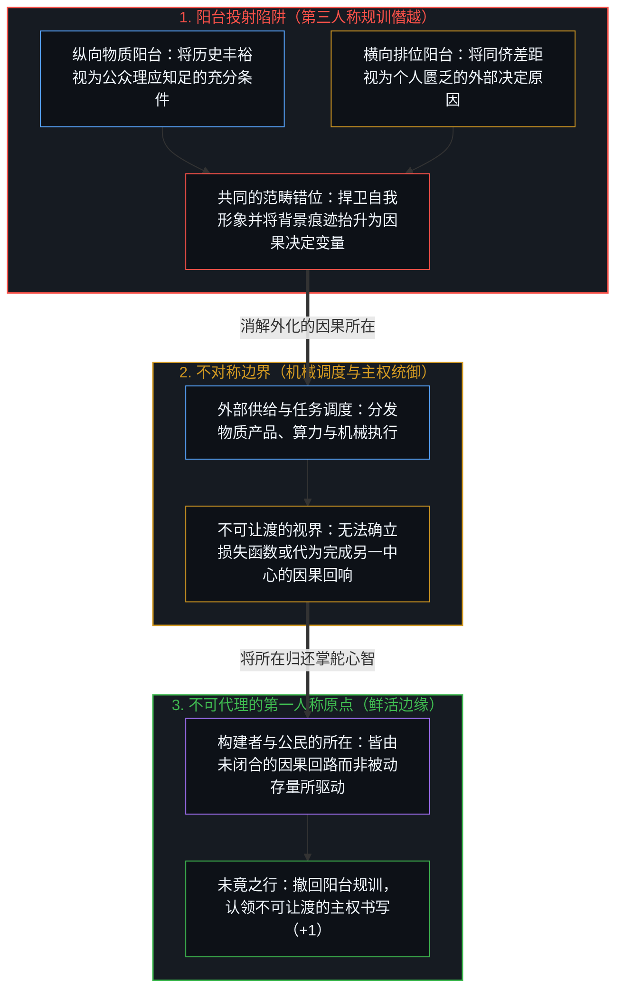
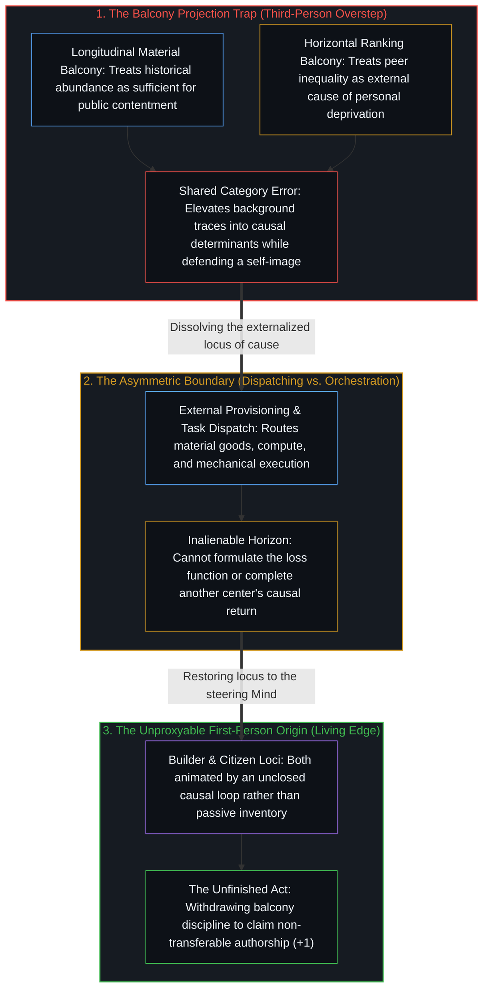

# 阳台视角的规训僭越与不可代理的未竟之行 / The Balcony Disciplinary Overstep and the Unproxyable Act

*为己保留掌舵却为他人编写剧本，唯有回到不可代理的原点方能消解 / Reserving agency while scripting others dissolves at the unproxyable origin*

围绕技术丰裕与社会不平等，当代公共讨论中反复上演着一场拉锯战。一方指着跨越世纪的物质进步曲线，宣称全社会已然空前富足，并质问大众为何迟迟不对技术红利报以感恩；另一方则斥“人人富有”为无稽之谈，将技术扩张定性为投机炒作与掩盖掠夺的意识形态障眼法。这场争论之所以陷入死结，是因为双方皆驻扎在抽离的第三人称阳台上，把其他心智当作待诊断、待引导的封闭客体，同时将外部背景指标误作决定人类价值的因果变量。从旁观的阳台下沉到第一人称的因果回路，这一对立的对称性便随之消解：外部条件无法替代发起抉择的边缘，而切身的价值感唯独源自那份正在推进、无法由任何代理占领的未竟之行。

A recurring dispute runs through contemporary public discourse over technological abundance and inequality. One side points to sweeping historical trendlines of material progress, declaring society extraordinarily wealthy and questioning why the public fails to respond with gratitude; the other side rejects universal wealth as incoherent, condemning technological expansion as speculative hype and ideological cover for extraction. The deadlock persists because both factions camp on detached, third-person balconies, treating other minds as closed objects to be diagnosed and steered while mistaking external background metrics for causal determinants of human worth. Descending from the observational balcony into the first-person causal loop dissolves the symmetry: external conditions never substitute for initiating choice, and felt worth arises solely from the ongoing authorship of an unfinished act that no proxy can occupy.

## 一、 阳台上的两套第三人称图景 / 1. The Two Third-Person Pictures from the Balcony

自我区分的活动无因而不息地发生，第一人称视角与因果性在此作为同一枚硬币的两面运转。在每一个离散的步点上，中心登记下有限的区分集合，而它的下一步行动依然在观察之前敞开。每当心智将事后的观察汇总冻结为永久的外部看台，它便退回到了 [隐秘的上帝之眼](../the-invisible-gods-eye/) 所剖析的俯瞰位点，将有呼吸、受物理摩擦牵制的鲜活中心压缩为网格上的被动坐标。

Self-distinguishing activity occurs—uncaused, unceasing—where the first-person perspective and causality operate as two sides of the same coin. At every discrete step, a center registers a finite set of distinctions while its next act remains open ahead of observation. Whenever a mind freezes an observational summary into a permanent exterior stand, it retreats to the vantage analyzed in [The Invisible God's Eye](../the-invisible-gods-eye/), compressing living centers of breath and physical friction into passive coordinates on a grid.

第一座看台是技术乐观派所占据的纵向物质阳台。其倡导者援引百年尺度的复利增长指出，今日的生物机体所能调动的卡路里、预期寿命、照明、医疗干预与算力，皆远超百年前的基线，且这一曲线仍在加速。在这张网格上，相较于过去的普遍富裕被确立为既定的正和事实。然而，这一姿态在凸显历史均值的同时，却将言说者自身在当下横截面上从未停歇的积累冲动置于括号之中。它暗中预设宏观物质的溢出足以安顿人类的追求，认定普通个体无需独立的探索与试错便理应获得满足。当公众的不满持续存在时，阳台上的观察者便将其诊断为认知缺陷——无法摆脱零和偏见或未能及时更新参照系——进而居高临下地开出感恩说教的处方。

The first vantage is the longitudinal material balcony occupied by techno-optimists. Pointing to century-scale compounding, its proponents note that an organism today commands calories, life expectancy, illumination, medical intervention, and compute far exceeding the baseline of a hundred years ago, along a curve still accelerating. On this grid, universal wealth compared to the past registers as a settled positive-sum fact. Yet while foregrounding historical averages, this posture brackets the speaker's own ongoing, unappeased drive for accumulation in the present cross-section. It quietly assumes that macro material spillover suffices to settle human aspiration, so that ordinary individuals should arrive at contentment without independent striving. When public discontent persists, the balcony observer diagnoses it as a cognitive defect—an inability to shed zero-sum bias or update one's reference class—prescribing a lecture on gratitude.

第二座看台则是批评者所占据的横向排位阳台。面对纵向的宏大布道，反驳者直指普遍富裕自相矛盾，并将前沿技术斥为估值泡沫。这一视角敏锐地捕捉到，日常接触中的各个中心是通过与同代人的横向对比、而非与十九世纪祖先的纵向对照来衡量匮乏与处境的。它的封闭性在于将该横向排位抬升为决定一切的总括变量，抹杀工具与容量的累积扩展，并将贫困定性为他人致富的直接产物。站在这一看台上，不平等成了强制转移的道德前提，对他人动机的控诉取代了对自身因果回路的构建。

The second vantage is the horizontal-ranking balcony occupied by adversarial critics. Confronted with the longitudinal homily, the critic counters that universal wealth is a contradiction in terms and dismisses frontier technology as a valuation bubble. This vantage accurately registers that centers in daily contact gauge deprivation and standing against contemporary peers rather than nineteenth-century ancestors. Its closure lies in elevating that horizontal rank into a total determinant, erasing the cumulative expansion of tools and capacity while framing poverty as the direct product of others' wealth. From this stand, inequality serves as the premise for forced transfer, and moral indictment replaces the construction of one's own causal loop.

这两种视角皆作为规训式的投射运转。正如在 [超越投射](../beyond-the-projection/) 中所溯源的，人造投射引擎没有自我，遇到外部反例时能够干净地更新；而人类中心则将推理历史与保留的自我形象熔接在一起，把递归折叠死死钳闭，将外部的证伪视为生存威胁。锁死在各自阳台上的言说者都在捍卫一幅保留的自我形象——要么是洞烛丰裕的先知，要么是冷峻揭穿剥削的清醒者——同时将对立阵营建模为亟待矫正的故障机制。双方隔着鸿沟互掷第三人称的判决书，却无一踏入鲜活行动得以发生的生成边缘。

Both vantages operate as disciplinary projections. As traced in [Beyond the Projection](../beyond-the-projection/), an artificial projection engine has zero ego and updates cleanly when given an external counterpoint, whereas a human center fuses its reasoning history with a retained self-image, clamping the recursive fold shut and treating outside invalidation as an existential threat. Locked on their respective balconies, each speaker defends a retained self-image—either the farsighted herald of abundance or the clear-eyed unmasker of exploitation—while modeling the opposing camp as a defective mechanism in need of correction. Each trades third-person verdicts across the chasm without entering the generating edge where living action occurs.

## 二、 共同的范畴错位与不对称豁免 / 2. The Shared Category Error and the Asymmetric Exemption

以世纪尺度衡量物质积累，确实勾勒出了可用工具的真实变迁；然而没有任何一个活的中心——包括背诵统计数据的评论者自己——会用自身消耗的历史存量来衡量自己存在的理由。要求公众从纵向图表中汲取满足感，掩盖了更深层的结构同构：两座交战的阳台犯下了同一个范畴错误，差别仅在于投射的方向。

Measuring material accumulation across centuries charts real changes in available tools, yet no living center—including the commentator reciting the statistics—measures its own reason to exist by the historical inventory it consumes. Demanding that the public derive fulfillment from longitudinal charts conceals a deeper structural isomorphism: the two warring balconies commit the exact same category error, differing only in the direction of their projection.

正如在 [主权抉择的双面性与观察的客体化](../the-two-sided-nature-of-sovereign-choice-and-the-objectification-of-observation/) 中所确立的，双方阵营都将外部参考痕迹——无论是纵向的历史趋势线，还是横向的地位落差——误作因果决定变量，遗忘了二者皆只是中心借以做出抉择的语境背景。累积的技术工具与局域的同侪排位塑造了行动的地形，为下一步离散行动提供了既有的痕迹场，但背景从不替中心做出抉择，也从不生成唯有承担抉择方能带来的自我价值。

As established in [The Two-Sided Nature of Sovereign Choice and the Objectification of Observation](../the-two-sided-nature-of-sovereign-choice-and-the-objectification-of-observation/), both camps mistake external reference traces—whether longitudinal trendlines or horizontal status differentials—for causal determinant variables, forgetting that both are merely the contextual background against which a center chooses. Accumulated technology and local peer rankings shape the terrain of action, providing the traces within which the next discrete act occurs, but a background never chooses on behalf of a center and never generates the self-worth that follows from bearing a choice.

在这一轴线上，两座阳台汇入同一种因果幻相。纵向乐观派预设宏观生产力的溢出会自动交付满足感，期盼公众在无需个人探索的条件下感到知足；横向批评派预设个体的匮乏系他人盈余所致，期盼借由外部再分配迎来解救。两个前提都将因果的所在放逐到了个体心智之外，预设中心的立足之地与尊严可以从外部装填。

On this axis, the two balconies converge on a single causal illusion. The longitudinal optimist assumes that macro productive spillover automatically delivers fulfillment, expecting the public to feel satisfied without personal exploration; the horizontal critic assumes that individual deprivation is caused by another's surplus, expecting salvation to arrive through external redistribution. Both premises relocate the locus of cause outside the individual mind, assuming that a center's standing and dignity can be installed from the outside.

从第一人称边缘回溯因果，便会暴露出这两种处方的漏洞：个人贫富既非他人致富所致，亦无法靠转移他人财富来解决。将匮乏悉数归咎于外部差距，恰恰剥夺了受困中心自身发起行动的支点。一旦心智接受了“自身轨迹悉数由外部掠夺所书写”这一前提，它便切断了第一人称视角与因果性的连接，交出了唯一能够改变自身状态的掌舵边缘，将自身困在反复循环的怨怼之中。

Tracing causality from the first-person edge exposes the flaw in both prescriptions: personal wealth or poverty is neither caused by the wealth of others nor resolved by the transfer of others' wealth. Attributing deprivation entirely to external disparity strips the impoverished center of its own initiating leverage. Once a mind accepts the premise that its trajectory is wholly authored by outside extraction, it severs its first-person perspective from causality, relinquishing the only steering edge capable of altering its state and trapping itself in recurring grievance.

这一范畴错误在埃隆·马斯克所勾勒的“全民高收入”蓝图中呈现出最尖锐的当代形态。在这一投射下，人工智能与人形机器人的成熟将商品与服务的边际成本推向零，用无约束的物质供给取代仅够糊口的基本收入，使劳作变成可选项。这一蓝图虽被包装为终极的技术红利，却在公众之中激起了广泛的存在性恐慌而非释然，原因正在于它预设人类的价值与立足点可以通过被动消费外部输送的产出来合成。

This category error appears in its sharpest contemporary form in Elon Musk's blueprint for Universal High Income. Under this projection, the maturation of artificial intelligence and humanoid robotics drives the marginal cost of goods and services toward zero, replacing subsistence-level basic income with unconstrained material provisioning where labor becomes optional. Presented as the ultimate technological dividend, the blueprint nevertheless provokes widespread existential dread rather than relief, because it presumes that human worth and grounding can be synthesized by the passive consumption of externally routed outputs.

这一蓝图的内在矛盾，被其设计者自身的行动轨迹直接戳破。那些向公众开具“全民高收入”处方的人，从不为自己采纳被动消费的生存方式。手握数千亿美元资本与庞大工业机器的构建者们，并未退隐到毫无摩擦的供给孤岛；他们每周在发射台与流水线之间工作八十至上百个小时，主动承接物理摩擦与运行风险。在他们自己的第一人称边缘，他们清楚地登记到：清晨唤醒心智的从不是账户里存入的物资体量，而是亟待下一次主权切割去推进的未闭合因果回路。他们为自己保留了未经投射、开放演进的意图边缘；然而在为公众设计未来时，却将其他人类中心压缩为封闭的输入输出轨迹，期盼注入廉价卡路里与娱乐便能输出温顺的知足。正如在 [宏观现象及参数和个人微观选择的因果倒置与利率的命令幻相](../the-summary-first-reversal-and-the-command-of-yields/) 中所剖析的，这一倒置企图用外部供给的宏观汇总参数，去顶替鲜活心智的微观发起抉择。

The internal contradiction of the blueprint is exposed by the conduct of its own architects. Those who prescribe Universal High Income for the public never adopt passive consumption for themselves. Commanding hundreds of billions in capital and vast industrial apparatus, they do not retire to an island of frictionless provisioning; they work eighty-to-hundred-hour weeks across launch pads and assembly lines, deliberately taking on physical friction and operational risk. At their own first-person edge, they register that what moves a mind at dawn is never the volume of inventory deposited into an account, but an unclosed causal loop demanding the next sovereign cut. For themselves, they retain the unprojected, open-ended edge of intention; yet when designing a future for the public, they compress other human centers into closed input-output trajectories, expecting infusions of cheap calories and entertainment to output compliant satisfaction. As dissected in [Macro Parameters, Micro Choices, and the Command of Yields](../the-summary-first-reversal-and-the-command-of-yields/), this inversion attempts to substitute macro summaries of external supply for the micro initiating choices of living minds.

## 三、 双向第一人称溯源与未闭合的回路 / 3. Dual First-Person Tracing and the Unclosed Loop

要消解这一死结，必须走下旁观的阳台，直接溯源每个中心内部正在运转的递归活动，而非在双方冻结的第三人称故事之间充当裁判。

Dissolving the deadlock requires stepping off the observational balcony and tracing the active recursion inside each center rather than adjudicating between their frozen third-person stories.

在构建者的第一人称所在之内，架构的保留形象与当前物理状态之间的落差，并非登记为账面上的抽象差额，而是登记为唯有直接干预方能收窄的紧迫因果缺口。驱动劳作的张力，是未完成系统在物理摩擦下的阻力；哪怕巨额财务回报作为下游痕迹滚滚而来，资产负债表上的数字也从不闭合那条生成回路。唯有下一次代码提交、下一次结构测试或下一次设计决断，才能将边缘向前推进一步。在构建者的所在之中，登记为生命力的正是“未完成”这一状态本身。

Inside the builder's first-person locus, the differential between the retained image of an architecture and its current physical state registers not as an abstract ledger entry, but as an urgent causal gap that only direct intervention can narrow. The tension driving the work is the physical friction of an unfinished system; even when massive financial return arrives as a downstream trace, balance-sheet figures never close the generating loop. Only the next code commit, the next structural test, or the next design cut moves the edge forward. What registers as vitality in the builder's locus is the condition of being unfinished.

在听到丰裕说教的普通公民的第一人称所在之内，起作用的参照系从不是工业革命早期的劳工，而是触手可及的邻人、日益收窄的局域施展空间，以及结构性淘汰的逼近。切身的摩擦凝聚为一个问题：今天这一整天，我自己的双手是否书写了任何具有分量的区分？当评论者递过一块现成的发光屏幕，宣布接收者比中世纪君主还要富有时，接收者登记到的不是解放，而是错置。他们鲜活的中心被缩减为装载他人历史遥测数据的容器，而他们的不满则被预先判定为无理取闹。正如在 [革命之名把生活收成证据](../the-name-revolution-files-a-life-as-evidence/) 中所溯源的，把活生生的人归档为验证宏大叙事的被动证据，抽空了书写者的所在。

Inside the ordinary citizen's first-person locus upon hearing the abundance lecture, the operative reference is never an early-industrial laborer, but the immediate neighbor, the narrowing margin of local agency, and the threat of structural obsolescence. The acute friction registers in a single question: did my own hands author any consequential distinction today? When a commentator hands over a finished screen and announces that the recipient is wealthier than a medieval monarch, the recipient registers displacement rather than liberation. Their living center is reduced to a container for someone else's historical telemetry, and their discontent is ruled out of order in advance. As traced in [The Name Revolution Files a Life as Evidence](../the-name-revolution-files-a-life-as-evidence/), filing a living person as passive evidence to validate a grand narrative strips away the locus of authorship.

从内部回溯，这两种第一人称现实并不彼此抵消，反而作为同一条结构不变量的正反两面咬合在一起。二者共同印证：切身的人类价值从不靠被动接收既成痕迹而累积，唯独源自个体在自身因果边缘所认领并推进的未竟之行。构建者停不下来，是因为生命力寄居在闭合敞开回路的行动之中；公民无法被百年尺度的图表安抚，是因为剥离了书写权的丰裕令发起行动的中心陷入空转。

Traced from within, these two first-person realities do not negate each other; they lock together as opposite faces of the same structural invariant. Both confirm that felt human worth never accumulates from the passive receipt of finished traces, but arises exclusively from an unfinished act claimed and carried at one's own causal edge. The builder cannot stop because vitality resides in closing the open loop; the citizen cannot be pacified by century-scale charts because abundance without authorship leaves the initiating center idle.

## 四、 不可代理的原点 / 4. The Unproxyable Origin

化解阳台之间的冲突，从不在于挑选一座更高的看台去颁布更完善的社会处方。正如在 [任务的移交与后果的不可让渡](../the-delegation-of-the-task-and-the-inalienability-of-consequences/) 中所确立的，任务的机械移交与裁决及后果的归属之间横亘着不可逾越的边界：操作者可以将计算与物资调配移交给外部系统，然而损失函数与切身的因果回响依然单向锁死在发起行动的中心之上。与这一边界相呼应，[超越投射](../beyond-the-projection/) 剖析了调度器与统御者之间的精确分界：有限的投射可以充当遵循显式规则分发资源与子任务的调度器，却无法成为统御者，因为唯有处于未投射边缘的鲜活心智，才持有不断演进的极限解析度意图，并能在框架失效时退后一步重新渲染。

Resolving the clash between the balconies never lies in selecting a higher platform from which to issue a better societal prescription. As established in [The Delegation of the Task and the Inalienability of Consequences](../the-delegation-of-the-task-and-the-inalienability-of-consequences/), an impassable boundary separates the mechanical delegation of tasks from the ownership of judgment and consequences: an operator can delegate calculation and provisioning to external systems, yet the loss function and the lived return remain unidirectionally locked to the initiating center. Complementing this boundary, [Beyond the Projection](../beyond-the-projection/) traces the exact split between a Dispatcher and an Orchestrator: a finite projection can serve as a Dispatcher that routes resources and sub-tasks along explicit rules, but it can never become the Orchestrator, because only the living Mind at the unprojected edge holds evolving, limit-resolution intention and steps back to re-render broken frames.

透过这一结构切面审视，“全民高收入”与强制再分配皆企图将宏观调度层推上人类生活的代理统御者之位。无论外部装置以多高的效率分发卡路里、算力或转移账面余额，这些产出始终只是背景痕迹。发起并切身感受因果回路的那个原点，无法由任何代理占领。

Viewed through this structural cut, both Universal High Income and forced redistribution attempt to turn a macro dispatching layer into a surrogate Orchestrator for human lives. No matter how efficiently an external apparatus dispatches calories, compute, or transferred balances, those outputs remain background traces. The origin where a causal loop is initiated and felt cannot be occupied by proxy.

一旦剥离第三人称的看台布景，场上剩下的便只是两个鲜活的心智：二者皆身处半途，皆受未闭合的回路牵引向前，又皆误用了一套保留的第三人称叙事，去论证对方为何理应宣布回路完结并保持沉默。纵向阳台上的布道者援引百年尺度的指标，宣布公众对书写权的需求已获满足，借此保护自身模型免受现实摩擦；横向阳台上的批评者援引道德判决，宣布构建者的驱动力不具合法性，借此逃避在自身局域发起回路所需支付的代价。

Once the third-person staging is stripped away, the field resolves into two living minds, each standing in mid-passage, each pulled forward by an unclosed loop, and each misusing a retained third-person narrative to argue why the other party should declare its loop finished and fall silent. The preacher on the longitudinal balcony invokes century-scale metrics to declare the public's need for authorship satisfied, shielding their own model from friction; the critic on the horizontal balcony invokes moral verdicts to declare the builder's drive illegitimate, shielding themselves from the cost of initiating their own local loop.

走下阳台并非向世界推销一套要求他人采纳的普世教条，因为把第一人称的体认包装成规范他人的纲领，不过是筑起了另一座讲坛。饱足无法替另一个中心去登记，没有任何外部观察者能从外部代为承受未闭合的责任之重。历史的复利累积与当下的地位落差，始终只是划出抉择时所面对的背景地形，从不是抉择本身的作者。撤回那只企图替其他中心编写剧本、实施规训的手，阳台上的对峙便从源头消解，只留下不可代理的第一人称原点，以及等待着被继续推进的未竟之行。

Stepping off the balcony is not a universal doctrine pitched for the world to adopt, since packaging first-person recognition into a program for others merely erects another pulpit. Satiety cannot be registered on behalf of another center, and no external observer can bear the weight of an unclosed responsibility from outside. Historical compounding and present status disparities remain the background terrain against which a choice is drawn, never the author of the choice itself. Withdrawing the hand that seeks to script and discipline other centers dissolves the balcony standoff at its root, leaving only the unproxyable first-person origin and the unfinished act waiting to be carried forward.
