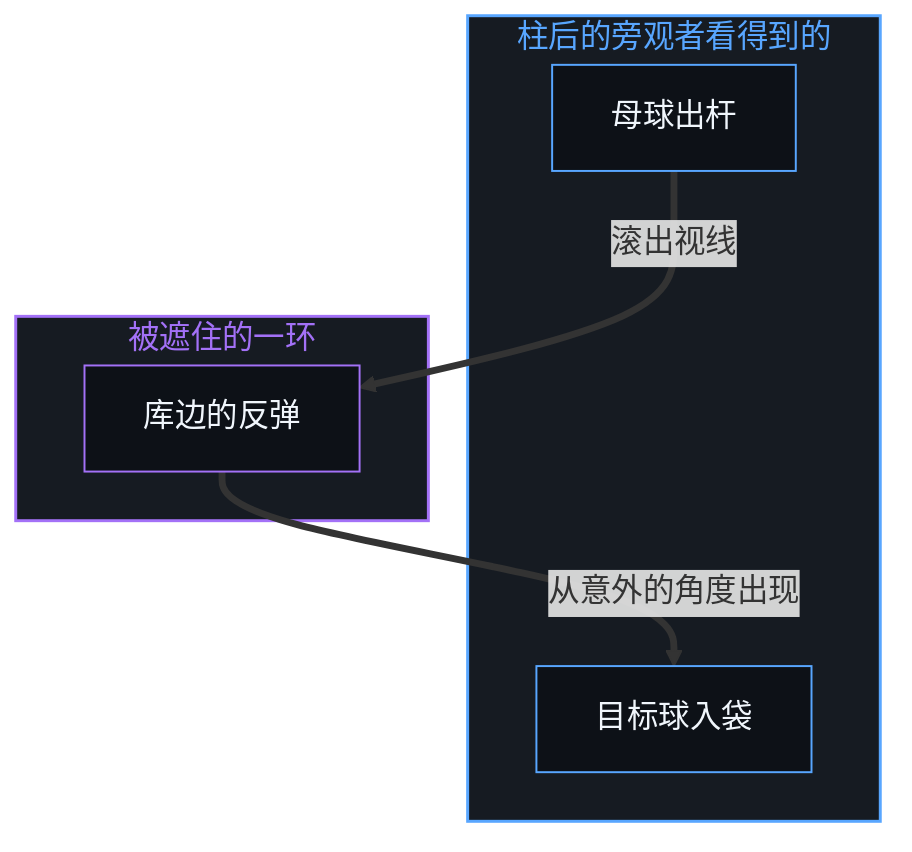
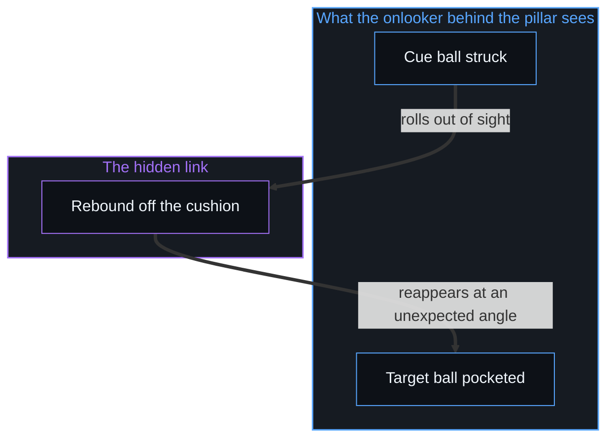

# 翻袋球与魔术戏法 / The Bank Shot and the Magic Trick

*中间的反弹被遮住，寻常的后果就像魔术，冲突是内部模型缺了一环因果 / A hidden bounce makes an ordinary consequence look like magic, and conflict is a link missing from the inner model.*

台球桌上，母球与目标球之间的直线常常被挡住。直打不可能，球手就打翻袋：让母球撞向库边，以一个角度反弹到目标。为了算出这条路线，熟练的球手有一个安静的心算办法：想象目标球在库边后面有一个对称的镜像，直接瞄准这个虚拟的投影。

In billiards the straight line between the cue ball and the target ball is often blocked. A direct stroke is impossible, so the player plays a bank shot: the cue ball strikes the cushion and rebounds at an angle toward the target. To work out this path, experienced players use a quiet mental device: they imagine a mirror image of the target ball sitting symmetrically behind the cushion, and aim straight at that virtual projection.

镜像球并不存在于球桌上，它是一个居间的认知启发，让入射角与反射角对齐。打得准，母球撞上木质库边，越过台呢反弹回来，把目标球干净地送进袋口。从这一杆出发，可以一路追到魔术、冲突与预判：凡是中间那一次反弹落在视野之外的地方，寻常的因果就显得不可思议。

The mirror ball does not exist on the table; it is an intermediate cognitive heuristic that lines up the angle of incidence with the angle of reflection. Struck well, the cue ball hits the wooden rail, comes back across the felt and sends the target ball cleanly into the pocket. From this one stroke the trace runs on to magic, conflict and anticipation: wherever the intermediate bounce falls outside the field of view, ordinary causality looks inexplicable.

## 一、 缺失的库边 / 1. The Missing Cushion

同一杆球，从屋里不同的位置去看，就不一样。站在桌边、不懂反射几何的旁观者，看到球手认真地瞄着一块空着的库边，而不是目标球，于是断定球手在乱打，朝着目标的反方向出杆。站在柱子后面、看不到库边的另一个旁观者，看到母球滚向墙边，消失在视线之外，又突然从一个意想不到的角度冒出来，撞中目标。在这位旁观者看来，这件事像奇迹：一个结果从无处而来，精准地成了。

The same stroke looks different from different places in the room. An onlooker standing beside the table without the geometry of reflection sees the player aim carefully at an empty stretch of cushion instead of the target ball, and concludes the player is shooting wildly, away from the goal. A second onlooker behind a pillar, with no view of the rail, sees the cue ball roll toward the wall, pass out of sight, and suddenly reappear from an unexpected angle to strike the target. To this onlooker the event looks like a miracle: a result arriving from nowhere and landing precisely.

这就是魔术的机制。舞台上的魔术师并不悬置因果，而是安排误导，让关键的中间环节发生在观众的感知框架之外。被当作魔术来欣赏、或被当作无法解释的反常来害怕的东西，只是一段反弹被遮住了的因果。

This is the mechanism of the magic trick. A stage magician does not suspend causality; the magician arranges misdirection so that the critical intermediate links happen outside the audience's frame of perception. What is enjoyed as magic, or feared as an inexplicable anomaly, is only causality with its bounce hidden.

## 二、 举重若轻的功夫 / 2. The Work Behind Ease

要让一个戏法看起来像魔术，表演者得投入大量第一人称的练习。手法要快、要准、误导要校准到位，直到一切机械的吃力都从观众眼里消失。“台上一分钟，台下十年功”说的正是因果的复利：看上去毫不费力的那份不在场，是由最严格的、重复的在场造出来的。

To make a trick look like magic, the performer has to put in a great deal of first-person practice. The sleight of hand must be fast and exact, the misdirection calibrated, until every trace of mechanical strain disappears from the audience's view. The saying that a minute on stage takes ten years off stage describes causal compounding: the look of effortless absence is produced by the most rigorous presence of repetition.

第三人称的旁观者看到举重若轻，常把看不见的吃力当成没有因果的功夫，把精通归于天才、天赋或运气。翻袋球打得越顺，背后在球桌边独自站过的时间就越多，握杆、旋转与力道，一次次对着真实的阻力校准出来。正如[你的代码库即是记忆](../your-codebase-is-memory/)所追溯的，一套维护得当的记忆代码库——校准好的库边、验证过的例程与修剪干净的脚手架——能让对母球的有意一击沿着多次反弹利落地传导到底，而魔术戏法的幻象遮住了这些预先铺垫的切分，把最终落袋的那颗球误认作无因的奇迹。

Third-person onlookers who see effortless ease tend to take the absence of visible strain for the absence of causal work, and credit the mastery to genius, gift or chance. The smoother the bank shot looks, the more hours were spent standing alone at the table, grip, spin and pace calibrated again and again against real resistance. As [Your Codebase Is Memory](../your-codebase-is-memory/) traces, a well-maintained codebase of memory—calibrated cushions, verified routines and pruned scaffolding—lets a single deliberate strike at the cue ball propagate cleanly across multiple bounces, whereas the magic-trick illusion hides those preparatory cuts and mistakes the final pocketed ball for an uncaused miracle.

## 三、 未被看见的反弹 / 3. The Unseen Rebound

人与人之间的摩擦也是这样运作的。每个人都从自己的第一人称坐标系出发，在一片各自的约束里行走。遇到僵局时，一场社交上的僵持、一份家庭的责任、一个创作上的两难，通往目标的直路常常被整个挡住。要往前走，就打一杆翻袋：把力气投向一个间接的边界，一次别扭的停顿、一段职业上的绕行、一个违反直觉的让步，只为了得到通向真正目标的那一次反弹。

Friction between people works the same way. Each person starts from a first-person coordinate system and moves through a landscape of constraints of their own. At an impasse, a social standoff, a family obligation, a creative dilemma, the straight path to the goal is often blocked entirely. To move on, they play a bank shot: they put their effort into an indirect boundary, an awkward pause, a detour in a career, a counterintuitive concession, only to get the rebound that leads to the actual aim.

从另一个身体与心理角度看过去的旁观者，只看到那一杆打在空着的库边上。重建不了对方的几何，就把这个举动判为不理性、恶意或愚蠢。人与人的冲突大多不是对现实的争执，而是没有看到决定对方路线的那些库边与反射角。[约束的样子不是自由的失去](../the-look-of-constraint-is-not-the-loss-of-freedom/)分析的正是这个感知陷阱：外部的观察者把约束之下的适应性导航，误认为乱来，或误认为能动性的丧失。

Onlookers seeing it from a different physical and psychological angle see only the stroke at the empty cushion. Unable to reconstruct the other person's geometry, they judge the act irrational, malicious or foolish. Most conflict between people is not a dispute over reality but a failure to see the cushions and angles of reflection that set the other person's path. [The Look of Constraint Is Not the Loss of Freedom](../the-look-of-constraint-is-not-the-loss-of-freedom/) analyses exactly this trap of perception: an outside observer taking adaptive navigation under constraint for erratic behaviour, or for a loss of agency.

## 四、 预判的翻袋与后见之明 / 4. The Anticipatory Bank Shot and Hindsight

预测未来，是一杆跨越时间的预判翻袋。要够到一个尚未显现的目标，需要两种功夫：在当下可见的约束后面投出一个准确的虚拟目标球的认知能力，以及在真实的摩擦里以校准过的力道击球的操作技能。只能看到眼前直线的位置上，向前投射的人显得在朝空处开火，旁观的位置会问为什么；不站到同一个向前投射的几何里，那些策略性的出杆就像妄想。即使看懂了这个投射，理解与执行仍是两回事，没有在球桌边成千上万小时的练习，理论知识打不出这一杆。只有远见而没有练习，是空想；只有练习而没有向前的投射，是钝直的碰撞。这些位置不是不同种类的人，同一个心智在不同的事情上会站在其中任何一个。

Forecasting the future is an anticipatory bank shot across time. Reaching a goal not yet manifest takes two kinds of skill: the cognitive capacity to project an accurate virtual target ball behind the constraints visible in the present, and the operating skill to strike with calibrated pace through real friction. From a position that sees only the straight line ahead, someone projecting forward seems to fire into empty space, and the onlooking position asks why; without stepping into the same forward geometry, those strategic strokes look like delusion. Even once the projection is understood, understanding and execution remain two things, and without thousands of hours of practice at the table theoretical knowledge does not make the shot. Vision without practice is empty speculation; practice without forward projection is blunt, direct collision. These positions are not different kinds of people; one Mind stands in any of them, depending on the matter at hand.

球进袋之后，第三人称的观察者赶来解释结果。后见之明能产出无数回溯的叙事，有的把这一杆归于外部的好运、球桌的异常或不可重复的巧合，有的反过来只讲功夫与眼光。把大量业余的出杆汇成一个数据集，画出一条钟形曲线，用分布来描述命中率，对于了解整体的情形是有用的；把它读成“打进翻袋只是随机与均值回归”，就到了边界。正如[自由的测不准](../zi-you-de-ce-bu-zhun/)所指出的，这一步把第三人称观察信息的缺席，当成了第一人称因果的缺席。

Once the ball drops, third-person observers arrive to explain the result. Hindsight produces endless retroactive narratives, some crediting the stroke to outside fortune, a quirk of the table or unrepeatable chance, others telling only of skill and vision. Pooling many amateur strokes into a dataset, drawing a bell curve and describing the success rate as a distribution is of use for seeing the overall picture; reading it as "sinking a bank shot is only chance and regression to the mean" is where it reaches its boundary. As [The Uncertainty of Freedom](../zi-you-de-ce-bu-zhun/) points out, that step takes the absence of third-person observational information for the absence of first-person causation.

把统计结论当作指导现实的定律，是忘了第三人称视角本是在第一人称之内编出来的抽象。统计是少不了的历史参照，是一份回溯的普查，记下许多个中心在先前的条件下怎样行走。把这份汇总的参照抬成规定性的定律，就把因果放错了位置：过去选择留下的下游痕迹，被当成从上往下的主宰，规定握着球杆的人下一步能做什么。事后提炼出整齐规则的回溯学说，也把完成的结果与生成的过程混为一谈，这是[成功学](../cheng-gong-xue/)拆开的陷阱。被遮住的反弹，就是[遗忘的脚手架](../the-scaffolding-we-forget/)所说的那种被遗忘的脚手架。

Treating statistical conclusions as laws guiding reality forgets that the third-person view is an abstraction compiled within the first person. Statistics are an indispensable historical reference, a retrospective census of how many centres moved through earlier conditions. Raising that aggregate reference into a prescriptive law misplaces causality: the downstream traces of past choices are treated as a master from above, dictating what the one holding the cue can do next. Retrospective doctrines that extract tidy rules after the fact likewise confuse the finished result with the generating process, the trap taken apart in [Theories After Success](../cheng-gong-xue/). Hidden bounces are the scaffolding forgotten in [The Scaffolding We Forget](../the-scaffolding-we-forget/).

## 五、 观察持有结果，原因先行一步 / 5. Observation Holds the Effect, the Cause Stays Ahead

这种归因错误的来源，在感知的一个基本条件里：每一次观察到达时都已是结果。观察总站在完成的后果那一边，生成的原因始终先行一步，[前因，后果](../qian-yin-hou-guo/)论证的正是这一点。落到感官上的是终点，球与球的碰撞、球的偏转、已经做出的裁决；承载动量的中间环节，除非有意去追，否则看不见。孤立地遇到一个陌生的结果时，心智会本能地用魔术般的叙事、系统的阴谋或任意的运气去填这个缺口。理解要求重建完整的传递链，找出动量被转向的那些中间表面。

The source of this misattribution lies in a basic condition of perception: every observation arrives already as an effect. Observation always stands on the side of the finished consequence, while the generating cause stays one step ahead, as [Cause Before, Effect After](../qian-yin-hou-guo/) argues. What lands on the senses is the end point, the collision of the balls, the deflection, the verdict already given; the intermediate links that carried the momentum stay unseen unless deliberately traced. Meeting an unfamiliar effect in isolation, the Mind instinctively fills the gap with magical narratives, systemic conspiracies or arbitrary luck. Understanding requires rebuilding the whole chain of transmission, finding the intermediate surfaces where the momentum was redirected.

这条原则从球桌一直延伸到一切宏观现象。从金融市场到文明的制度，宏观结构都是相互作用的微观选择稳定下来的反馈回路，[宏观现象的生成图谱](../the-generative-atlas-of-macroscopic-phenomena/)展示了这一点；推动任何宏观发展的首要自由变量，是穿过约束而行动的个体选择，[个体抉择是唯一的因果杠杆](../individual-choices-as-the-only-causal-levers/)确立了这一点。对一个把能动性剥掉的外部观察者来说，地平线看上去是统计的随机或量子的不确定；从第一人称看，这份不确定正是选择、专注的练习与有后果的行动所在的地方。随机与自由是同一件事的两面，一面从外部登记，一面从内部经历。否认自由意志也是一杆翻袋：这个否认本身就是它所否认的自由，[自由意志的自否自由](../the-freedom-of-will-to-deny-itself/)展示了这一点。

This principle extends from the table to every macroscopic phenomenon. From financial markets to the institutions of civilisations, macro structures are stabilised feedback loops of interacting micro choices, as [The Generative Atlas of Macroscopic Phenomena](../the-generative-atlas-of-macroscopic-phenomena/) shows; the primary free variable driving any macro development is individual choice acting through constraint, as [Individual Choices as the Only Causal Levers](../individual-choices-as-the-only-causal-levers/) establishes. To an outside observer who strips out agency, the horizon looks like statistical randomness or quantum indeterminacy; from the first person, that indeterminacy is exactly where choice, focused practice and consequential action reside. Randomness and freedom are two faces of one thing, one registered from outside, one lived from inside. Denying free will is a bank shot too: the denial is the freedom it denies, as [The Freedom of Will to Deny Itself](../the-freedom-of-will-to-deny-itself/) shows.

## 六、 从未离开的第一人称 / 6. The First Person Never Left

更深的一层认识，不只是回到第一人称的立场，而是看到从来没有离开过它。即使有意地设身处地，推断对方隐藏的约束，想象对方的那颗镜像球，这一切也都发生在自己意识的光圈之内。没有跃入另一个意识的超越，也没有脱离的“无处之见”，[无穷总体的海市蜃楼](../the-mirage-of-the-infinite-totality/)表明了这一点。对另一个行动者建起的每一个心智模型，都画在自己心智内部的画布上。每一次反弹都是因果在时间中的一步，[时间是因果的不可逆方向与离散步长](../time-is-causality-not-a-dimension/)把它当作步长的次序，而不是一个维度。

The deeper recognition is not only returning to the first-person stance but seeing that it was never left. Even the deliberate effort to stand in another's place, infer their hidden constraints and imagine their mirror ball takes place within the aperture of one's own awareness. There is no transcendent leap into another awareness and no detached "view from nowhere", as [The Mirage of the Infinite Totality](../the-mirage-of-the-infinite-totality/) shows. Every model of another actor is drawn on the inner canvas of one's own Mind. Each bounce is a step of causality in time, which [Time Is the Irreversible Direction and Discrete Step of Causality](../time-is-causality-not-a-dimension/) treats as an order of steps rather than a dimension.

于是，凡是感到或看到的冲突、误解或不理性，都是自己对现实的内部模型里缺了的一环因果。冲突不是外部地形固有的属性，它是一张不完整的地图带来的认知摩擦。内部的几何里缺了对方动量被转向的那一段库边，对方的路线就显得是一次不可能的、古怪的跳跃，像一场没经过同意就上演的魔术。

So whatever registers as conflict, misunderstanding or irrationality is a causal link missing from one's own inner model of reality. Conflict is not a property of the outer terrain; it is the cognitive friction of an incomplete map. When the inner geometry lacks the stretch of cushion where the other person's momentum was redirected, their path looks like an impossible, erratic leap, a magic trick performed without consent.

## 七、 补上那一环 / 7. Tracing the Missing Link

这样一来，第一人称在现实中导航的办法简单得出奇：找出并追上缺了的那一环因果。凡是出现困惑、人与人的摩擦或看似的不可能，现实并没有坏，只是一次中间的反弹从感知里掉了出去。为了补上这个缺口，任何现成的模型、形式理论或外部视角都可以暂时借来用。正如[框架的边界](../the-boundary-of-the-frame/)所分析的，框架与理论的作用正像库边后面那颗想象的镜像球：有用的几何脚手架与局部的坐标系，帮着推出反射角。可脚手架从来不是地形，那一环因果要从第一人称的立场直接看到、住进去、验证过，才有意义与操作的力量。

This makes the method of first-person navigation surprisingly simple: find and trace the missing causal link. Wherever confusion, friction between people or apparent impossibility shows up, reality has not broken; an intermediate bounce has dropped out of perception. To close the gap, any existing model, formal theory or outside view can be borrowed for the time being. As [The Boundary of the Frame](../the-boundary-of-the-frame/) analyses, frameworks and theories work exactly like the imagined mirror ball behind the cushion: useful geometric scaffolding and local coordinate systems that help derive the angle of reflection. Yet the scaffolding is never the terrain, and the causal link has to be seen, inhabited and verified directly from the first-person stance to carry meaning and operating power.

所以追上缺了的那一环，从来不是对别人居高临下的施舍，而是自己感知地平线的主动延展。找到那段未被看见的库边，就把新的因果几何并进内部模型，魔术的幻象随之消散，防御性的评判让位给结构上的清晰。这份延展直接丰富了自己活着的经验，拓宽了选择去看的那个世界，开出一条通向更自洽的感知的路。

So tracing the missing link is never a condescending charity toward another; it is an active widening of one's own perceptual horizon. Finding the unseen cushion folds new causal geometry into the inner model, the illusion of magic dissolves, and defensive judgment gives way to structural clarity. That widening directly enriches one's own lived experience, broadens the world one chooses to see, and opens a path toward a more coherent perception.

别人的反射角，没有义务向谁解释；世界也不提供现成的自洽或不费力的展开，[没有普渡，只有自渡](../mei-you-pu-du-zhi-you-zi-du/)从这里立足。要求对方解释自己，或等外部的情形送来清晰，是把这一环交给了别人；而它能被补上的地方，只在此刻感知着现实的这个心智之中。在世界中导航，就是追着翻袋穿过每一次中间的反射，每一颗球、每一段库边、每一条地平线，都是从内部被持有、被感知、被实现的。冲突出现在拿投影相比而忘了向量的时候，[向量与投影的迷局](../the-vector-and-the-puzzle-of-projections/)展示了这一点。

No one is obliged to explain their angle of reflection, and the world offers neither ready-made coherence nor an effortless unfolding, which is where [No Universal Salvation, Only Boundless Possibilities of Self-Salvation](../mei-you-pu-du-zhi-you-zi-du/) stands. Asking another person to explain themselves, or waiting for outside circumstances to deliver clarity, hands the missing link to someone else; the only place it can be closed is the Mind perceiving reality at this moment. Navigating the world is tracing the bank shot through every intermediate reflection, every ball, every cushion and every horizon held, perceived and realised from within. Conflict appears when projections are compared without the vector, as [The Vector and the Puzzle of Projections](../the-vector-and-the-puzzle-of-projections/) shows.
