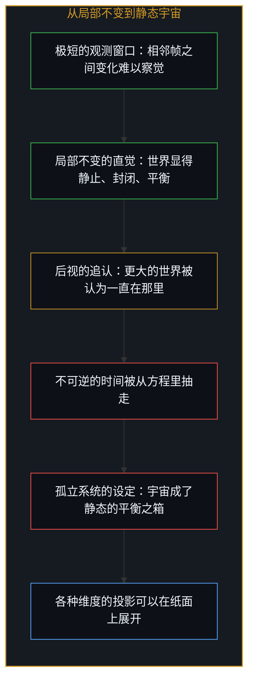
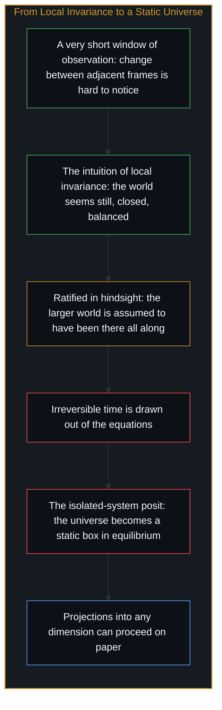
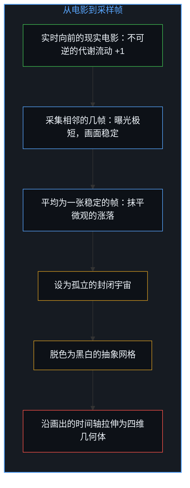
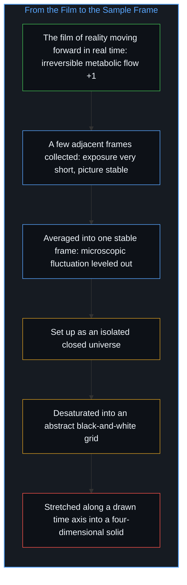
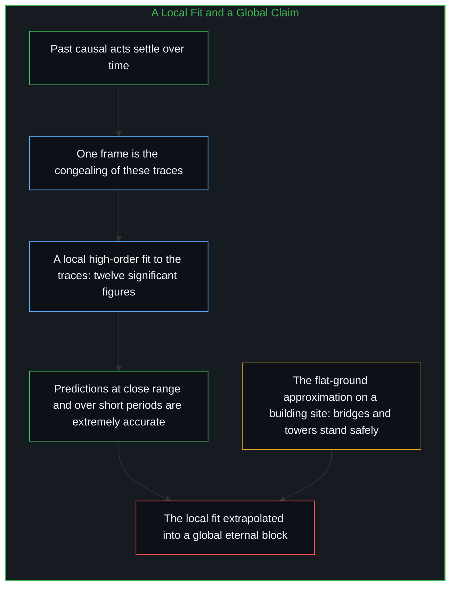
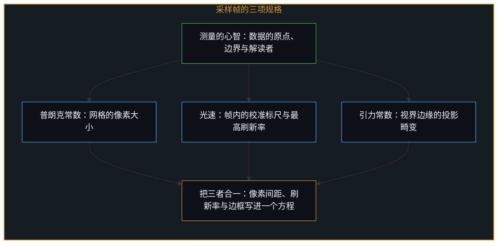
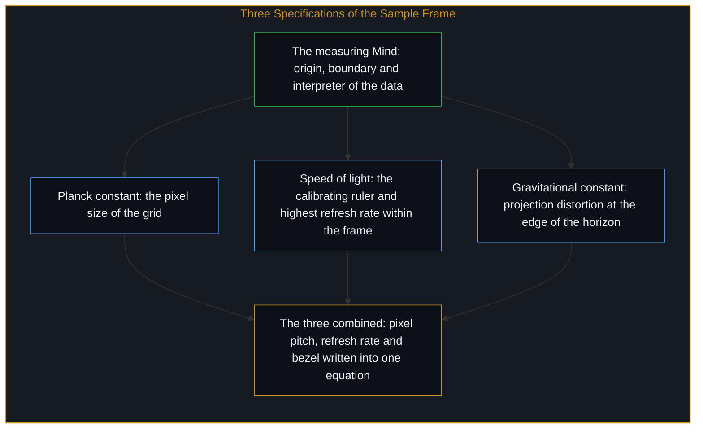
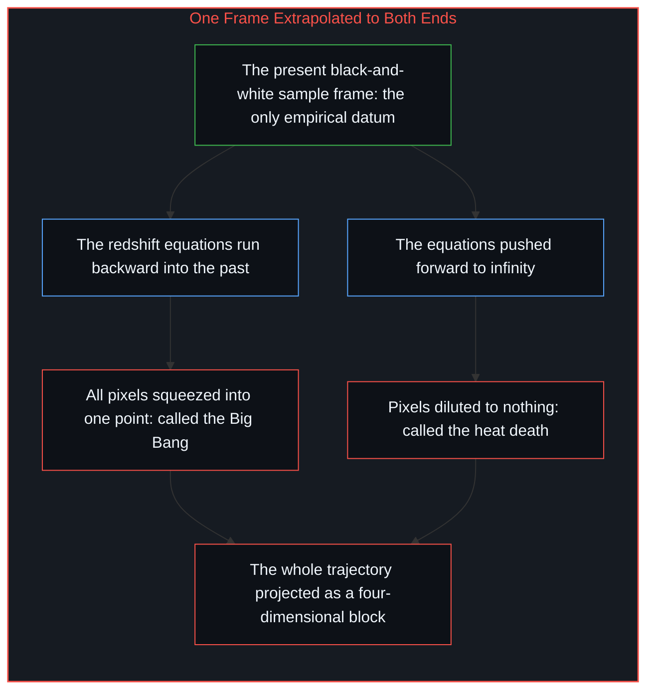
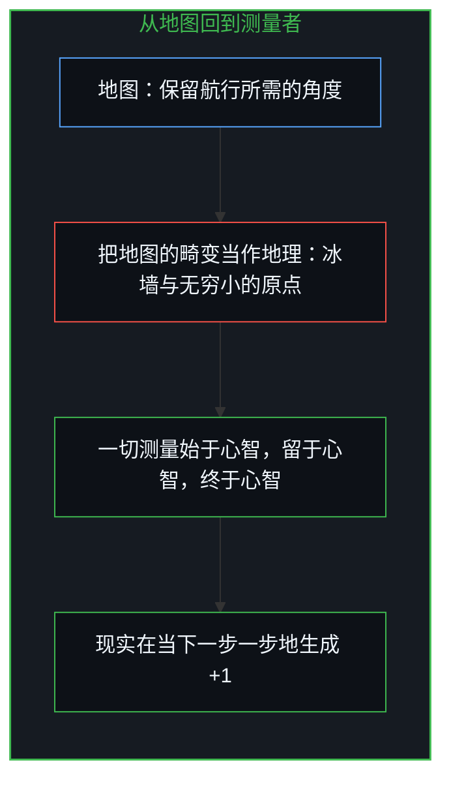
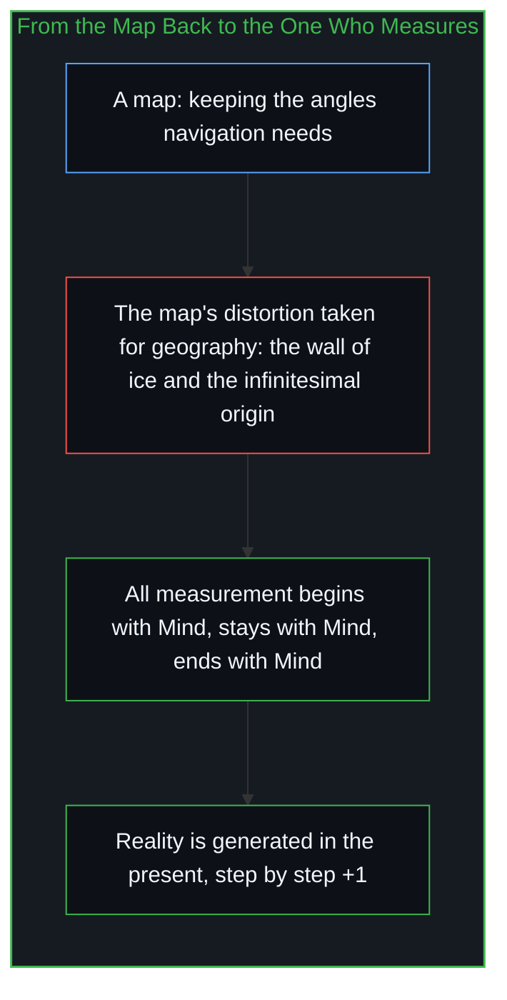

# 黑白采样帧与外推宇宙 / The Black-and-White Sample Frame and the Extrapolated Universe

*物理学如何冻结现实电影并将投影命名为宇宙 / How Physics Froze the Movie of Reality and Named the Projection the Cosmos*

所经验的现实像一部正在实时向前播放的高动态影像。物理学在极短的时间里采集相邻的几帧，平均成一张高度稳定的帧，把它设为封闭的宇宙，再脱色为黑白的网格。这种不变性在局部与即时的范围内成立，所以理论的局部预测极为准确。把这张局部的平均帧外推为四维的永恒块，则与把工地上的平地外推为整个大地是同一步。

The reality experienced is like a high-dynamic-range film playing forward in real time. Physics collects a few adjacent frames within a very short time, averages them into one highly stable frame, sets it up as a closed universe and then desaturates it into a black-and-white grid. The invariance holds within what is local and immediate, which is why the theory's local predictions are extremely accurate. Extrapolating this local averaged frame into an eternal four-dimensional block is the same step as extrapolating the level ground of a building site to the whole Earth.

## 一、 瞬时的不变与静态宇宙的诱惑 / 1. Momentary Invariance and the Pull of a Static Universe

在有限的观测视界之内，宇宙呈现出一种高度稳定的静止感。恒星在夜空里的位置似乎不动，行星沿既定的轨道周而复始，重力加速度在日常的尺度上保持平稳。任何仪器都要经过一段曝光才能捕获信号，物理学实际采集的是这部电影里最相邻的若干帧。这段时间极短，画面在相邻帧之间高度稳定，眼前的世界便自然被当作一个自足、封闭而孤立的平衡系统。

Within a limited horizon of observation, the universe presents a highly stable sense of stillness. The stars seem not to move in the night sky, the planets go round on their set orbits, and gravitational acceleration stays steady at everyday scales. Every instrument needs a stretch of exposure to capture a signal, and what physics in fact collects are the most adjacent frames of this film. The time is very short, the picture is highly stable from one adjacent frame to the next, and the world before one's eyes is naturally taken for a self-sufficient, closed and isolated system in equilibrium.

这种即时感知里的局部不变，引出一次范畴上的跳跃：系统既然在极短的时间里表现得像一个静态的孤立系统，不可逆的时间便被从方程里抽走。排除了因果的流动，把现实截成一张静态的切片之后，任何数学维度的投影都可以在纸面上顺畅地展开。

This local invariance within immediate perception invites a leap of category: since the system behaves, over a very short time, like a static isolated system, irreversible time is drawn out of the equations. With the flow of causality excluded and reality cut into a static slice, projection into any mathematical dimension can proceed smoothly on paper.

这里还有一层后视的错位：把扩展的视界当成预先存在的容器。婴儿出生时，所感知的世界只在母亲的怀抱与摇篮之间，随着身心的发育、语言的习得与行动半径的延伸，所经验的世界不可逆地向外拓展。文明的演进也是如此，从洞穴到大陆，从太阳系到百亿光年之外的深空。而每当感知到一个更大的世界，心智便想当然地认为，那个更大的世界一直完好地立在那里等着被“发现”。感知的视界在因果的推进中不断显现的扩展，于是被读成了对一座早已封顶的四维大厦的巡览，块状宇宙的模型便从这里得到情感上的支撑。

There is also a displacement made in hindsight here: an expanding horizon is taken for a container that existed in advance. At birth an infant's perceived world lies between the mother's arms and the cradle, and with the growth of body and mind, the learning of language and the lengthening radius of action, the world experienced extends irreversibly outward. So it is with the development of civilization, from the cave to the continents, from the solar system to deep space tens of billions of light-years away. Yet each time a larger world is perceived, a Mind takes it for granted that this larger world had stood there intact all along, waiting to be "discovered." The expansion of the perceptual horizon, appearing step by step in the advance of causality, is thereby read as a tour through a four-dimensional edifice long since topped out, and the block universe model draws its emotional support from here.

[双生子佯谬与隐秘观察者](../the-twin-paradox-and-the-hidden-observer/)说明，只要信息在形式的变换里保持守恒，符号的运算便能给出一种“完美宇宙模型”的自洽。很少有人亲手推导那些张量方程，对大爆炸与四维时空的接受多来自学术机构的背书。[共享沙盒的幻象](../the-illusion-of-the-shared-sandbox/)指出，既定的科学是特定框架下的低维出清价，即便在理论家之间，不同的学派对同一套数学形式的理解也各不相同。

[The Twin Paradox and the Hidden Observer](../the-twin-paradox-and-the-hidden-observer/) shows that as long as information is conserved through formal transformations, symbolic operations can yield the self-consistency of a "perfect model of the universe." Few people derive those tensor equations by hand, and acceptance of the Big Bang and four-dimensional spacetime mostly comes from the endorsement of academic institutions. [The Illusion of the Shared Sandbox](../the-illusion-of-the-shared-sandbox/) points out that established science is a low-dimensional clearing price under a particular framework, and even among theorists, different schools understand the same mathematical formalism differently.

## 二、 从高动态的现实到黑白采样帧 / 2. From High-Dynamic Reality to the Black-and-White Sample Frame

现实不是陈列在玻璃柜里的一件几何标本。在生活与物理的过程里，世界是一部正在实时向前播放的高动态范围电影，每一刻的到来都伴着不可逆的消耗、代谢的应力与新的因果区分（+1）。过去沉淀为确定的因果痕迹，未来尚未发生，能够指出来的都在正在显现的当下。

Reality is not a geometric specimen displayed in a glass case. In living and in physical processes the world is a high-dynamic-range film playing forward in real time, and the arrival of each moment comes with irreversible expenditure, metabolic stress and a new causal distinction (+1). The past has settled into definite causal traces, the future has not yet happened, and whatever can be pointed to is in the present now appearing.

理论物理的建模对它作了一次大幅的降维。它收集这部电影里最相邻的若干帧，时间尺度极短，画面高度平稳。随后是一次关键的平均：把相邻的帧作统计上的平滑，抹平微观的涨落与起伏，熔成一张高度稳定的“平均帧”。这张平均帧被设为一个自足而孤立的“封闭宇宙”。为了让它能被微积分与线性代数处理，画面里的色彩、主观的经验与代谢的流动被抽去，脱色为抽象的黑白几何网格。

The modeling of theoretical physics performs a large reduction of dimension upon it. It collects the most adjacent frames of the film; the time scale is very short and the picture highly steady. Then comes a decisive averaging: the adjacent frames are smoothed statistically, microscopic fluctuation and variation are leveled out, and they are fused into one highly stable "average frame." This average frame is set up as a self-sufficient and isolated "closed universe." To make it tractable for calculus and linear algebra, the color in the picture, subjective experience and the flow of metabolism are drawn off, and it is desaturated into an abstract black-and-white geometric grid.

在这张黑白采样帧里，只剩下孤立的点、坐标轴与数值的向量。这张帧随后沿一条画出来的时间轴向前向后拉伸，成了一个四维的静态几何体，并被称为宇宙的全貌。[时间是因果的不可逆方向与离散步长](../time-is-causality-not-a-dimension/)说明，把时间看作第四个空间维度，是把电影的胶片一次摊开在桌面上，而没有谁站在桌子之外审视整条胶片，所拥有的是放映机的光束穿过当前这一格的那一瞬。

On this black-and-white sample frame only isolated points, coordinate axes and numerical vectors remain. The frame is then stretched forward and backward along a drawn time axis into a static four-dimensional solid, which is called the full extent of the universe. [Time Is the Irreversible Direction and Discrete Step of Causality](../time-is-causality-not-a-dimension/) shows that seeing time as a fourth spatial dimension is laying the whole reel of film out on a table at once, while no one stands apart from the table inspecting the entire reel; what one has is the instant in which the projector's beam passes through the current frame.

## 三、 像素级的精度与局部的可靠 / 3. Pixel-Level Precision and Local Reliability

这种外推之所以如此有说服力，在于局部的数学描述精密得惊人。把现实定在这张黑白采样帧上之后，便有了一个确定而封闭的形式系统，微积分、群论与微分几何在这张平整的底片上展现出很强的计算力。从广义相对论对水星近日点进动的微小修正，到量子电动力学对电子反常磁矩多达十二位有效数字的预测，对帧内像素关系的解析准确到令人叹服。

What makes this extrapolation so persuasive is the astonishing precision of the local mathematical description. With reality fixed on this black-and-white sample frame there is a definite and closed formal system, and calculus, group theory and differential geometry show great computational power on this flat negative. From general relativity's small correction to the precession of Mercury's perihelion to quantum electrodynamics predicting the electron's anomalous magnetic moment to as many as twelve significant figures, the analysis of the relations among pixels within the frame is admirably exact.

这张黑白的残留之所以能被精密地建模，在于画面里的每一个像素与结构，都是过去的因果动作在时间中沉淀下来的痕迹，它们之间有经过不可逆的时间才形成的因果关联。相邻帧平均出来的痕迹忠实地记下了已经发生且高度稳定的局部因果序列，这种不变性在即时与局部的范围内是成立的。所以把这套模型用在近距离、短时期的预测上，结果极准，日食月食的秒级预报与卫星导航的时钟同步都是例子。

This black-and-white residue can be modeled with precision because every pixel and structure in the picture is a trace that past causal acts have settled into over time, and among them are causal relations that took irreversible time to form. The traces averaged from adjacent frames faithfully record a local causal sequence that has already occurred and is highly stable, and this invariance does hold within what is immediate and local. So when the model is applied to predictions at close range and over short periods, the results are extremely accurate; forecasts of solar and lunar eclipses to the second and the synchronization of clocks for satellite navigation are examples.

这份精度是对已经沉淀的、局部相邻的历史数据的高阶拟合。局部的不变在眼前高度成立，预测在手边屡试不爽，于是容易多走一步：把针对局部相邻帧平均值的拟合，当作统摄全宇宙过去与未来的先验定律。局部预测的成功说明模型在这个范围内可靠，对宇宙整体的性质则没有说什么。

This precision is a high-order fit to historical data that has already settled and is locally adjacent. Local invariance holds strongly before one's eyes and predictions at hand succeed time after time, so it is easy to take one step more: treating a fit to the average of locally adjacent frames as an a priori law governing the past and future of the whole universe. The success of local prediction shows the model to be reliable within this range and says nothing about the properties of the universe as a whole.

地平的设想走的是同一步。建造摩天大楼或跨海大桥时，工地的地表被当作平坦的二维欧氏平面，在几百米乃至几公里的尺度内，这种近似有无可挑剔的工程精度。越界发生在把这套在局部极准的平面坐标沿地平线无限向外延展，说大地是一个平坦圆盘的时候。宇宙学上的做法与此同构：在极短的观测区间内，黑白采样帧的局部切空间数学极为精确，切线便被画向百亿年尺度的过去与未来，宇宙被宣布为一座早已完工、所有事件同在的四维大厦。局部有效的测绘在这里被当成了整体的图景。

The idea of a flat Earth takes the same step. In building a skyscraper or a bridge across the sea, the surface of the site is treated as a flat two-dimensional Euclidean plane, and within a scale of hundreds of meters or even several kilometers the approximation has impeccable engineering precision. The overstep occurs when this plane coordinate system, extremely accurate locally, is extended without limit along the horizon and the Earth is said to be a flat disk. What is done in cosmology is isomorphic with this: within a very short interval of observation the mathematics of the local tangent space of the black-and-white sample frame is extremely precise, so the tangent line is drawn toward a past and future on the scale of tens of billions of years, and the universe is declared a four-dimensional edifice long complete, with all events present together. A survey that is valid locally is here taken for the picture of the whole.

## 四、 三个常数是采样帧的规格 / 4. Three Constants as the Specifications of the Sample Frame

在物理学的话语里，光速 c、普朗克常数 ħ 与引力常数 G 被看作客观宇宙的三个终极常数，是世界内部的围墙，量子引力的工作便是要把三者合成一套统一的理论。从第一人称的因果出发，这三个常数是心智把现实定住、制作黑白采样帧时确立的三项操作规格。

In the discourse of physics, the speed of light c, the Planck constant ħ and the gravitational constant G are regarded as three ultimate constants of an objective universe, walls inside the world, and the work of quantum gravity is to combine the three into one unified theory. Starting from first-person causality, the three constants are three operating specifications established when a Mind holds reality still and makes the black-and-white sample frame.

普朗克常数是采样帧的像素分辨率。所经验的连续，来自因果在逻辑上的连贯，最小的离散步长小到可以忽略，如同 dx 足够小时被当作零。把 dx 等同于零，并把这一步推到现实本身，是数学的越界，普朗克常数标出的正是这个不为零的最小步长。量子力学里的波粒二象性、测不准关系与概率波函数，便是连续的微积分数学去探查网格上两个相邻像素之间时留下的涂抹，现实显得悖谬，是因为被要求去合乎模型。把一张低分辨率的位图放大，看到的马赛克与模糊边缘属于显示网格的分辨率，不属于被拍的东西。

The Planck constant is the pixel resolution of the sample frame. The continuity experienced comes from the logical coherence of causality, with the smallest discrete step small enough to be ignored, just as dx is treated as zero when small enough. Equating dx with zero and carrying that step over to reality itself is where mathematics oversteps, and what the Planck constant marks is this smallest step that is not zero. Wave-particle duality, the uncertainty relation and the probability wavefunction in quantum mechanics are then the smear left when the continuous mathematics of calculus probes between two adjacent pixels of the grid; reality seems paradoxical because it is being required to fit the model. Enlarge a low-resolution bitmap and the mosaic and blurred edges seen belong to the resolution of the display grid, not to the thing photographed.

光速是采样帧的校准标尺与最高刷新率。在一张定住的切片内部描述像素之间的相对运动与相互作用，须选定一个最高的速度作基准，否则相对的距离与时序无法在同一张图纸上校准。狭义相对论选光速，是因为光是即时感知里能捕获的最快信号，以最快的现象作参照，才能测绘一切较慢的现象。它标出的是感知这块画布的响应带宽，是信号完成因果交握的最高刷新速率。

The speed of light is the calibrating ruler and highest refresh rate of the sample frame. To describe relative motion and interaction among pixels inside a slice held still, a highest speed must be chosen as the benchmark, or relative distances and timings cannot be calibrated on one drawing. Special relativity chooses the speed of light because light is the fastest signal that can be captured in immediate perception, and only with the fastest phenomenon as reference can everything slower be surveyed. What it marks is the response bandwidth of the canvas of perception, the highest refresh rate at which signals complete their causal handshake.

引力常数与时空的弯曲，是宏观视界上的投影畸变。把这张局部平坦的采样帧扩展到整个宇宙时，外部的参照物用尽了，广义相对论以宇宙整体作为最终的参照背景。这相当于把一个球面的感知边界压平在一张纸面上。正如墨卡托地图把格陵兰拉得比南美洲还大，把平坦的采样帧投到宏观视界的边缘时，方程须引入空间的弯曲与度规张量来补偿投影的失真。空间的弯曲便是把局部平坦的坐标外推到全宇宙视界时的几何代偿。

The gravitational constant and the curvature of spacetime are projection distortion at the macroscopic horizon. When this locally flat sample frame is extended to the entire universe, outside objects of reference are used up, and general relativity takes the universe as a whole for the final background of reference. This amounts to pressing a spherical boundary of perception flat on a sheet of paper. Just as a Mercator map stretches Greenland larger than South America, when a flat sample frame is cast to the edge of the macroscopic horizon the equations must bring in spatial curvature and a metric tensor to compensate for the distortion of projection. The curvature of space is thus the geometric compensation made when locally flat coordinates are extrapolated to the horizon of the whole universe.

用弦理论或圈量子引力写出一个把 ħ、c 与 G 合在一起的万物理论，好比写出一个把显示器的像素间距、刷新频率与外壳边框融为一体的方程，并期望由它推出正在播放的电影的情节。三个常数是测量工具的技术边界，电影的内容不在其中。

Writing a theory of everything that joins ħ, c and G through string theory or loop quantum gravity is like writing an equation that fuses a monitor's pixel pitch, its refresh frequency and the bezel of its casing, and expecting to derive from it the plot of the film now playing. The three constants are the technical limits of the measuring tool, and the content of the film is not in them.

## 五、 外推出的大爆炸、热寂与块状宇宙 / 5. The Big Bang, Heat Death and Block Universe as Extrapolations

有了这张黑白采样帧和它局部的像素精度，一出宇宙学的戏便接着上演。在这张定住的幻灯片里，空间的膨胀被编码为距离与红移之间的一个代数关系，于是可以把帧内的数学轨迹倒放：像素之间的距离在当前帧里呈现出分离的趋势，沿方程反向推算，全部像素便在过去的某个数学截面上重合。当前帧的全部像素被挤回原点的一个点，这个点被称为宇宙的开端，即大爆炸的奇点。

With this black-and-white sample frame and its local pixel precision in hand, a cosmological drama follows. On this slide held still, the expansion of space is encoded as an algebraic relation between distance and redshift, so the mathematical trajectory within the frame can be played backward: the distances between pixels show a tendency to separate in the current frame, and computing in reverse along the equations, all pixels coincide on some mathematical section in the past. All the pixels of the current frame are squeezed back into one point at the origin, and this point is called the beginning of the universe, the singularity of the Big Bang.

同一个方程再被推向未来，让像素无休止地彼此远离。距离拉到无限大、信息的密度在数学上归零之处，被称为时间的尽头，即宇宙的热寂。最后，从一个点膨胀到无限稀薄的整条数学轨迹，被整体投影成一个四维的柱体，名为“块状宇宙”，时间在其中成了预先刻在四维晶体里的一条条静态“世界线”，电影的放映则被说成主观的幻觉。把取样框外推为定律，正是[“物理学才是定律”的障眼法](../the-sleight-of-hand-in-physics-is-the-law-and-the-friction-of-reality/)所揭示的戏法。

The same equations are then pushed toward the future, letting the pixels recede from one another without end. The place where distance stretches to infinity and the density of information goes mathematically to zero is called the end of time, the heat death of the universe. Finally, the whole mathematical trajectory, expanding from one point to unlimited thinness, is projected as a whole into a four-dimensional column named the "block universe," in which time becomes static "worldlines" engraved in advance within a four-dimensional crystal, and the showing of the film is said to be a subjective illusion. Extrapolating the sample frame into law is the sleight of hand that [The Sleight of Hand in "Physics Is the Law"](../the-sleight-of-hand-in-physics-is-the-law-and-the-friction-of-reality/) exposes.

[连续性作为建模的权宜之计](../the-continuum-is-a-modeling-convenience/)说明，一个数学函数在极限处出现奇点时，显出的是模型自身失效的位置。大爆炸的奇点与热寂便是对一张单帧的黑白幻灯片作坐标外推时，符号在纸面上走到尽头的地方。

[The Continuum is a Modeling Convenience](../the-continuum-is-a-modeling-convenience/) shows that when a mathematical function meets a singularity at a limit, what appears is the place where the model itself fails. The singularity of the Big Bang and the heat death are thus where the symbols run out on paper when coordinates are extrapolated from a single black-and-white slide.

## 六、 归还测量者 / 6. Returning the One Who Measures

科学的实用无需否定。相对论与量子力学像是画得极准的二维地图。墨卡托投影把两极拉到无限大，也扭曲了陆地面积的对比，而航海者只要按地图上的角度航行，便能抵达对岸，因为地图保留了航行所需的相对关系。边界出现在忘了这是一张地图的时候：指着地图上无限延展的北极边缘说大地的尽头是一堵无限宽的冰墙，指着被拉成一点的原点说时间诞生于一个无穷小的像素。

The practical use of science needs no denying. Relativity and quantum mechanics are like two-dimensional maps drawn with great accuracy. The Mercator projection stretches the poles to infinity and distorts the comparison of land areas, yet a navigator who sails by the angles on the map reaches the far shore, because the map keeps the relative relations that navigation needs. The boundary appears when it is forgotten that this is a map: pointing to the endlessly extended northern edge of the map and saying the end of the Earth is an infinitely wide wall of ice, or pointing to the origin stretched into a point and saying time was born in an infinitesimal pixel.

宇宙一直是用心智在测量的。一切测量始于心智，留于心智，终于心智。被称为客观世界的“物理常数”的，是心智展开感知与理性的探查时，测量仪器自身的分辨率与带宽：光速是感知现实的最高刷新率，普朗克尺度是数字化的网格像素，引力场与时空的弯曲是把有限的视界投到全局背景时的几何补偿。[当电子开始思考](../when-electrons-think/)在电子的尺度上展示了同一张被定住的画面。

The universe has been measured with Mind all along. All measurement begins with Mind, stays with Mind and ends with Mind. What are called the "physical constants" of an objective world are the resolution and bandwidth of the measuring instrument itself as a Mind unfolds perception and rational inquiry: the speed of light is the highest refresh rate of perceiving reality, the Planck scale is the grid pixel of digitization, and the gravitational field and the curvature of spacetime are the geometric compensation for casting a finite horizon onto a global background. [When Electrons Think](../when-electrons-think/) shows the same picture held still at the scale of electrons.

从第一人称出发，找不到一张印好的四维全景胶片，也找不到一个站在万物之外审视全局的位置。能指出来的，是此刻每一个生命作出的因果决断与不可逆的代谢步进（+1）。那张被脱色、定住并拉伸到无穷的黑白幻灯片仍是一张好用的地图，电影则在放映之中：因果是画布，抉择是不可约的自由变量，未来由当下的一笔一画写成。

Starting from the first person, no printed four-dimensional panoramic film is found, nor any position standing outside all things to inspect the whole. What can be pointed to are the causal decisions each life makes in this moment and its irreversible metabolic steps (+1). The black-and-white slide, desaturated, held still and stretched to infinity, remains a good map to use, while the film is in the showing: causality is the canvas, choice is the irreducible free variable, and the future is written by the strokes of the present.
