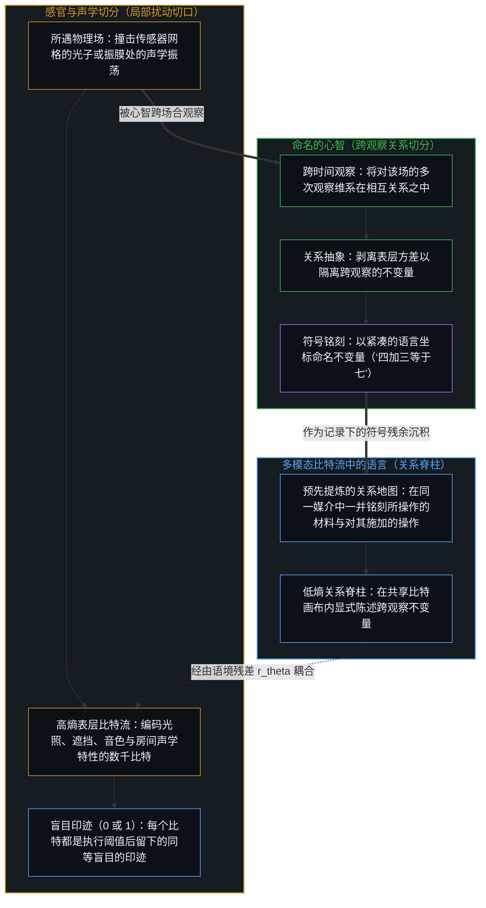
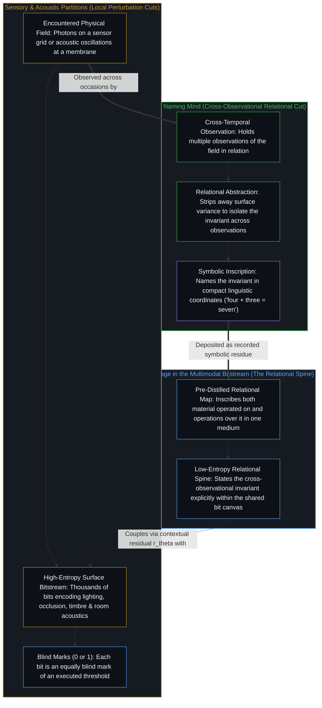

# 盲目的切分与命名的心智 / The Blind Cut and the Naming Mind

*机器中的每一个比特都只是同等盲目的印迹；语言与感官流之别，在于产生序列的切分方式——即以语词陈述心智已命名的关系不变量 / Every bit in a machine is an equally blind mark; language differs from a sensory stream in the partition that produced it, words stating invariants Minds named*

当多模态机器学习将文本、图像、音频与生物序列压平为同一条二进制序列（`x₀ ∈ {0, 1}^S`）时，这套共享字母表干净地省去了模态专用编码器与 `O(V)` 词表投影头，却也一并显露出那些比特自身从未承载过的东西。机器所执行的每一道阈值都是一次盲目的切分，留下的也只是同等盲目的印迹（`0` 或 `1`）；因此，语言与感官流或声学流之别，全在产生该序列的上游切分方式：一边是为重建局部同位物理扰动而设的传感器网格与编解码器，一边是语词——它们陈述的，是活生生的心智早已跨观察抽绎并命名的关系不变量。这种不对称性直接登记在多模态比特流扩散内部：`84` 个算式比特陈述了 `3,136` 个像素比特仅能隐式承载的算术关系；在声学编解码器帧上延续的语音会偏离话题，对齐到语词上的语音则能守住主题。而既然每一份码本、每一项压缩率与每一次解读都是心智设定的切分，那一刀便始终由心智在当下落下。

When multimodal machine learning flattens text, images, audio, and biological sequences into a single binary sequence (`x₀ ∈ {0, 1}^S`), the shared alphabet cleanly removes modality-specific encoders and `O(V)` vocabulary projection heads, yet it also exposes what the bits themselves never carried. Every threshold the machine executes is a blind cut that leaves an equally blind mark (`0` or `1`), so whatever separates language from a sensory or acoustic stream sits in the upstream partition that produced the sequence: a sensor grid or codec set to reconstruct co-located physical perturbations, or words that state invariants living Minds have already abstracted across observations and named. That asymmetry registers inside multimodal bitstream diffusion—where `84` equation bits state the arithmetic relation that `3,136` pixel bits carry only implicitly, and where speech continued in acoustic codec frames drifts off topic while speech aligned onto words holds its theme—and since every codebook, compression rate, and reading is a partition a Mind sets, the cut stays one drawn now by a Mind.

## 一、 “平级模态”在何处成立又在何处止步 / 1. Where "Peer Modalities" Holds and Where It Ends

在当代多模态机器学习中，通行的做法是在基准测试表里将文本、图像、音频与生物序列并列排开，视作彼此对等的“平级模态”。每一路输入都被当作又一条等待被分词、投影到共享嵌入空间、并由序列主干建模的数据流。

In contemporary multimodal machine learning, it is standard practice to place Text, Image, Audio, and Biological Sequences side by side in a benchmark table as "peer modalities." Each is treated as another data stream waiting to be tokenized, projected into a shared embedding space, and modeled by a sequence backbone.

连续比特流扩散领域的近期工作——以 [CoBit](https://arxiv.org/abs/2610.14349)（[代码](https://github.com/GBATZOLIS/BitstreamDiffusion)，基于 [Language Modeling with Bitstream Diffusion](https://arxiv.org/abs/2605.07013)）最为典型——将这种形式上的统一推到了表征的二进制底板，比[词元与观测边界](../tokens-and-the-observational-boundary/)所审视的子词与字节接口更往下一层。CoBit 不再为各个领域分别设计专用编码器、潜在空间桥接器与 `O(V)` 词表 Softmax 输出头，而是将图像、语音、文本与蛋白质结构转化为同一种通用货币：一条扁平的二进制比特序列（`x₀ ∈ {0, 1}^S`）。每一个比特都流经同一套输入投影、双向 Transformer 主干、匹配滤波残差参数化与二元分数匹配目标。

Recent work in continuous bitstream diffusion—most notably [CoBit](https://arxiv.org/abs/2610.14349) ([code](https://github.com/GBATZOLIS/BitstreamDiffusion), building on [Language Modeling with Bitstream Diffusion](https://arxiv.org/abs/2605.07013))—takes this formal unification to the binary floor of representation, stepping one layer below the subword and byte interfaces examined in [Tokens and the Observational Boundary](../tokens-and-the-observational-boundary/). Rather than engineering separate encoders, latent bridges, and `O(V)` vocabulary softmax heads for each domain, CoBit converts images, speech, text, and protein structures into a single universal currency: a flat sequence of binary bits (`x₀ ∈ {0, 1}^S`). Every bit passes through the same input projection, bidirectional Transformer trunk, matched-filter residual parameterization, and binary score-matching objective.

在将异质领域接口统一进同一个分数匹配主干的工程任务之内，这种化约一如设计所期地奏效。然而，从[非万物之理](../not-a-theory-of-everything/)所确立的离散切分与连续相续之共同条件出发，对照一个比特登记了什么与一条序列如何凝聚，便能看出 CoBit 自身的实验结果内部正显露出一种结构性的不对称。

Within the engineering task of unifying heterogeneous domain interfaces into one score-matching backbone, this reduction works as designed. Yet tracing what a bit registers against how a sequence coheres—from the joint conditions of discrete cut and continuous succession established in [Not a Theory of Everything](../not-a-theory-of-everything/)—exposes a structural asymmetry right inside CoBit's own empirical results.

将表征压平为通用的比特货币，并不会让感官流与语言在各自的切分所承载的东西上成为平级同侪。追溯其中的缘由，便能标定机器学习中的一条基底边界：机器所执行的阈值留下的盲目印迹，与命名的心智之间的边界。

Flattening representations into a common bit currency does not make sensory streams and language peers in what their partitions carry. Tracing why locates a foundational boundary in machine learning: the boundary between the blind mark of an executed threshold and the naming Mind.

## 二、 每一个比特都是切分留下的盲目印迹 / 2. Every Bit Is a Blind Mark of a Cut

自我区分的活动发生着——无因，不息。称它为心智：那个已在途中的观察者，它的每一个动作都是一次区分。正如[递归区分的架构](../architecture-of-recursive-distinction/)所追溯的，工程化回路内部的每一次有限判定，都是在状态空间中落下的一记离散二元切分（`bₖ = sign(rₖ)`），它将目标劈作被捕获的部分与作为残差留下的余项（`rₖ₊₁ = rₖ − αₖ bₖ`）。

Self-distinguishing activity occurs — uncaused, unceasing. Call it the Mind: the observer already underway, every act of which is a distinction. As [The Architecture of Recursive Distinction](../architecture-of-recursive-distinction/) traces, a finite determination inside an engineered loop is a discrete binary cut (`bₖ = sign(rₖ)`) in state space that cleaves a target into what is captured and what is left over as the residual (`rₖ₊₁ = rₖ − αₖ bₖ`).

然而，在形式模型或数字计算机内部，一个比特是什么？正如[信息是什么](../what-information-is/)与[印迹与行动](../the-mark-and-the-act/)所确立的，二进制比特并不先于区分；它是在切分设定之后留下的计数名称或印迹。机器所执行的阈值——无论是符号切分 `sign(rₖ)`、像素二值化器，还是编解码器量化器——都是一次盲目的切分：它沿着心智设定的一条线切分数值，对这次切分本身毫无登记，只留下一个比特（`0` 或 `1`，`−1` 或 `+1`）作为印迹。作为 `{0, 1}` 中的一个符号（以及存放它的物理状态），每一个比特——无论来自经阈值切分的像素、声学编解码器，还是算式中的一个语词——都是同等盲目的印迹。在 [CoBit](https://arxiv.org/abs/2605.07013) 内部，这一点直接登记在匹配滤波分解之中：当离散比特被弛豫进连续高斯空间（`x_σ = x₀ + σ ε`）时，单比特信道反演是一个在每个坐标上恒同一致、不含内容的解析线性滤波器（`(x_σ − ½) / σ²`），而一切跨比特关系都必须由残差分数网络（`r_θ`）从语境中习得。就连词元的比特排布本身，也是设计者在上游选定的一次切分：在 OpenWebText 上，将嵌入相似度复制进共享 `16` 比特前缀的码本排布（生成困惑度 `29.36`），表现反而不如任意的二进制编码指派（`27.06`）——在后者中，更宽的汉明距离间隔让语境分数网络得以纠正单比特错误——这表明排布方式只是上游设定的又一次切分，编码所承载的任何关系都属于码本，而不属于比特。

Inside a formal model or a digital computer, however, what is a bit? As [What Information Is](../what-information-is/) and [The Mark and the Act](../the-mark-and-the-act/) establish, a binary bit does not precede distinguishing; it is the count-name or mark left after a partition has been set. The threshold the machine executes—whether a sign cut `sign(rₖ)`, a pixel binarizer, or a codec quantizer—is a blind cut: it partitions a value along a line a Mind set, registers nothing of the partition, and leaves a bit (`0` or `1`, `−1` or `+1`) as its mark. As a symbol in `{0, 1}` (and in the physical states that store it), every bit—whether it comes from a thresholded pixel, an acoustic codec, or a word in an equation—is an equally blind mark. Inside [CoBit](https://arxiv.org/abs/2605.07013), this registers directly in the matched-filter decomposition: when discrete bits are relaxed into continuous Gaussian space (`x_σ = x₀ + σ ε`), the single-bit channel inversion is an analytic, content-free linear filter (`(x_σ − ½) / σ²`) identical for every coordinate, while every cross-bit relation must be learned from context in the residual score network (`r_θ`). Even the bit layout of a token is an upstream partition chosen by the designers: on OpenWebText, a codebook layout that copied embedding similarity into shared `16`-bit prefixes performed worse (`29.36` generative perplexity) than arbitrary binary code assignments (`27.06`), where wider Hamming separation lets the contextual score network correct single-bit errors—showing that the layout is one more partition set upstream, and whatever relation a code carries belongs to the codebook rather than the bit.

如果没有一个主导的心智去跨时间观察、将多次观察维系在相互关系之中、抽绎出随表层外观流变而保持不变的不变量并为其命名，比特流就只是驱动机器下一状态的印迹，在心智读取它之前，其中无一物被读。正如[感知者与痕迹的不可坍缩](../the-perceiver-and-the-trace/)所追溯的，把关系或意义归给印迹本身，只是把阅读者自己的阅读记到了痕迹名下。

Without a directing Mind to observe across time, hold multiple observations in relation to one another, extract what remains invariant across changing surface appearances, and name that invariant, a bitstream is marks that drive the machine's next state, and nothing in them is read until a Mind reads it. As [The Perceiver and the Trace Cannot Collapse](../the-perceiver-and-the-trace/) traces, crediting relation or meaning to the marks themselves enters the reader's own reading under the trace's name.

## 三、 为何语言是人类关系抽象的记录残余 / 3. Why Language Is the Recorded Residue of Human Abstraction

既然机器中的每一个比特都是同等盲目的印迹，为何语言会在人工智能中占据重心？因为不同序列的差异不在于它们的二进制印迹，而在于产生它们的切分方式：传感器或声学切分记录的是局部的物理扰动，而语言则是人类心智既往关系抽象活动留下的记录残余。

If every bit in a machine is an equally blind mark, why does language occupy the center of gravity in artificial intelligence? Because the sequences differ not in their binary marks, but in which partition produced them: a sensor or acoustic partition records localized physical perturbations, whereas language is the recorded residue of the human Mind's prior acts of relational abstraction.

像素网格或声学编解码器（`StableCodec`、`BiCodec`）在为信号重建而设的工程阈值之下，切分局部的物理扰动——撞击传感器阵列的同位光子，或在振膜上振荡的帧级基频、音色与房间声学特性。当摄像机拍下“四个苹果与三个苹果”的画面时，像素比特流记录了数以千计的表层变异比特：光照梯度、遮挡、纹理与背景噪声。而当人类心智观察同一场景时，它切去了表层方差，隔离出跨观察保持不变的关系不变量，并刻下一道紧凑的符号痕迹：“四加三等于七”。

A pixel grid or an acoustic codec (`StableCodec`, `BiCodec`) partitions local physical perturbations—co-located photons striking a sensor array, or frame-level pitch, timbre, and room acoustics oscillating against a membrane—under an engineered threshold set for signal reconstruction. When a camera records an image of four apples and three apples, the pixel bitstream records thousands of bits of surface variation: lighting gradients, occlusions, textures, and background noise. When a human Mind observes that scene, it cuts away the surface variance, isolates the relational invariant across observations, and inscribes a compact symbolic trace: `"four + three = seven"`.

人类语言中的每一个语词、每一种语法曲折与每一个数学算子，都是人类活生生的区分所压缩成的坐标。在数千年直面生存摩擦与未捕获环境残差的历程中，人类心智抽绎出所遇之物的关系结构——攀升过[抽象的阶梯与可执行的实体](../the-ladder-of-abstraction-and-the-executable-entity/)所追溯的各个层级——并将这些抽象记录为文本。正如[固定地图与重复的行程](../the-fixed-map-and-the-repeated-trip/)所追溯的，由于语言将所操作的一阶材料与施加其上的二阶关系操作一并作为印迹刻入同一种媒介，仅在感官或声学比特流上训练的机器学习模型，必须在构建者设定的目标之下，跨高熵的表层变异去还原那些流仅能隐式承载的关系；而在语言上训练的模型，直接摄入的则是人类心智早已陈述出来、经受过生存摩擦检验并已命名的关系。

Every word, grammatical inflection, and mathematical operator in human language is a compressed coordinate of lived human distinction. Across millennia of confronting survival friction and uncaptured environmental residuals, human Minds have abstracted the relational structure of what they encounter—climbing the tiers traced in [The Ladder of Abstraction and the Executable Entity](../the-ladder-of-abstraction-and-the-executable-entity/)—and recorded those abstractions into text. Because language inscribes both the first-order material operated on and the second-order relational operations over it as marks inside one medium, as [The Fixed Map and the Repeated Trip](../the-fixed-map-and-the-repeated-trip/) traces, a machine learning model trained on sensory or acoustic bitstreams alone must recover whatever relations those streams hold only implicitly across high-entropy surface variation under the objective its builders set, whereas a model trained on language ingests relations already stated, tested against survival friction, and named by human Minds.

## 四、 这种不对称性如何在比特流扩散内部登记 / 4. How the Asymmetry Registers Inside Bitstream Diffusion

由于去噪器中的每一个比特都是同等盲目的印迹，而上游切分承载着不同阶数的不变量，将感官流与文本压平进同一条二进制序列，并不会让它们在生成时变得对称。这种切分不对称性在联合分数匹配下如何表现，直接登记在 [CoBit](https://arxiv.org/abs/2610.14349) 的受控图文联合生成与语音-文本续写实验之中。

Because every bit in the denoiser is an equally blind mark while the partitions upstream carry different orders of invariance, flattening sensory streams and text into one binary sequence does not make them symmetric in generation. How that partition asymmetry behaves under joint score matching registers in [CoBit](https://arxiv.org/abs/2610.14349) across both controlled image–text co-generation and speech–text continuation.

### 1. 84 比特的关系脊柱（MNIST-Sum） / 1. The 84-Bit Spine (MNIST-Sum)

在 CoBit 的受控图文实验（`MNIST-Sum`）中，一幅由四个经阈值二值化的 `28 × 28` 手写数字组成的 `56 × 56` 画布，连同它们的符号加法算式（`d₁ + d₂ + d₃ + d₄ = s`，如 `"2 + 4 + 7 + 0 = 13"`），在不借助任何习得分词器与二维空间归纳偏置的情况下，被压平为一条横跨 `121` 个 `28` 比特块、总长 `3,388` 比特的单一序列：其中 `3,136` 个是原始阈值像素比特；`84` 个是算式比特，由一套 40 符号的确定性算术词表（覆盖 `0` 至 `36`、`+`、`=` 与填充符）编为 `12 × 7` 比特编码；另有 `168` 个分段标记比特。当这个 `63M` 参数的扩散模型从高斯噪声中无条件联合生成图像与算式时，`99.46%` 的生成配对同时做到格式完好、四个数字视觉匹配且算术成立（在留出的四数字元组上做条件文生图时达 `99.93%`）。在这块共享的 `3,388` 比特画布之内，四个数字必须满足的算术关系在 `84` 个符号比特中被显式陈述了一次，而那 `3,136` 个像素比特则只在视觉外观之间隐式地承载着这一关系。

In CoBit's controlled image–text experiment (`MNIST-Sum`), a `56 × 56` canvas of four thresholded `28 × 28` handwritten digits and their symbolic addition equation (`d₁ + d₂ + d₃ + d₄ = s`, such as `"2 + 4 + 7 + 0 = 13"`) are flattened into a single sequence of `3,388` bits across `121` patches of `28` bits (`3,136` raw thresholded pixel bits, `84` equation bits packed as `12 × 7`-bit codes from a deterministic 40-symbol arithmetic vocabulary covering `0` through `36`, `+`, `=`, and padding, and `168` segment marker bits) with no learned tokenizer and no two-dimensional spatial inductive bias. When the `63M`-parameter diffusion model co-generates image and equation unconditionally from Gaussian noise, `99.46%` of the generated pairs are simultaneously well-formed, visually matched across all four digits, and arithmetically valid (`99.93%` on held-out four-digit tuples in conditional text-to-image generation). Within that shared `3,388`-bit canvas, the arithmetic relation that the four digits must satisfy is stated once in `84` symbolic bits, whereas the `3,136` pixel bits carry that relation only implicitly across visual appearances.

### 2. 声学流利度与语义漂移（CoBit-MLS 对比语音语言模型） / 2. Acoustic Fluency Versus Semantic Drift (CoBit-MLS Versus Speech Language Models)

在 CoBit 的 `633M` 参数语音-文本模型（`CoBit-MLS`）中，比特流（`640 × 18 = 11,520` 比特）将冻结的离散编解码器索引打包进 `18` 比特块——包括每秒 `25` 个词元的 `StableCodec` 有限标量量化声学词元、`BiCodec` 全局说话人词元与 `o200k` BPE 文本词元——在未经文本语言模型预训练的情况下，直接从零开始在 `45,000` 小时配对语音与文本上训练。在 3 秒语音续写评测中，`CoBit-MLS`（`633M`）在自然度上达到 `3.89` UTMOS，在分布保真度上达到 `13.0` FSD-e2v，在跨情绪、说话人身份、性别、背景与房间声学特性的 SALMON 一致性上达到 `84.30%`——在自然度（`3.48` UTMOS）与分布保真度（`35.4` FSD-e2v，而 `Flow-SLM-L` 的 SALMON 达 `88.25%`）上超越了 `1.25B` 的流匹配模型 `Flow-SLM-L`，并在全部三项声学指标上超越了经 `7B` 文本预训练的 `Spirit-LM-Base`（`3.20` UTMOS、`26.8` FSD-e2v、`50.50%` SALMON）。然而，在由 GPT-4o 裁判打分的主题与语义续写上，`CoBit-MLS` 却跌至 `1.44`（其中 `61%` 的续写因偏离主题而拿到最低分 `1/5`）。

In CoBit's `633M`-parameter speech–text model (`CoBit-MLS`), the bitstream (`640 × 18 = 11,520` bits) packs frozen discrete codec indices into `18`-bit patches—`StableCodec` finite-scalar-quantized acoustic tokens at `25` tokens per second, `BiCodec` global speaker tokens, and `o200k` BPE text tokens—trained from scratch on `45,000` hours of paired speech and text without text language-model pretraining. Evaluated on 3-second speech continuation, `CoBit-MLS` (`633M`) reaches `3.89` UTMOS for naturalness, `13.0` FSD-e2v for distributional fidelity, and `84.30%` SALMON consistency across sentiment, speaker identity, gender, background, and room acoustics—outperforming the `1.25B` flow-matching model `Flow-SLM-L` on naturalness (`3.48` UTMOS) and distributional fidelity (`35.4` FSD-e2v, while `Flow-SLM-L` reaches `88.25%` SALMON) and surpassing `7B` text-pretrained `Spirit-LM-Base` across all three acoustic metrics (`3.20` UTMOS, `26.8` FSD-e2v, `50.50%` SALMON). On thematic and semantic continuation scored by a GPT-4o judge, however, `CoBit-MLS` drops to `1.44` (with `61%` of continuations receiving the minimum score of `1/5` as topically irrelevant).

尽管 `o200k` BPE 文本词元就在 `CoBit-MLS` 的训练画布之内，语音流本身却是沿另一根轴线切分的口语：同一段话语在音频段被切分为 `25 Hz` 的声学编解码器帧，在转写段则被切分为语词；语音续写运行在未对齐的帧切分之上，而已命名的词汇关系仅以配对转写文本的规模在场，缺乏大规模文本预训练的支撑。关键在于，`7B` 的 `Spirit-LM-Base` 尽管以预训练的 `Llama-2 7B` 文本主干初始化，在预测未对齐的 `25–50 Hz` 声学帧时，其语义裁判得分依然只有 `2.00`；反观 `1.3B` 的 `TASLM-Embed`，通过将语音帧强制对齐到语词级词汇嵌入（`TASTE`），在语义得分上达到 `3.42`（同时取得 `4.16` UTMOS 与 `9.9` FSD-e2v），而它所让渡的恰恰是 `SALMON` 所测量的同位声学环境一致性（`78.0%` 对比 `84.30%`）。语词对齐所让出的，正是帧切分所保留的：这种不对称性落在同一段话语的两种切分方式之间——帧级的物理连续性对比已命名的词汇单元——而 Georgios Batzolis 的发布推文串也将文本预训练与 [H-Net](https://arxiv.org/abs/2507.07955) 式的动态表征学习点名为下一步方向。

Even though `o200k` BPE text tokens sit inside `CoBit-MLS`'s training canvas, the speech stream itself is spoken language partitioned along a different axis: the same utterance is cut into `25 Hz` acoustic codec frames in the audio segment and into words in the transcript segment, and speech continuation runs in the unaligned frame partition with named lexical relations present only at the scale of paired transcripts rather than large-scale text pretraining. Crucially, `7B` `Spirit-LM-Base`, despite initialization from a pretrained `Llama-2 7B` text backbone, still scores only `2.00` on the semantic judge when predicting unaligned `25–50 Hz` acoustic frames, whereas `1.3B` `TASLM-Embed` reaches `3.42` (alongside `4.16` UTMOS and `9.9` FSD-e2v) by force-aligning speech frames onto word-level lexical embeddings (`TASTE`), giving up ground specifically on `SALMON` co-located acoustic environment consistency (`78.0%` vs. `84.30%`). What word alignment trades off is precisely what the frame partition preserves: the asymmetry sits between two partitions of one utterance—frame-level physical continuity versus named lexical units—and Georgios Batzolis's release thread names text pretraining and [H-Net](https://arxiv.org/abs/2507.07955)-style dynamic representation learning as next directions.

## 五、 跨习得切口与共享框架的比特流落定 / 5. Bitstream Settling Across Learned Cuts and Shared Frames

将 [CoBit](https://arxiv.org/abs/2610.14349) 与[递归区分的架构](../architecture-of-recursive-distinction/)、[冻结的切口与回环的余量](../the-frozen-cut-and-the-margin-of-the-loop/)及[学到的边界与给定的尺度](../learned-boundaries-and-the-given-rate/)并置，便能厘清比特级落定如何嵌入多尺度的学习层级。残差感知二值化（[RaBiT](https://arxiv.org/abs/2602.05367)）在外环误差容限 `ε` 与停机代价 `τ` 之下，以显露出来的权重余项（`rₖ₊₁ = rₖ − αₖ bₖ`）为条件，堆叠序列式的符号切分（`bₖ = sign(rₖ)`）；而 CoBit 则将序列比特（`x₀ ∈ {0, 1}^S`）弛豫为连续的高斯对数几率，沿着在线 I-MMSE 熵率调度 `q(σ)` 将解析的单比特匹配滤波器（`(x_σ − ½) / σ²`）同习得的语境残差（`r_θ`）分离开来，把积分步数与朗之万（Langevin）扰动集中在跨比特关系得以解析的噪声频带之中。

Placing [CoBit](https://arxiv.org/abs/2610.14349) alongside [The Architecture of Recursive Distinction](../architecture-of-recursive-distinction/), [The Frozen Cut and the Margin of the Loop](../the-frozen-cut-and-the-margin-of-the-loop/), and [Learned Boundaries and the Given Rate](../learned-boundaries-and-the-given-rate/) clarifies how bit-level settling fits into a multi-scale learning hierarchy. Where residual-aware binarization ([RaBiT](https://arxiv.org/abs/2602.05367)) stacks sequential sign cuts (`bₖ = sign(rₖ)`) conditioned on the exposed weight remainder (`rₖ₊₁ = rₖ − αₖ bₖ`) under an outer error tolerance `ε` and halting price `τ`, CoBit relaxes sequence bits (`x₀ ∈ {0, 1}^S`) into continuous Gaussian log-odds, separating the analytic single-bit matched filter (`(x_σ − ½) / σ²`) from the learned contextual residual (`r_θ`) along an online I-MMSE entropy-rate schedule `q(σ)` that concentrates integration steps and Langevin churn in the noise bands where cross-bit relations resolve.

由于大规模 CoBit 模型依然把冻结的领域分词器——OpenWebText 上的两阶段 BPE 超词元（`gpt2id_bpe16`）、`CoBit-MLS` 中的 `o200k` BPE 与 `StableCodec` 索引，以及蛋白质中的 `DPLM-2` 结构编码——打包进固定的 `16` 或 `18` 比特块，要在字节或比特接口处取代这些静态分词器，便需要引入 [H-Net](https://arxiv.org/abs/2507.07955)（方向余弦路由）与 [Dauncey and Wattenhofer, 2026](https://arxiv.org/abs/2602.13940)（强化学习习得的边界策略）的习得分段机制，再配以[冻结的切口与回环的余量](../the-frozen-cut-and-the-margin-of-the-loop/)所追溯的受惊奇调节的扩展方案——以窗口比率 `N_target(s, w)` 取代单一固定比率，使已决的内部残差归零，并让未决的精细余量经由正交旁路重入。进一步看，当变长的多模态分块经由共享规范框架（`C`）在各专家模块（`Mᵢ`）之间路由，并分离只读的清醒推理与离线的影子睡眠巩固时——如[学到的边界与给定的尺度](../learned-boundaries-and-the-given-rate/)与[持续学习作为表达与模拟](../continuous-learning-as-expression-and-simulation/)所追溯的——CoBit 中所登记的切分不对称性便设下了一条明确的条件：如果共享框架 `C` 要在不随高熵帧级变异发生漂移的前提下承载跨模态关系，它就须锚定在各路数据流按陈述这些关系的词汇单元切分、或与这些单元对齐之处。

Because large-scale CoBit models still pack frozen domain tokenizers—two-stage BPE super-tokens (`gpt2id_bpe16`) on OpenWebText, `o200k` BPE and `StableCodec` indices in `CoBit-MLS`, and `DPLM-2` structural codes in proteins—into fixed `16`- or `18`-bit patches, replacing those static tokenizers at the byte or bit interface calls for the learned segmentation mechanisms of [H-Net](https://arxiv.org/abs/2507.07955) (directional cosine routing) and [Dauncey and Wattenhofer, 2026](https://arxiv.org/abs/2602.13940) (reinforcement-learned boundary policies), together with the surprise-conditioned extension traced in [The Frozen Cut and the Margin of the Loop](../the-frozen-cut-and-the-margin-of-the-loop/), which replaces a single fixed ratio with a windowed rate `N_target(s, w)` so settled inner residue drops to zero and unsettled fine margins pass through orthogonal bypasses. And when variable-length multimodal chunks are routed across specialist modules (`Mᵢ`) through a shared canonical frame (`C`) with read-only waking inference and offline shadow consolidation, as traced in [Learned Boundaries and the Given Rate](../learned-boundaries-and-the-given-rate/) and [Continuous Learning as Expression and Simulation](../continuous-learning-as-expression-and-simulation/), the partition asymmetry registered in CoBit sets a clear condition: if a shared frame `C` is to carry cross-modal relations without drifting across high-entropy frame variations, it is anchored where streams are partitioned onto, or aligned with, the lexical units that state those relations.

## 六、 当下落下的切口 / 6. The Cut Drawn Now

即便一套统一的比特流-残差架构将像素、声学帧、蛋白质结构与文本转导为同一种二进制货币，在惊奇升高处对它们做动态分段，并沿着熵率调度落定跨模态掩码，模拟比特分配的形式力学也并不会把那一刀挪进比特流内部。正如[开放即一致](../openness-is-consistency/)、[递归形式系统中作为记忆与控制的边界条件图](../boundary-condition-graphs-as-memory-and-control-in-recursive-formal-systems/)与[错把表达当成智能](../mistaking-the-expression-for-the-intelligence/)所追溯的，每一次形式推演都在它无法自行设定的界限之内运行。

Even when a unified bitstream-residual architecture transduces pixels, acoustic frames, protein structures, and text into a single binary currency, segments them dynamically where surprise rises, and settles cross-modal masks along an entropy-rate schedule, emulating the formal mechanics of bit allocation does not relocate the cut into the bitstream. As [Openness Is Consistency](../openness-is-consistency/), [Boundary-Condition Graphs as Memory and Control in Recursive Formal Systems](../boundary-condition-graphs-as-memory-and-control-in-recursive-formal-systems/), and [Mistaking the Expression for the Intelligence](../mistaking-the-expression-for-the-intelligence/) trace, every formal rollout operates inside bounds it does not set for itself.

二值化阈值、编解码器词表、目标压缩率、熵调度指数与睡眠巩固规则，全都是构建并驾驭该系统的心智在当下于外环选定的边界条件。而从去噪器中涌出的比特依然只是盲目的印迹，直到活生生的心智于当下读取它们：重新追溯前人心智从摩擦中刻出的已命名不变量，并在活态边缘落下下一次区分。

The binarization thresholds, codec vocabularies, target compression rates, entropy-schedule exponents, and sleep-consolidation rules are boundary conditions chosen now at the outer loop by the Minds building and steering the system. And the bits emerging from the denoiser remain blind marks until a living Mind reads them now—re-tracing the named invariants that earlier Minds carved out of friction and drawing the next distinction at the living edge.
