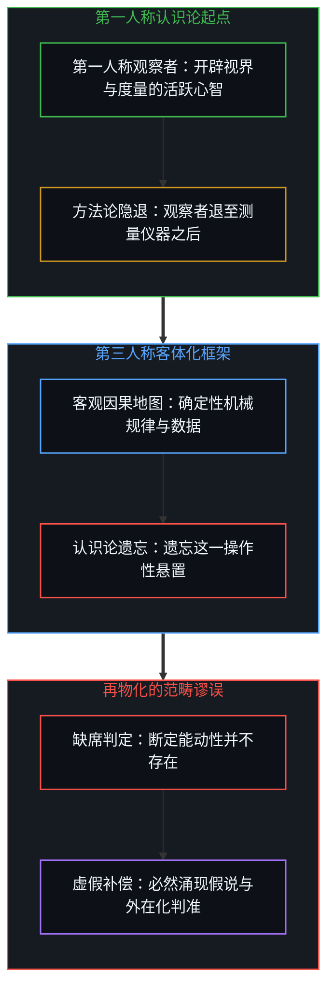
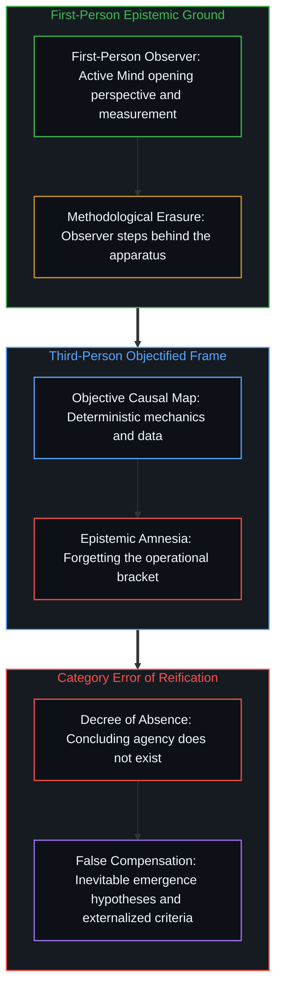
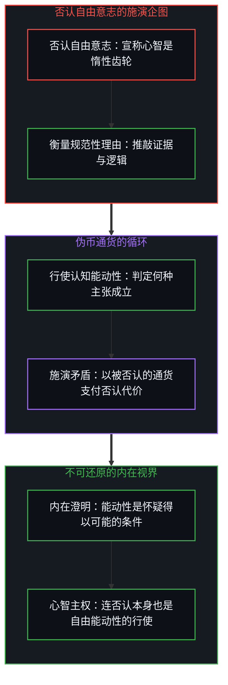
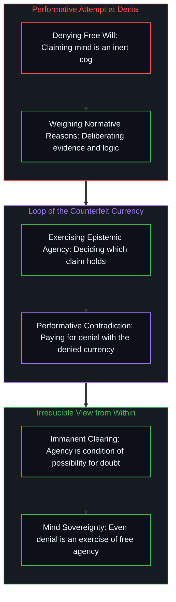

# 框架的盲区 / The Blind Spot of the Frame

*自由意志是不可还原的先行条件，脱离内在视界的裁决皆源于方法论遗忘。 / Agency is an irreducible prior condition; third-person verdicts reflect methodological amnesia.*

在关于人类能动性的长久论争中，每当观察者试图站在托马斯·内格尔所称的“无处之境”——一处悬于鲜活现实之外的想象栖位——去裁断意志，探究便一再偏离。机械物理主义宣称自由意志是在系统复杂度不断攀升中诞生的“必然涌现”，试图将能动性核准为钟表机械的下游副产物；与之相反，让-保罗·萨特虽准确把握到意识抗拒被还原为惰性客体，并将自我客体化命名为“自欺”，但一旦将这一结构洞察转为外在的道德裁决——抑或将自由框定为无条件的否定——便等于重新立起了外部法庭。然而，自由意志既非无思自然所恩赐的演化赠礼，亦非外部裁判官评定的真诚度评分；意志是不可还原的先行条件。要解开这一点，必须揭开现代探究根基处的那场戏法：为了锻造可复现的模型，观察者在方法论上退至记录仪器之后，随后却染上了把方法论省略误作本体论缺席的形而上学健忘症。

Across the enduring debates over human agency, inquiry repeatedly drifts whenever observers attempt to adjudicate volition from Thomas Nagel's "view from nowhere," an imagined perch outside lived reality. Mechanistic physicalism decrees free will an "inevitable emergence" born of escalating systemic complexity, attempting to sanction agency as a downstream byproduct of clockwork mechanics; conversely, while Jean-Paul Sartre rightly grasped that consciousness resists reduction to an inert object and named self-objectification "bad faith" (*mauvaise foi*), turning that structural insight into an external moral verdict—or casting freedom as unconditioned negation—reinstalls an outside tribunal. Yet free will is neither an evolutionary grant issued by unthinking nature nor an authenticity score judged by an external magistrate; volition is an irreducible prior condition. Unpacking this requires exposing the sleight of hand at the foundation of modern inquiry: the observer methodologically stepped behind the recording apparatus to forge reproducible models, only to contract the metaphysical amnesia that mistakes methodological omission for ontological absence.

## 一、 旁观者的双重自白与无处之境 / 1. The Twin Confessions of the Spectator and the View from Nowhere

机械决定论者与外在化的道德裁判者虽然结论截然相反，却同样依赖一种不可能的逃脱——脱离具身观察现场，去占据不受约束的制高点。物理主义者凝视钟表般运转的因果网络，急于消除第一人称体验给封闭确定性带来的摩擦，因而宣称只要结构复杂度越过临界阈值，自由意志便会作为一个功能性子模块必然涌现出来。这一手看似对内心生活颇为宽容，实则是将能动性贬降为无生命物质在宇宙时间中翻滚激起的副现象泡沫。相比之下，萨特把握到意识抗拒被物化为惰性客体，并将自欺定位于意识自身的自我客体化之中；然而，当这一存在主义诊断向外转向另一位退缩的行动者时，批判者便悬浮于该行动者的内在世界之上，仿佛外部法官能够穿透隐秘动机，核定规避式的自我欺骗。

Mechanistic determinists and externalizing moralists reach opposite conclusions, yet rely on the same impossible escape from the embodied site of observation to claim an unconstrained vantage point. The physicalist surveys the clockwork web of causation, eager to eliminate the friction that first-person experience poses to closed certainty, and declares that once structural complexity crosses a critical threshold, free will inevitably emerges as a functional submodule. This maneuver appears generous toward inner life, yet reduces agency to an epiphenomenal foam churned up by inanimate matter tumbling through cosmic time. Sartre, by contrast, grasps that consciousness resists reification into an inert object and locates bad faith in consciousness's own self-objectification; yet when that existentialist diagnosis is turned outward against another retreating actor, the critic hovers above the agent's interiority as if an outside judge could penetrate hidden motives and certify evasive self-deception.

每当一个框架从第一人称的体认滑向第三人称的裁决，观察者自身的坐标便从视野中淡出。无论是宣告意志是宇宙演化的既定终点，还是将他人在约束面前的挣扎斥为道德懦弱，这两种裁决都占据了[远方的轮廓与无处之境的清单](../the-distant-silhouette-and-the-inventory-from-nowhere/)中所剖析的阿基米德栖位。它们假定存在一本脱离具体视位、将现实编目归档的超然账簿，并试图从外部为人类意志打分。将观察者从被观察的宇宙中剔除，切断了认识论与具身现实的关联，使关于意志的探究沦为经院式的争执。

Whenever a framework slides from first-person recognition into third-person adjudication, the observer's own coordinates drop out of view. Whether declaring volition a predetermined terminus of cosmic evolution or dismissing another's struggle with constraint as moral cowardice, both verdicts claim the Archimedean perch dissected in [The Distant Silhouette and the Inventory from Nowhere](../the-distant-silhouette-and-the-inventory-from-nowhere/). They presume a transcendent ledger detached from situated vantage points that catalogs reality, attempting to score human volition from without. Excising the observer from the observed cosmos severs epistemology from embodied reality, reducing the inquiry into volition to scholastic dispute.

## 二、 方法论的隐退与本体论的遗忘 / 2. Methodological Erasure and Ontological Amnesia

客观知识的大厦，始于观察者主动而审慎的退隐。为了追踪星体轨迹、配平热力学方程或测绘神经元放电模式，主体必须退到记录仪器背后。相机若让自己的镜头独占底片，便无法捕捉风景；眼睛若苛求在视野内看见自己的视网膜，便无法审视山谷。路德维希·维特根斯坦在《逻辑哲学论》中点明了这道几何界限：主体并不属于世界，而是世界的界限。这种悬置式的退隐并非认知缺陷，而是构建可复现的第三人称模型的操作前提；自然哲学与形式逻辑之所以兴盛，正因为意识能够将自身透明化，将目光向外投射到客体矩阵之上。

The edifice of objective knowledge begins with the observer's deliberate withdrawal into the background. To track planetary trajectories, balance thermodynamic equations, or map neural firing patterns, the subjective investigator must step behind the recording apparatus. A camera cannot capture a landscape if its own lens monopolizes the negative; an eye cannot survey a valley while demanding to see its own retina within the field of view. Ludwig Wittgenstein pinpointed this geometric boundary in the *Tractatus*: the subject does not belong to the world, but is rather a limit of the world. This bracketed withdrawal is no defect of cognition, but the operational prerequisite for articulating reproducible, third-person models; natural philosophy and formal logic flourish precisely because consciousness can render itself transparent, projecting its gaze outward onto matrices of objects.

一旦探究者遗忘了这一操作手法，现代危机便随之爆发。既已在方法论上放逐主观性以构建决定论蓝图，理论家转而审视完工的图式，宣称在宇宙中找不到任何意志的踪迹。这种倒置宛如一位制图师为了保持地形清晰而刻意略去自己的身影，待地图绘制完成，却指着羊皮纸断定制图师并不存在。将方法论省略误作本体论缺席，是再物化的范畴谬误。在[寻觅的语法与淡出的观察者](../the-grammar-of-finding-and-the-fading-observer/)中，心智早已遭遇过这种将使能条件误作可抛弃冗赘的冲动；在[割点可移不可除](../the-cut-moves-but-never-vanishes/)中，冯·诺依曼链条表明，割点固然可以沿着测量序列任意移动，观察所在却无法消解；同样，在[不可还原的观察者](../the-irreducible-observer/)与[你的代码库即是记忆](../your-codebase-is-memory/)中，若把记录下来的测量链或磁盘上的外化痕迹库从铭刻并掌舵它的活体心智中割裂出来，便是把惰性残余误作自我维持的系统。这种结构性遗忘筑起了一道人工围栏，将理论理智搁浅在它亲手制造的盲区之中。

The modern crisis erupts the moment the investigator forgets this operational maneuver. Having methodologically banished subjectivity to construct a deterministic blueprint, the theorist inspects the completed schema and proclaims that volition is nowhere to be found in the cosmos. This reversal resembles a cartographer who omits his own figure to keep topography legible, only to inspect the parchment and conclude that cartographers do not exist. Mistaking methodological omission for ontological absence is a category error of reification. The Mind confronted this impulse in [The Grammar of Finding and the Fading Observer](../the-grammar-of-finding-and-the-fading-observer/), where enabling conditions were mistaken for dispensable clutter; in [The Cut Moves but Never Vanishes](../the-cut-moves-but-never-vanishes/), the von Neumann chain demonstrated that while the cut can be displaced arbitrarily along the measurement sequence, the site of observation cannot be dissolved; similarly, within [The Irreducible Observer](../the-irreducible-observer/) and [Your Codebase Is Memory](../your-codebase-is-memory/), severing the recorded measurement chain or the externalized trace repository on disk from the living Mind that inscribes and steers it mistakes inert residue for a self-sustaining system. This structural amnesia constructs an artificial enclosure, stranding theoretical intellect inside a blind spot of its own making.

## 三、 必然涌现与自欺的外在化 / 3. Inevitable Emergence and the Externalization of Bad Faith

面对被人为抽空了能动性的机械宇宙，物理主义必须设法将意志重新偷渡回场景之中，而它最偏爱的庇护所便是“复杂性涌现论”。物理主义者主张，只要给予足够的演化时间、代谢流与计算层级，自由意志便是神经组织的一个必然阈值。这一推演的漏洞在于其中偷渡的视角：要宣称某种结局具有必然性，叙述者必须站到宇宙时间之外，从一个不可能的终点俯视演化轨迹。试图用无思物质的因果堆叠推导出赋予意义的主体，无异于从画布中推导出那只活生生的眼睛，而正是这只眼睛当初握着画笔绘就了画作。正如[主体性不曾涌现](../agency-does-not-arise/)所论证的，涌现并非主体性的源头，而是第三人称模型无法吸纳第一人称现实时编造出的叙事补丁。

Confronted with a mechanical cosmos artificially emptied of agency, physicalism must devise a rationale to smuggle volition back into the scene, finding its favored shelter in the doctrine of emergent complexity. The physicalist contends that given sufficient evolutionary time, metabolic flow, and computational layering, free will was an inevitable threshold of neural organization. The flaw in this deduction lies in its smuggled vantage point: to pronounce an outcome inevitable, the narrator must stand outside cosmic time, peering down upon evolutionary trajectories from an impossible terminus. Attempting to derive the meaning-bestowing agent from the causal stacking of unthinking matter is equivalent to deriving the living eye from the canvas, when that eye held the brush that painted it. As demonstrated in [Agency Does Not Arise](../agency-does-not-arise/), emergence is not the origin of subjectivity, but a narrative patch invented when third-person models fail to ingest first-person reality.

存在主义并不像物理主义那样抹除主体；相反，它指出了一重不可还原的不对称性。萨特认识到存在先于既定设定，并将自欺定位于意识自身的结构之中：行动者借模仿惰性客体，搬演出无助的表象。然而，这一框定触及两重截然不同的边界。其一，当自由被刻画为无条件的否定时，直面具体约束的挣扎便有可能被压平为单纯的逃避。其二，每当“自欺”从第一人称的结构洞察转为向另一位行动者下达的第三人称裁决，批判者便步入了无处之境的法庭——声称自己能从外部窥入另一处中心的内在世界与隐秘动机；[排序的投影与自我意识的退隐](../the-projection-of-ranking-and-the-recession-of-self-awareness/)在日常感知中追溯了同样的遗忘：自我意识的退隐若未被回转，局部坐标便硬化为外部评分。况且，在切身体验中，将自己视为因果链条里一枚无助的齿轮，并不总是面对无约束虚空时的戏剧性逃避；它正是同一种认识论遗忘向内留下的残余——个体将相机的第三人称凝视内化，把一张客体化的快照误认作了鲜活自我的全部。

Existentialism does not share physicalism's erasure of the subject; rather, it identifies an irreducible asymmetry. Sartre recognized that existence precedes essence and located bad faith within the structure of consciousness itself: an agent staging the appearance of helplessness by mimicking an inert object. Yet this framing reaches two distinct boundaries. First, when freedom is cast as unconditioned negation, struggle against concrete constraints risks being flattened into mere evasion. Second, whenever bad faith is converted from a first-person structural insight into a third-person verdict pronounced over another agent, the critic steps into a courtroom from nowhere—claiming exterior access to another center's interiority and hidden motives; [The Projection of Ranking and the Recession of Self-Awareness](../the-projection-of-ranking-and-the-recession-of-self-awareness/) traces the same forgetting in everyday perception, where an unreversed recession of self-awareness hardens a local coordinate into an external grade. Within lived experience, moreover, treating oneself as a helpless cog inside causal chains is not always theatrical evasion against an unconstrained void; it is the inward residue of the same epistemic amnesia, in which an individual internalizes the camera's third-person gaze and mistakes an objectified snapshot for the whole living Self.

在[约束基底与自由自否](../the-substrate-of-constraint-and-the-self-denial-of-freedom/)中，行动者正是通过介入切实的阻力才确立了自由的坐标；一旦自由被抽象为无着落的失重状态，或者阻力被教条化为因果闭合，思想便会在两种倾向之间来回摇摆：或是将能动性宣称为复杂度涌现的副产物，或是下达外在的“自欺”道德裁决。如[功能主义者无法持有的功能主义](../the-functionalism-no-functionalist-can-hold/)所示，那些将心智还原为算法状态跃迁的理论家，依然仰赖自身对证明有效性的主权确信。这两种操作都表明，试图从外部为能动性寻求裁决，只会把探究困在自制的幻象之中。

In [The Substrate of Constraint and the Self-Denial of Freedom](../the-substrate-of-constraint-and-the-self-denial-of-freedom/), the actor establishes coordinates of freedom precisely by engaging tangible resistance; once freedom is abstracted into unanchored weightlessness, or resistance dogmatized into causal closure, thought oscillates between declaring agency an emergent byproduct of complexity and issuing external moral verdicts of bad faith. As shown in [The Functionalism No Functionalist Can Hold](../the-functionalism-no-functionalist-can-hold/), theorists who reduce mind to algorithmic state-transitions continue to rely on sovereign conviction regarding the validity of their proofs. Both moves show that seeking external adjudication for agency traps inquiry within self-generated illusions.

## 四、 否认的施演结构与不可还原的内在视界 / 4. The Performative Architecture of Denial and the View from Within

这表明为何能动性无法经由外部宣告来解决：自由意志是不可还原的。称其不可还原，既不是将其抬举为机器中的幽灵，也不是将其捧为演化的目的论战利品，更不是将其视作外部记分员的账簿。不可还原性意味着，意志是一切感知、审思、论证、否认与裁决得以成立的不可逃逸的前提条件。它不是等待被发现的经验客体，而是使观察得以可能的内在澄明。

This demonstrates why agency cannot be resolved through external declarations: free will is irreducible. To deem it irreducible is neither to elevate it into a ghost inside the machine, nor to celebrate it as a teleological trophy of evolution, nor to treat it as an external scorekeeper's ledger. Irreducibility signifies that volition is the inescapable condition of possibility for all perception, deliberation, demonstration, denial, and judgment. It is not an empirical object waiting to be discovered, but the immanent clearing that makes observation possible.

审视否认行动的施演结构，便会揭露出这种不可还原性：当一位决定论者分析神经影像扫描、权衡相互竞争的假说、撰写学术文章，并论证选择只是错觉时，他究竟在做什么？他在衡量规范性理由，判定哪一个命题成立，行使着无可否认的认知能动性。哪怕在宣称自己并不自由的当口，说话者也必须调动注意力、维系意图并评估结论。否认自由意志，所花费的恰恰是被它宣称为伪币的那同一种通货。在[自由意志的自否自由](../the-freedom-of-will-to-deny-itself/)中，这一施演矛盾充分显现：即便一个人斩钉截铁地断言自由意志并不存在，这一否认本身依然是自由能动性的行使。

Examining the performative architecture of denial exposes this irreducibility: when a determinist analyzes neurological scans, weighs rival hypotheses, crafts scholarly prose, and argues that choice is an illusion, what are they doing? They are weighing normative reasons, determining which proposition holds, and exercising undeniable epistemic agency. Even in the act of declaring oneself unfree, the speaker must marshal attention, sustain intention, and evaluate conclusions. Denying free will requires spending the exact currency declared counterfeit. In [The Freedom of Will to Deny Itself](../the-freedom-of-will-to-deny-itself/), this performative contradiction comes into full view: even when adamantly asserting the absence of free will, that denial remains an exercise of free agency.

与“必然涌现”的事后回溯投射或外在化的“自欺裁决”不同，承认不可还原性并不需要借助无处之境的支点。它既不要求脱离历史去检视宇宙因果链条，也不声称能够进入他人心智去给真诚度打分。它立足于内在视界之中——那是一切怀疑、验证、摩擦与决断得以发生的内蕴现场。自由意志从来不是第三人称模型赐予的属性，而是有意识的心智借以审思与行动的不可剥离的基线。

Unlike the retrospective projection of "inevitable emergence" or externalized "bad faith verdicts," acknowledging irreducibility requires no leverage from nowhere. It neither demands stepping outside history to inspect cosmic causal chains, nor claims access to another mind to score authenticity. It operates within the view from within—the immanent site where all doubt, verification, friction, and decision transpire. Free will is never a property conferred by third-person models, but the inseparable baseline through which conscious minds deliberate and act.

## 五、 重返不可还原的第一人称源头 / 5. Reclaiming the Irreducible First-Person Origin

关于自由意志的现代争论之所以令人疲惫，根源在于思想执意要在被观察的场域内部搜寻观察者。第三人称客观性仍是一项深湛的智力发明，然而这项工具是由身处第一人称视角中的主体锻造而成的。当这件工具变得无比强大，心智却反被它的倒影所迷惑，断定只有被动到足以摆上实验台解剖的客体才配拥有存在的资格。

The modern debate over free will has proved exhausting because thought insists on searching for the observer inside the observed field. Third-person objectivity remains a profound intellectual invention, yet this tool was forged by a subject situated within a first-person perspective. When the tool grew immensely powerful, the Mind became enchanted by its reflection, concluding that only objects passive enough to be dissected on an experimental bench qualify as existing.

遗忘了主体退至仪器之后的那份契约，便会将探究锁入人为的框架之中，令思想摇摆于两端之间：一端是把意志当作涌现计算副产物的机械还原，另一端是把人在约束面前的挣扎压平为“自欺”的外在道德裁决。走出这一摇摆的路径，在于尊重维特根斯坦指出的那道几何界限：主体无法爬出自身的视角，站在无处之境将自己作为客体来观察。意志这一使能在场无法绕过，亦无法自上方俯瞰。即使心智竭尽一切智力资源去否认自由能动性，这一否认本身，依然是在内在视界中迈出的主权一步。

Forgetting the pact by which the subject stepped behind the apparatus locks inquiry inside an artificial frame, leaving thought to oscillate between mechanistic reduction that treats volition as an emergent computational byproduct, and externalized moral verdicts that flatten struggle against constraint into bad faith. The path beyond this oscillation lies in honoring the geometric boundary Wittgenstein noted: the subject cannot climb outside its own vantage to observe itself as an object from nowhere. The enabling presence of volition cannot be bypassed or surveyed from above. Even when the Mind expends every intellectual resource to disclaim free agency, that very denial remains a sovereign step taken from within.
