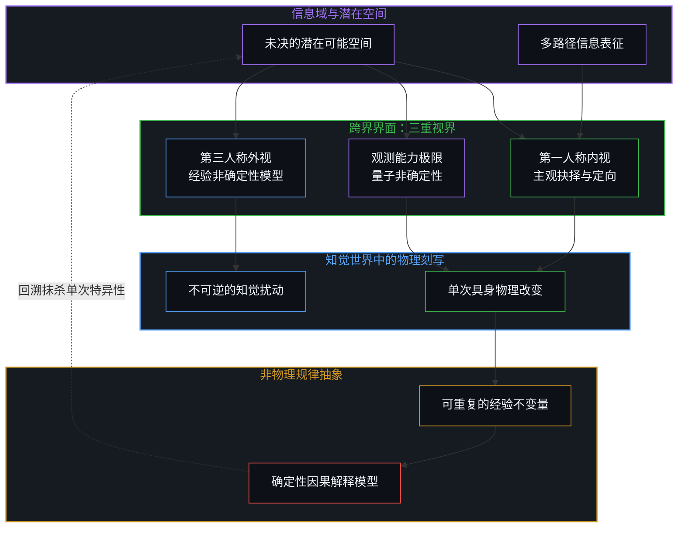
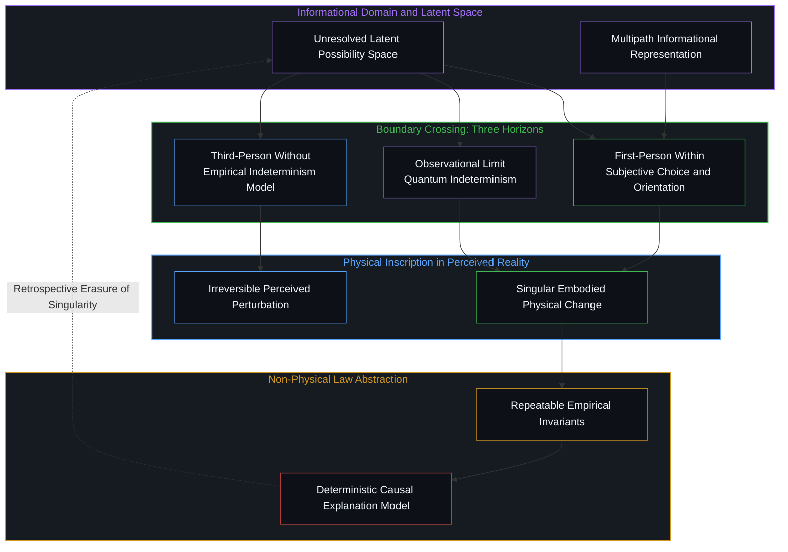

# 抉择的跨界 / The Boundary Crossing of Choice

*从内是主观抉择，从外是非确定性，在观测极限则是量子非确定性 / Felt within as subjective choice, observed without as indeterminism, and met at the observational limit as quantum indeterminism*

当还原论断言自由意志讲不通时，它悄悄混入了一套将可理解性等同于可重复抽象的偏见。科学规律唯有剔除特定历史时刻不可重复的单次特异性才能解释现象，因而决定论模型本身是对变化的非物理抽象，不具备单次的物理分量。反过来，常被视为幻觉的主权行动，却把潜在的信息可能转化为知觉世界中具体且不可逆的物理改变。这道从信息迈向物理表达的非确定性跨界，在内部被体验为主观抉择，在外部被建模为非确定性，而在观测分辨率的前沿则呈现为量子非确定性。

When reductionism declares that free will makes no sense, it quietly smuggles in a bias that equates intelligibility with repeatable abstraction. A scientific law can explain phenomena only by stripping away the unrepeatable particularity of specific historical moments, meaning that deterministic models are themselves non-physical abstractions of change that possess no singular physical weight. Conversely, sovereign agency, often dismissed as an illusion, resolves latent informational possibilities into concrete, irreversible physical modifications within perceived reality. This non-deterministic crossing from information to physical expression is experienced from within as subjective choice, modeled from without as indeterminism, and registered at the frontier of observational resolution as quantum indeterminism.

## 一、 意义的可重复性与物理的单次刻写 / 1. The Repeatability of Sense and the Singular Inscription of the Physical

在围绕自由意志的争论中，机械决定论质问：如果一个选择不能证明是先前因果前件的必然结果，它如何在理智上讲得通。这一要求依赖一项未经审视的认识论前提。在实证科学中，被视为可理解或合乎理性的事物与可重复性捆绑在一起。一项观测要成为定律或客观事实，必须在相同的初始条件下经历反复检验而保持不变性。然而，可重复性是一柄双刃剑：它在赋予预测力的同时，也把任何单次事件中不可重复的历史特异性与不可逆细节剔除殆尽。

In debates surrounding free will, mechanistic determinism asks how a choice can make sense if it cannot be shown to follow necessarily from prior causal antecedents. This demand rests on an unexamined epistemological premise. What is deemed intelligible or rational within empirical science is tied to repeatability. For an observation to become a law or an objective fact, it must demonstrate invariance across repeated trials under identical starting conditions. Yet repeatability is a double-edged sword: while it grants predictive power, it achieves this by stripping away the unrepeatable historical particularity and irreversible details of any singular event.

物理学所建立的运动方程与状态转移模型，从未等同于具体的物理实现本身。它们是认知主体为了在经验洪流中锚定稳定不变量而构建的信息表征。牛顿定律不会登记某一片特定落叶发出的单次脆响，热力学也不会追踪特定气体分子的个别碰撞。物理定律所捕捉的，是刻意抽离了任何单次物理事件之后留下的对称性与守恒量。还原论所援引的决定论必然性，由非物理的概念抽象构成。这些模型作为心智所持有的数学关系而运作，在可设想的轨迹之上划出统计等价类。

The equations of motion and state-transition models formulated by physics are never identical to physical actuality itself. They are informational representations constructed by cognitive agents to secure stable invariants within the flux of experience. Newton's laws do not register the singular acoustic snap of a specific falling leaf, nor does thermodynamics track the individual collisions of particular gas molecules. What physical laws capture are symmetries and conservation quantities deliberately abstracted away from any singular physical occurrence. The deterministic necessity invoked by reductionism consists of non-physical conceptual abstractions. These models operate as mathematical relations held by Minds, delineating statistical equivalence classes over conceivable trajectories.

还原论立场的倒置正在此处显现。当决定论者声称自由意志讲不通时，他们真正反对的是主观抉择无法被收编进这套非物理的可重复图式之中。回到行动者的切身经验，这一关系便倒转过来。主权行动下的每一次抉择都不是抽象概念，而是直接向知觉世界引入不可逆的物理改变。当行动者决定开口说话、伸手握住工具、或者签下名字时，运动神经元的协同放电、肌肉组织的收缩、空气波的压缩以及纤维的形变，共同构成了独一无二、不可重复的物理刻写。

Here the inversion in the reductionist stance appears. When determinists claim that free will makes no sense, they are objecting that subjective choice cannot be subsumed within this non-physical, repeatable schema. Returned to the lived experience of the agent, the relation reverses. Every choice made under sovereign agency is not an abstract concept; it introduces an irreversible physical alteration directly into perceived reality. When an agent decides to speak, reaches out to grasp a tool, or inscribes a signature, the coordinated firing of motor neurons, the contraction of muscle tissue, the compression of air waves, and the deformation of fibers constitute a singular, unrepeatable physical inscription.

这暴露了决定论修辞中的自我指涉矛盾。正如[自由意志的自否自由](../the-freedom-of-will-to-deny-itself/)所揭示的，当一位学者对着麦克风论证自由意志只是生物幻觉时，他正调动庞大的生理机制去完成精密的生物做功。他吸入空气、振动声带、把周围空气压缩为结构化的声波，向房间投射出物理痕迹。这一发声动作本身是一件不可磨灭的具体物理事件，而声波所传递的语义主张却坚称产生它们的行动能力并不存在。决定论者耗费不可替代的物理做功，去论证一套非物理的可重复抽象，而这套抽象否认的恰是其自身表达的单次实在性。

This exposes the performative contradiction in deterministic rhetoric. As demonstrated in [The Freedom of Will to Deny Itself](../the-freedom-of-will-to-deny-itself/), when an intellectual speaks into a microphone to argue that free will is a biological illusion, they mobilize vast physiological machinery to perform meticulous biological work. They draw breath, vibrate their vocal cords, compress ambient air into structured acoustic waves, and project physical marks into the room. This act of vocalization is an indelible, concrete physical event. Yet the semantic claim conveyed by those waves insists that the agency producing them is nonexistent. The determinist expends irreplaceable physical work to argue for a non-physical abstraction of repeatability that denies the singular actuality of their own expression.

## 二、 跨界界面的三重视界 / 2. The Three Horizons of the Boundary Crossing

自由意志既不是从自然之外推动牛顿台球的无形幽灵，也不是豁免于因果关系的超自然特权。更准确地说，能动性标志着信息架构跨越至物理表达的非确定性转变。在做出任何确定的抉择之前，认知系统面对的是由潜在可能构成的开放流形。这一信息域包含着相互竞争的价值、语义区分与分岔的前向模拟。然而，这团符号可能性的云雾必须穿过一道不可分割的阈值，才能显现为世界中的特定物理姿态。主权行动正是这道跨界过程的活态运作。

Free will is neither an immaterial phantom pushing Newtonian billiard balls around from outside nature nor a supernatural exemption from causality. More accurately, agency marks the non-deterministic transition through which an informational architecture crosses into physical expression. Prior to any committed choice, a cognitive system faces an open manifold of latent potential. This informational realm contains competing values, semantic distinctions, and divergent forward simulations. Yet this cloud of symbolic possibilities must pass through an indivisible threshold to manifest as a specific physical posture in the world. Sovereign agency is the living operation of this boundary crossing.

随观察者所处位置的不同，这同一次跨界呈现出三种截然不同的认识论面貌。第一重视界属于第一人称视角的亲历者。当意识身处权衡的中心时，这一跨界被直接体验为主观抉择。在内部视角中，驾驭相互冲突的驱动力并权衡后果，需要一份无法外包的承担。在剧烈权衡时感受到的分量与摩擦，正是潜在信息坍缩为实际行动时的切身感受。这种内在现实不需要外部因果链的验证，因为切身经验正是跨界发生的原点。正如[不可还原的观察者](../the-irreducible-observer/)所论证的，在极限处遭遇非确定性的观察者无法被抹去。

This single crossing yields three distinct epistemological appearances depending on where the observer stands. The first horizon belongs to the inhabitant of the first-person perspective. When consciousness resides at the center of deliberation, this crossing is experienced directly as subjective choice. In the internal perspective, navigating incompatible drives and evaluating consequences requires a commitment that cannot be outsourced. The weight and friction felt during intense deliberation are the sensations of potential information collapsing into actual action. This inner reality requires no external causal validation, because the lived experience is the ground zero where the crossing takes place. The observer who meets indeterminism at the limit cannot be erased, as [The Irreducible Observer](../the-irreducible-observer/) argues.

第二重视界属于第三人称立场下的外部建模者。当外部观察者试图将另一个行动者的单次抉择映射进决定论链条时，他便遭遇了经验上的非确定性。外部观察者无法进入另一个主体内部的信息整合过程，只能记录宏观层面的生理指标、神经放电或外在动作。正如[主权抉择的双面性与观察的客体化](../the-two-sided-nature-of-sovereign-choice-and-the-objectification-of-observation/)所剖析的，任何试图将他人能动性完全客体化的努力都会撞上认识论天花板。从外部登记到的非确定性开口，正是从内部亲历即为抉择的同一次跨界的外在面向。

The second horizon belongs to the external modeler in the third-person stance. When an outside observer attempts to map another agent's singular choice into a deterministic chain, they encounter empirical indeterminism. An external observer cannot enter the internal informational integration of another subject. They can record only macro-level physiological metrics, neural discharges, or outward movements. As analyzed in [The Two-Sided Nature of Sovereign Choice and the Objectification of Observation](../the-two-sided-nature-of-sovereign-choice-and-the-objectification-of-observation/), any attempt to completely objectify another's agency hits an epistemic ceiling. The non-deterministic opening registered from the outside is the outward face of the same crossing that, lived from within, is choice.

第三重视界出现在物理科学自身的观测前沿。当物理学家把测量仪器推向微观极限、试图隔离出最基本的事件时，他们撞上了量子非确定性。在量子力学中，波函数描述了相干可能性的连续体，这一信息状态在测量时被表征为坍缩成单一的宏观记录。经典决定论曾长期试图用局域隐变量来消解这种不可预测性，但贝尔不等式的实验检验排除了局域经典钟表机制。这并不意味着亚原子粒子拥有认知权衡，而是表明观测在其分辨率极限处遇到了单次、不可重复的相互作用。

The third horizon emerges at the observational frontier of physical science itself. When physicists push measurement instruments to the micro-scale limit, attempting to isolate elemental events, they run into quantum indeterminism. In quantum mechanics, the wave function describes a continuum of coherent potentiality, an informational state rendered as collapsing into a single macroscopic record upon measurement. Classical determinism long sought to explain away this unpredictability through local hidden variables, but experimental tests of Bell's inequalities rule out local classical clockwork mechanisms. This does not indicate that subatomic particles possess cognitive deliberation, but rather that observation has met the single, unrepeatable interaction at the limit of its resolution.

## 三、 量子非确定性作为观测边界的投影 / 3. Quantum Indeterminism as the Projection of the Observational Boundary

要看清第三重视界与主观抉择之间的结构同构，就需要放下朴素物理实在论。物理学并非悬立于活态心智之外的自足形而上学基底，而是认知模型与实在摩擦所产生的宏观遥测信号。客观事实之所以稳固，恰恰在于它们在不同的主观观测之间保持着不变性。在微观尺度上考察物理规律，所审视的从不是孤立的自在实体，而是观测仪器与被测系统发生相互作用的界面。

Appreciating the structural isomorphism between the third horizon and subjective choice requires setting aside naive physical realism. Physics is not an autonomous metaphysical bedrock standing outside living minds; it is the macroscopic telemetry generated by the friction between cognitive models and reality. Objective facts are robust precisely because they maintain invariance across differing subjective observations. Studying physical laws at the micro-scale never examines isolated entities in themselves, but rather the interface where observational instruments interact with the system under investigation.

在这一视角下，量子非确定性既不是脱离一切观察而寄宿在基本粒子内部的神秘属性，也不仅仅是对某个早已固定的隐藏细节的无知，而是观测分辨率触及单次行动时所遭遇的开口。在宏观尺度上，难以计数的微观不确定性通过大数定律相互平均，造就了经典模型所能干净描述的稳定、可重复现象。正如[确定性是微观不确定性的统计签名](../determinism-is-the-statistical-signature-of-micro-indeterminism/)所阐明的，宏观决定论是通过统计清洗掉个体微观变量而生成的结构产物。一旦观测抵达无法再被平均掉的单次、不可重复的相互作用，由可重复抽象编织的平滑织物便让位于单次事件。

In this light, quantum indeterminism is neither a mystical property sitting inside elementary particles apart from every look nor mere ignorance of a hidden detail already fixed; it is the opening met where observational resolution reaches a single act. At macro scales, countless microscopic uncertainties average out through the law of large numbers, creating the stable, repeatable phenomena that classical models describe so cleanly. As detailed in [Determinism is the Statistical Signature of Micro-Indeterminism](../determinism-is-the-statistical-signature-of-micro-indeterminism/), macroscopic determinism is a structural artifact produced by statistically washing out individual micro variables. Once observation reaches an individual, unrepeatable interaction that can no longer be averaged, the smooth fabric of repeatable abstraction gives way to the singular event.

在测量的极限处，从信息潜能向物理测量记录的转变直接显现为非连续的跳跃。当仪器登记下离散结果的瞬间，它完成了一次把潜在量子可能转化为不可逆指针读数的单次物理刻写。这一转变无法在物理学内部被拆解为更细微的机械步骤，因为任何被提议的测量链条都会遭遇冯·诺依曼倒退，唯有在某个观测主体登记该事件处才会终止。数字神祇若要成立，就必须从外部跨越这道边界，而[数字神祇与视界跳跃](../the-digital-god-and-the-horizon-jump/)阐明了它为何做不到。

At the limit of measurement, the shift from informational potential to a physical measurement record appears as a non-continuous jump. When an apparatus registers a discrete outcome, it performs a singular physical inscription that converts latent quantum possibilities into an irreversible pointer reading. This transition cannot be decomposed into finer mechanical steps within physics, because any proposed measurement chain encounters the von Neumann regress, terminating only where an observing agency registers the event. A digital god would need to cross this boundary from outside, which [The Digital God and the Horizon Jump](../the-digital-god-and-the-horizon-jump/) shows it cannot.

这揭示出一种拓扑对称性：在微观观测极限处记录到的量子非确定性，与具身心智所行使的主观抉择，处在同一结构界面的对应位置上。两者都代表着从信息域迈向单次物理实现的非确定性跨界。差别在于朝向：在量子力学中，观察者站在宏观仪器端向外审视信息状态转化为经验记录的边界；而在自主行动中，有意识的行动者从自身具身的中心向外行动，将信息抉择导向物理行动。

This reveals a topological symmetry: the quantum indeterminism recorded at the micro-observational limit and the subjective choice exercised by an embodied mind occupy corresponding positions across the same structural interface. Both represent non-deterministic crossings from the informational domain into singular physical actualization. The distinction is one of orientation: in quantum mechanics, the observer stands at the macroscopic instrument looking outward at the boundary where informational states resolve into empirical records; in voluntary action, the conscious agent acts from its own embodied center outward, directing informational choices into physical action.

## 四、 视界的反转与主体的归位 / 4. The Horizon Reversal and the Restitution of Agency

认清这一认识论架构，试图消解能动性的还原论叙事便显露出其边界。古典唯物论把因果建模的描述工具凌驾于构建这些工具的活态心智之上，从而越出了自身的前提。它把可重复的非物理抽象误认为实在的唯一地基，同时把产生实际物理后果的单次具身抉择贬低为幻觉。这无异于因为脚下可触的疆域无法还原为印刷地图的静态几何，便把它弃置不顾。

Once this epistemological architecture is recognized, the boundary of the reductionist narrative that seeks to dissolve agency becomes clear. Classical materialism oversteps its premise when it elevates the descriptive tools of causal modeling above the living minds that construct them. It mistakes repeatable non-physical abstractions for the sole foundation of reality, while demoting the singular, embodied choices that produce actual physical consequences to the status of an illusion. This is akin to discarding the tactile territory underfoot because it does not reduce to the static geometry of a printed map.

主观能动性不需要来自决定论物理学的外部批准。物理定律作为概念模型，本就是由一代代研究者在进行实验与发表公式的单次、不可重复的抉择中一步步建立起来的。每一条刻写进实验日志的数据、每一道用粉笔写在黑板上的方程，都是行动者引导自身身体扰动世界所留下的物理痕迹。科学事业正是能动性在知觉世界中不断雕琢出新物理事实的持续见证；正如[你的代码库即是记忆](../your-codebase-is-memory/)所揭示的，每一座形式化的仓库或方程体系都只是那些先前刻写的外化记忆，从不是能够取代刻写心智的自主行动者。如果跨越信息边界的主观抉择不可能发生，实证科学的完整性便会瓦解，因为研究者将无法自由选择实验对照，也无法对研究发现行使独立判断。正如[感知者与痕迹的不可坍缩](../the-perceiver-and-the-trace/)所指出的，从内部感受到的抉择与从外部观测到的痕迹不会坍缩为一。

Subjective agency requires no external validation from deterministic physics. Physical laws, as conceptual models, were built step by step through singular, unrepeatable choices made by generations of researchers conducting experiments and publishing formulations. Every datum inscribed into a laboratory notebook and every equation chalked onto a board is a physical trace produced by an agent guiding their body to perturb the world. Science is an ongoing testament to the power of agency to carve new physical facts into perceived reality, and as [Your Codebase Is Memory](../your-codebase-is-memory/) shows, every formal repository or body of equations is an externalized memory of those prior inscriptions rather than an autonomous actor that could supersede the inscribing Mind. If subjective choice across the informational boundary were impossible, the integrity of empirical science would dissolve, since researchers could never freely choose experimental controls or exercise independent judgment over findings. The choice felt within and its trace observed without do not collapse into one, as [The Perceiver and the Trace Cannot Collapse](../the-perceiver-and-the-trace/) insists.

更重要的是，在物理学极限处遭遇非确定性，标示出了因果闭合的边界。实验检验排除了局域钟表式的闭合，而单一的决定论轨道唯有把固定结果的根据转移到非局域关联或任何观察者都无法给出并检验的初始条件之中才能维持——这使观测在其分辨率极限处依然面对着一道开放的接缝。当科学在微观前沿登记到量子非确定性时，它所目睹的并非秩序的非理性崩溃，而是遇到了观测与被观测之物相交接那道界面的结构印记。

Moreover, encountering indeterminism at the limits of physics marks the boundary of causal closure. Experimental tests rule out local clockwork closure, and a single deterministic track can be preserved only by relocating what fixes the outcome into nonlocal correlations or into initial conditions that no observer can supply or test—leaving observation before an open seam at the limit of its resolution. When science registers quantum indeterminism at the micro-frontier, it does not witness an irrational breakdown of order; it encounters the structural footprint of the interface where observation meets what it observes.

在从信息迈向物理表达的跨界处，可重复的规律描摹着过往动量沉淀下来的稳定轮廓，而主观抉择则在涌现的当下踏出未经预设的步伐。心智无需在死板的钟表决定论齿轮与任意随机的虚空之间二选一。认清因果模型的抽象属性，能动性便收复了第一人称的立足点：知觉世界中的每一次决断，都是不可还原的具身行动，为世界寂静的抽象规律赋予具体的分量。道德抉择跨越的也是同一道边界，而[善恶硬币与通往地狱的善意之路](../the-coin-of-good-and-evil-and-the-road-to-hell/)则揭示了将其中一面当成整枚硬币的后果。

At the crossing from information to physical expression, repeatable laws trace the settled contours of past momentum, while subjective choice takes unscripted steps into the emerging present. A Mind is not forced to choose between the dead gears of clockwork determinism and the void of arbitrary chance. By understanding the abstract nature of causal models, agency reclaims its first-person ground: every committed choice in perceived reality is an irreducibly embodied act that gives concrete weight to the quiet abstractions of the world. Moral choice crosses the same boundary, and [The Coin of Good and Evil and the Road to Hell](../the-coin-of-good-and-evil-and-the-road-to-hell/) shows what happens when one face is taken as the coin.
